# Flow: Account: settings, health, permissions, sign out, expired session

**ACTUAL application.** Started at `/settings`, fixture `default`, simulated server. See [the README](../../README.md).

## p390 (390×844): captured

### 1. account

`/settings` · heading: Account

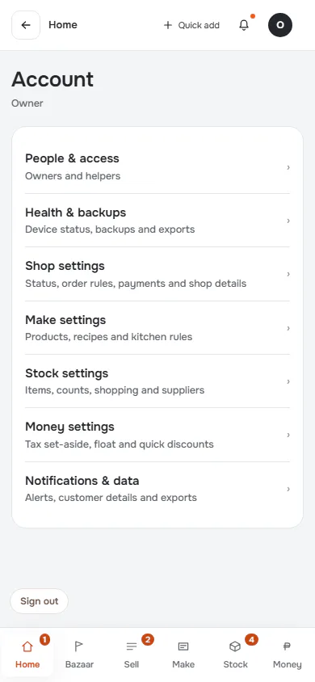

### 2. people

`/settings` · heading: People & access

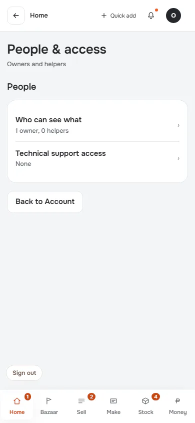

### 3. who-can-see-what

`/settings` · heading: People & access

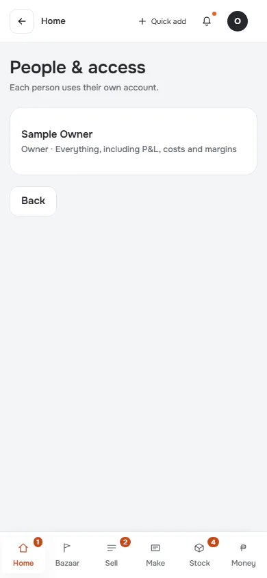

### 4. health

`/health` · heading: Health & backups

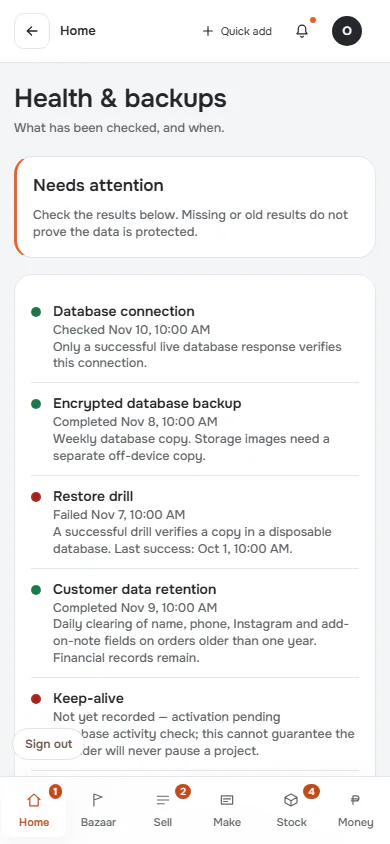

[Full page](../../flows/account-access-and-session/04-health/p390.full.webp)

### 5. sign-out-asks

`/settings` · heading: Account

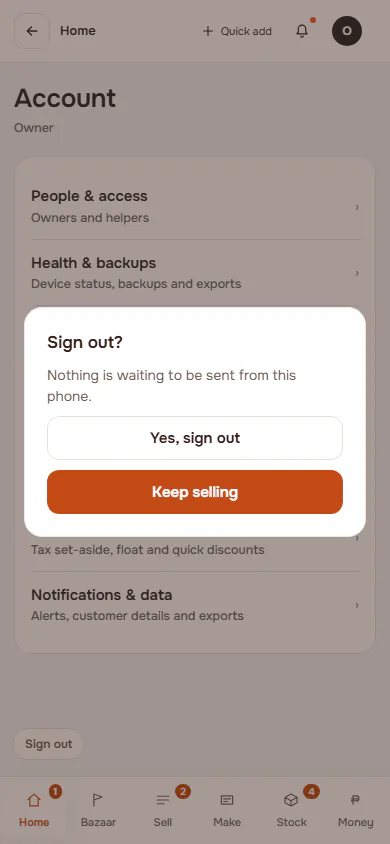

### 6. signed-out: Real gate sends the browser to sign-in

`/sign-in?next=%2Fsettings` · heading: Sign in

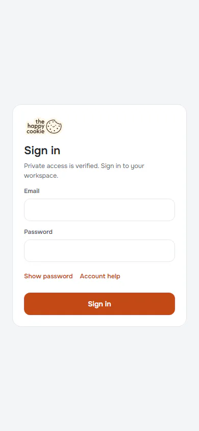

### 7. signed-back-in

`/settings` · heading: Account

## d1440 (1440×900): captured

### 1. account

`/settings` · heading: Account

### 2. people

`/settings` · heading: People & access

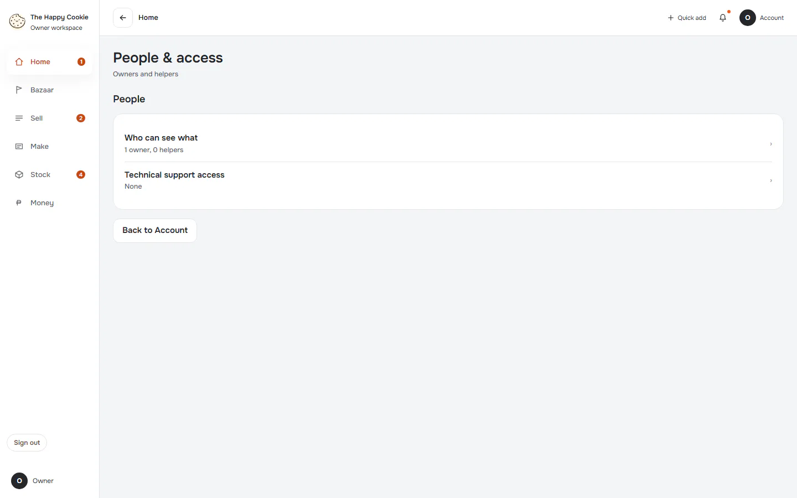

### 3. who-can-see-what

`/settings` · heading: People & access

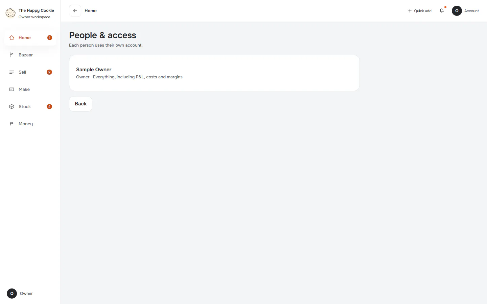

### 4. health

`/health` · heading: Health & backups

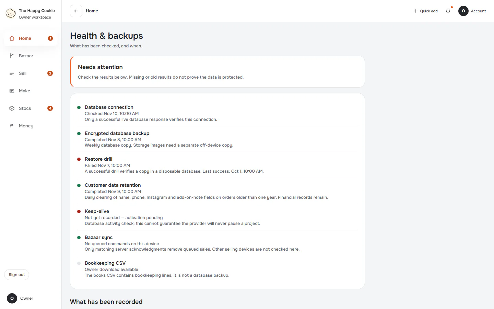

[Full page](../../flows/account-access-and-session/04-health/d1440.full.webp)

### 5. sign-out-asks

`/settings` · heading: Account

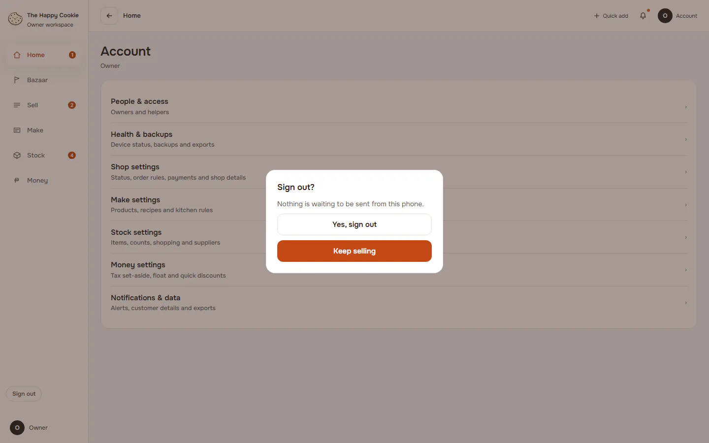

### 6. signed-out: Real gate sends the browser to sign-in

`/sign-in?next=%2Fsettings` · heading: Sign in

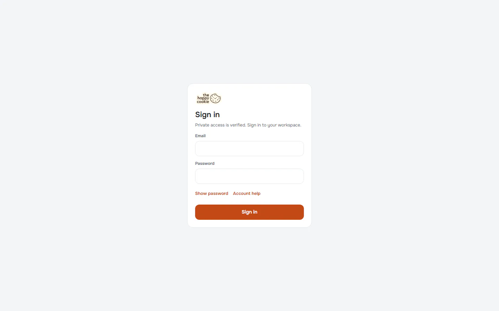

### 7. signed-back-in

`/settings` · heading: Account

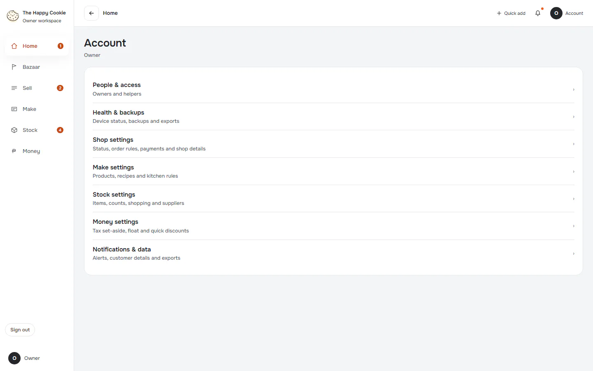
