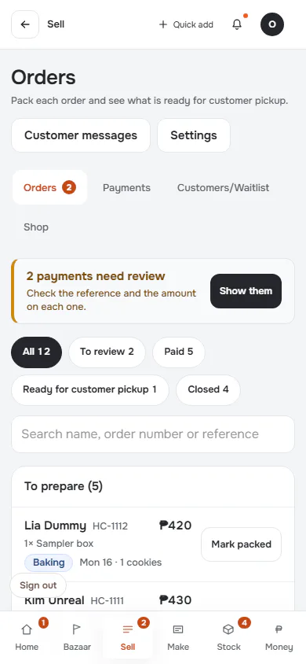

# Flow: Account: session expires while working

**ACTUAL application.** Started at `/orders`, fixture `default`, simulated server. See [the README](../../README.md).

## p390 (390×844): captured

### 1. working

`/orders` · heading: Orders · says: 2 payments need review
Check the reference and the amount on each one.
Show them

[Full page](../../flows/account-expiry/01-working/p390.full.webp)

### 2. after-recheck: After the gate re-checks identity

`/orders` · heading: Orders · says: 2 payments need review
Check the reference and the amount on each one.
Show them

[Full page](../../flows/account-expiry/02-after-recheck/p390.full.webp)

## d1440 (1440×900): captured

### 1. working

`/orders` · heading: Orders · says: 2 payments need review
Check the reference and the amount on each one.
Show them

[Full page](../../flows/account-expiry/01-working/d1440.full.webp)

### 2. after-recheck: After the gate re-checks identity

`/orders` · heading: Orders · says: 2 payments need review
Check the reference and the amount on each one.
Show them

[Full page](../../flows/account-expiry/02-after-recheck/d1440.full.webp)
