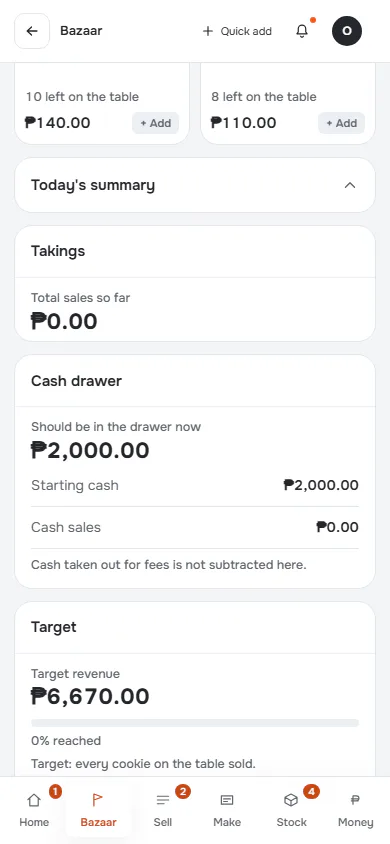
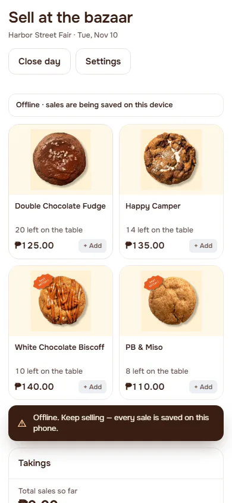
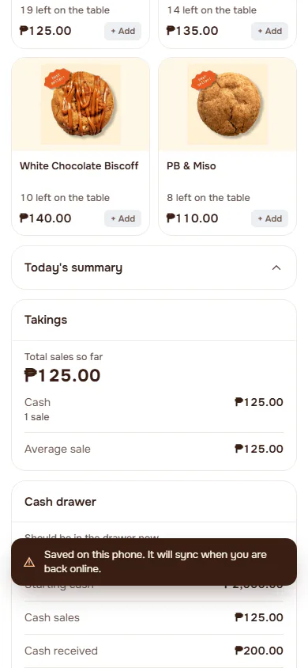
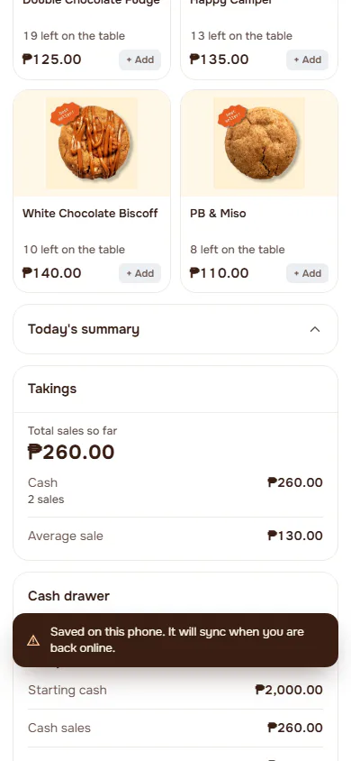
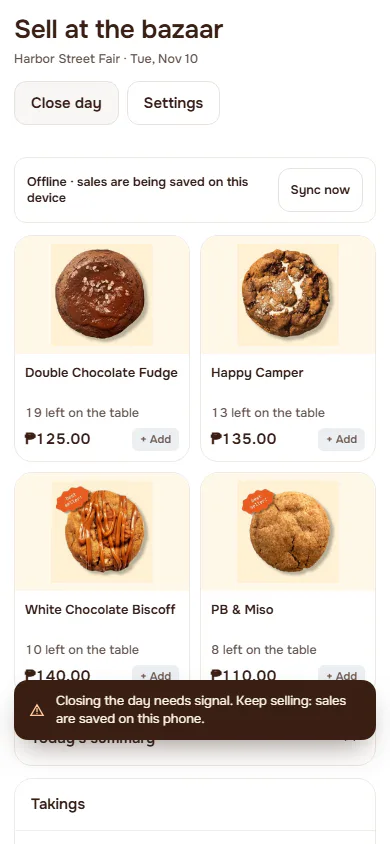
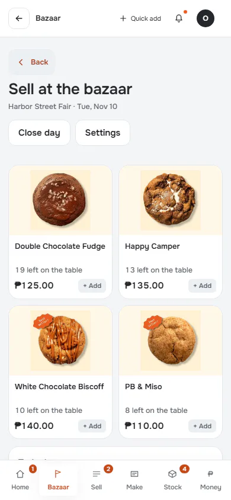
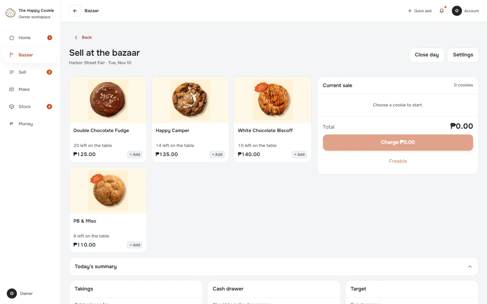
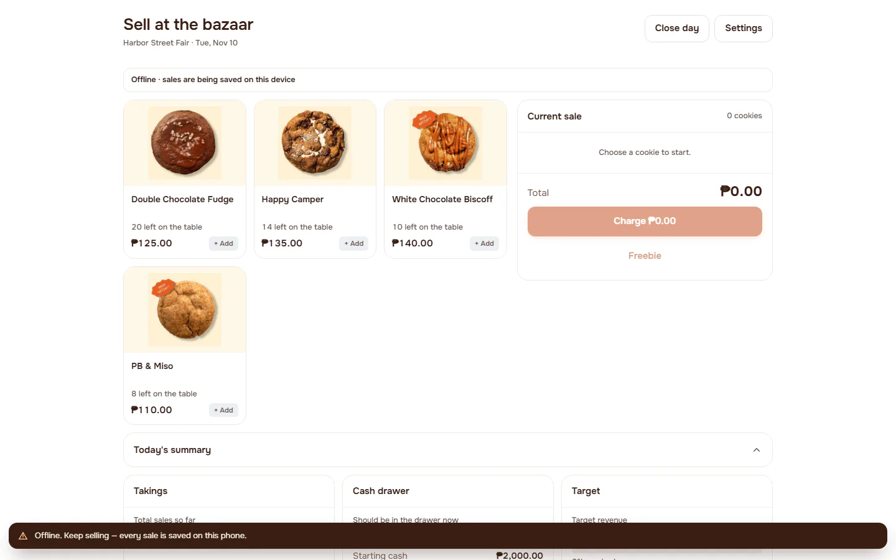
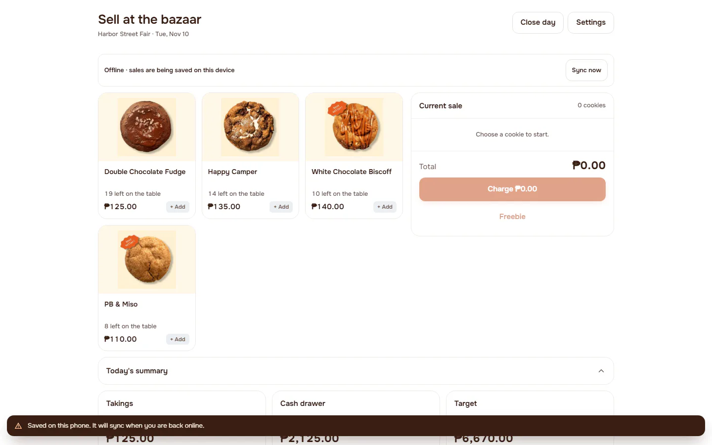
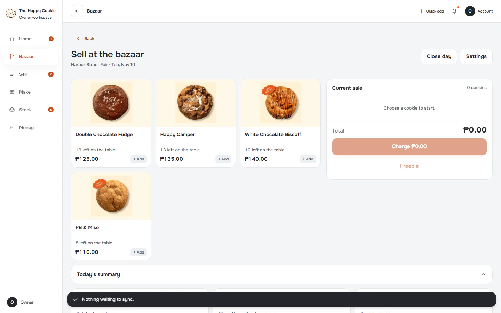

# Flow: Bazaar: lose connection, sell offline, reconnect, sync

**ACTUAL application.** Started at `/bazaar`, fixture `bazaar:planned`, simulated server. See [the README](../../README.md).

## p390 (390×844): captured

Controls the flow looked for and did not find here: 2. Listed in manifest.json.

### 1. online

`/bazaar?bazaar=till` · heading: Sell at the bazaar

[Full page](../../flows/bazaar-offline-sync/01-online/p390.full.webp)

### 2. offline

`/bazaar?bazaar=till` · heading: Sell at the bazaar · says: Offline · sales are being saved on this device

### 3. sale-queued: Queued in the real IndexedDB queue through the real OfflineBridge

`/bazaar?bazaar=till` · heading: Sell at the bazaar · says: Offline · sales are being saved on this device
Sync now

### 4. two-queued

`/bazaar?bazaar=till` · heading: Sell at the bazaar · says: Offline · sales are being saved on this device
Sync now

### 5. close-blocked-while-unsent: What Close day says with sales unsent

`/bazaar?bazaar=till` · heading: Sell at the bazaar · says: Offline · sales are being saved on this device
Sync now

### 6. reconnected: After connection returns

`/bazaar?bazaar=till` · heading: Sell at the bazaar

[Full page](../../flows/bazaar-offline-sync/06-reconnected/p390.full.webp)

### 7. synced

`/bazaar?bazaar=till` · heading: Sell at the bazaar

[Full page](../../flows/bazaar-offline-sync/07-synced/p390.full.webp)

## d1440 (1440×900): captured

Controls the flow looked for and did not find here: 2. Listed in manifest.json.

### 1. online

`/bazaar?bazaar=till` · heading: Sell at the bazaar

[Full page](../../flows/bazaar-offline-sync/01-online/d1440.full.webp)

### 2. offline

`/bazaar?bazaar=till` · heading: Sell at the bazaar · says: Offline · sales are being saved on this device

### 3. sale-queued: Queued in the real IndexedDB queue through the real OfflineBridge

`/bazaar?bazaar=till` · heading: Sell at the bazaar · says: Offline · sales are being saved on this device
Sync now

### 4. two-queued

`/bazaar?bazaar=till` · heading: Sell at the bazaar · says: Offline · sales are being saved on this device
Sync now

### 5. close-blocked-while-unsent: What Close day says with sales unsent

`/bazaar?bazaar=till` · heading: Sell at the bazaar · says: Offline · sales are being saved on this device
Sync now

### 6. reconnected: After connection returns

`/bazaar?bazaar=till` · heading: Sell at the bazaar

[Full page](../../flows/bazaar-offline-sync/06-reconnected/d1440.full.webp)

### 7. synced

`/bazaar?bazaar=till` · heading: Sell at the bazaar

[Full page](../../flows/bazaar-offline-sync/07-synced/d1440.full.webp)
