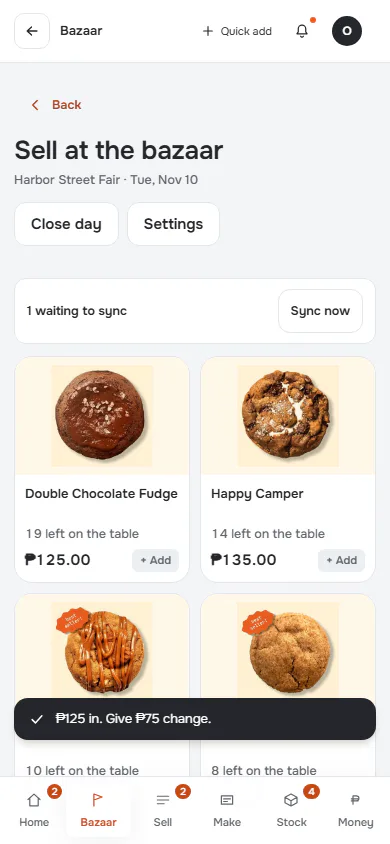
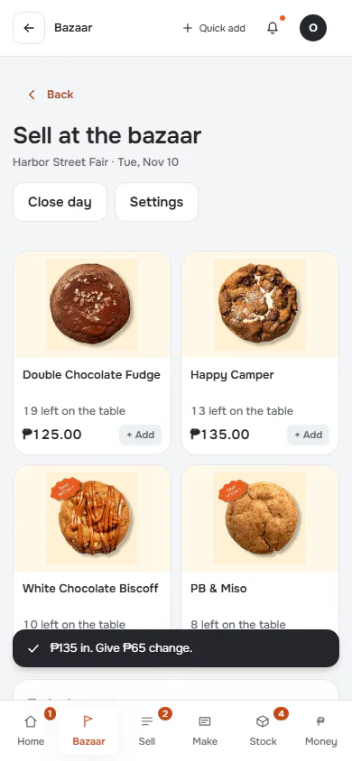
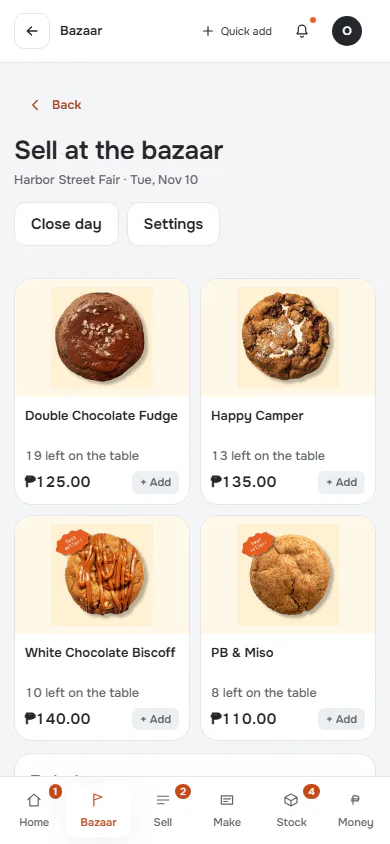
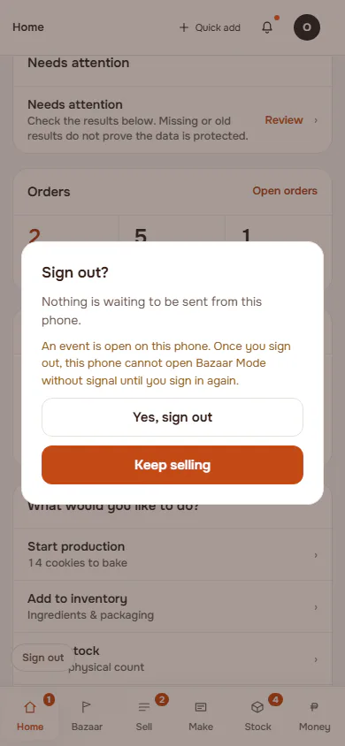
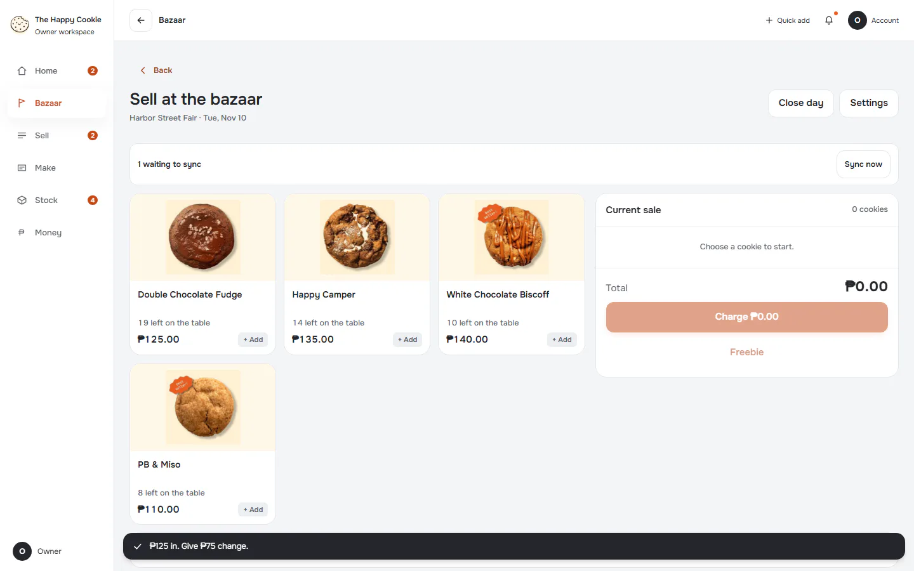
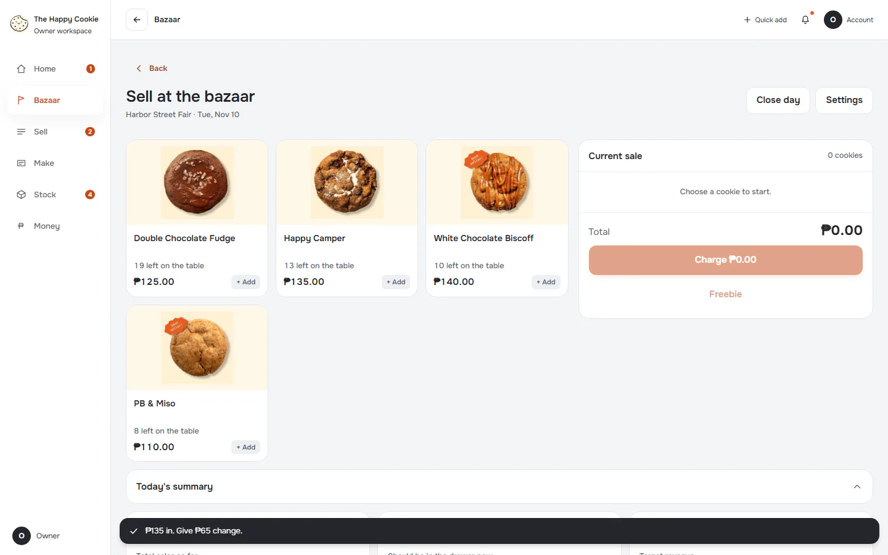
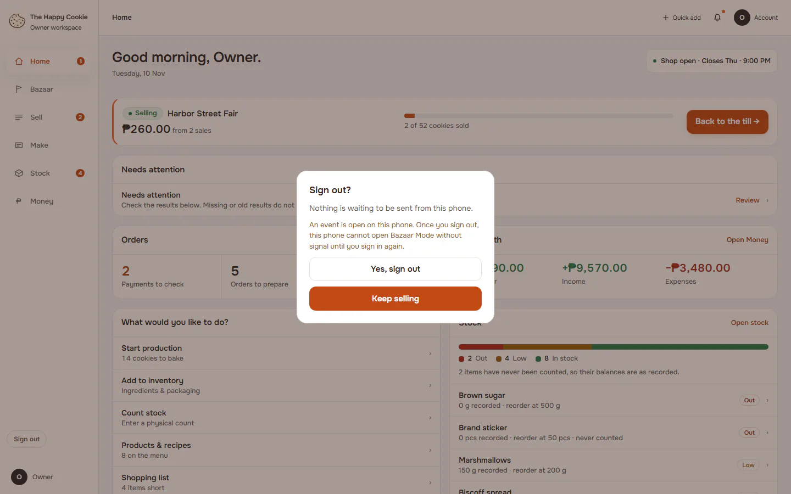

# Flow: Bazaar: one sale refused while others send

**ACTUAL application.** Started at `/bazaar`, fixture `bazaar:planned`, simulated server. See [the README](../../README.md).

## p390 (390×844): captured

### 1. refused-sale: Refused by the simulated server

`/bazaar?bazaar=till` · heading: Sell at the bazaar · says: 1 waiting to sync
Sync now / The server refused this sale: 42501 not allowed. It is still saved on this device. / ₱125 in. Give ₱75 change.

[Full page](../../flows/bazaar-partial-sync-failure/01-refused-sale/p390.full.webp)

### 2. next-sale-sends: A later sale sends; the refused one stays visible

`/bazaar?bazaar=till` · heading: Sell at the bazaar · says: ₱135 in. Give ₱65 change.

[Full page](../../flows/bazaar-partial-sync-failure/02-next-sale-sends/p390.full.webp)

### 3. summary-shows-both

`/bazaar?bazaar=till` · heading: Sell at the bazaar

[Full page](../../flows/bazaar-partial-sync-failure/03-summary-shows-both/p390.full.webp)

### 4. sign-out-warns: Sign out warns about the unsent sale

`/` · heading: Good morning, Owner.

[Full page](../../flows/bazaar-partial-sync-failure/04-sign-out-warns/p390.full.webp)

## d1440 (1440×900): captured

### 1. refused-sale: Refused by the simulated server

`/bazaar?bazaar=till` · heading: Sell at the bazaar · says: 1 waiting to sync
Sync now / The server refused this sale: 42501 not allowed. It is still saved on this device. / ₱125 in. Give ₱75 change.

[Full page](../../flows/bazaar-partial-sync-failure/01-refused-sale/d1440.full.webp)

### 2. next-sale-sends: A later sale sends; the refused one stays visible

`/bazaar?bazaar=till` · heading: Sell at the bazaar · says: ₱135 in. Give ₱65 change.

[Full page](../../flows/bazaar-partial-sync-failure/02-next-sale-sends/d1440.full.webp)

### 3. summary-shows-both

`/bazaar?bazaar=till` · heading: Sell at the bazaar

[Full page](../../flows/bazaar-partial-sync-failure/03-summary-shows-both/d1440.full.webp)

### 4. sign-out-warns: Sign out warns about the unsent sale

`/` · heading: Good morning, Owner.

[Full page](../../flows/bazaar-partial-sync-failure/04-sign-out-warns/d1440.full.webp)
