# Flow: Customer: browse, order, payment instructions, status, find order

**ACTUAL application.** Started at `/shop`, fixture `signed-out`, simulated server. See [the README](../../README.md).

## p390 (390×844): captured

Controls the flow looked for and did not find here: 1. Listed in manifest.json.

### 1. browse: The published menu

`/shop` · heading: This week's drop

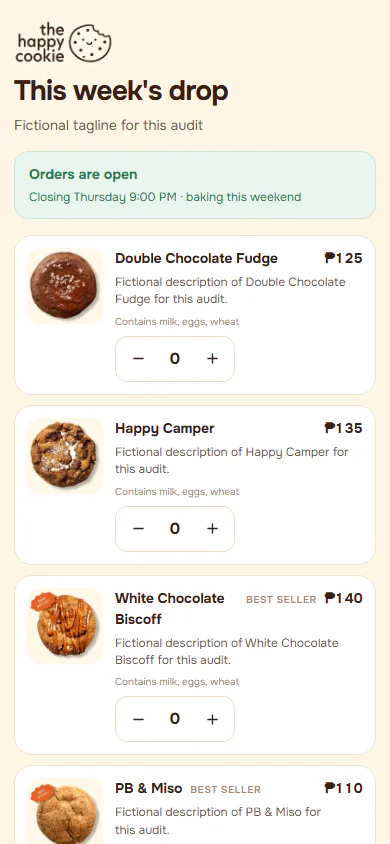

### 2. quantities: Box filled

`/shop` · heading: This week's drop

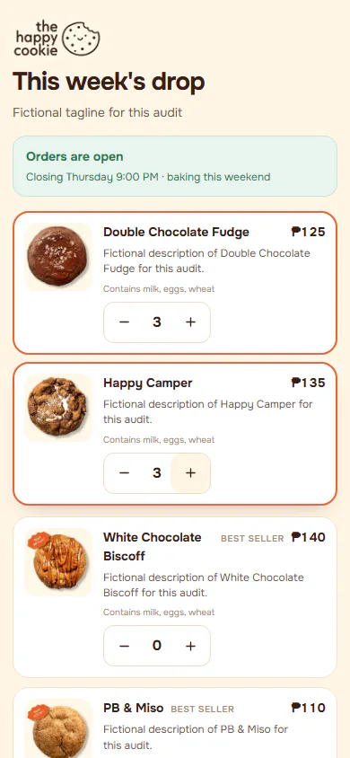

### 3. checkout-empty: Checkout before any detail

`/checkout` · heading: none

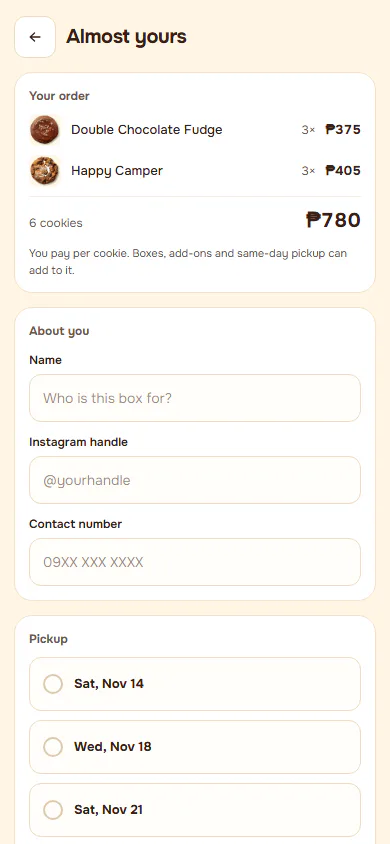

### 4. checkout-validation: Submit with nothing filled

`/checkout` · heading: none

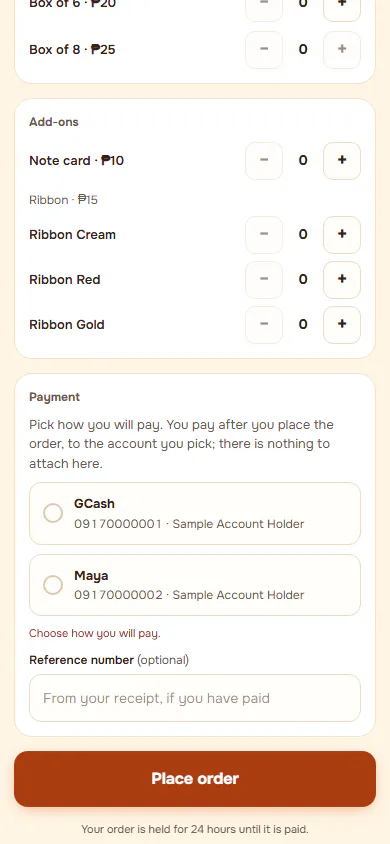

### 5. checkout-filled: Fields filled with fictional values

`/checkout` · heading: none

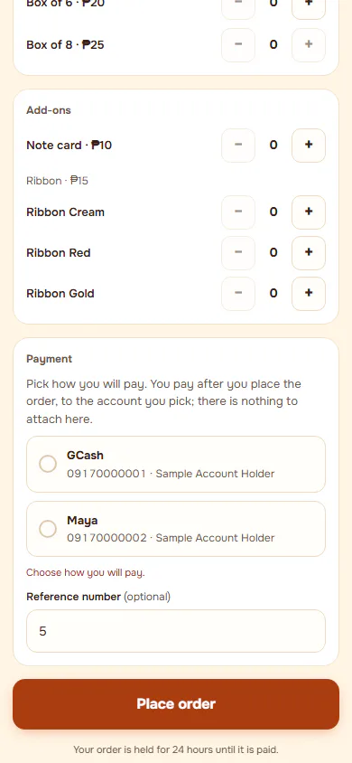

### 6. after-submit: What the customer sees after submitting, before paying

`/checkout` · heading: none

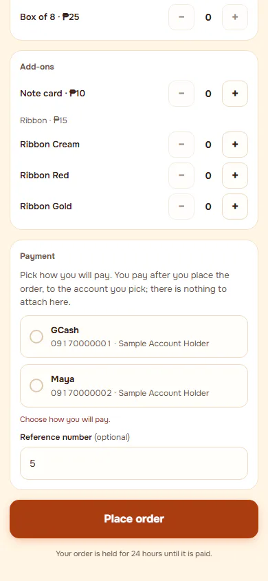

### 7. payment-claimed: After the customer says they paid, where offered

`/checkout` · heading: none

### 8. status-after-reload: Reload keeps the order in view

`/checkout` · heading: none

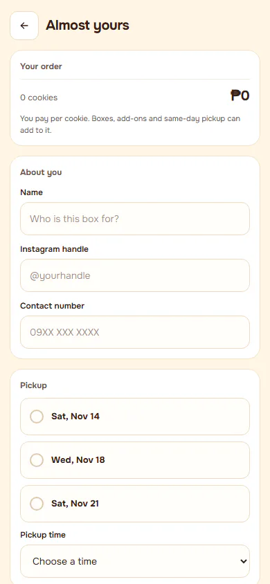

## d1440 (1440×900): captured

Controls the flow looked for and did not find here: 1. Listed in manifest.json.

### 1. browse: The published menu

`/shop` · heading: This week's drop

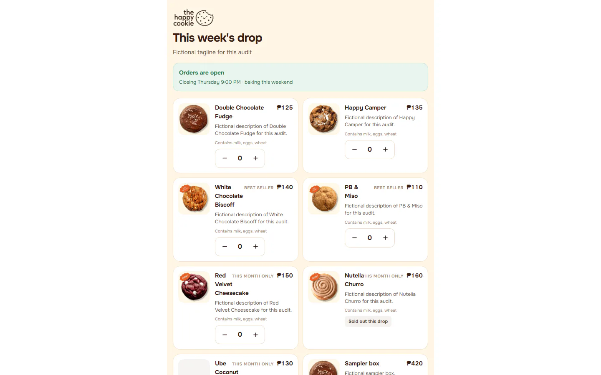

### 2. quantities: Box filled

`/shop` · heading: This week's drop

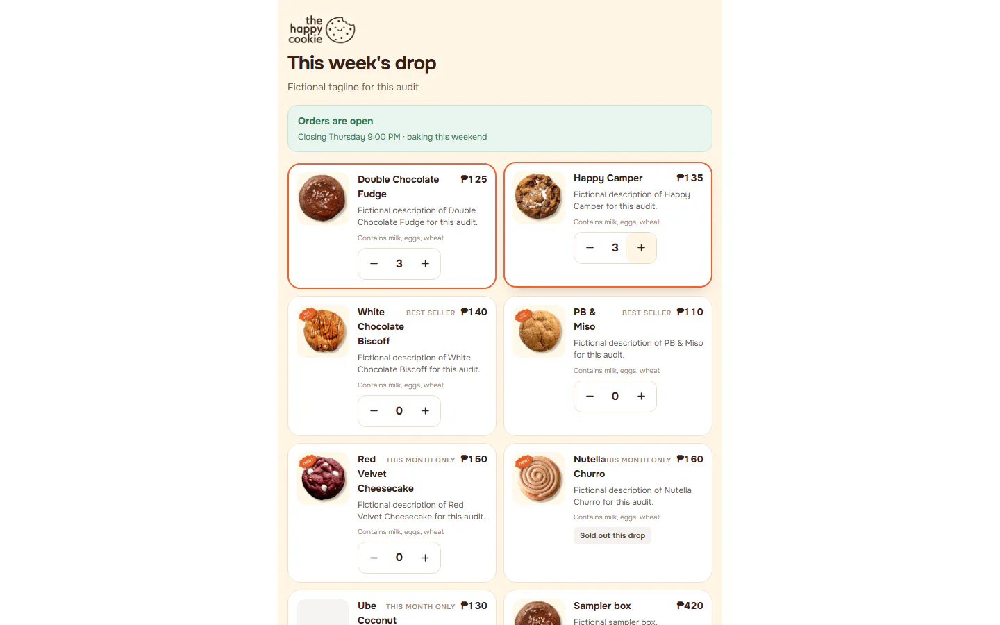

### 3. checkout-empty: Checkout before any detail

`/checkout` · heading: none

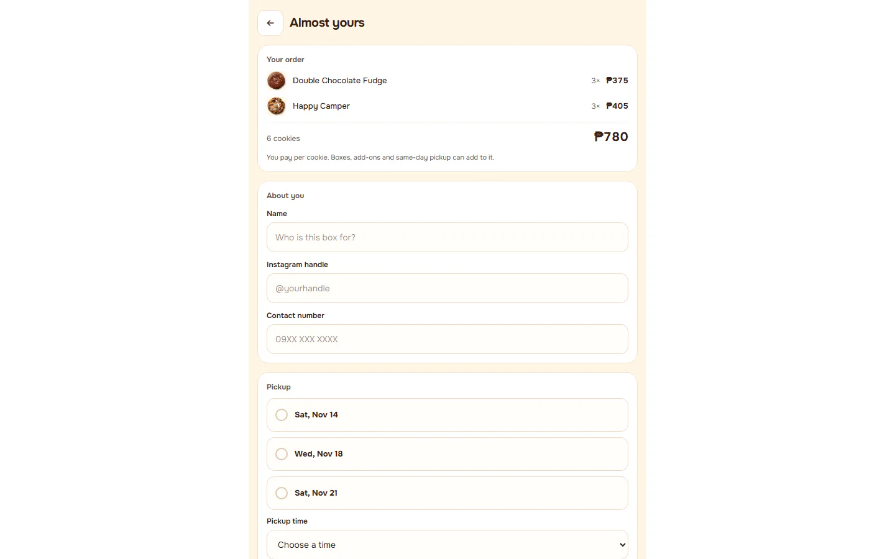

### 4. checkout-validation: Submit with nothing filled

`/checkout` · heading: none

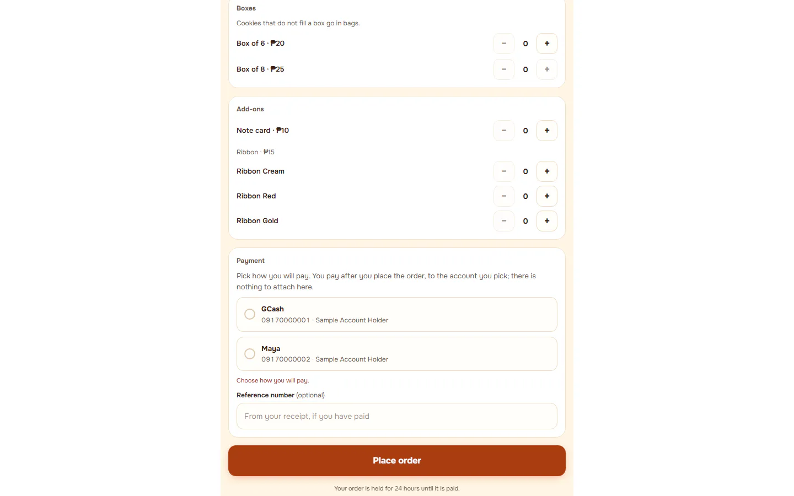

### 5. checkout-filled: Fields filled with fictional values

`/checkout` · heading: none

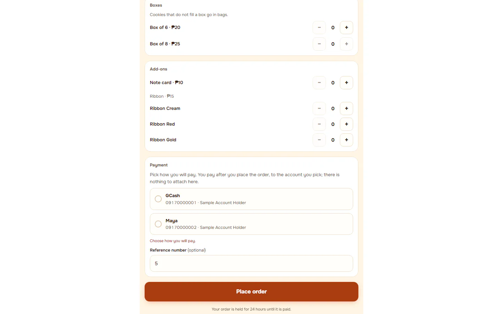

### 6. after-submit: What the customer sees after submitting, before paying

`/checkout` · heading: none

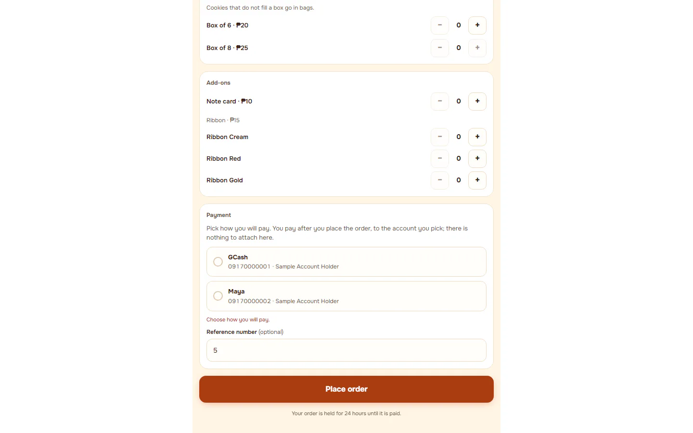

### 7. payment-claimed: After the customer says they paid, where offered

`/checkout` · heading: none

### 8. status-after-reload: Reload keeps the order in view

`/checkout` · heading: none

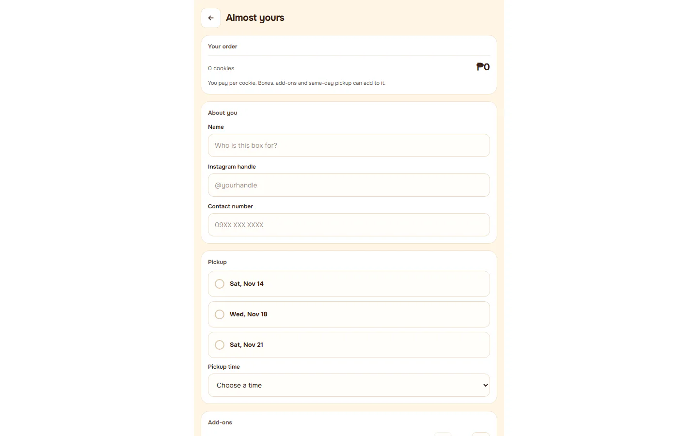
