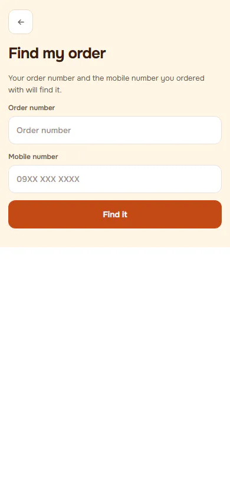
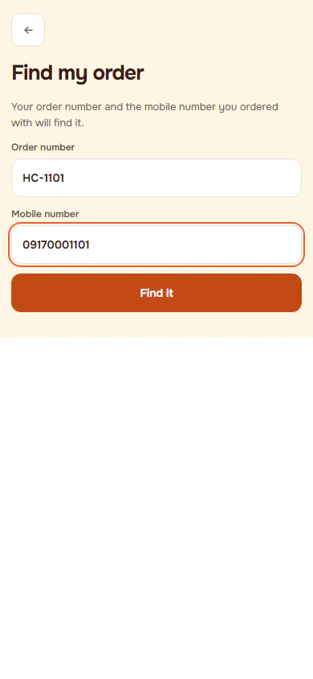
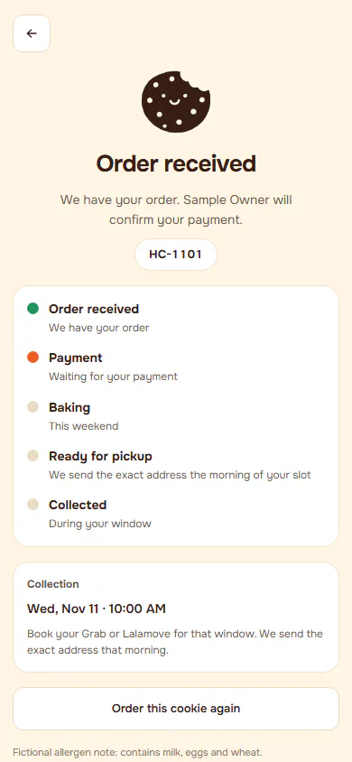
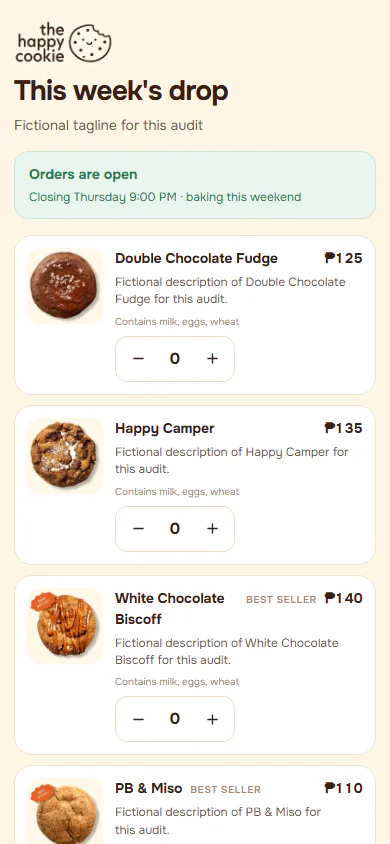
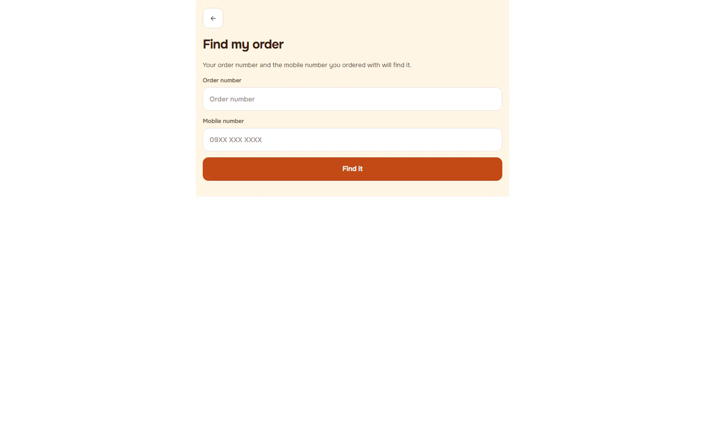
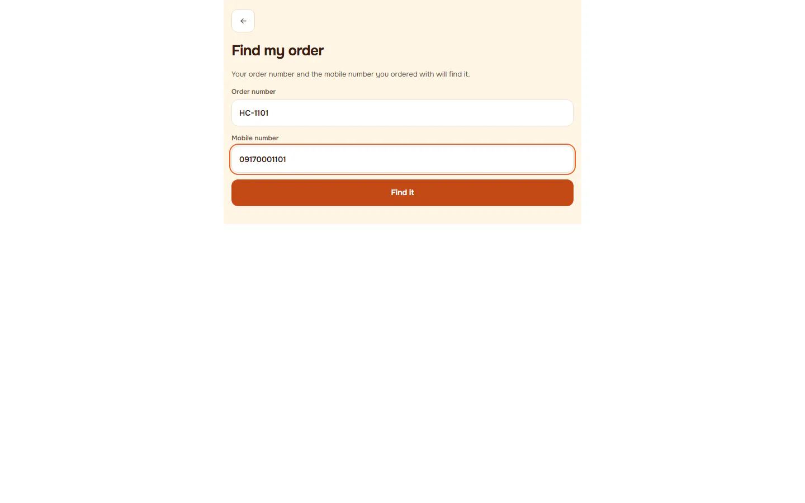
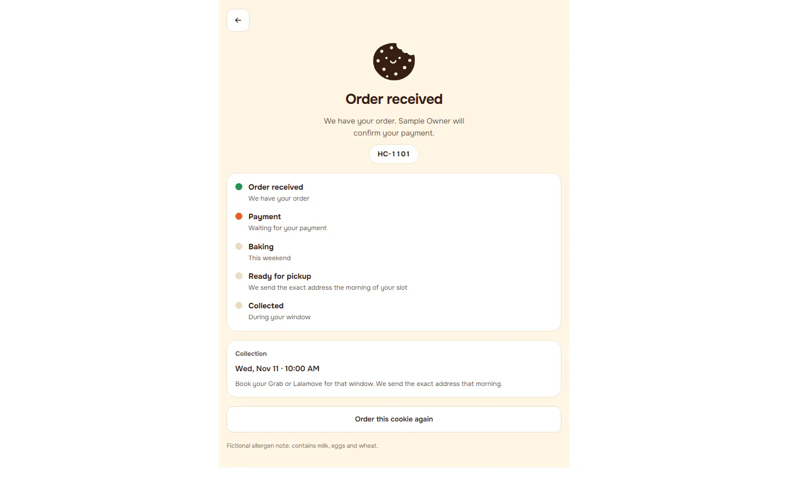
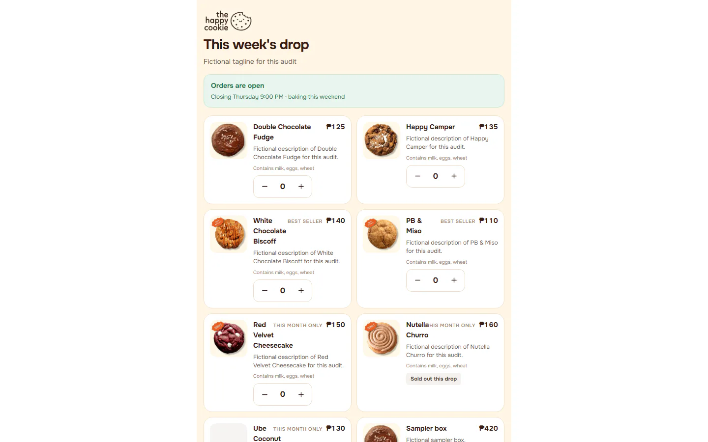

# Flow: Customer: recover an order, unavailable date, closed shop

**ACTUAL application.** Started at `/lookup`, fixture `signed-out`, simulated server. See [the README](../../README.md).

## p390 (390×844): captured

### 1. find-form

`/lookup` · heading: Find my order

### 2. find-filled

`/lookup` · heading: Find my order

### 3. found-order: Status page of the found order

`/status` · heading: none

### 4. back-to-shop

`/shop` · heading: This week's drop

## d1440 (1440×900): captured

### 1. find-form

`/lookup` · heading: Find my order

### 2. find-filled

`/lookup` · heading: Find my order

### 3. found-order: Status page of the found order

`/status` · heading: none

### 4. back-to-shop

`/shop` · heading: This week's drop

