# Flow: Make: browse, open recipe, scale, availability, edit, review, save

**ACTUAL application.** Started at `/products`, fixture `default`, simulated server. See [the README](../../README.md).

## p390 (390×844): captured

### 1. products

`/products` · heading: Products

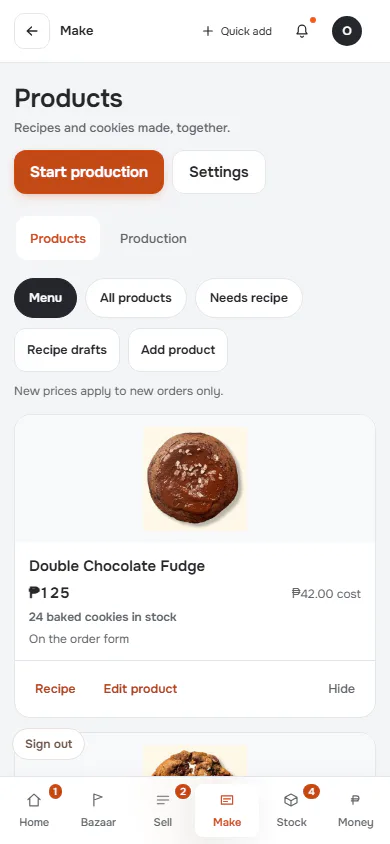

[Full page](../../flows/make-recipe/01-products/p390.full.webp)

### 2. recipe

`/recipes` · heading: Double Chocolate Fudge

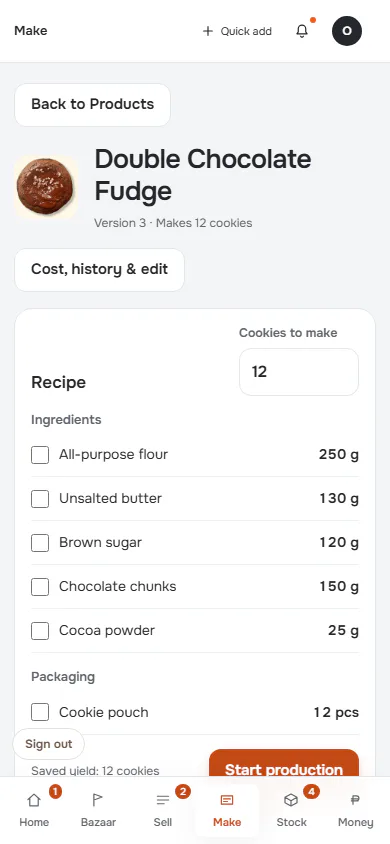

[Full page](../../flows/make-recipe/02-recipe/p390.full.webp)

### 3. scaled-shortage: Do you have enough?

`/recipes` · heading: Double Chocolate Fudge

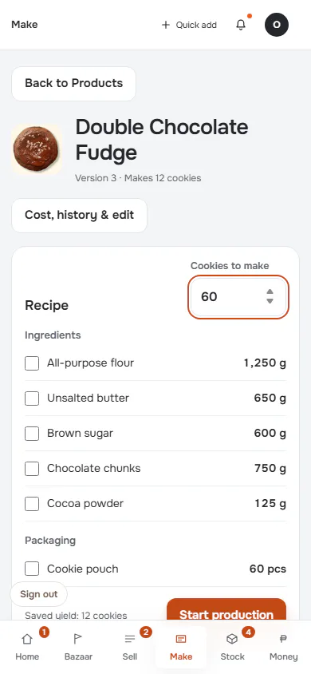

[Full page](../../flows/make-recipe/03-scaled-shortage/p390.full.webp)

### 4. cost-history

`/recipes` · heading: Double Chocolate Fudge

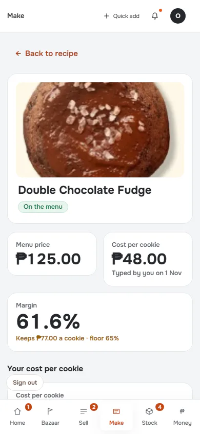

[Full page](../../flows/make-recipe/04-cost-history/p390.full.webp)

### 5. editor

`/recipes` · heading: Edit Double Chocolate Fudge

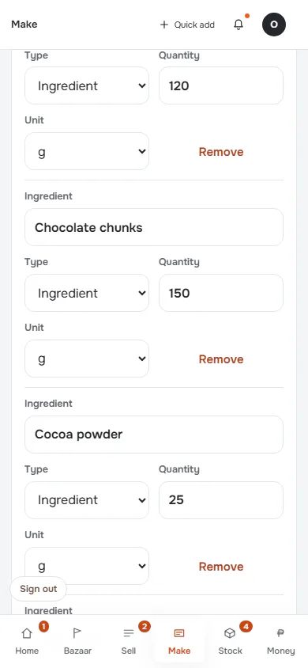

[Full page](../../flows/make-recipe/05-editor/p390.full.webp)

### 6. editor-changed

`/recipes` · heading: Edit Double Chocolate Fudge

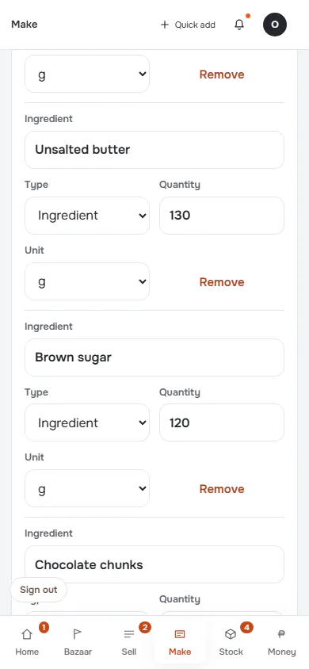

[Full page](../../flows/make-recipe/06-editor-changed/p390.full.webp)

### 7. editor-review

`/recipes` · heading: Review recipe changes

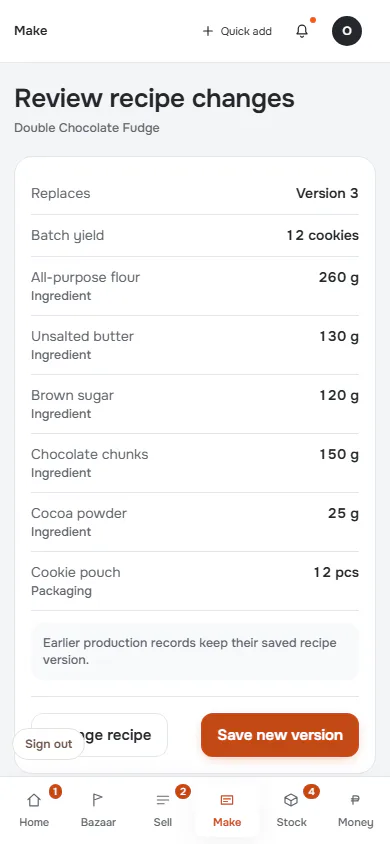

[Full page](../../flows/make-recipe/07-editor-review/p390.full.webp)

### 8. saved: Version change after save

`/recipes` · heading: Edit Double Chocolate Fudge · says: Saved as Version 4. The version before it is kept for anything already baked on it.

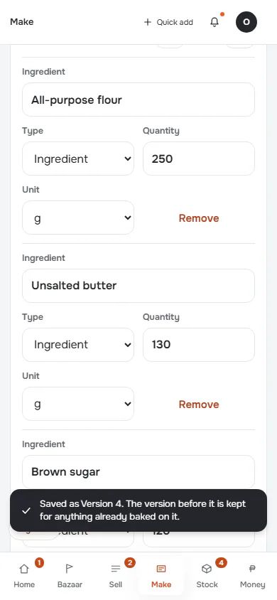

[Full page](../../flows/make-recipe/08-saved/p390.full.webp)

### 9. reload

`/recipes` · heading: Recipe book

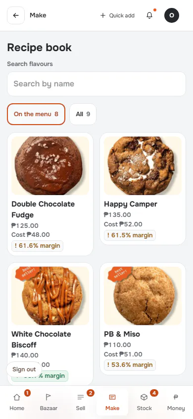

[Full page](../../flows/make-recipe/09-reload/p390.full.webp)

## d1440 (1440×900): captured

### 1. products

`/products` · heading: Products

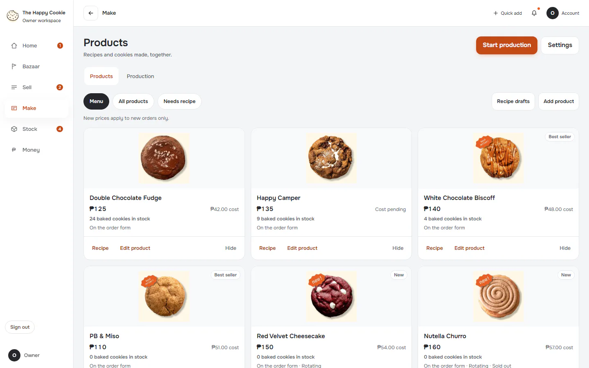

[Full page](../../flows/make-recipe/01-products/d1440.full.webp)

### 2. recipe

`/recipes` · heading: Double Chocolate Fudge

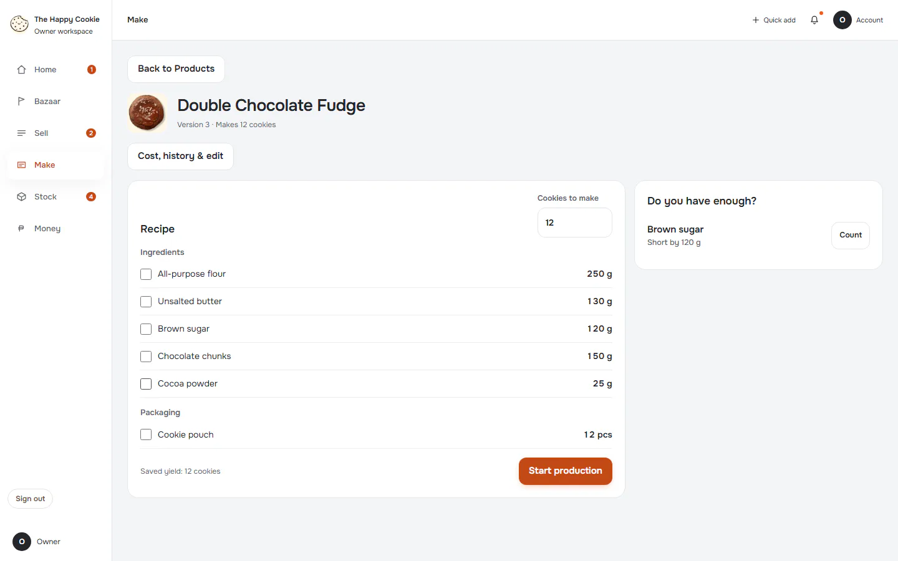

### 3. scaled-shortage: Do you have enough?

`/recipes` · heading: Double Chocolate Fudge

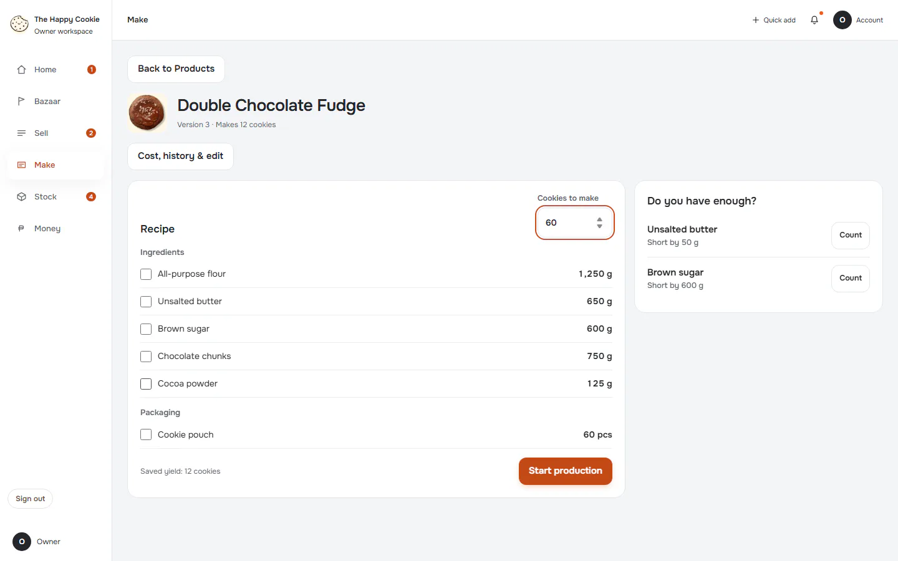

### 4. cost-history

`/recipes` · heading: Double Chocolate Fudge

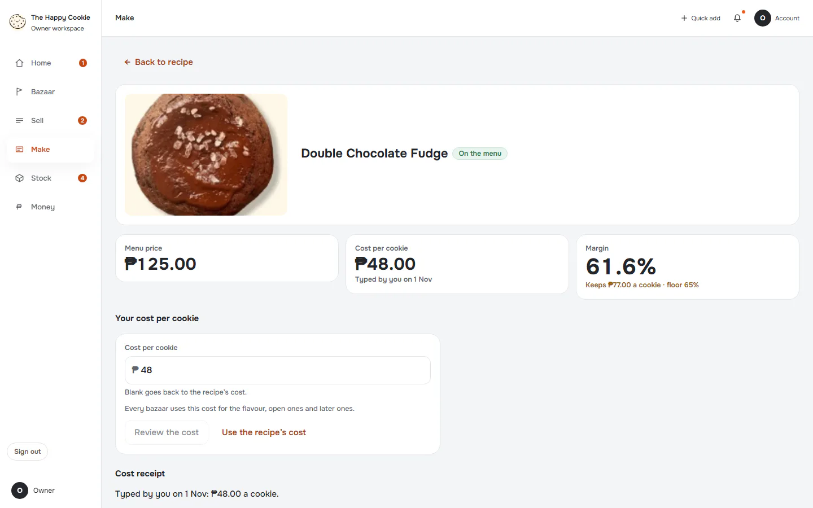

[Full page](../../flows/make-recipe/04-cost-history/d1440.full.webp)

### 5. editor

`/recipes` · heading: Edit Double Chocolate Fudge

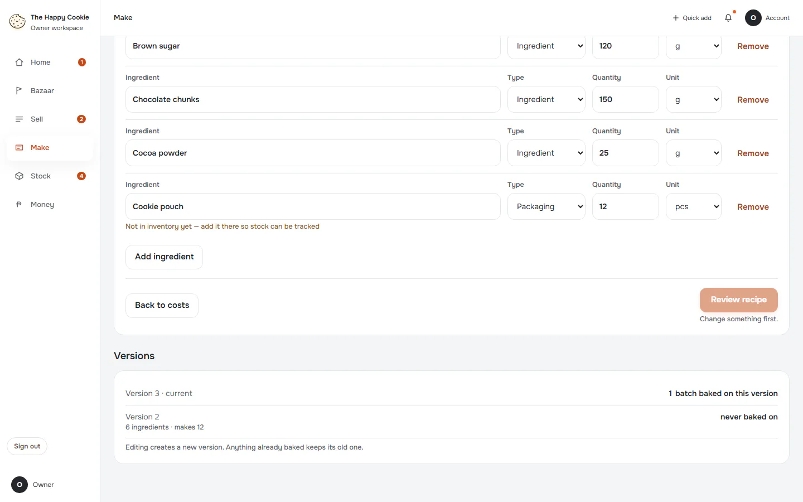

[Full page](../../flows/make-recipe/05-editor/d1440.full.webp)

### 6. editor-changed

`/recipes` · heading: Edit Double Chocolate Fudge

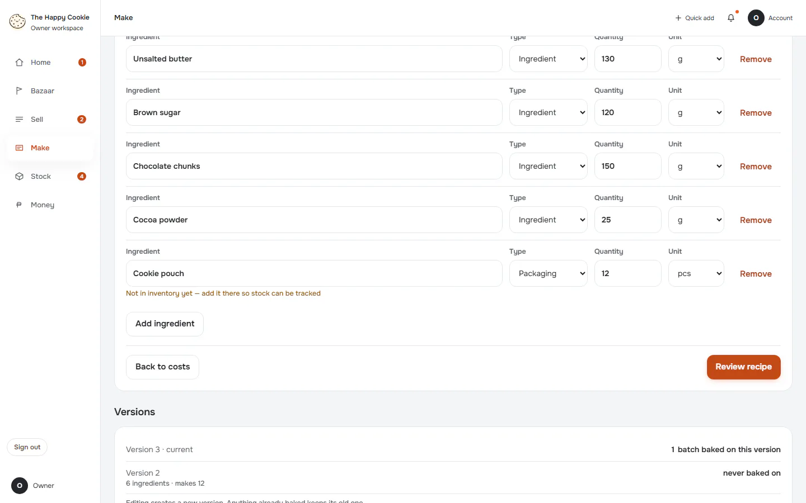

[Full page](../../flows/make-recipe/06-editor-changed/d1440.full.webp)

### 7. editor-review

`/recipes` · heading: Review recipe changes

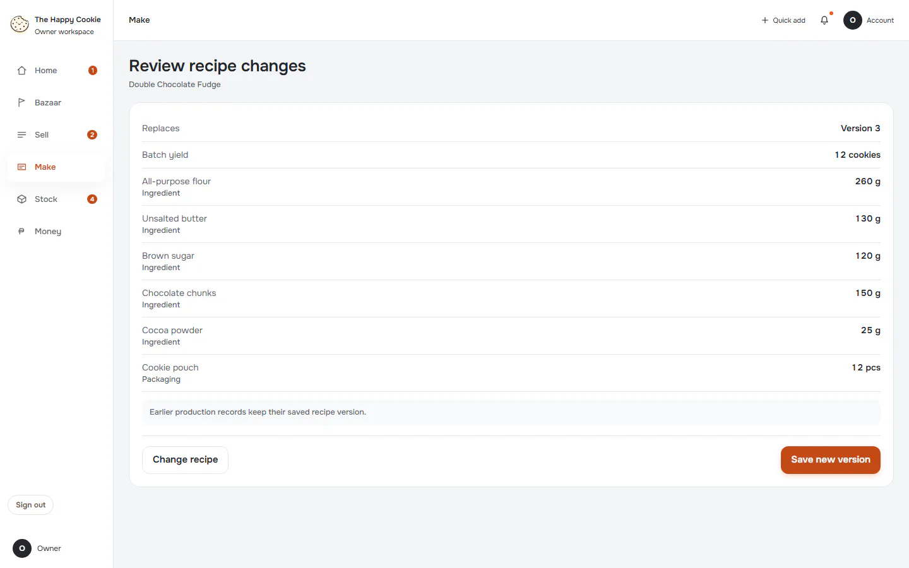

### 8. saved: Version change after save

`/recipes` · heading: Edit Double Chocolate Fudge · says: Saved as Version 4. The version before it is kept for anything already baked on it.

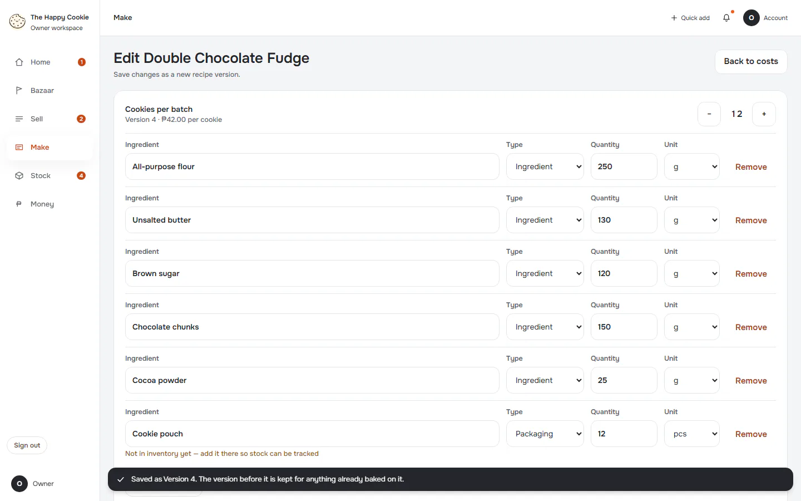

[Full page](../../flows/make-recipe/08-saved/d1440.full.webp)

### 9. reload

`/recipes` · heading: Recipe book

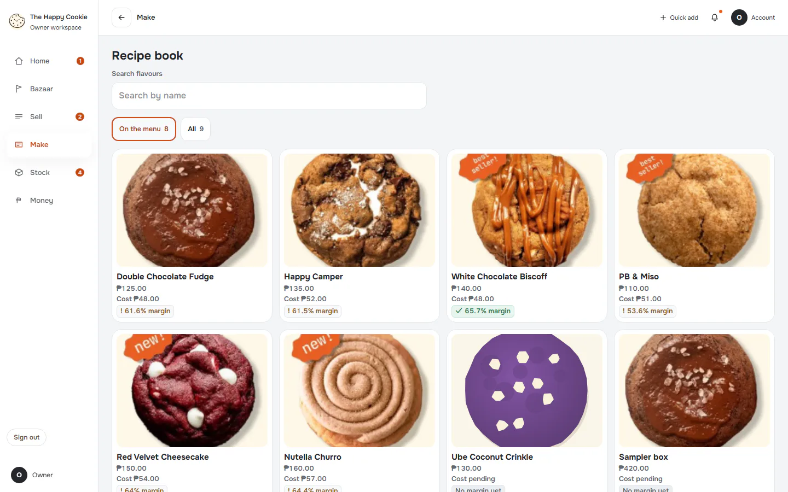

[Full page](../../flows/make-recipe/09-reload/d1440.full.webp)
