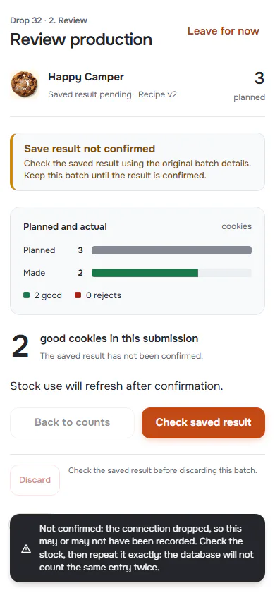
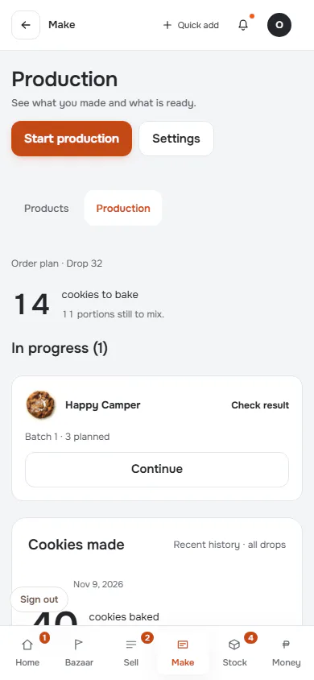
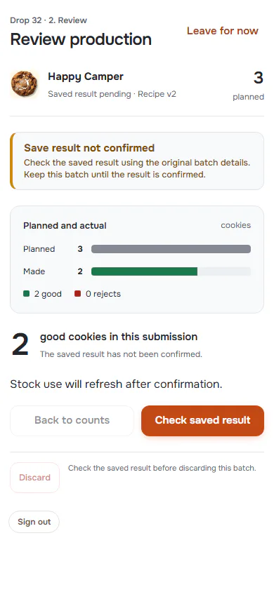
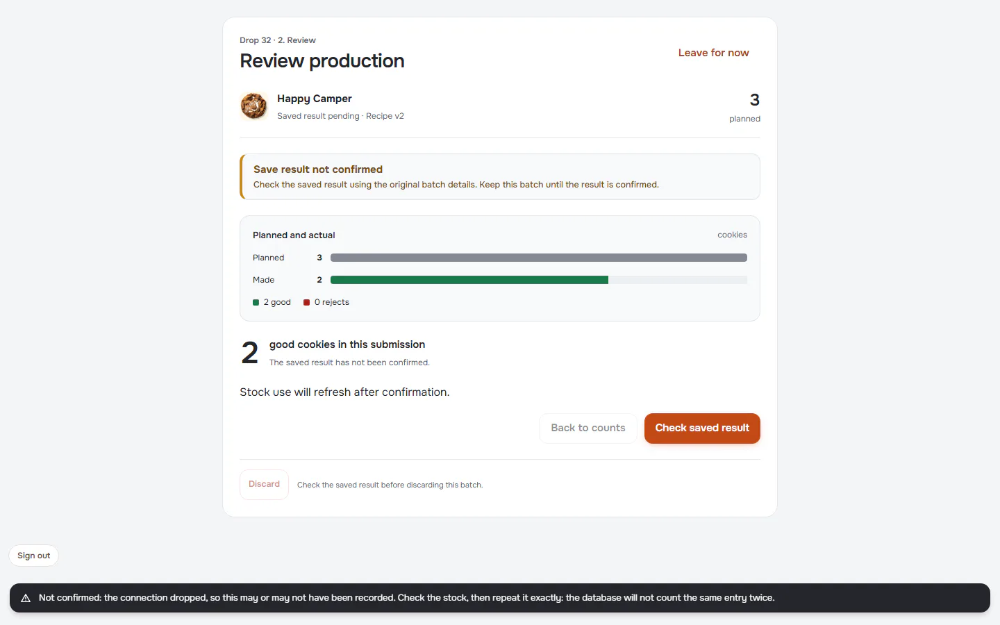
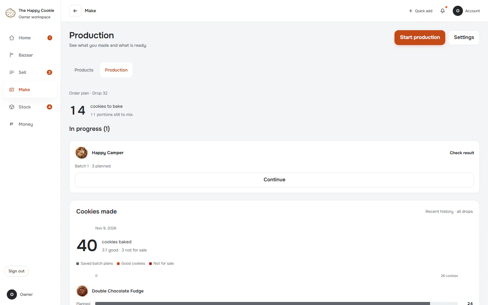
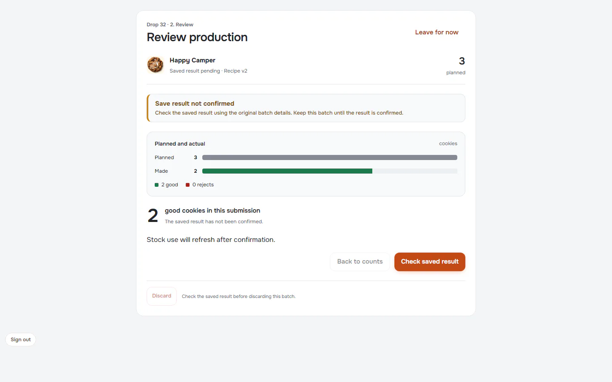

# Flow: Make: unfinished and uncertain work

**ACTUAL application.** Started at `/bake`, fixture `default`, simulated server. See [the README](../../README.md).

## p390 (390×844): captured

### 1. uncertain-save: The reply was lost

`/batch` · heading: Review production · says: Save result not confirmed
Check the saved result using the original batch details. Keep this batch until the result is c / Not confirmed: the connection dropped, so this may or may not have been recorded. Check the stock, then repeat it exactl

### 2. reload-after-uncertain: What the app shows after reload

`/bake` · heading: Production

[Full page](../../flows/make-unfinished-recovery/02-reload-after-uncertain/p390.full.webp)

### 3. continue

`/batch` · heading: Review production · says: Save result not confirmed
Check the saved result using the original batch details. Keep this batch until the result is c

## d1440 (1440×900): captured

### 1. uncertain-save: The reply was lost

`/batch` · heading: Review production · says: Save result not confirmed
Check the saved result using the original batch details. Keep this batch until the result is c / Not confirmed: the connection dropped, so this may or may not have been recorded. Check the stock, then repeat it exactl

### 2. reload-after-uncertain: What the app shows after reload

`/bake` · heading: Production

[Full page](../../flows/make-unfinished-recovery/02-reload-after-uncertain/d1440.full.webp)

### 3. continue

`/batch` · heading: Review production · says: Save result not confirmed
Check the saved result using the original batch details. Keep this batch until the result is c

