# Flow: Sell: find order, review payment, confirm, packed, ready, picked up

**ACTUAL application.** Started at `/orders`, fixture `default`, simulated server. See [the README](../../README.md).

## p390 (390×844): captured

Controls the flow looked for and did not find here: 1. Listed in manifest.json.

### 1. orders-list

`/orders` · heading: Orders · says: 2 payments need review
Check the reference and the amount on each one.
Show them

[Full page](../../flows/sell-payment-to-pickup/01-orders-list/p390.full.webp)

### 2. search

`/orders` · heading: Orders · says: 2 payments need review
Check the reference and the amount on each one.
Show them

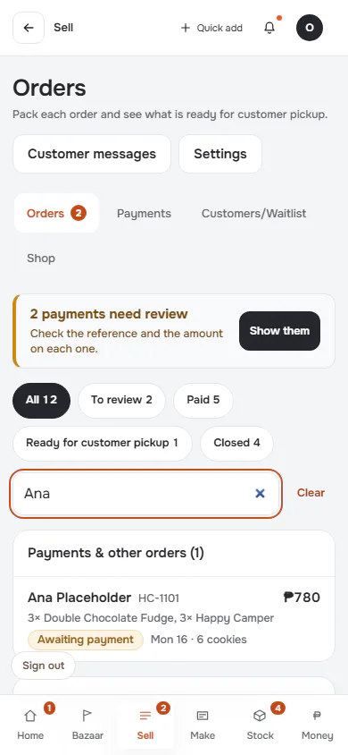

[Full page](../../flows/sell-payment-to-pickup/02-search/p390.full.webp)

### 3. payment-to-check: Payment claimed, awaiting review

`/order` · heading: Order HC-1101

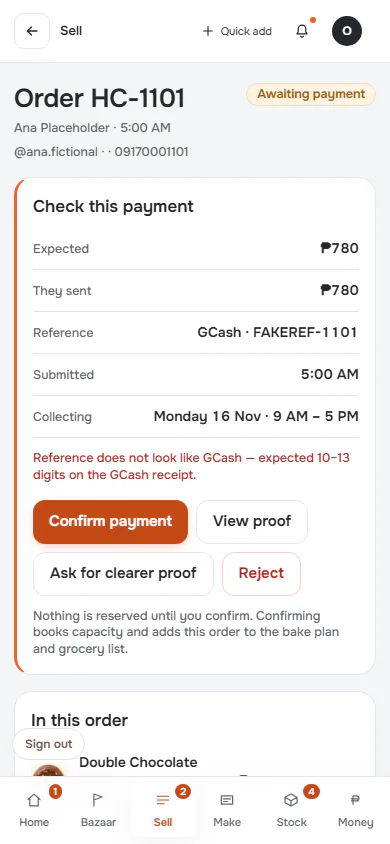

[Full page](../../flows/sell-payment-to-pickup/03-payment-to-check/p390.full.webp)

### 4. proof

`/order` · heading: Order HC-1101

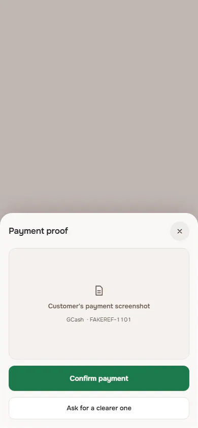

[Full page](../../flows/sell-payment-to-pickup/04-proof/p390.full.webp)

### 5. confirmed: Acknowledged by the simulated server

`/order` · heading: Order HC-1101 · says: Ana’s order is marked paid.

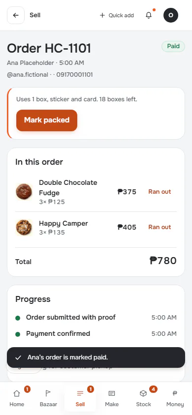

[Full page](../../flows/sell-payment-to-pickup/05-confirmed/p390.full.webp)

### 6. packed

`/order` · heading: Order HC-1101 · says: Ana’s order is packed and ready.

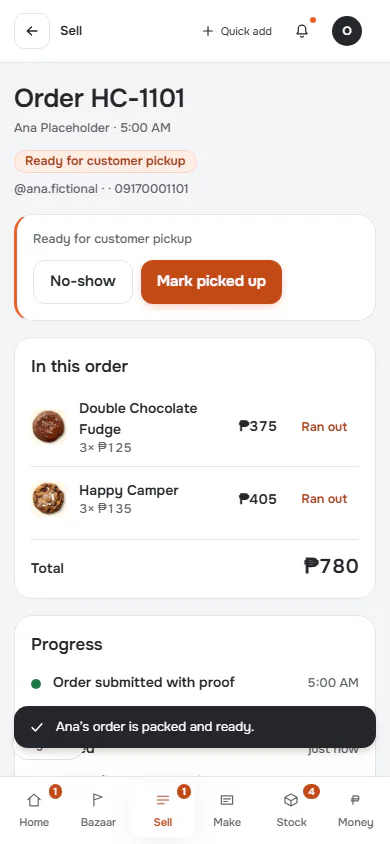

[Full page](../../flows/sell-payment-to-pickup/06-packed/p390.full.webp)

### 7. next-status

`/order` · heading: Order HC-1101 · says: Ana’s order is picked up.
Undo

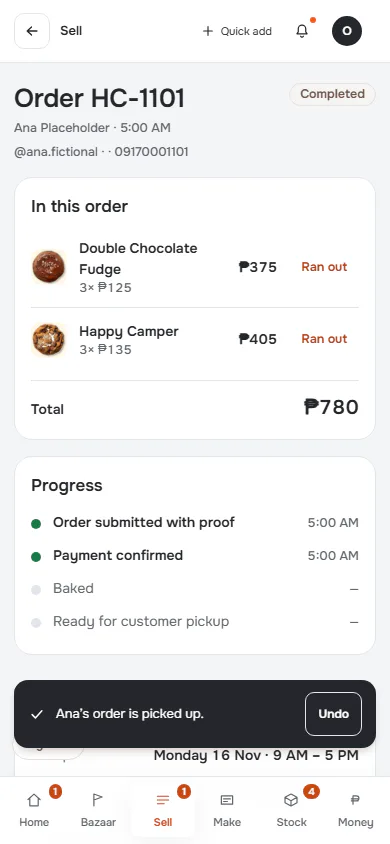

[Full page](../../flows/sell-payment-to-pickup/07-next-status/p390.full.webp)

### 8. picked-up: Picked Up means Completed

`/order` · heading: Order HC-1101 · says: Ana’s order is picked up.
Undo

[Full page](../../flows/sell-payment-to-pickup/08-picked-up/p390.full.webp)

### 9. reload: Reloaded from the simulated server

`/orders` · heading: Orders · says: 2 payments need review
Check the reference and the amount on each one.
Show them

[Full page](../../flows/sell-payment-to-pickup/09-reload/p390.full.webp)

## d1440 (1440×900): captured

Controls the flow looked for and did not find here: 1. Listed in manifest.json.

### 1. orders-list

`/orders` · heading: Orders · says: 2 payments need review
Check the reference and the amount on each one.
Show them

[Full page](../../flows/sell-payment-to-pickup/01-orders-list/d1440.full.webp)

### 2. search

`/orders` · heading: Orders · says: 2 payments need review
Check the reference and the amount on each one.
Show them

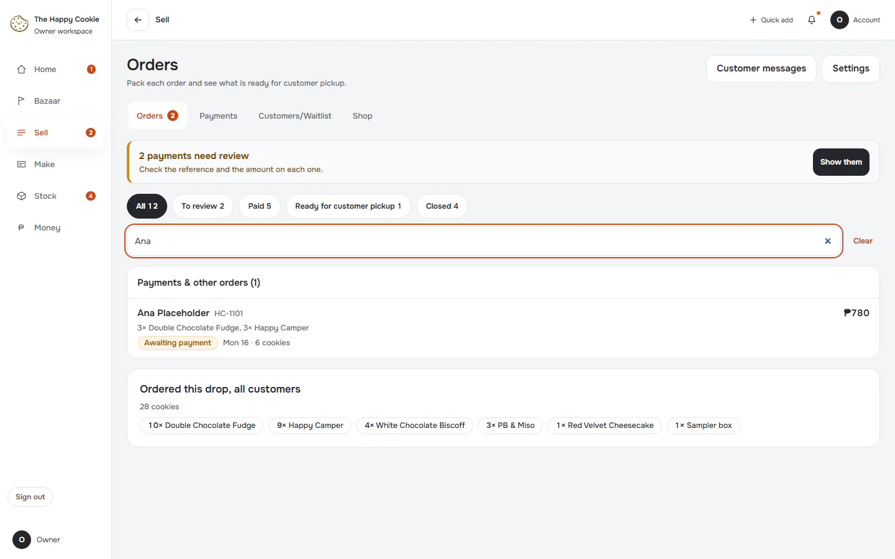

### 3. payment-to-check: Payment claimed, awaiting review

`/order` · heading: Order HC-1101

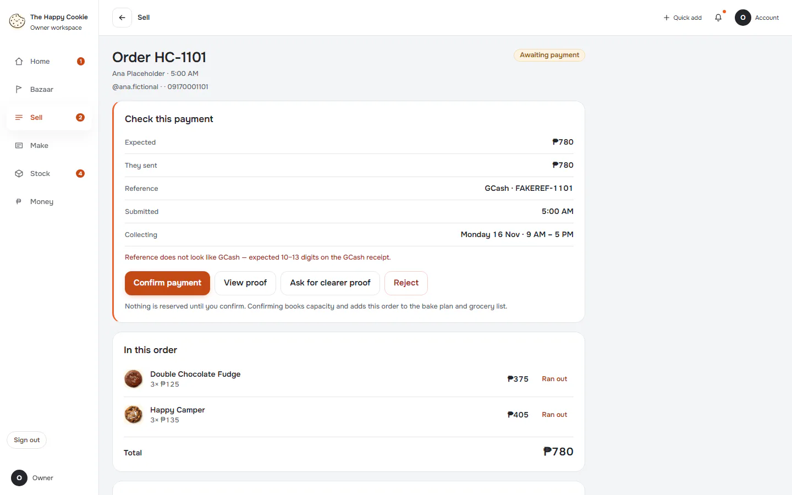

[Full page](../../flows/sell-payment-to-pickup/03-payment-to-check/d1440.full.webp)

### 4. proof

`/order` · heading: Order HC-1101

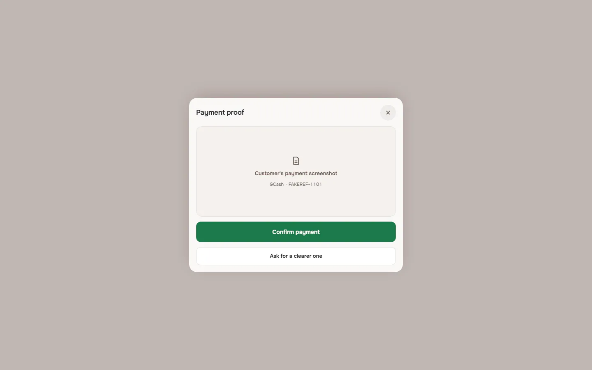

[Full page](../../flows/sell-payment-to-pickup/04-proof/d1440.full.webp)

### 5. confirmed: Acknowledged by the simulated server

`/order` · heading: Order HC-1101 · says: Ana’s order is marked paid.

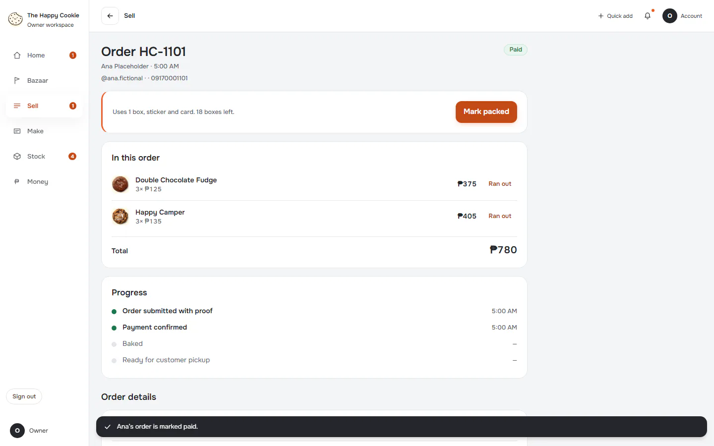

[Full page](../../flows/sell-payment-to-pickup/05-confirmed/d1440.full.webp)

### 6. packed

`/order` · heading: Order HC-1101 · says: Ana’s order is packed and ready.

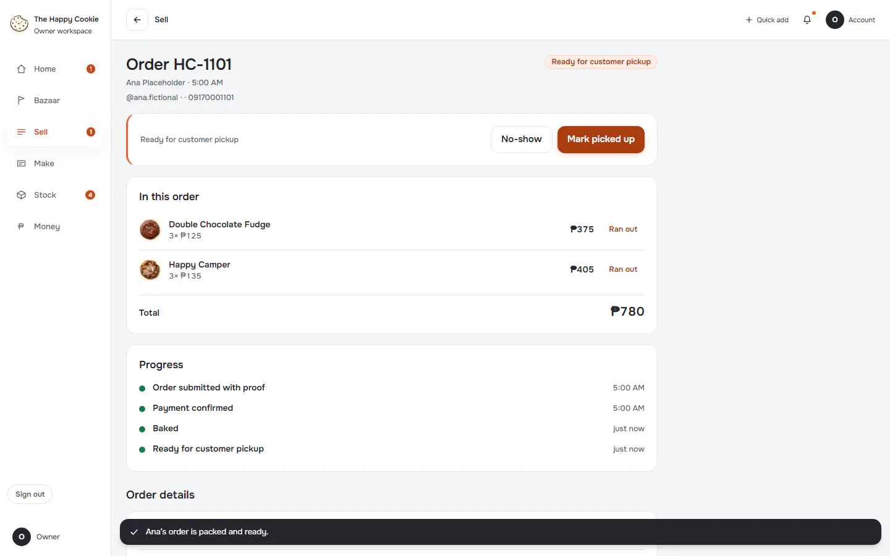

[Full page](../../flows/sell-payment-to-pickup/06-packed/d1440.full.webp)

### 7. next-status

`/order` · heading: Order HC-1101 · says: Ana’s order is picked up.
Undo

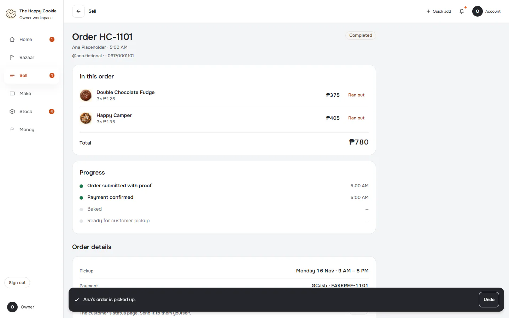

[Full page](../../flows/sell-payment-to-pickup/07-next-status/d1440.full.webp)

### 8. picked-up: Picked Up means Completed

`/order` · heading: Order HC-1101 · says: Ana’s order is picked up.
Undo

[Full page](../../flows/sell-payment-to-pickup/08-picked-up/d1440.full.webp)

### 9. reload: Reloaded from the simulated server

`/orders` · heading: Orders · says: 2 payments need review
Check the reference and the amount on each one.
Show them

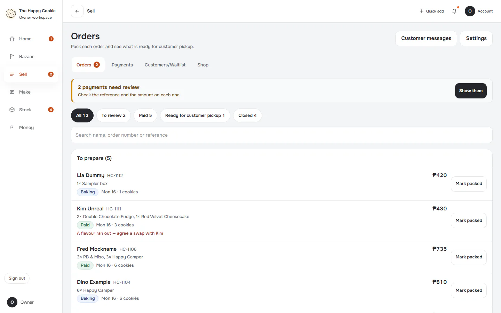

[Full page](../../flows/sell-payment-to-pickup/09-reload/d1440.full.webp)
