# Flow: Sell: reject, cancel, no-show, refund, swap

**ACTUAL application.** Started at `/orders`, fixture `default`, simulated server. See [the README](../../README.md).

## p390 (390×844): captured

### 1. rejected: Reject applies on the first press

`/order` · heading: Order HC-1101 · says: Payment rejected. The order is cancelled and its slots are free again.

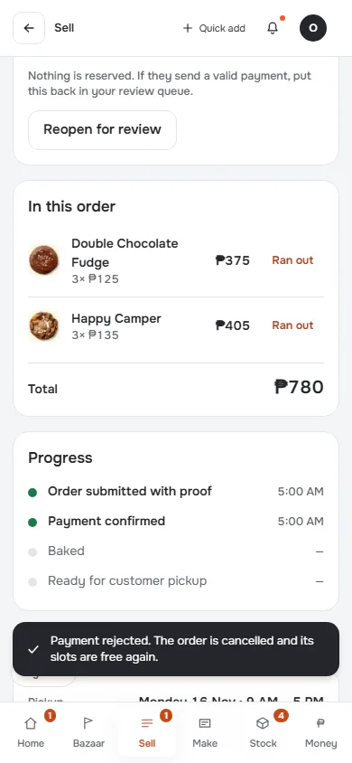

[Full page](../../flows/sell-reject-cancel-noshow-refund/01-rejected/p390.full.webp)

### 2. back-to-list: Return to context

`/orders` · heading: Orders · says: 1 payment needs review
Check the reference and the amount on each one.
Show them

[Full page](../../flows/sell-reject-cancel-noshow-refund/02-back-to-list/p390.full.webp)

### 3. paid-order

`/order` · heading: Order HC-1103

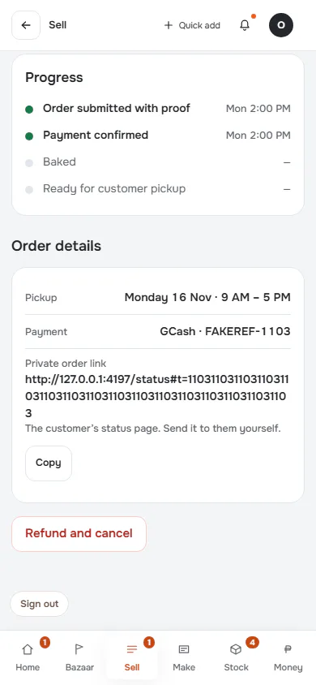

[Full page](../../flows/sell-reject-cancel-noshow-refund/03-paid-order/p390.full.webp)

### 4. refund-form

`/order` · heading: Record refund

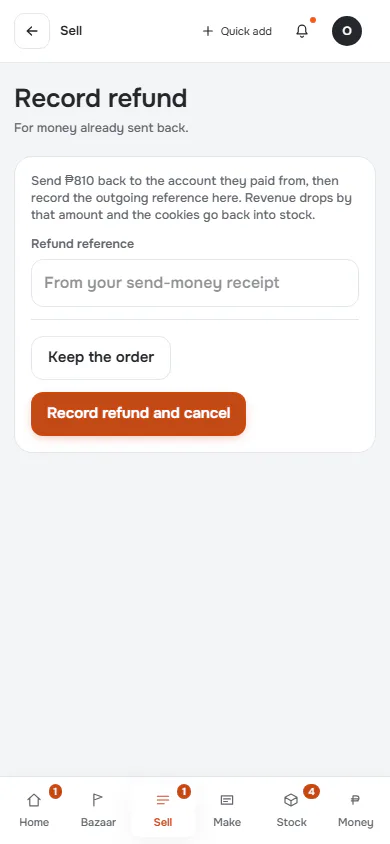

### 5. refund-filled

`/order` · heading: Record refund

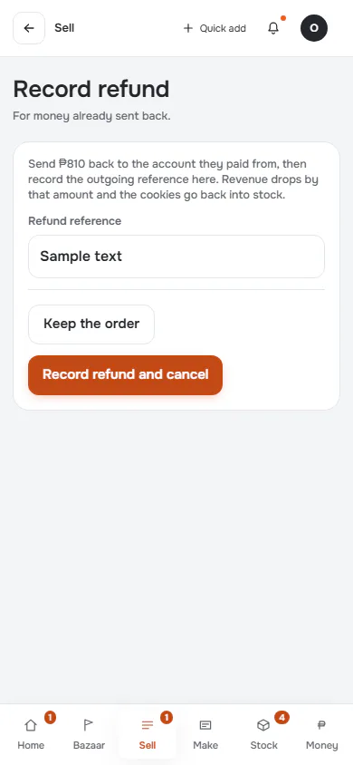

### 6. refund-result

`/order` · heading: Order HC-1103 · says: ₱810 refund recorded. The order is cancelled.

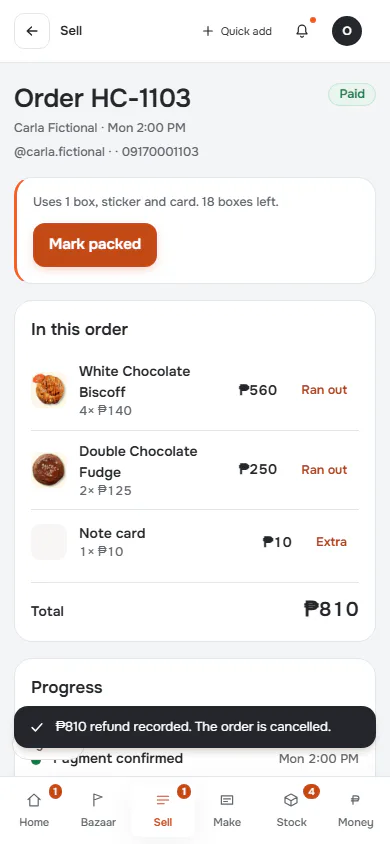

[Full page](../../flows/sell-reject-cancel-noshow-refund/06-refund-result/p390.full.webp)

### 7. back-after-refund

`/orders` · heading: Orders · says: 1 payment needs review
Check the reference and the amount on each one.
Show them

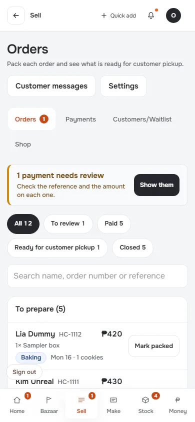

[Full page](../../flows/sell-reject-cancel-noshow-refund/07-back-after-refund/p390.full.webp)

### 8. ready-order

`/order` · heading: Order HC-1105

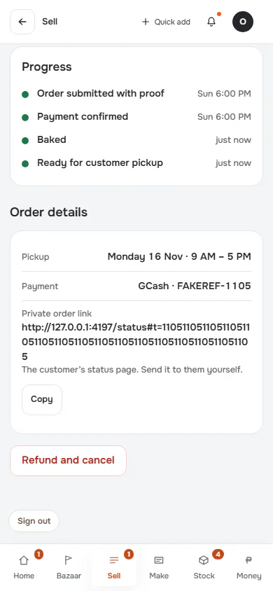

[Full page](../../flows/sell-reject-cancel-noshow-refund/08-ready-order/p390.full.webp)

### 9. no-show-form

`/order` · heading: Mark as no-show

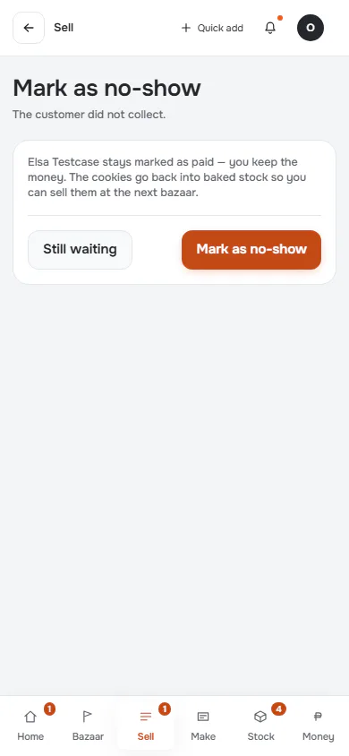

### 10. no-show-result

`/order` · heading: Order HC-1105 · says: Elsa did not pick up. The order stays paid.

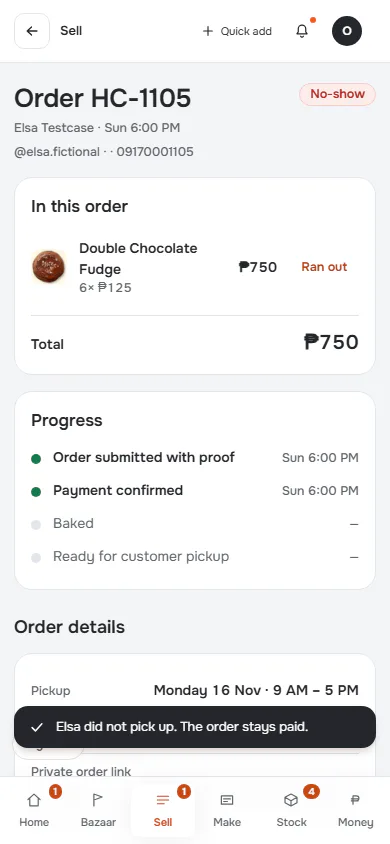

[Full page](../../flows/sell-reject-cancel-noshow-refund/10-no-show-result/p390.full.webp)

## d1440 (1440×900): captured

### 1. rejected: Reject applies on the first press

`/order` · heading: Order HC-1101 · says: Payment rejected. The order is cancelled and its slots are free again.

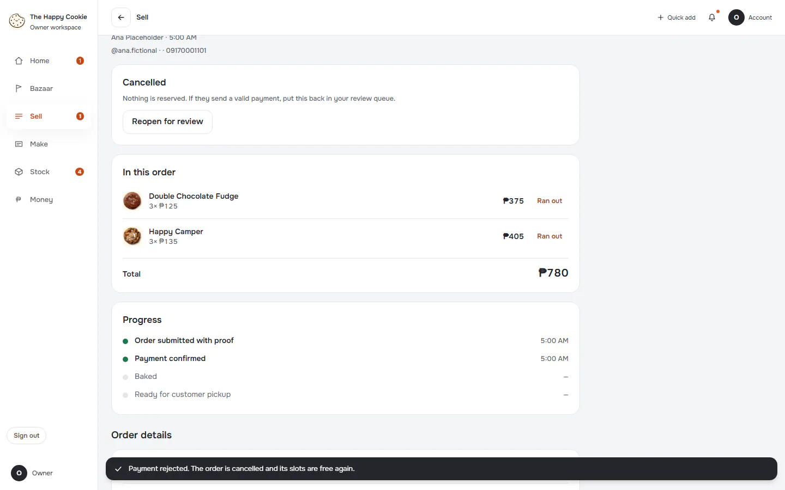

[Full page](../../flows/sell-reject-cancel-noshow-refund/01-rejected/d1440.full.webp)

### 2. back-to-list: Return to context

`/orders` · heading: Orders · says: 1 payment needs review
Check the reference and the amount on each one.
Show them

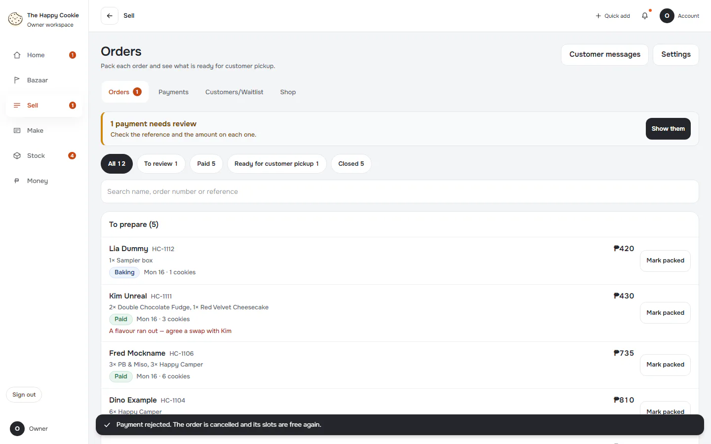

[Full page](../../flows/sell-reject-cancel-noshow-refund/02-back-to-list/d1440.full.webp)

### 3. paid-order

`/order` · heading: Order HC-1103

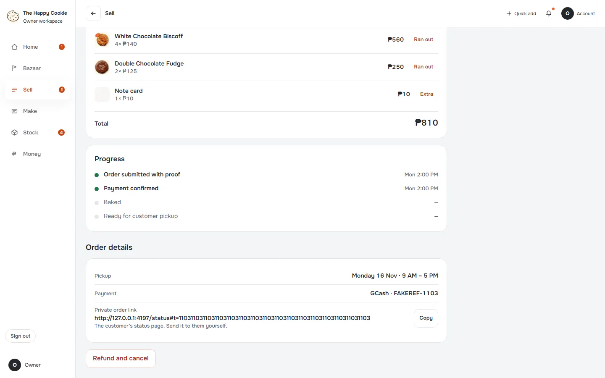

[Full page](../../flows/sell-reject-cancel-noshow-refund/03-paid-order/d1440.full.webp)

### 4. refund-form

`/order` · heading: Record refund

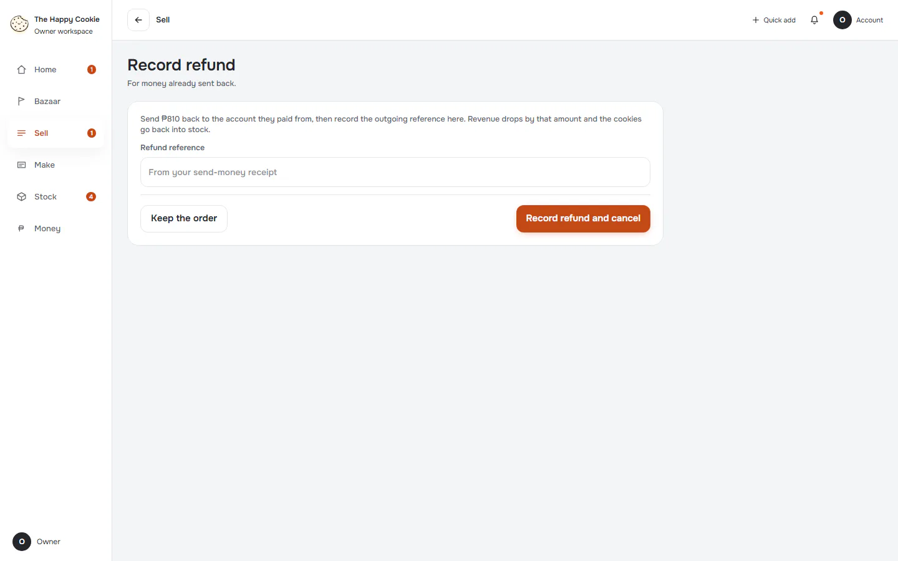

### 5. refund-filled

`/order` · heading: Record refund

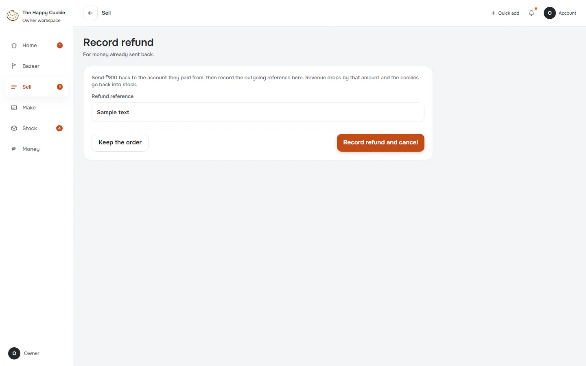

### 6. refund-result

`/order` · heading: Order HC-1103 · says: ₱810 refund recorded. The order is cancelled.

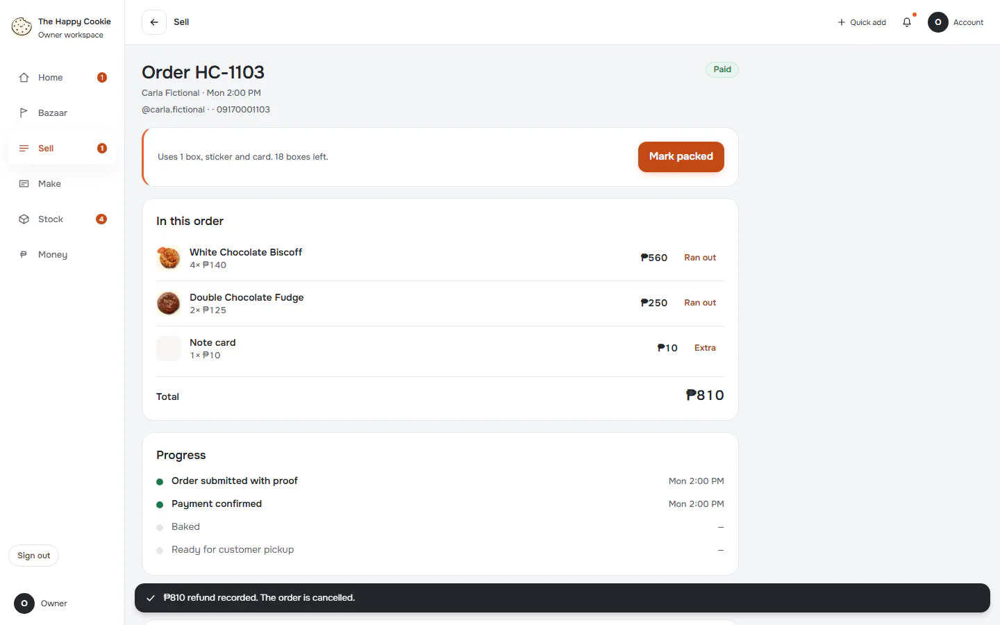

[Full page](../../flows/sell-reject-cancel-noshow-refund/06-refund-result/d1440.full.webp)

### 7. back-after-refund

`/orders` · heading: Orders · says: 1 payment needs review
Check the reference and the amount on each one.
Show them

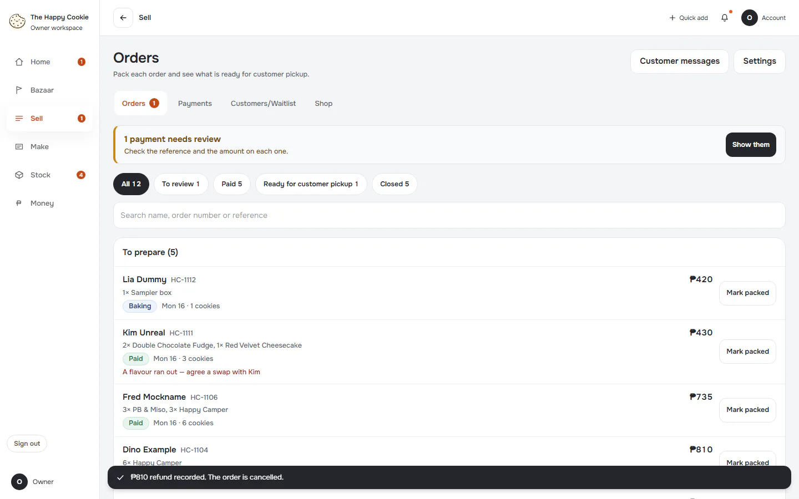

[Full page](../../flows/sell-reject-cancel-noshow-refund/07-back-after-refund/d1440.full.webp)

### 8. ready-order

`/order` · heading: Order HC-1105

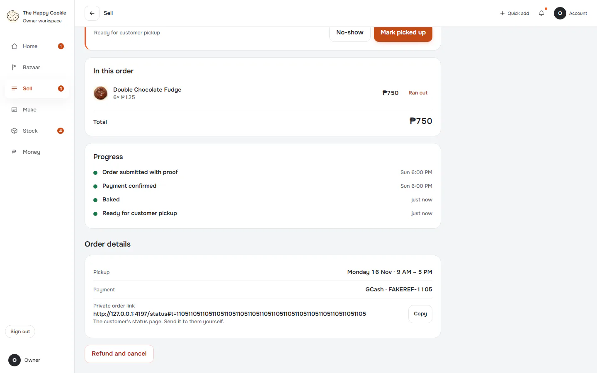

[Full page](../../flows/sell-reject-cancel-noshow-refund/08-ready-order/d1440.full.webp)

### 9. no-show-form

`/order` · heading: Mark as no-show

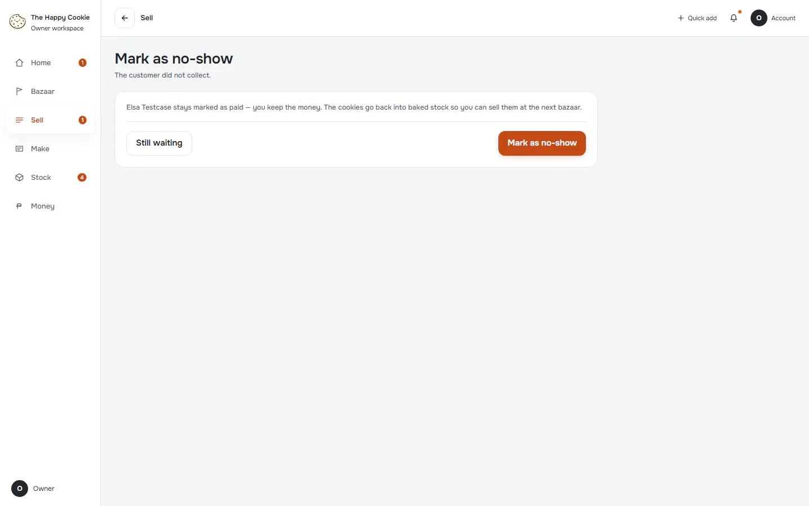

### 10. no-show-result

`/order` · heading: Order HC-1105 · says: Elsa did not pick up. The order stays paid.

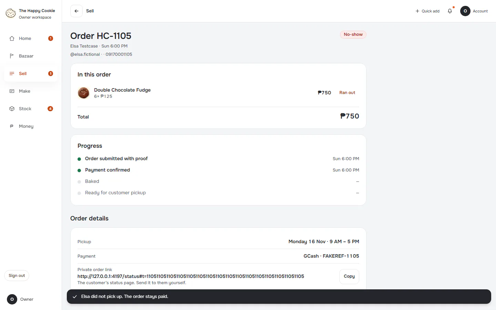
