# Flow: Stock: item, add to inventory, count, waste, movement history

**ACTUAL application.** Started at `/inventory`, fixture `default`, simulated server. See [the README](../../README.md).

## p390 (390×844): captured

Controls the flow looked for and did not find here: 1. Listed in manifest.json.

### 1. inventory

`/inventory` · heading: Inventory

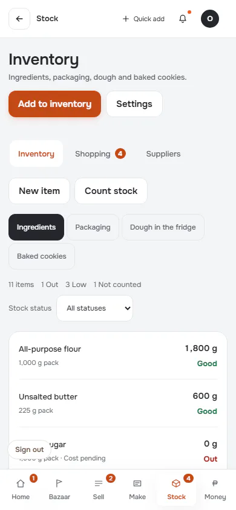

[Full page](../../flows/stock-item-count-waste/01-inventory/p390.full.webp)

### 2. item

`/inventory` · heading: All-purpose flour

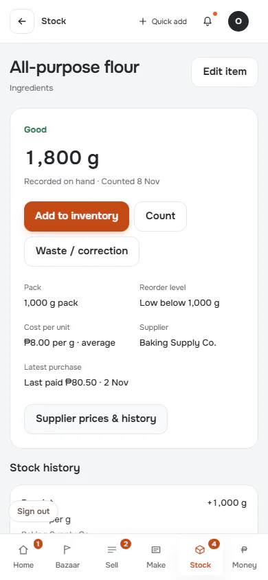

[Full page](../../flows/stock-item-count-waste/02-item/p390.full.webp)

### 3. receive

`/inventory` · heading: Add to inventory

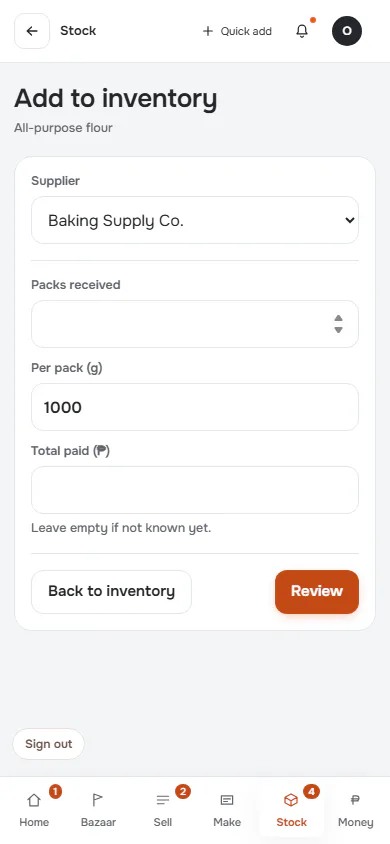

### 4. receive-review

`/inventory` · heading: Review

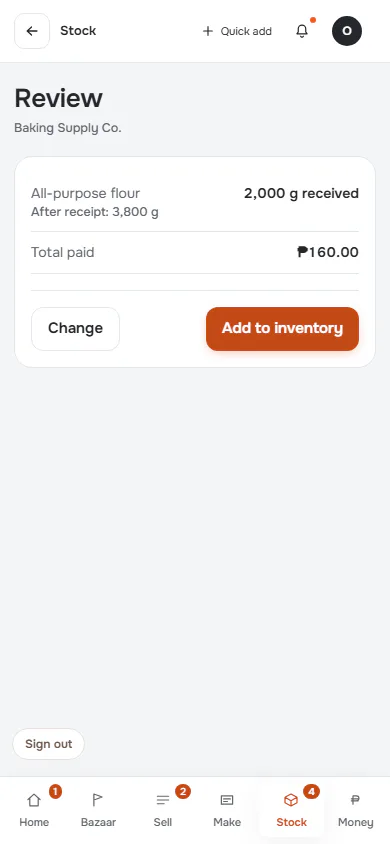

### 5. received: Saved, with the return to context

`/inventory` · heading: All-purpose flour · says: Delivery recorded.

[Full page](../../flows/stock-item-count-waste/05-received/p390.full.webp)

### 6. count

`/inventory` · heading: Count inventory

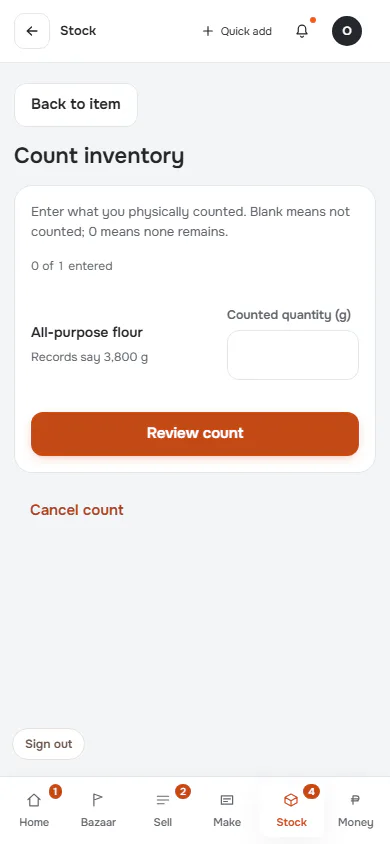

### 7. count-review

`/inventory` · heading: Review count

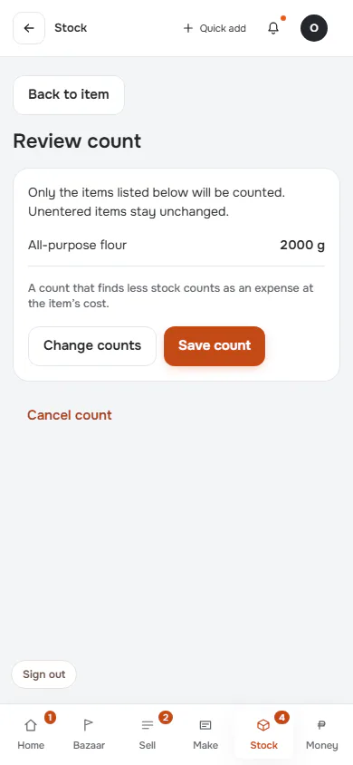

### 8. counted

`/inventory` · heading: All-purpose flour · says: 1 item corrected. ₱14,400 less stock than your records said.

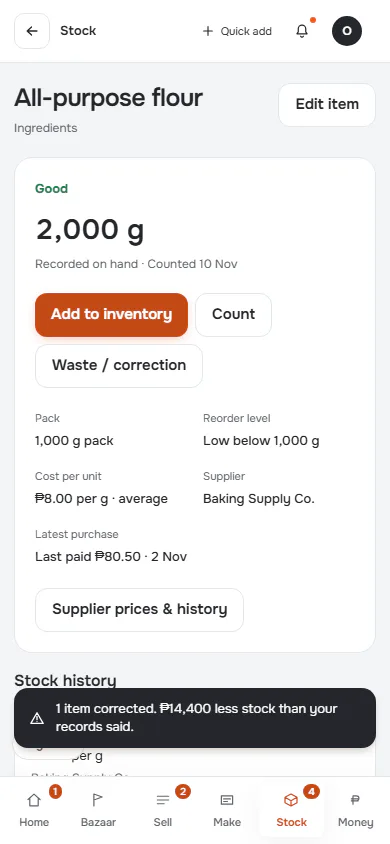

[Full page](../../flows/stock-item-count-waste/08-counted/p390.full.webp)

### 9. waste

`/inventory` · heading: Waste / correction

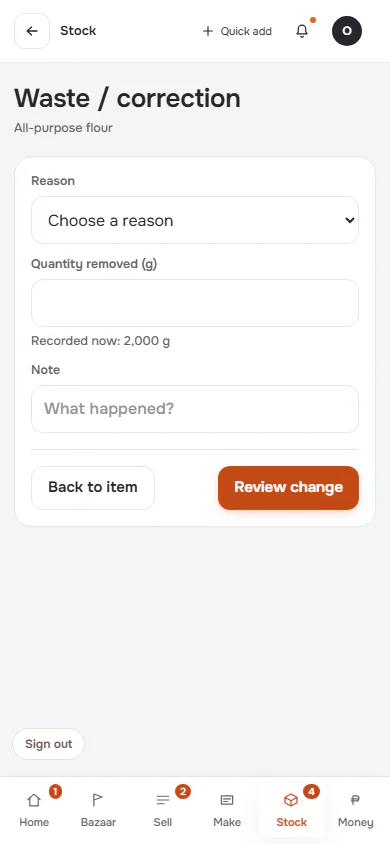

### 10. waste-review

`/inventory` · heading: Review stock change

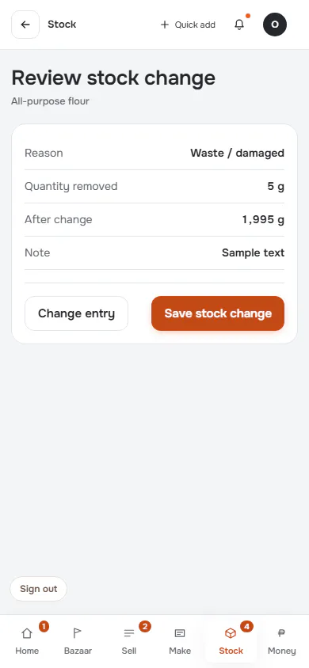

### 11. waste-saved

`/inventory` · heading: All-purpose flour · says: 5 of all-purpose flour written off. About ₱40 of stock gone. It is a cost in the books the day it was wasted.

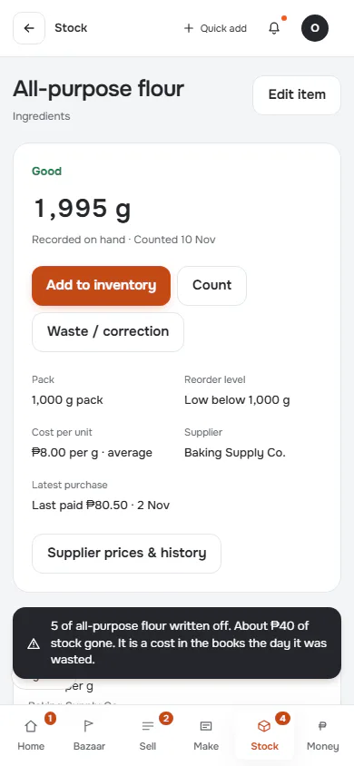

[Full page](../../flows/stock-item-count-waste/11-waste-saved/p390.full.webp)

## d1440 (1440×900): captured

Controls the flow looked for and did not find here: 1. Listed in manifest.json.

### 1. inventory

`/inventory` · heading: Inventory

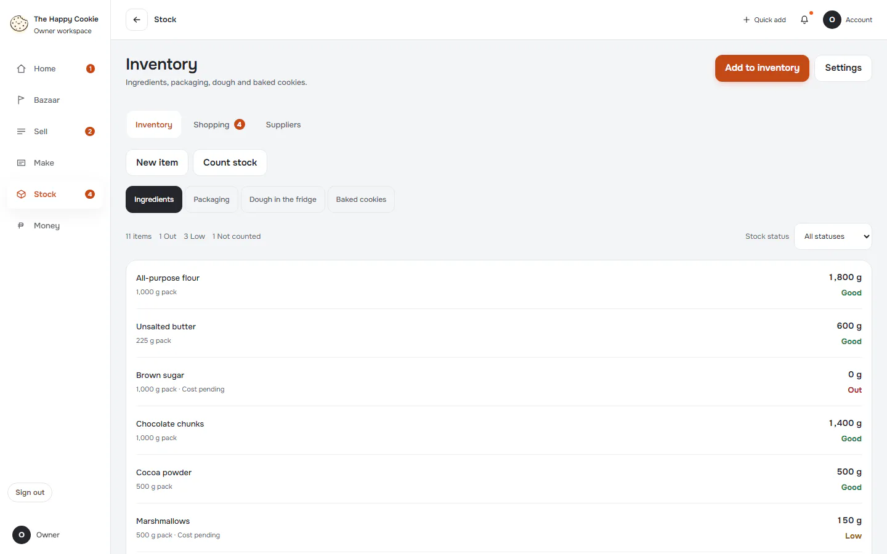

[Full page](../../flows/stock-item-count-waste/01-inventory/d1440.full.webp)

### 2. item

`/inventory` · heading: All-purpose flour

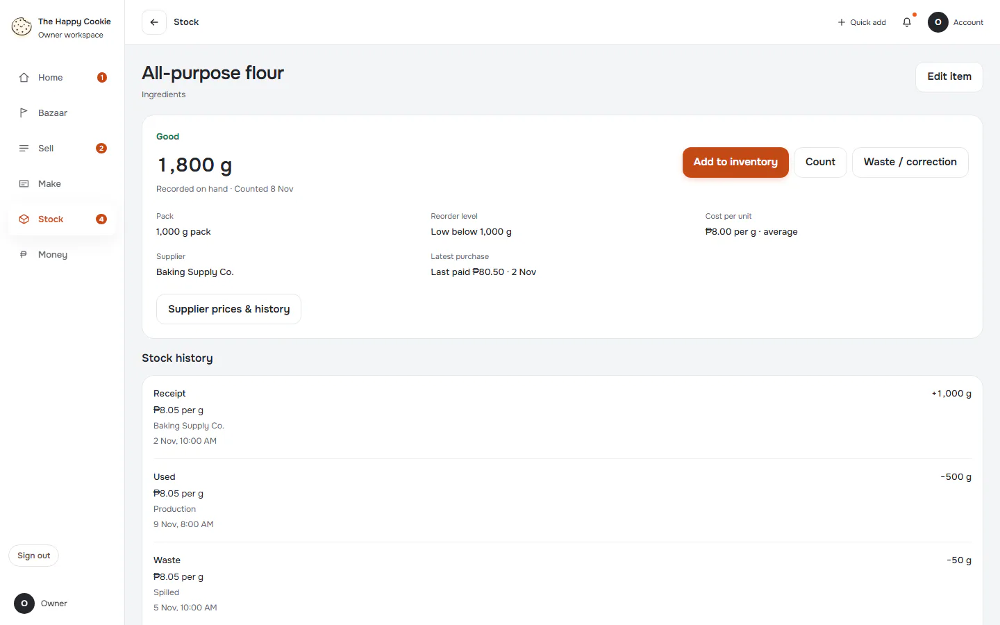

[Full page](../../flows/stock-item-count-waste/02-item/d1440.full.webp)

### 3. receive

`/inventory` · heading: Add to inventory

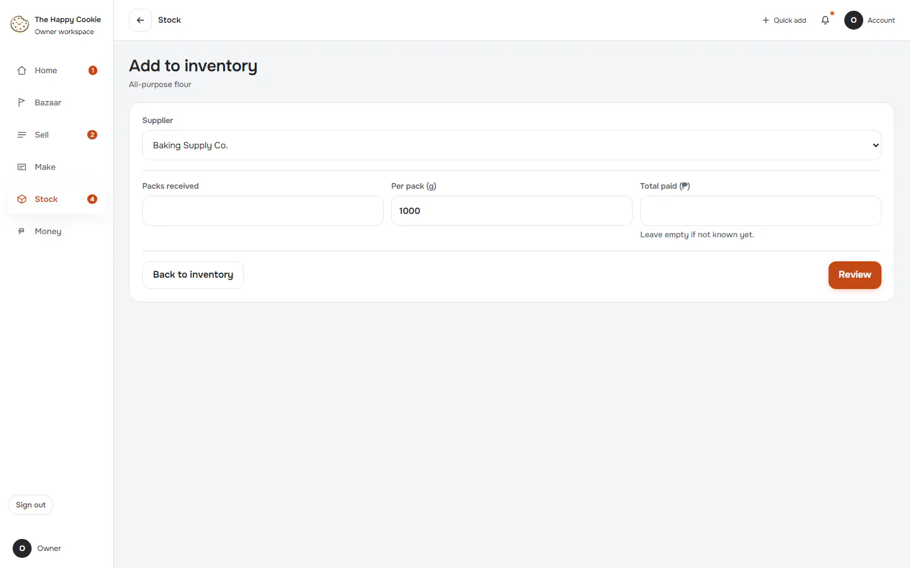

### 4. receive-review

`/inventory` · heading: Review

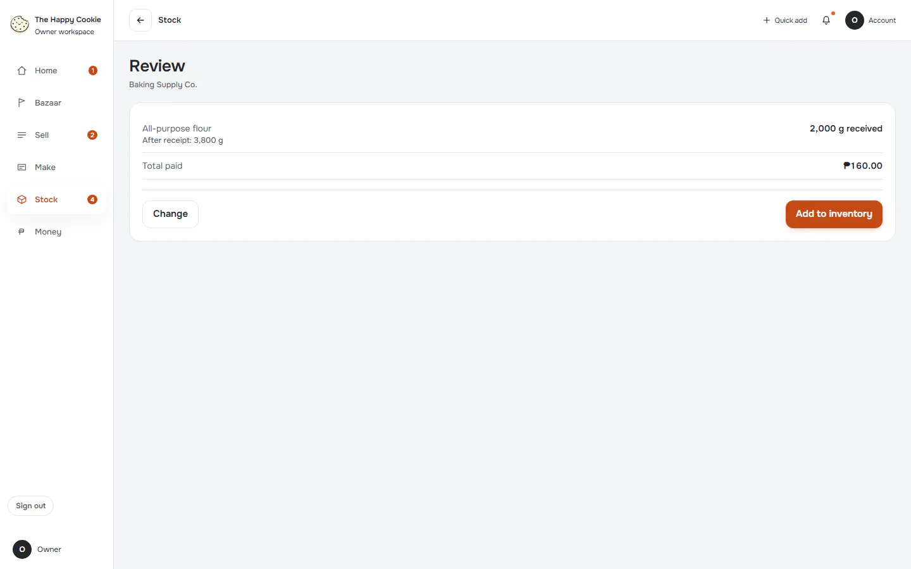

### 5. received: Saved, with the return to context

`/inventory` · heading: All-purpose flour · says: Delivery recorded.

[Full page](../../flows/stock-item-count-waste/05-received/d1440.full.webp)

### 6. count

`/inventory` · heading: Count inventory

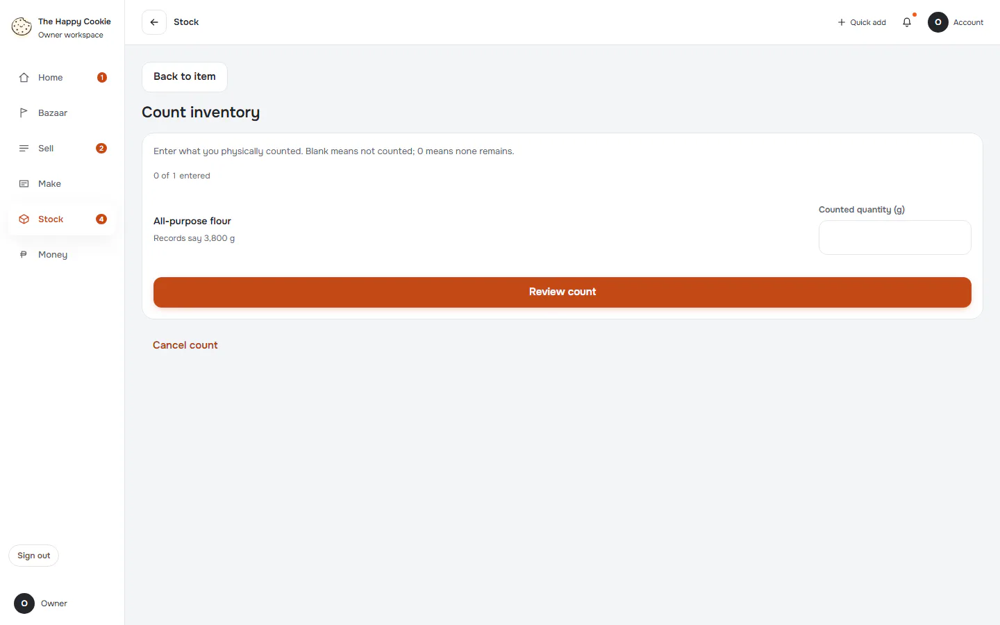

### 7. count-review

`/inventory` · heading: Review count

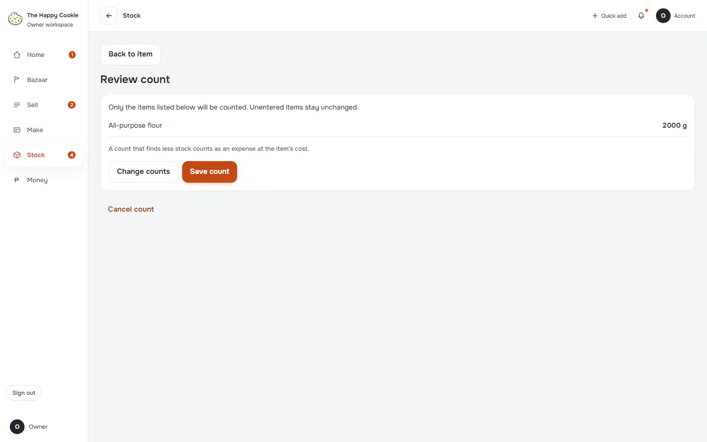

### 8. counted

`/inventory` · heading: All-purpose flour · says: 1 item corrected. ₱14,400 less stock than your records said.

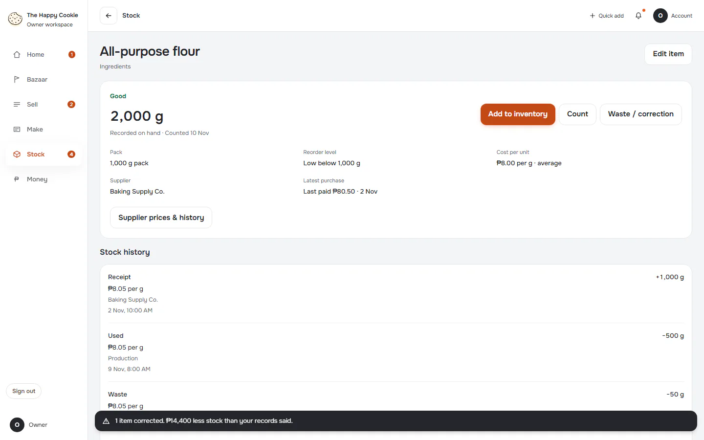

[Full page](../../flows/stock-item-count-waste/08-counted/d1440.full.webp)

### 9. waste

`/inventory` · heading: Waste / correction · says: 1 item corrected. ₱14,400 less stock than your records said.

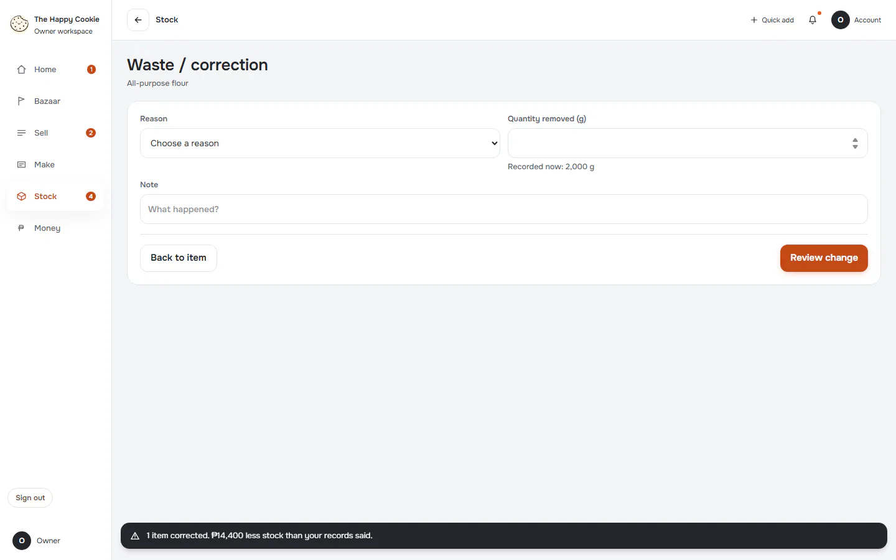

### 10. waste-review

`/inventory` · heading: Review stock change

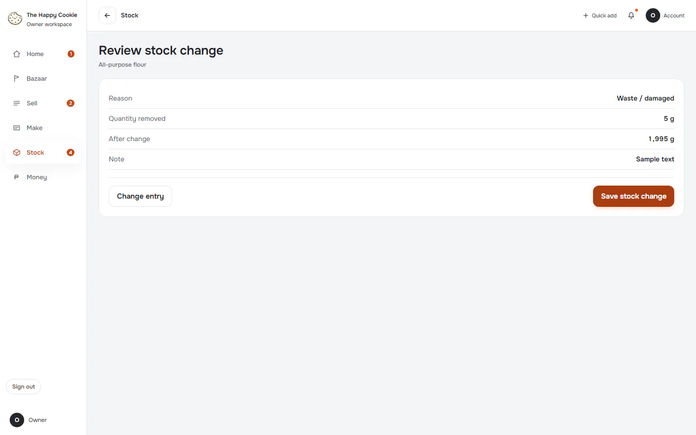

### 11. waste-saved

`/inventory` · heading: All-purpose flour · says: 5 of all-purpose flour written off. About ₱40 of stock gone. It is a cost in the books the day it was wasted.

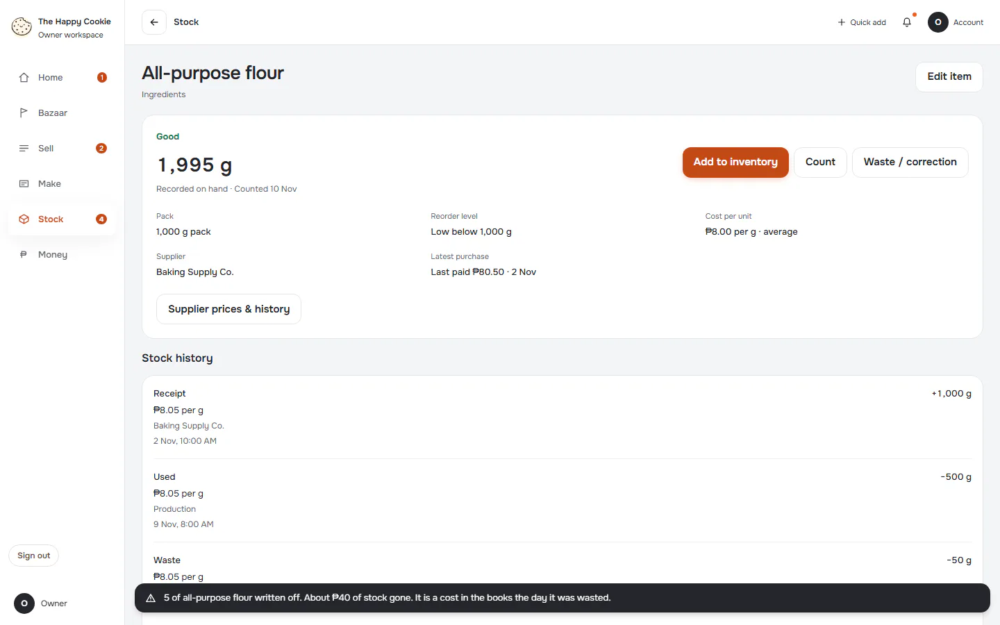

[Full page](../../flows/stock-item-count-waste/11-waste-saved/d1440.full.webp)
