# Flow: Stock: supplier, prices, shopping list, plan a bake, back to production

**ACTUAL application.** Started at `/grocery`, fixture `default`, simulated server. See [the README](../../README.md).

## p390 (390×844): captured

### 1. shopping

`/grocery` · heading: Shopping

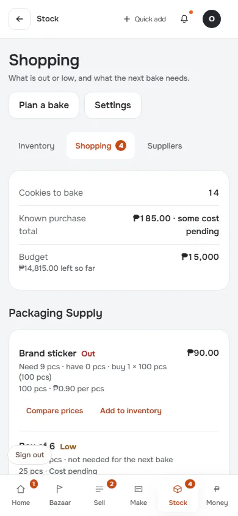

[Full page](../../flows/stock-suppliers-shopping/01-shopping/p390.full.webp)

### 2. plan-bake

`/grocery` · heading: Planned bake

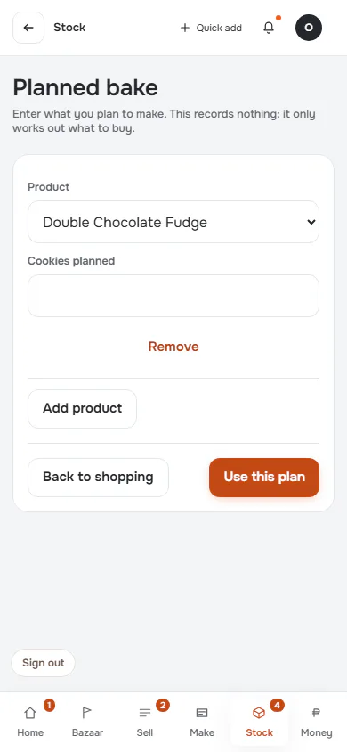

### 3. plan-filled

`/grocery` · heading: Planned bake

### 4. shopping-with-plan: Shopping list includes the plan

`/grocery` · heading: Shopping

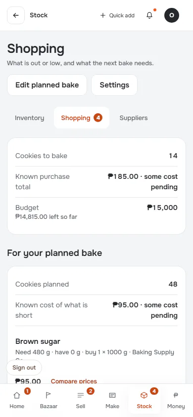

[Full page](../../flows/stock-suppliers-shopping/04-shopping-with-plan/p390.full.webp)

### 5. compare-prices

`/inventory` · heading: Brown sugar

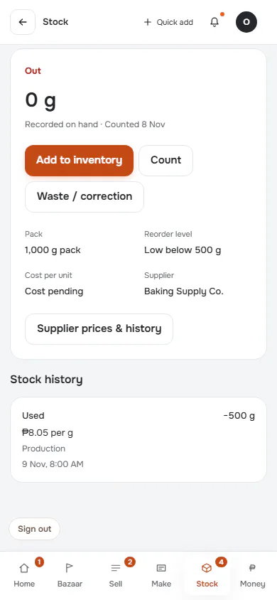

[Full page](../../flows/stock-suppliers-shopping/05-compare-prices/p390.full.webp)

### 6. back-to-shopping: Return to context

`/inventory` · heading: Inventory

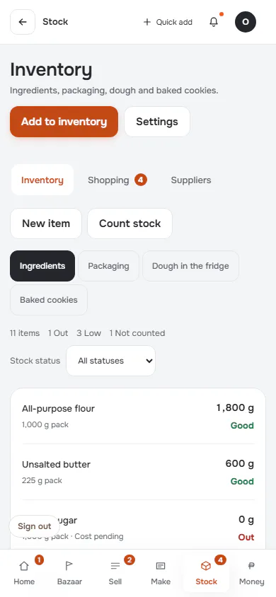

[Full page](../../flows/stock-suppliers-shopping/06-back-to-shopping/p390.full.webp)

### 7. suppliers

`/suppliers` · heading: Suppliers

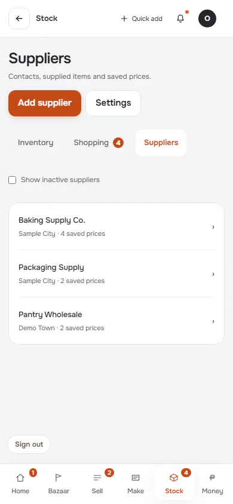

### 8. add-supplier

`/suppliers` · heading: Suppliers & prices

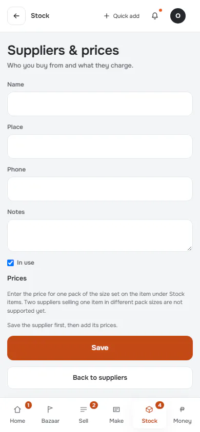

[Full page](../../flows/stock-suppliers-shopping/08-add-supplier/p390.full.webp)

### 9. supplier-saved

`/suppliers` · heading: Suppliers · says: Saved.

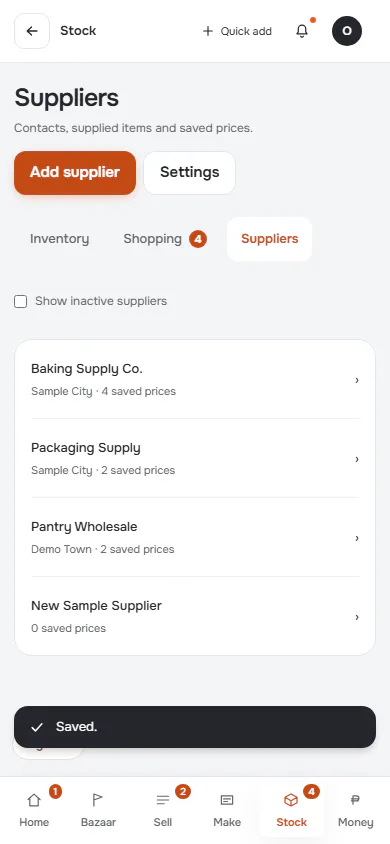

### 10. back-to-production

`/bake` · heading: Production

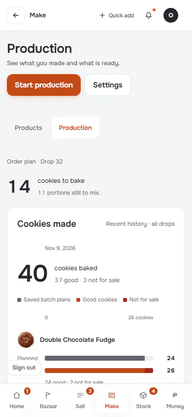

[Full page](../../flows/stock-suppliers-shopping/10-back-to-production/p390.full.webp)

## d1440 (1440×900): captured

### 1. shopping

`/grocery` · heading: Shopping

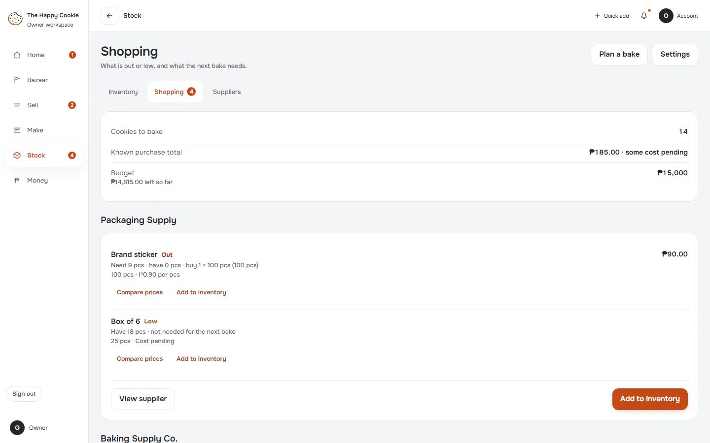

[Full page](../../flows/stock-suppliers-shopping/01-shopping/d1440.full.webp)

### 2. plan-bake

`/grocery` · heading: Planned bake

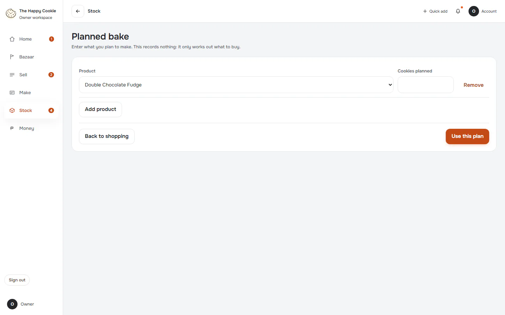

### 3. plan-filled

`/grocery` · heading: Planned bake

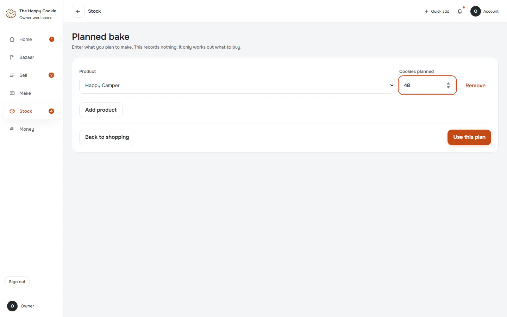

### 4. shopping-with-plan: Shopping list includes the plan

`/grocery` · heading: Shopping

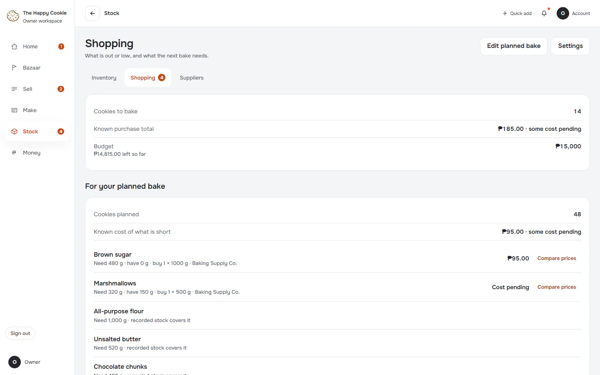

[Full page](../../flows/stock-suppliers-shopping/04-shopping-with-plan/d1440.full.webp)

### 5. compare-prices

`/inventory` · heading: Brown sugar

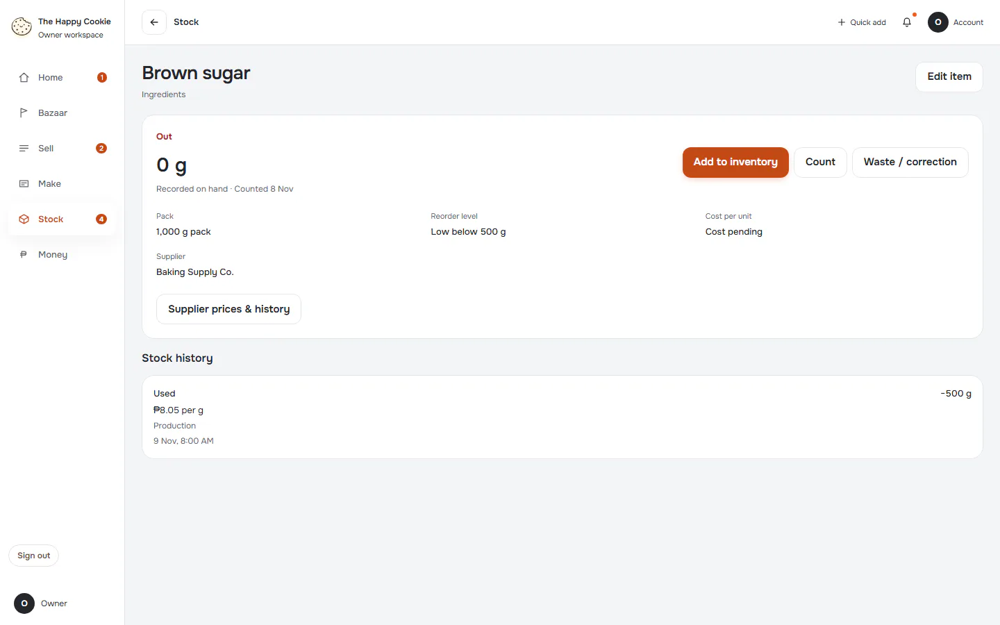

### 6. back-to-shopping: Return to context

`/inventory` · heading: Inventory

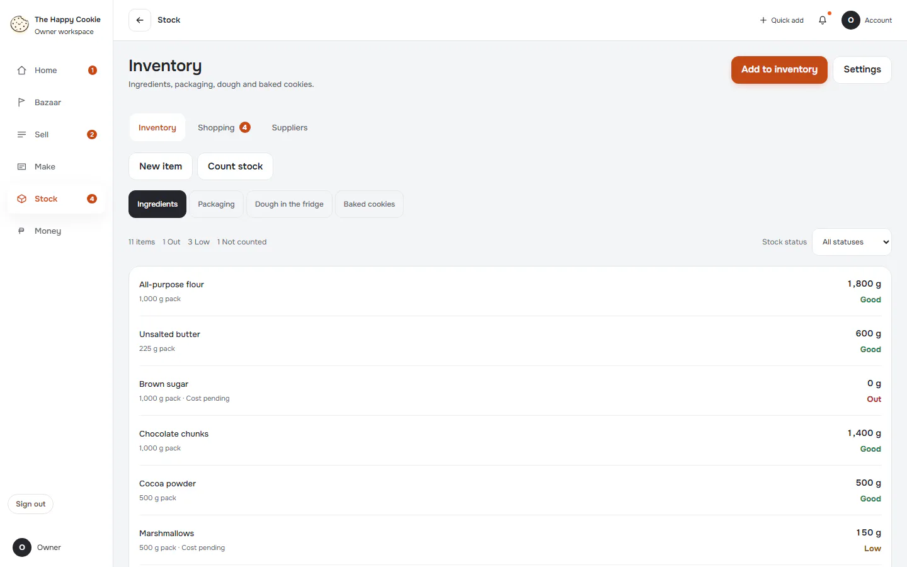

[Full page](../../flows/stock-suppliers-shopping/06-back-to-shopping/d1440.full.webp)

### 7. suppliers

`/suppliers` · heading: Suppliers

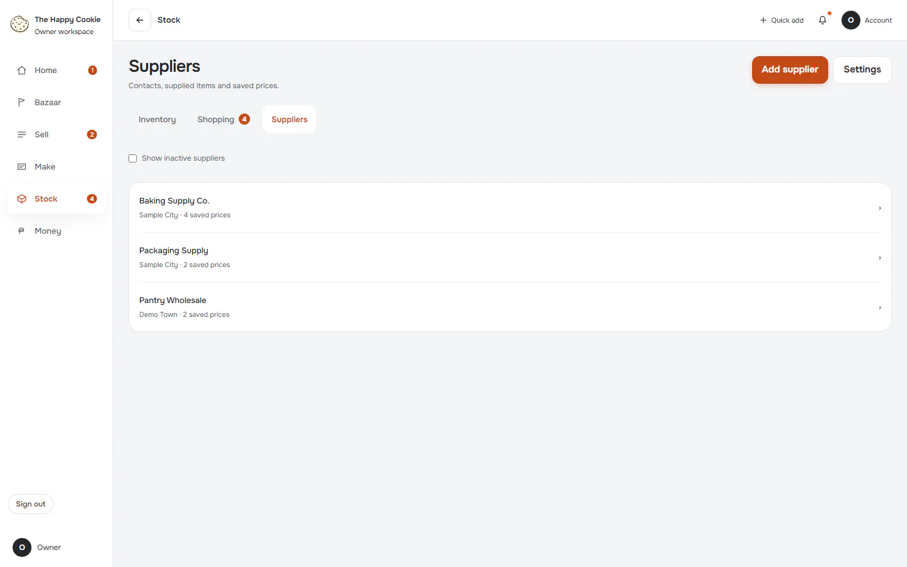

### 8. add-supplier

`/suppliers` · heading: Suppliers & prices

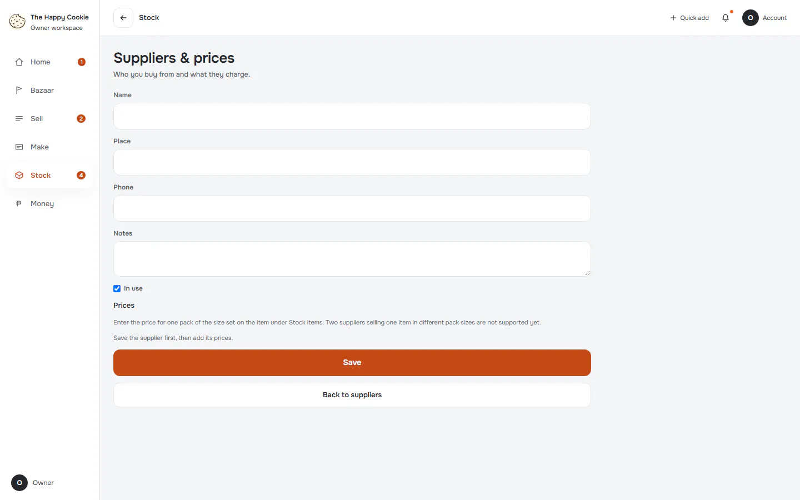

### 9. supplier-saved

`/suppliers` · heading: Suppliers · says: Saved.

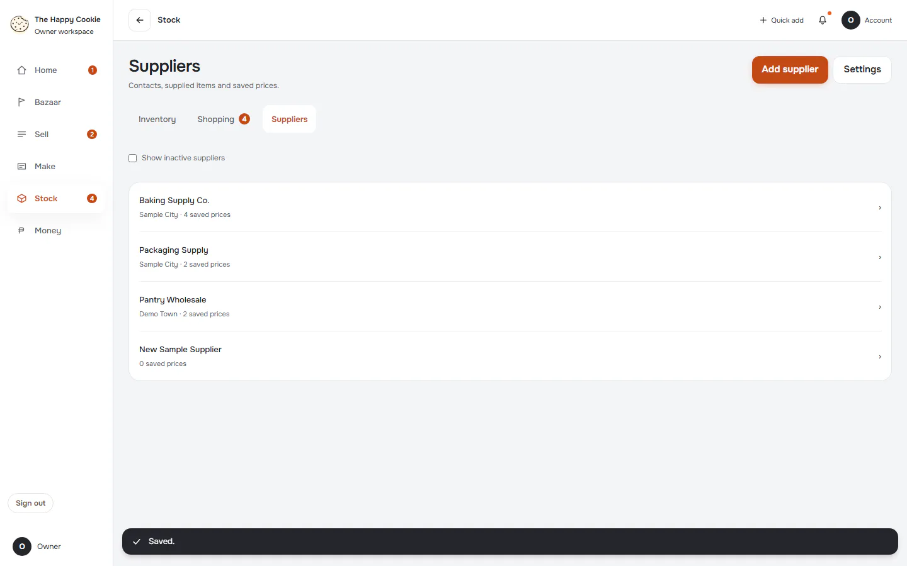

### 10. back-to-production

`/bake` · heading: Production

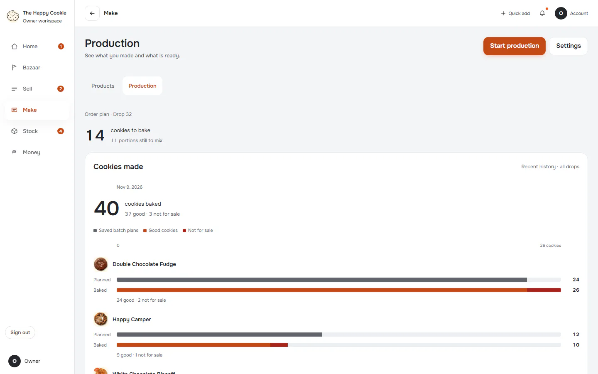

[Full page](../../flows/stock-suppliers-shopping/10-back-to-production/d1440.full.webp)
