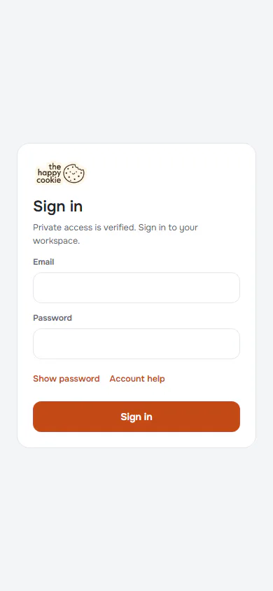
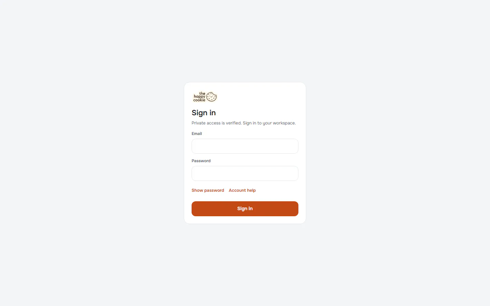
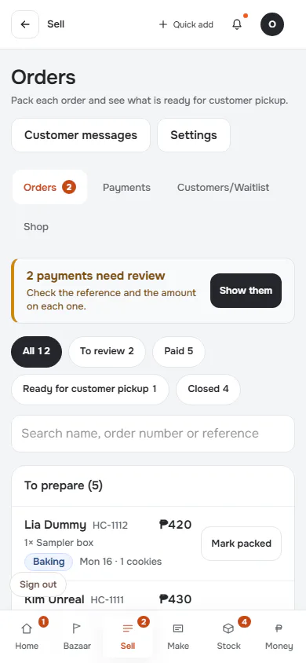
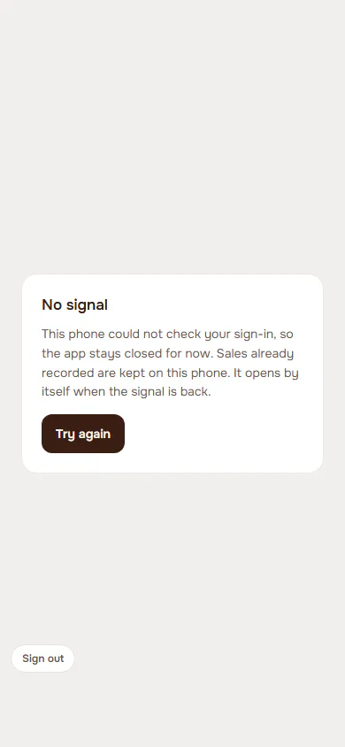
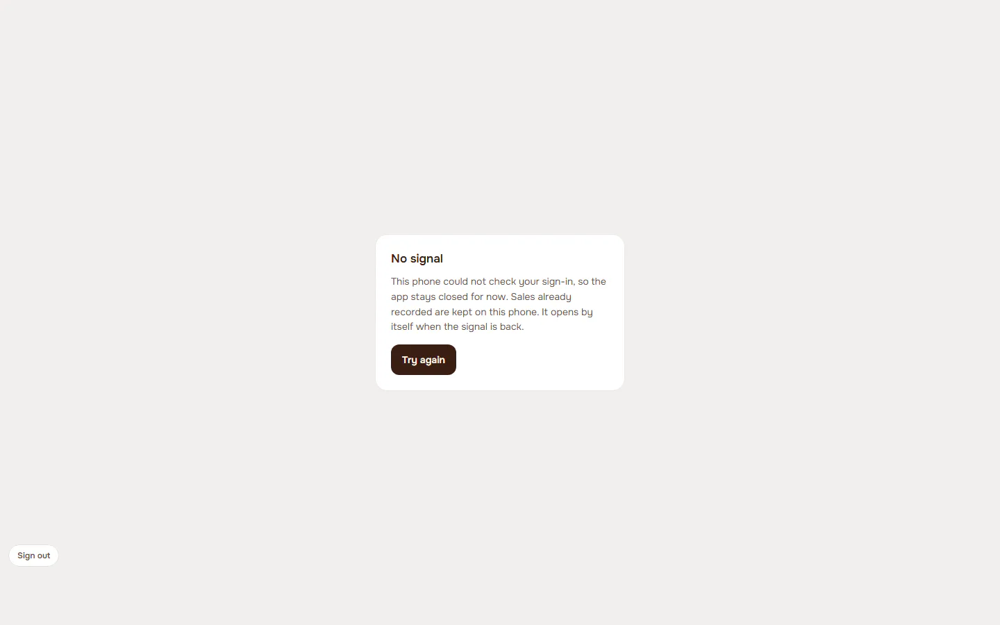
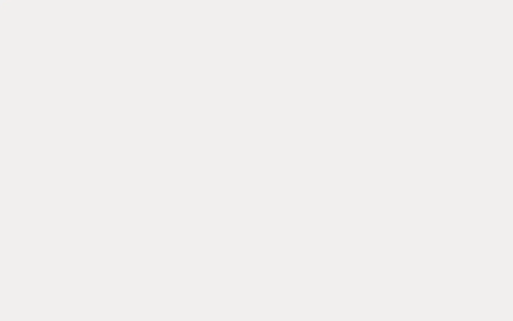
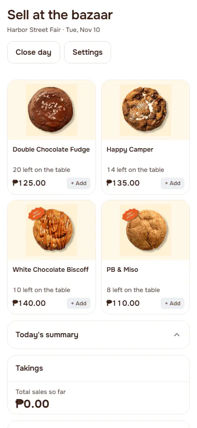
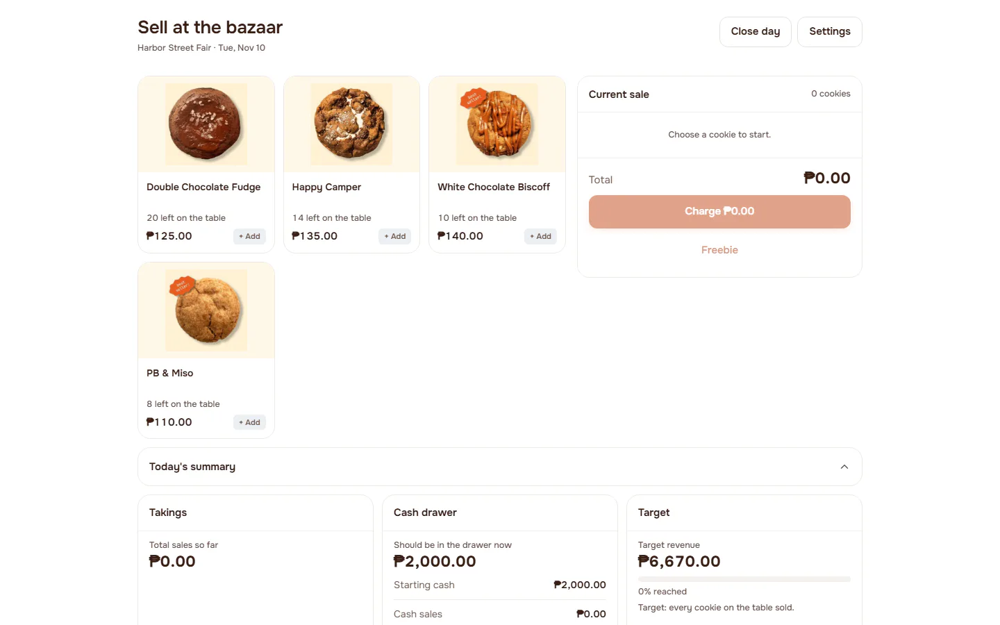

# Session and access gate

**ACTUAL application.** [Back to account](README.md)

- Manifest id: `account/access-gate`
- Source: `src/components/app/live-gate.tsx`
- Role: owner
- Reference views: none (found in code)

## session-expired-redirect

getUser returns no user: the real gate redirects to sign-in, so this is the same image as Sign in, untouched. Group: failure. Fixture: `fail:auth=expired`. How it was reached: rpc-fixture.

**p390** 390×844 (pixel-identical to `account/sign-in/untouched@p390`)

**d1440** 1440×900 (pixel-identical to `account/sign-in/untouched@d1440`)

## idle-time-spent

Clock moved five and a half hours forward with no activity. The page did not change. Group: failure. Fixture: `default`. How it was reached: ui-driven.

**p390** 390×844 (pixel-identical to `sell/orders/populated@p390`) · [full page](../../screenshots/sell/orders/populated/p390.full.webp)

**d1440** 1440×900 (pixel-identical to `sell/orders/populated@d1440`) · [full page](../../screenshots/sell/orders/populated/d1440.full.webp)

## inactive-profile

Lands on the sign-in page: the same image as Sign in, untouched. Group: failure. Fixture: `fail:profile=inactive`. How it was reached: rpc-fixture.

**p390** 390×844 (pixel-identical to `account/sign-in/untouched@p390`)

**d1440** 1440×900 (pixel-identical to `account/sign-in/untouched@d1440`)

## no-signal-first-open

First check cannot complete: notice instead of sign-out. Group: failure. Fixture: `fail:auth=network`. How it was reached: rpc-fixture.

**p390** 390×844

**d1440** 1440×900

## identity-check-pending

Before the first check answers the app draws nothing behind the gate. Group: failure. Fixture: `fail:auth=never`. How it was reached: rpc-fixture.

**p390** 390×844 (pixel-identical to `make/products/malformed-answer@p390`)

**d1440** 1440×900 (pixel-identical to `make/products/malformed-answer@d1440`)

## profile-read-failed

Group: failure. Fixture: `fail:profile=down`. How it was reached: rpc-fixture.

**p390** 390×844 (pixel-identical to `account/access-gate/no-signal-first-open@p390`)

**d1440** 1440×900 (pixel-identical to `account/access-gate/no-signal-first-open@d1440`)

## bazaar-only-offline-open

A day is held; reload with no signal opens Bazaar Mode alone. Group: failure. Fixture: `bazaar:planned`. How it was reached: ui-driven.

**p390** 390×844

**d1440** 1440×900

## other-screen-refused-offline

Group: failure. Fixture: `bazaar:planned`. How it was reached: ui-driven.

**p390** 390×844

**d1440** 1440×900 (pixel-identical to `account/access-gate/bazaar-only-offline-open@d1440`)

