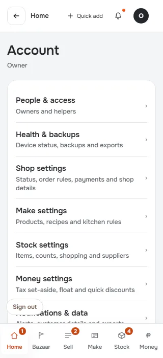
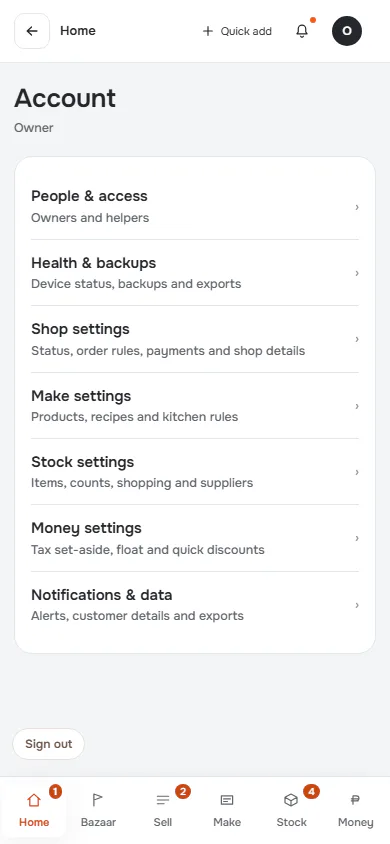
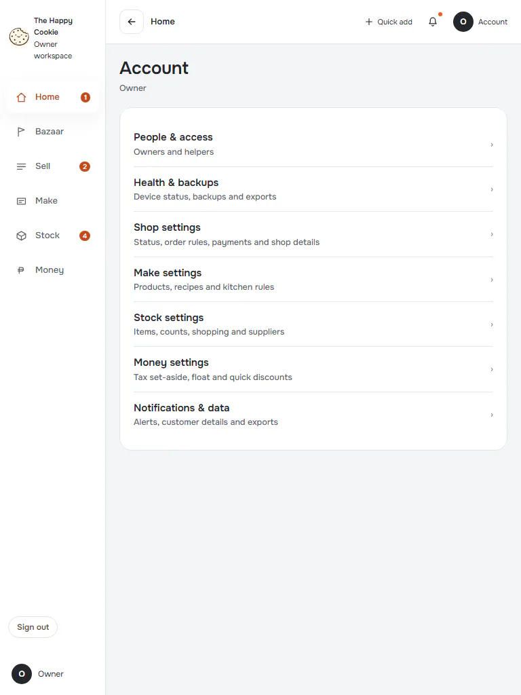
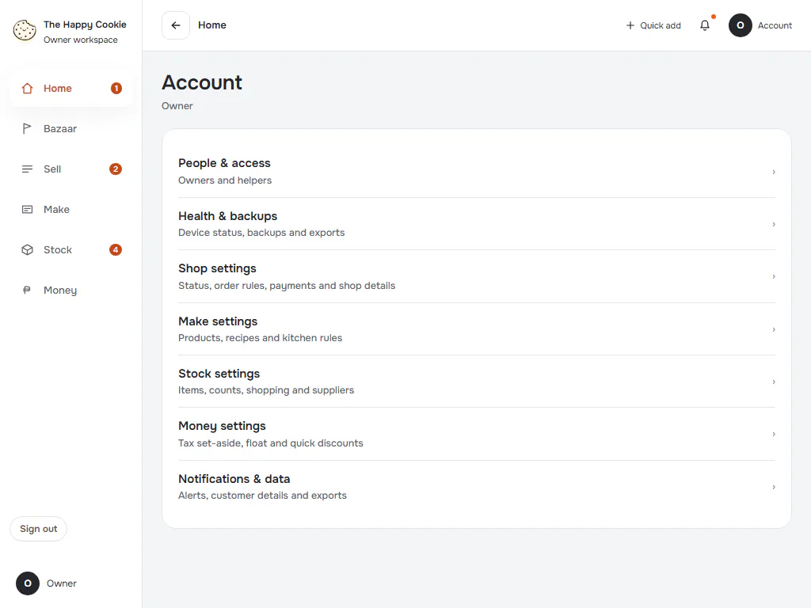
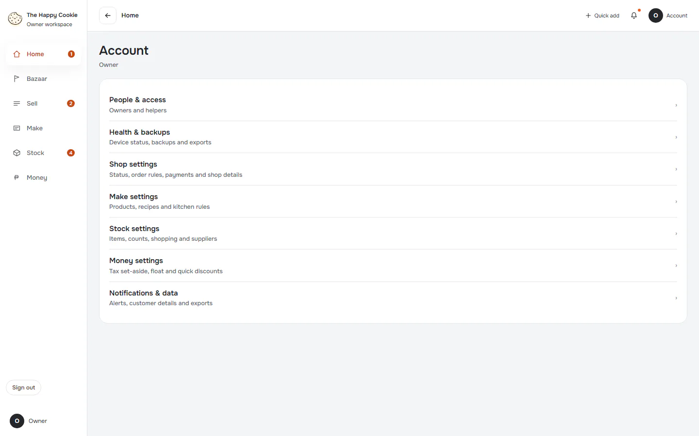
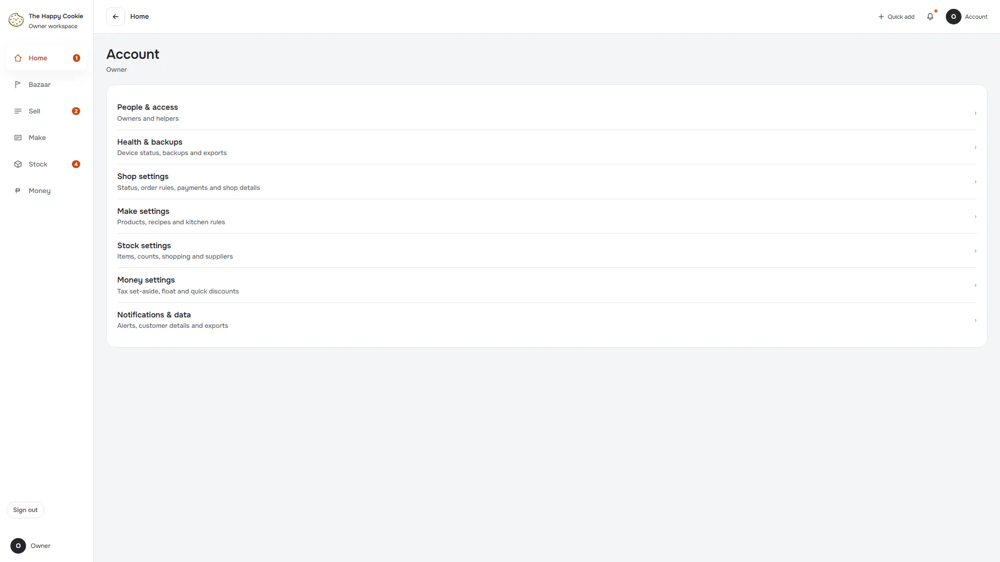
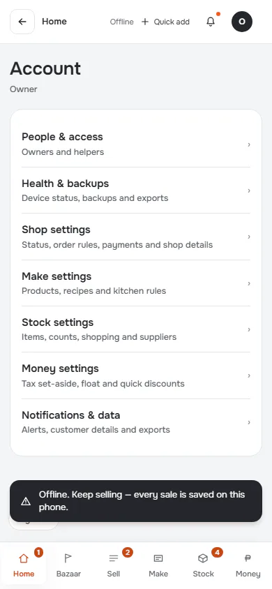
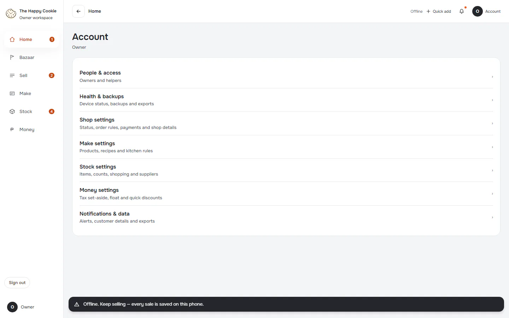
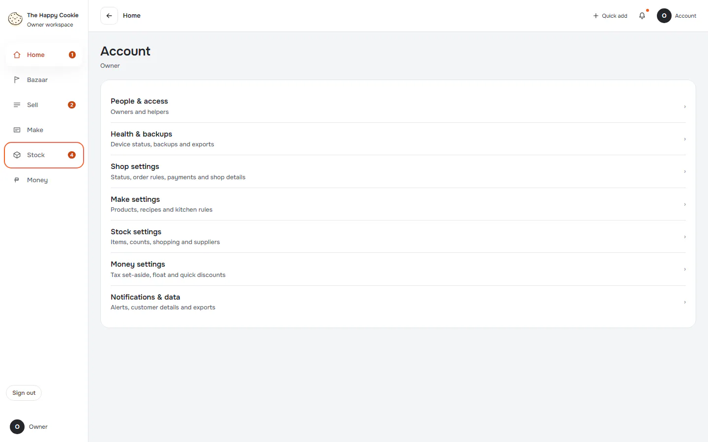

# Account

**ACTUAL application.** [Back to account](README.md)

- Manifest id: `account/account`
- Source: `src/components/live/account/account-live.tsx`
- Role: owner
- Reference views: account

## populated

Group: data. Fixture: `default`. How it was reached: ui-driven.

**p320** 320×700 · [full page](../../screenshots/account/account/populated/p320.full.webp)

**p390** 390×844

**t768** 768×1024

**l1024** 1024×768

**d1440** 1440×900

**w1920** 1920×1080

## loading

Reads never answer, so the loading treatment stays on screen. Group: failure. Fixture: `fail:get_settings=never`. How it was reached: rpc-fixture.

**p390** 390×844 (pixel-identical to `account/account/populated@p390`)

**d1440** 1440×900 (pixel-identical to `account/account/populated@d1440`)

## read-failure

Reads answer with a connection error (08006). Group: failure. Fixture: `fail:get_settings=down`. How it was reached: rpc-fixture.

**p390** 390×844 (pixel-identical to `account/account/populated@p390`)

**d1440** 1440×900 (pixel-identical to `account/account/populated@d1440`)

## malformed-answer

Reads answer with a shape the parser refuses. Group: failure. Fixture: `fail:get_settings=malformed`. How it was reached: rpc-fixture.

**p390** 390×844 (pixel-identical to `account/account/populated@p390`)

**d1440** 1440×900 (pixel-identical to `account/account/populated@d1440`)

## offline-after-load

Browser goes offline after a populated load. Group: failure. Fixture: `default`. How it was reached: ui-driven.

**p390** 390×844

**d1440** 1440×900

## focus-keyboard

Five Tab presses from page start: what focus looks like. Group: interaction. Fixture: `default`. How it was reached: ui-driven.

**d1440** 1440×900

