# Health & backups

**ACTUAL application.** [Back to account](README.md)

- Manifest id: `account/health`
- Source: `src/components/live/account/account-live.tsx`
- Role: owner
- Reference views: health, backups, restore-preview
- Note: Status and export only; a browser restore is not offered on purpose (coverage.md).

## populated-restore-failed

Group: data. Fixture: `default`. How it was reached: ui-driven.

**p320** 320×700 · [full page](../../screenshots/account/health/populated-restore-failed/p320.full.webp)

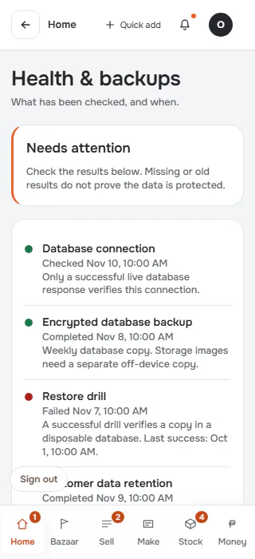

**p390** 390×844 · [full page](../../screenshots/account/health/populated-restore-failed/p390.full.webp)

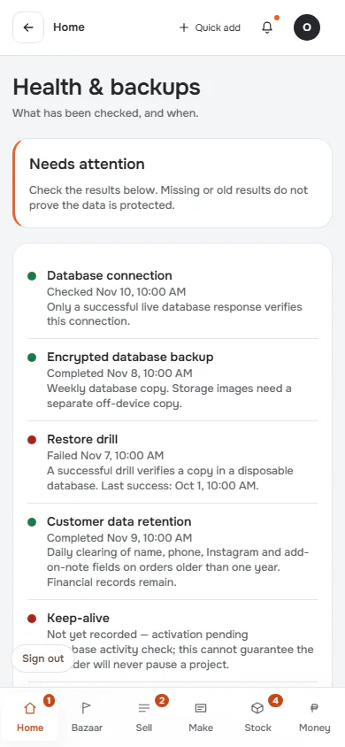

**t768** 768×1024 · [full page](../../screenshots/account/health/populated-restore-failed/t768.full.webp)

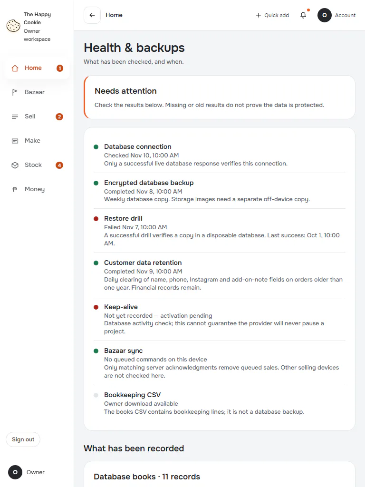

**l1024** 1024×768 · [full page](../../screenshots/account/health/populated-restore-failed/l1024.full.webp)

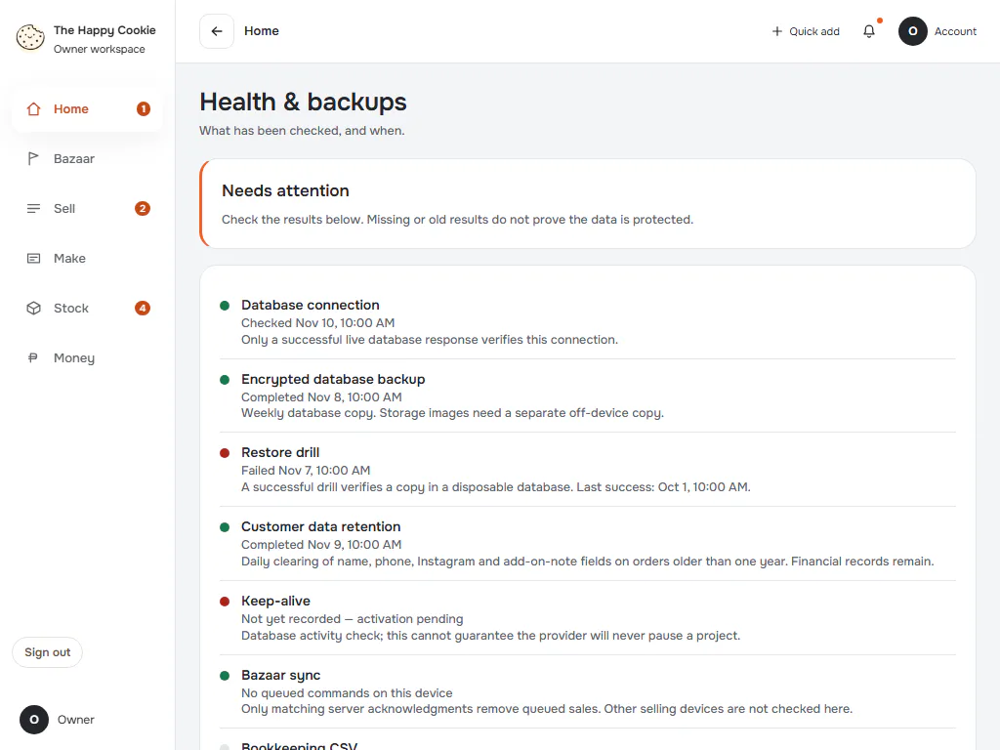

**d1440** 1440×900 · [full page](../../screenshots/account/health/populated-restore-failed/d1440.full.webp)

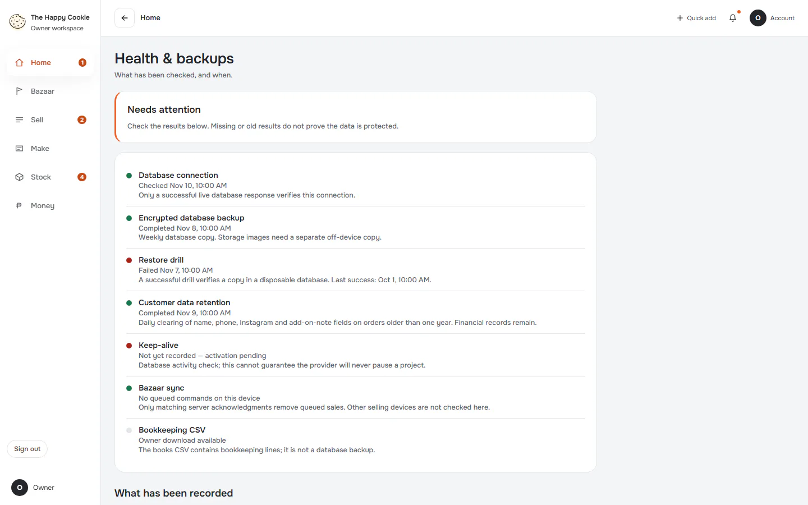

**w1920** 1920×1080 · [full page](../../screenshots/account/health/populated-restore-failed/w1920.full.webp)

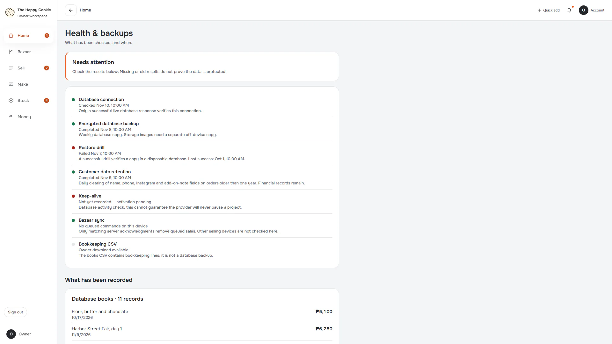

## read-failure

Group: failure. Fixture: `fail:get_operations_health=down`. How it was reached: rpc-fixture.

**p390** 390×844 · [full page](../../screenshots/account/health/read-failure/p390.full.webp)

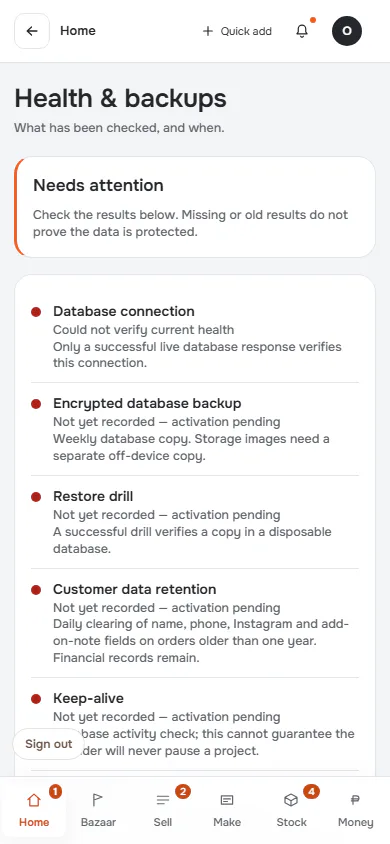

**d1440** 1440×900 · [full page](../../screenshots/account/health/read-failure/d1440.full.webp)

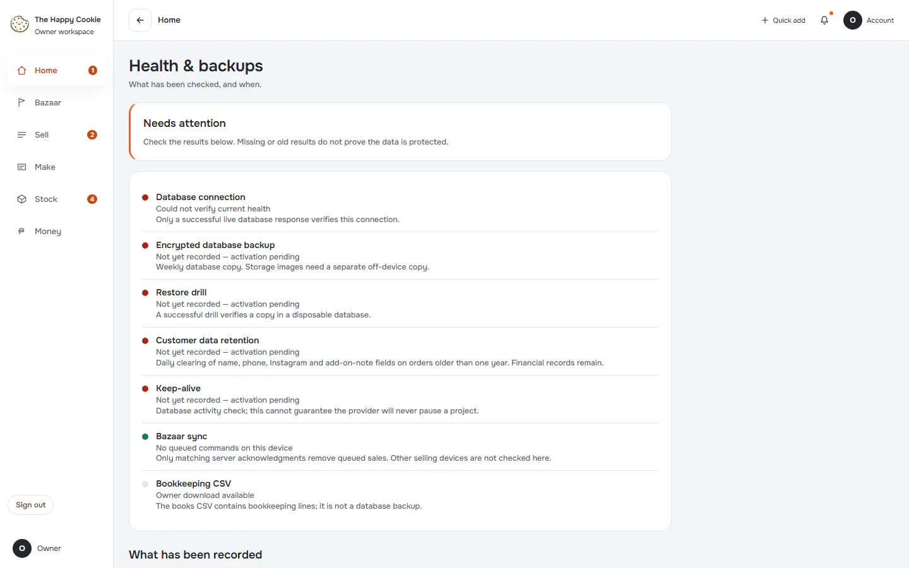

## malformed-answer

Group: failure. Fixture: `fail:get_operations_health=malformed`. How it was reached: rpc-fixture.

**p390** 390×844 (pixel-identical to `account/health/read-failure@p390`) · [full page](../../screenshots/account/health/read-failure/p390.full.webp)

**d1440** 1440×900 (pixel-identical to `account/health/read-failure@d1440`) · [full page](../../screenshots/account/health/read-failure/d1440.full.webp)

## loading

Group: failure. Fixture: `fail:get_operations_health=never`. How it was reached: rpc-fixture.

**p390** 390×844 · [full page](../../screenshots/account/health/loading/p390.full.webp)

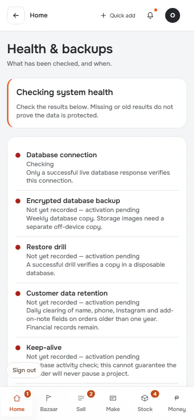

**d1440** 1440×900 · [full page](../../screenshots/account/health/loading/d1440.full.webp)

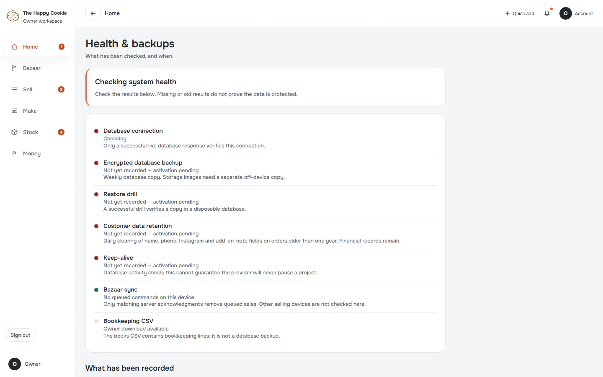

## empty

Group: data. Fixture: `data:empty`. How it was reached: rpc-fixture.

**p390** 390×844 · [full page](../../screenshots/account/health/empty/p390.full.webp)

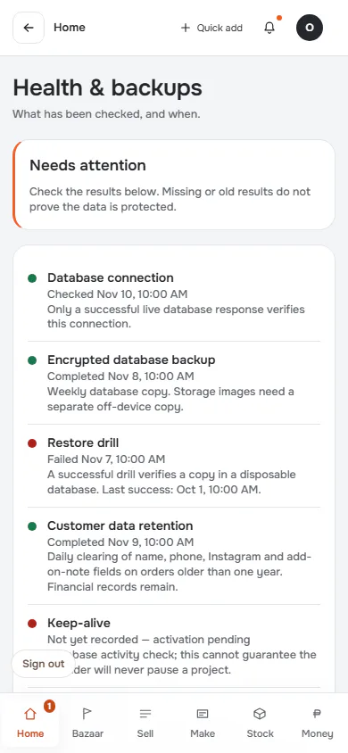

**d1440** 1440×900 · [full page](../../screenshots/account/health/empty/d1440.full.webp)

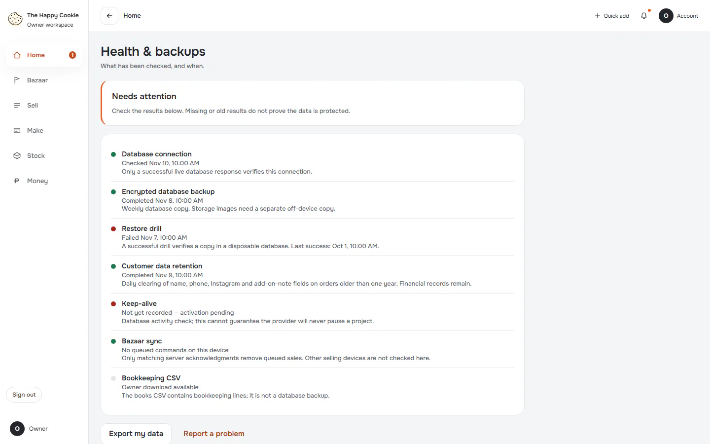
