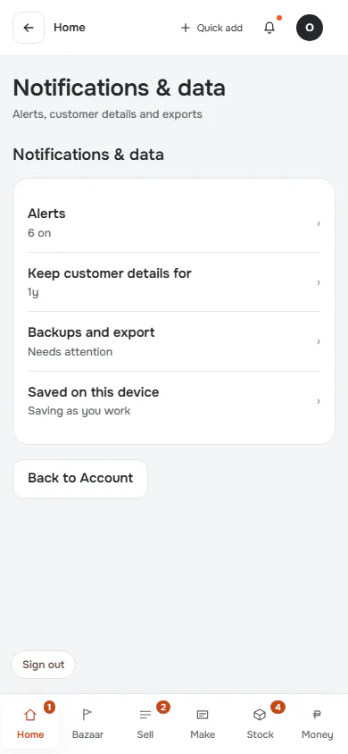
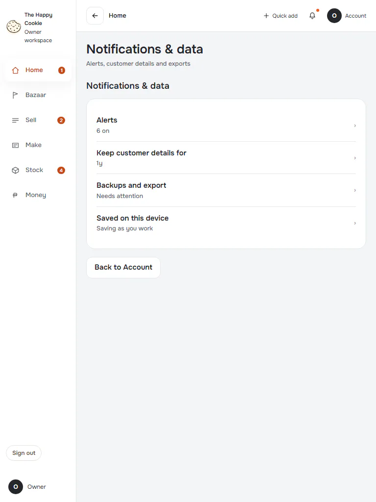
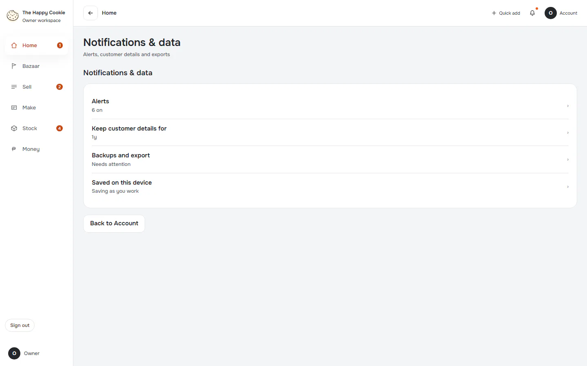

# Notifications & data

**ACTUAL application.** [Back to account](README.md)

- Manifest id: `account/notifications-data`
- Source: `src/components/live/account/settings-areas.tsx`
- Role: owner
- Reference views: none (found in code)

## default

Group: interaction. Fixture: `default`. How it was reached: ui-driven.

**p390** 390×844

**t768** 768×1024

**d1440** 1440×900

