# Notifications

**ACTUAL application.** [Back to account](README.md)

- Manifest id: `account/notifications`
- Source: `src/components/live/account/account-live.tsx`
- Role: owner
- Reference views: none (found in code)

## populated

Group: data. Fixture: `default`. How it was reached: ui-driven.

**p320** 320×700 · [full page](../../screenshots/account/notifications/populated/p320.full.webp)

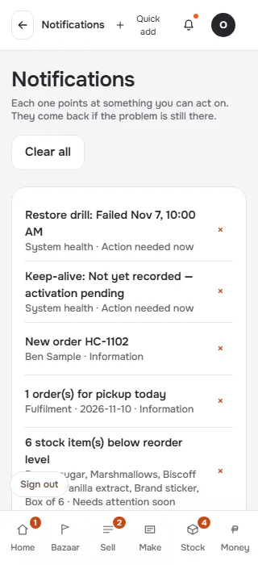

**p390** 390×844 · [full page](../../screenshots/account/notifications/populated/p390.full.webp)

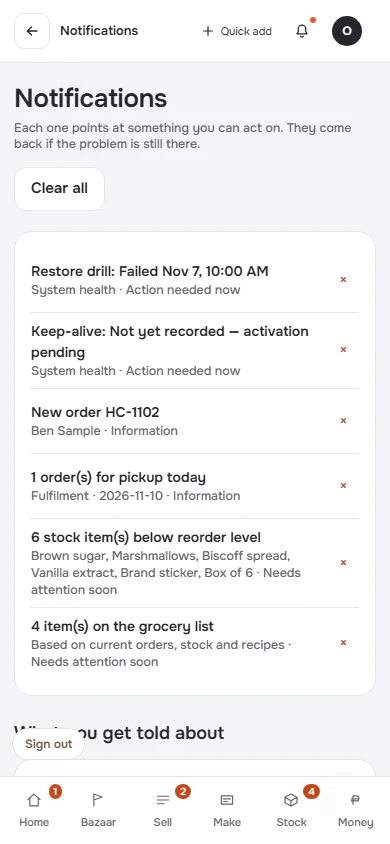

**t768** 768×1024 · [full page](../../screenshots/account/notifications/populated/t768.full.webp)

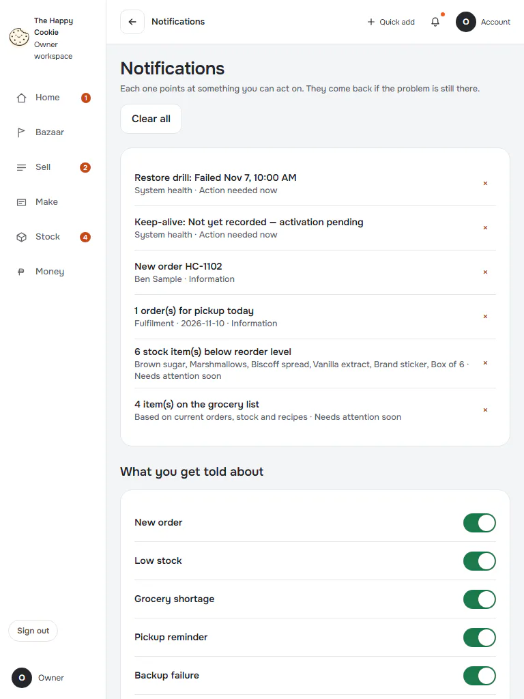

**l1024** 1024×768 · [full page](../../screenshots/account/notifications/populated/l1024.full.webp)

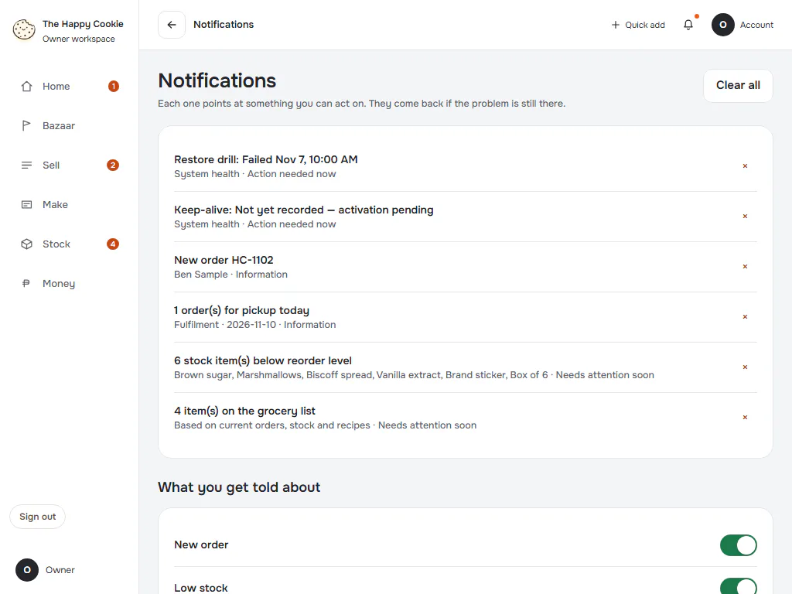

**d1440** 1440×900 · [full page](../../screenshots/account/notifications/populated/d1440.full.webp)

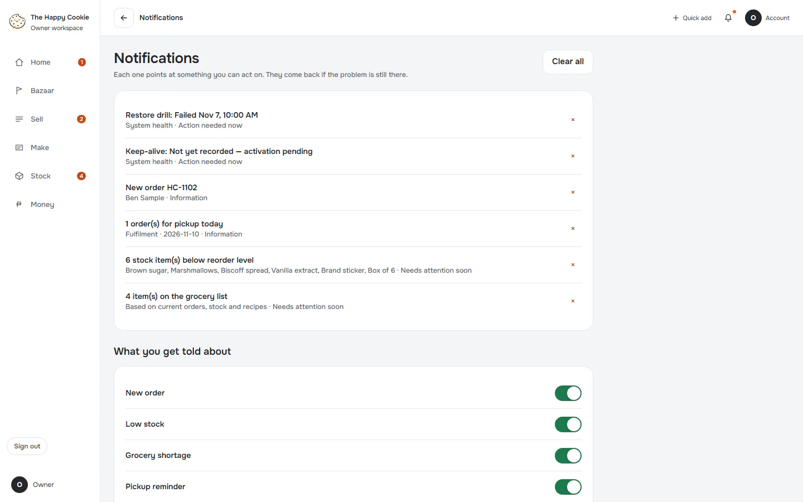

**w1920** 1920×1080 · [full page](../../screenshots/account/notifications/populated/w1920.full.webp)

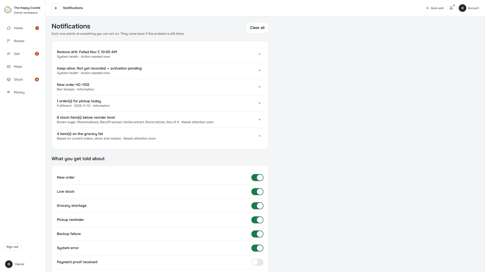

## empty

Group: data. Fixture: `data:empty`. How it was reached: rpc-fixture.

**p390** 390×844 · [full page](../../screenshots/account/notifications/empty/p390.full.webp)

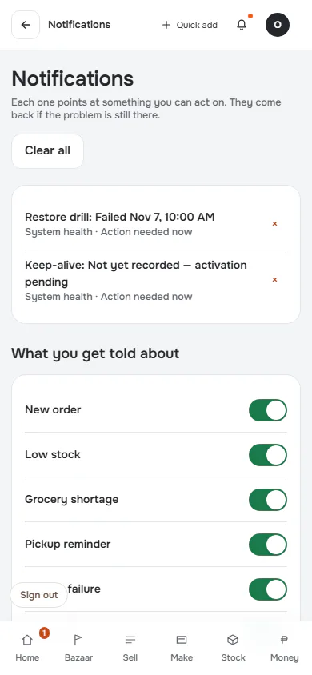

**d1440** 1440×900 · [full page](../../screenshots/account/notifications/empty/d1440.full.webp)

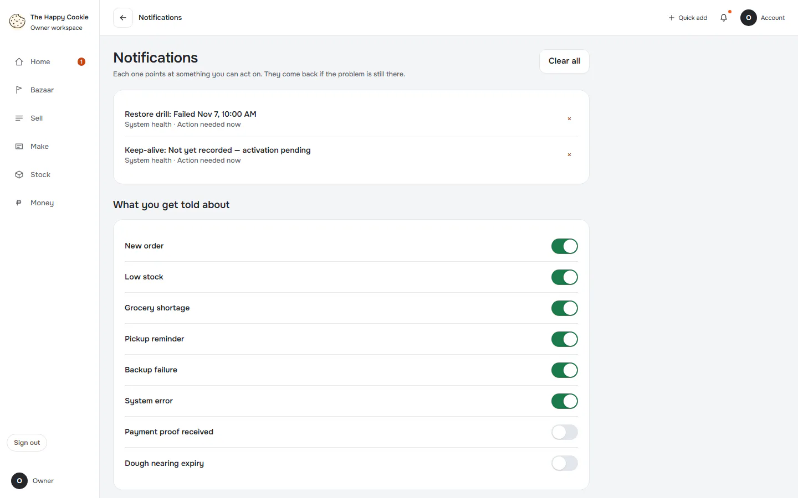

## one-dismissed

Group: interaction. Fixture: `default`. How it was reached: ui-driven.

**p390** 390×844 · [full page](../../screenshots/account/notifications/one-dismissed/p390.full.webp)

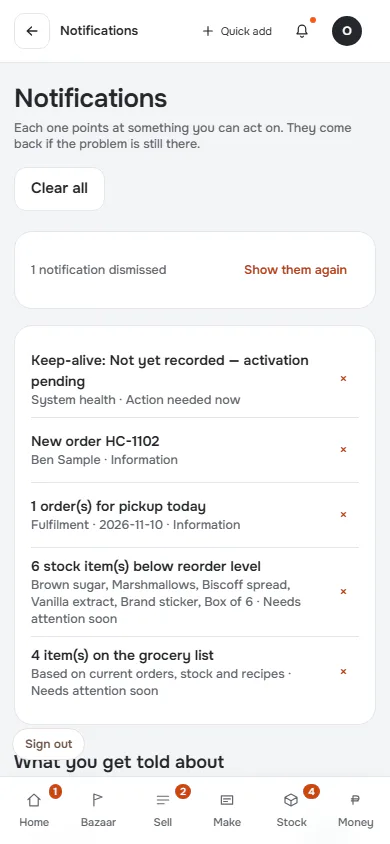

**d1440** 1440×900 · [full page](../../screenshots/account/notifications/one-dismissed/d1440.full.webp)

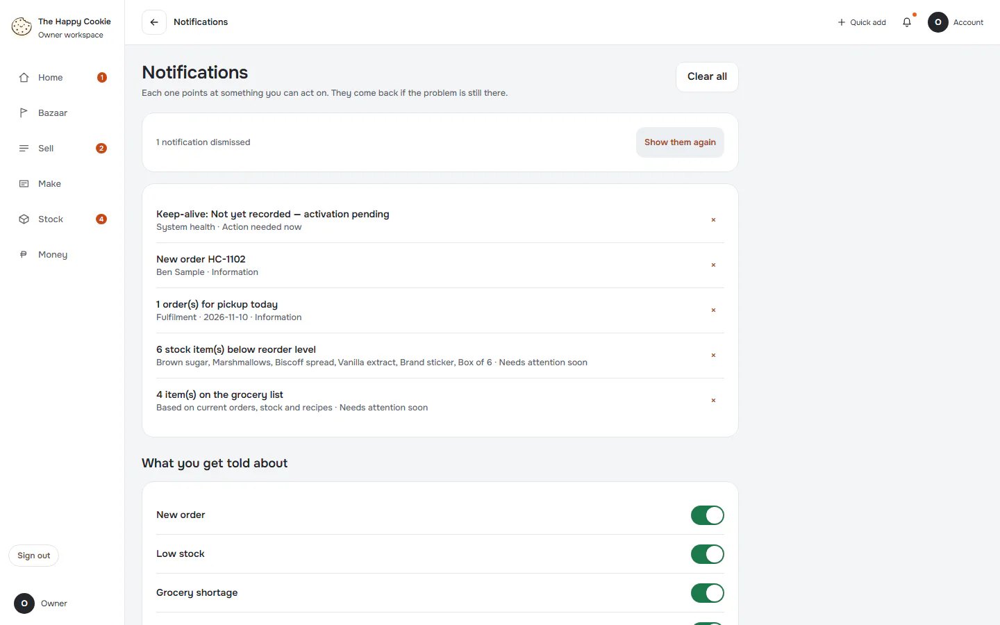

## all-cleared

Group: interaction. Fixture: `default`. How it was reached: ui-driven.

**p390** 390×844 · [full page](../../screenshots/account/notifications/all-cleared/p390.full.webp)

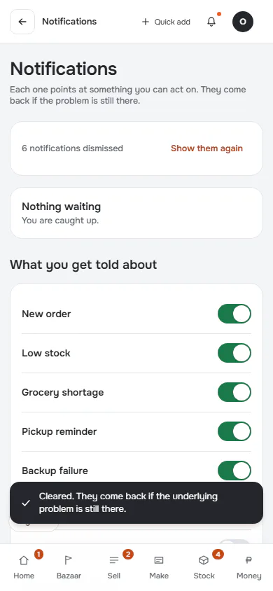

**d1440** 1440×900 · [full page](../../screenshots/account/notifications/all-cleared/d1440.full.webp)

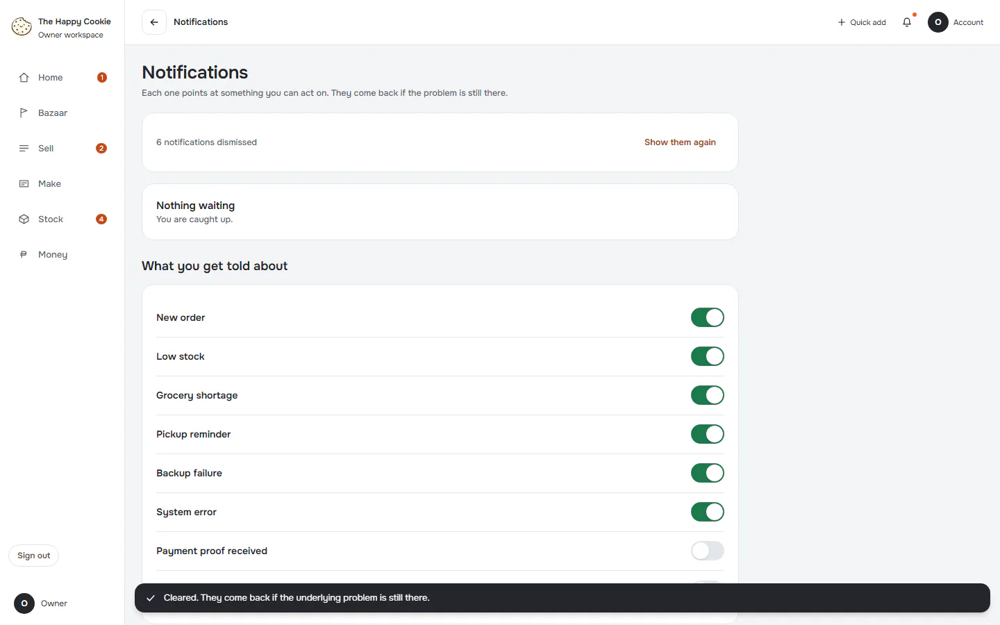
