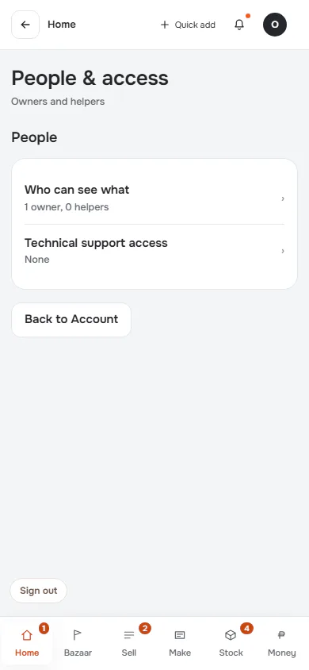
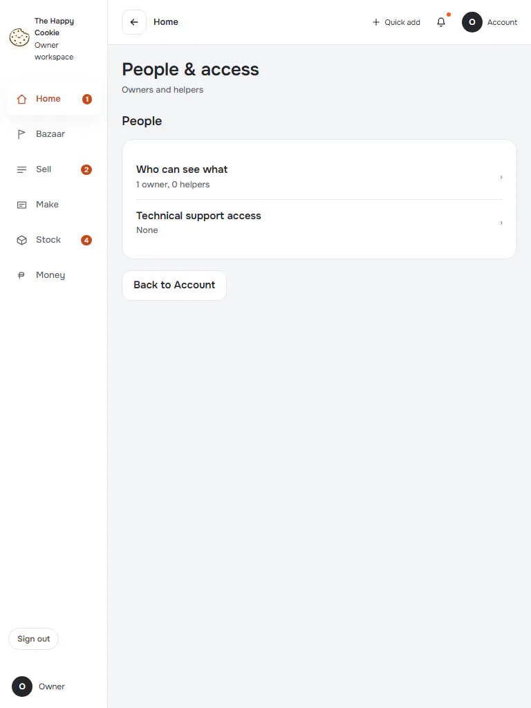
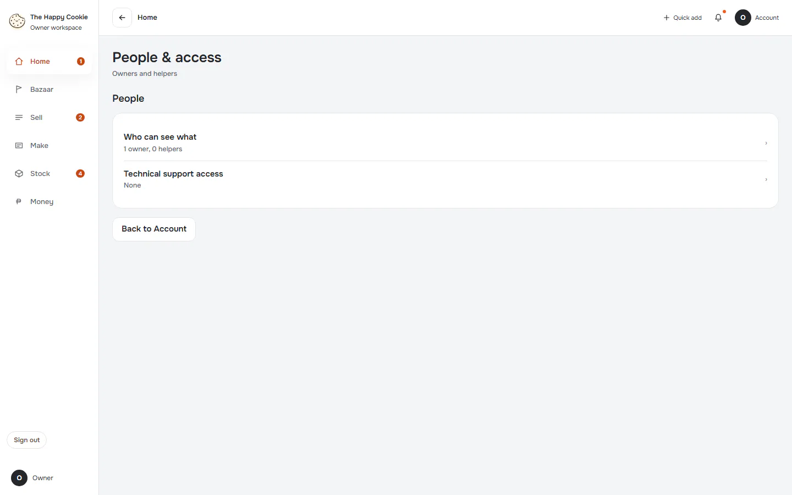
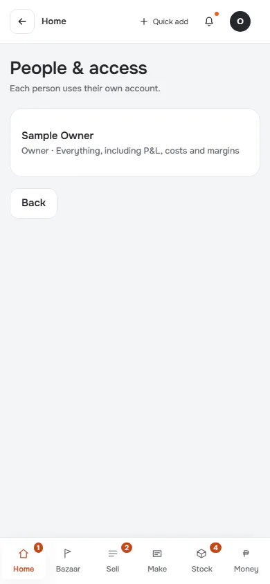
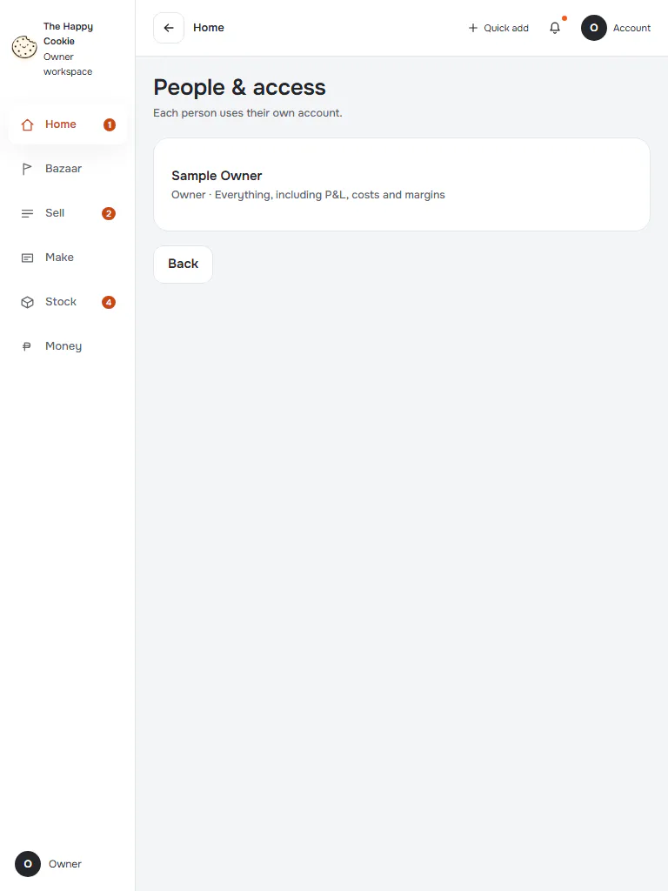
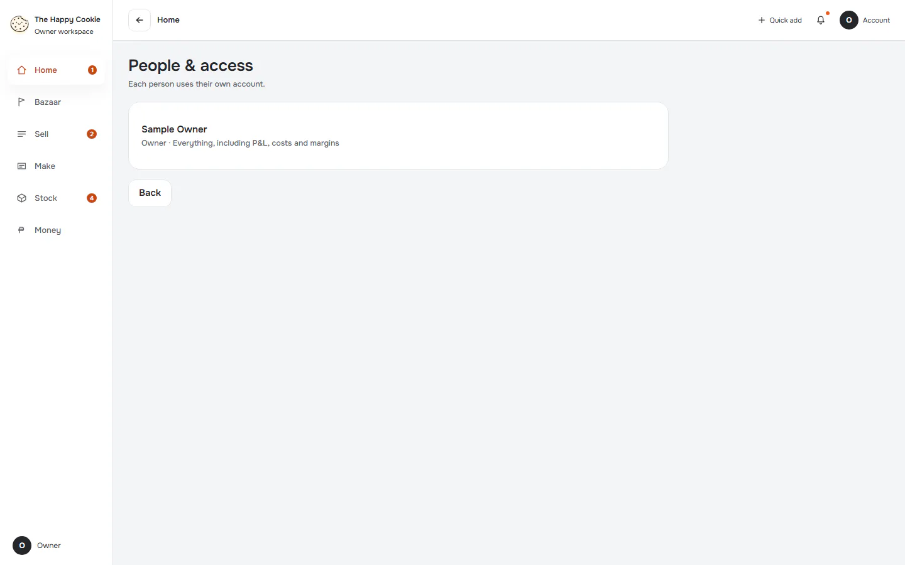

# People & access

**ACTUAL application.** [Back to account](README.md)

- Manifest id: `account/people`
- Source: `src/components/live/settings-pages.tsx`
- Role: owner
- Reference views: people, person-edit
- Note: Adding a person needs hosted accounts, so no person-edit page exists (coverage.md: Partial).

## hub

Group: interaction. Fixture: `default`. How it was reached: ui-driven.

**p390** 390×844

**t768** 768×1024

**d1440** 1440×900

## who-can-see-what

Group: interaction. Fixture: `default`. How it was reached: ui-driven.

**p390** 390×844

**t768** 768×1024

**d1440** 1440×900

## support-access

Group: interaction. Fixture: `default`. How it was reached: ui-driven.

**p390** 390×844 (pixel-identical to `account/people/who-can-see-what@p390`)

**d1440** 1440×900 (pixel-identical to `account/people/who-can-see-what@d1440`)

