# Helper role

**ACTUAL application.** [Back to account](README.md)

- Manifest id: `account/role-helper`
- Source: `src/components/shell/app-frame.tsx`
- Role: helper
- Reference views: none (found in code)
- Drawn by an old ported screen, not the refined live interface.

## home

Group: role. Fixture: `role:helper`. How it was reached: ui-driven.

**p390** 390×844

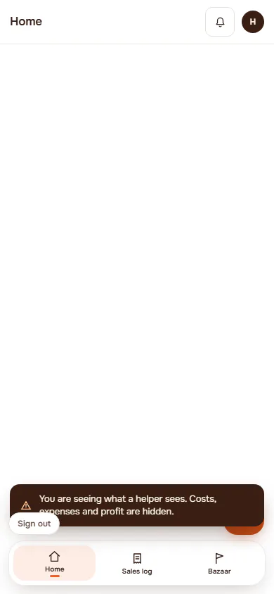

**t768** 768×1024

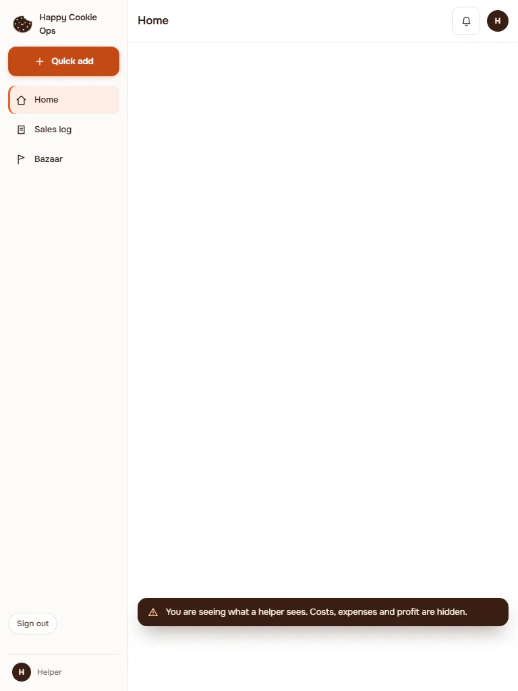

**d1440** 1440×900

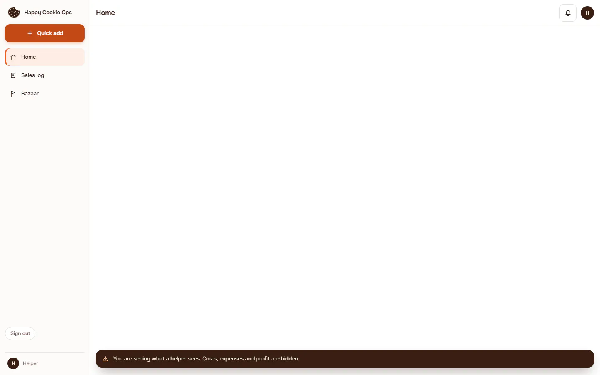

## orders-denied

Group: role. Fixture: `role:helper`. How it was reached: ui-driven.

**p390** 390×844

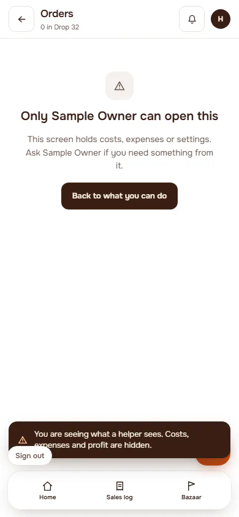

**d1440** 1440×900

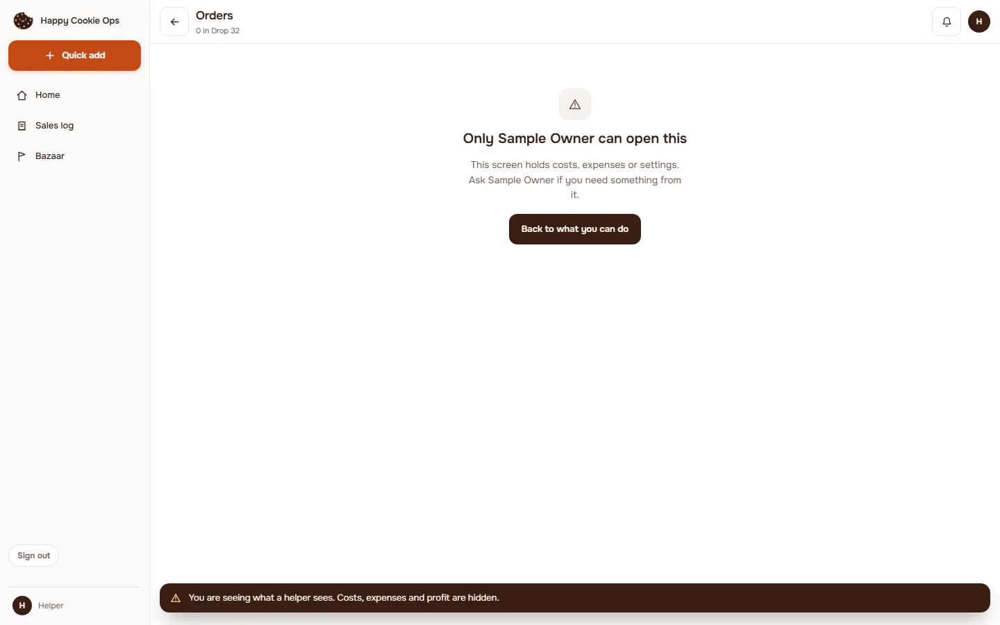

## money-denied

Group: role. Fixture: `role:helper`. How it was reached: ui-driven.

**p390** 390×844

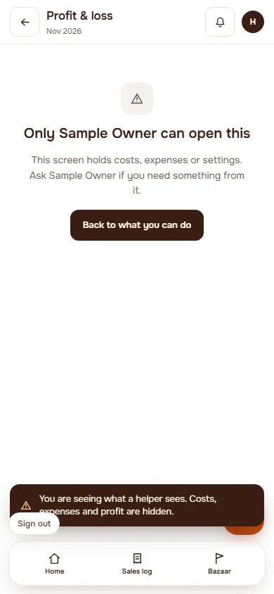

**d1440** 1440×900

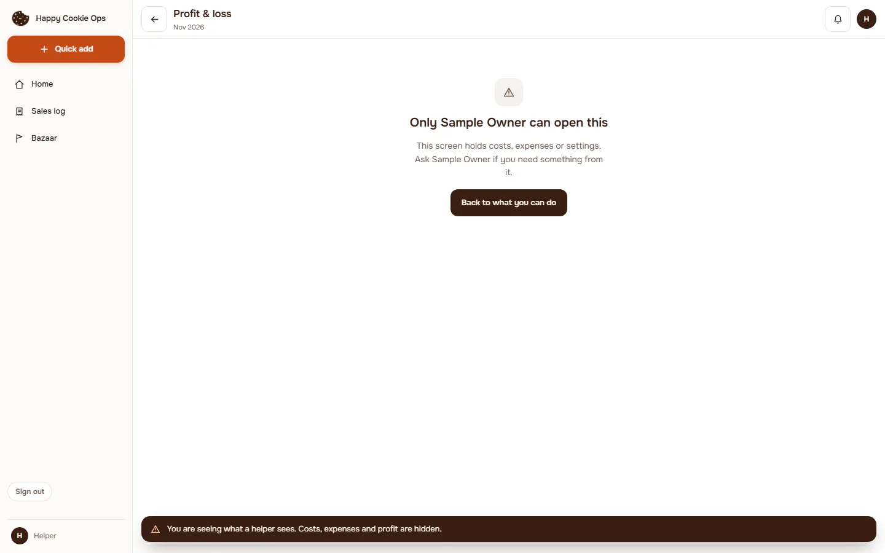

## sales-log

Group: role. Fixture: `role:helper`. How it was reached: ui-driven.

**p390** 390×844

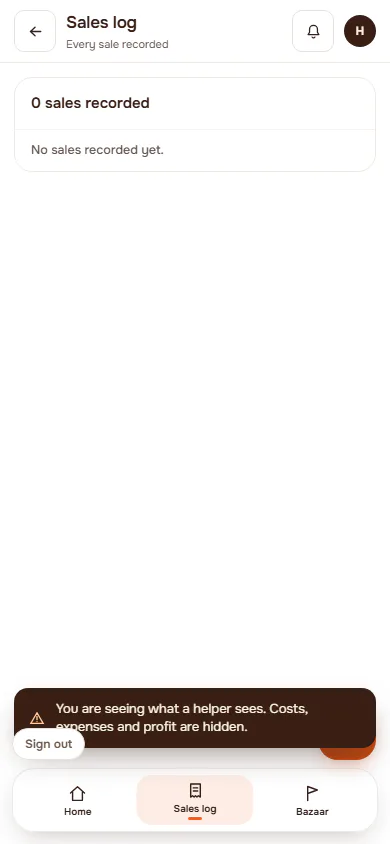

**d1440** 1440×900

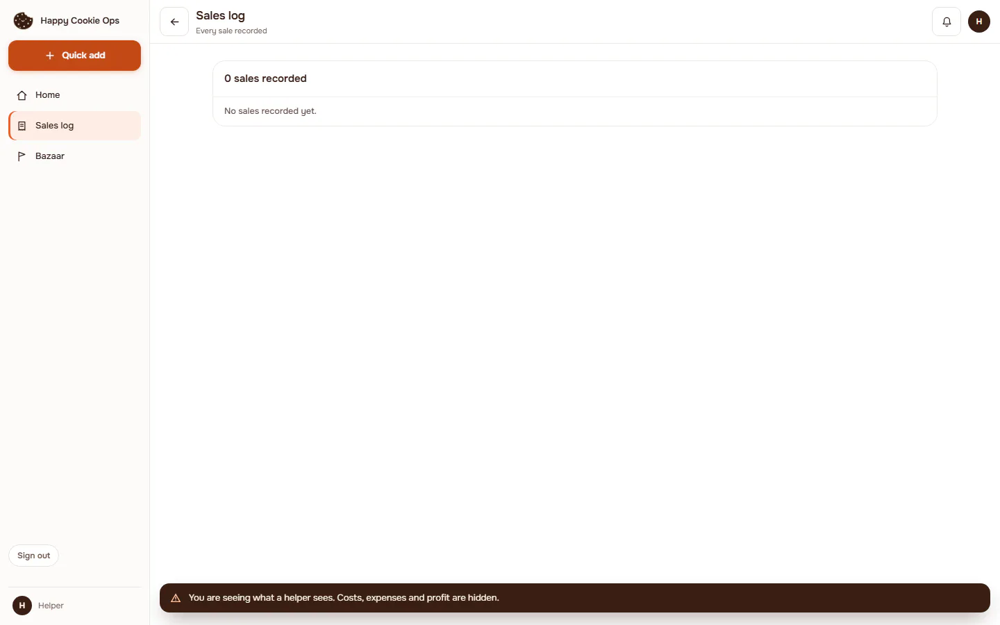

## bazaar

Group: role. Fixture: `role:helper`. How it was reached: ui-driven.

**p390** 390×844

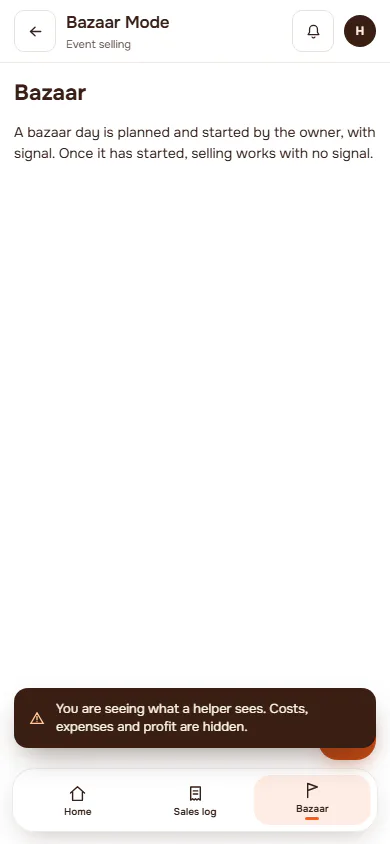

**t768** 768×1024

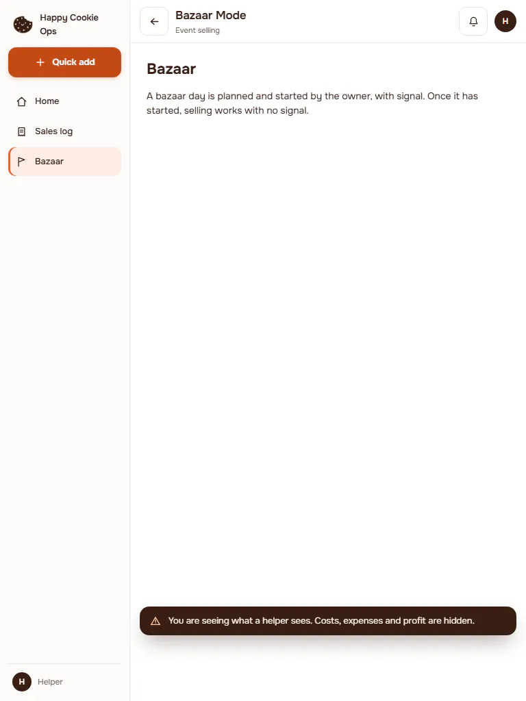

**d1440** 1440×900

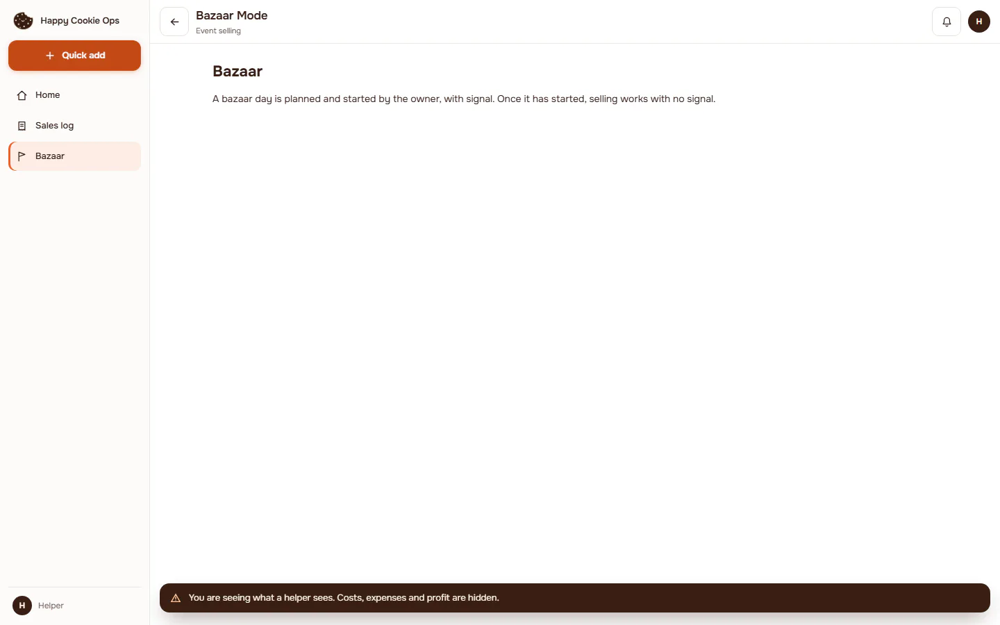

## inventory

Group: role. Fixture: `role:helper`. How it was reached: ui-driven.

**p390** 390×844

**d1440** 1440×900

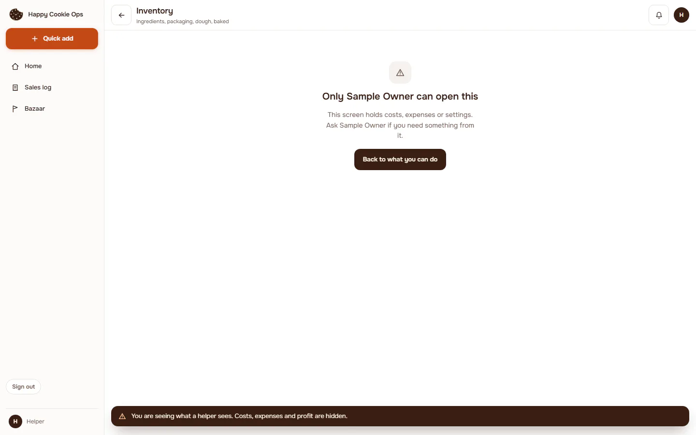

## settings-denied

Group: role. Fixture: `role:helper`. How it was reached: ui-driven.

**p390** 390×844

**d1440** 1440×900

