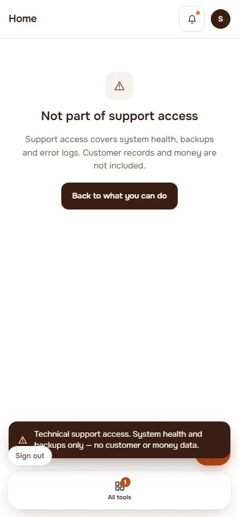
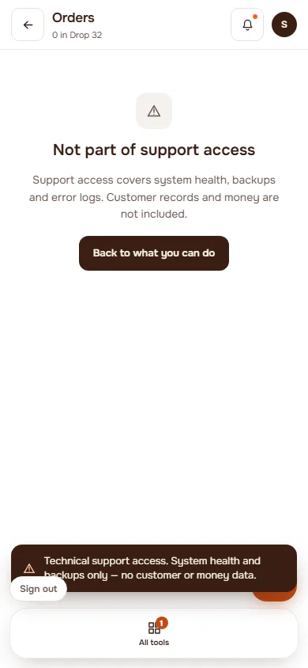
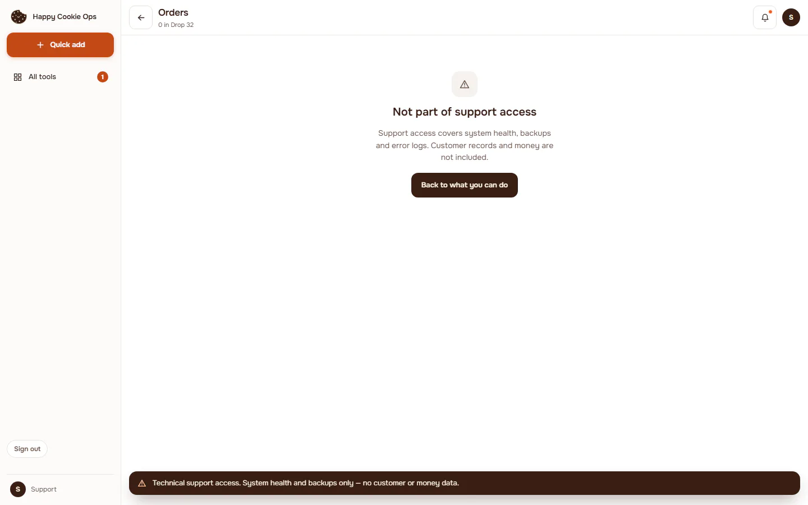
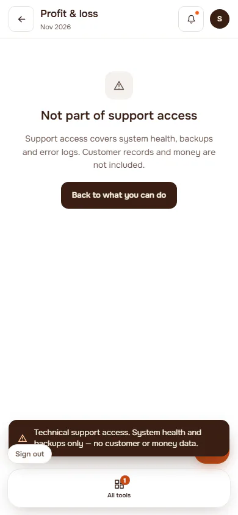
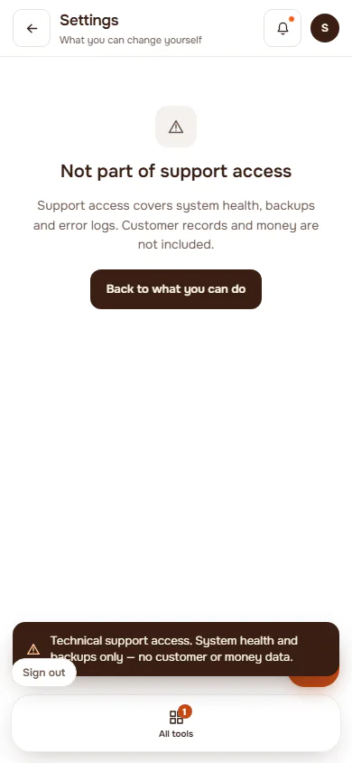
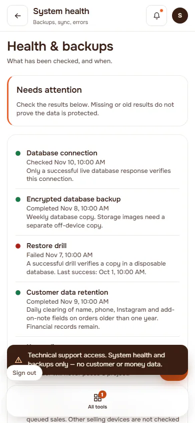
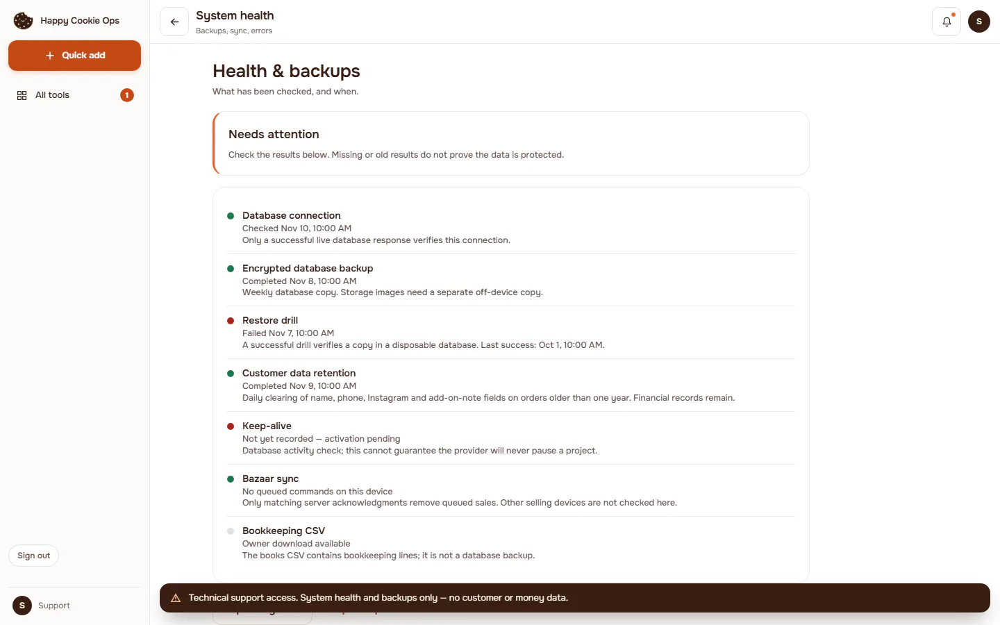

# Support role

**ACTUAL application.** [Back to account](README.md)

- Manifest id: `account/role-support`
- Source: `src/components/shell/app-frame.tsx`
- Role: support
- Reference views: none (found in code)
- Drawn by an old ported screen, not the refined live interface.

## home

Group: role. Fixture: `role:support`. How it was reached: ui-driven.

**p390** 390×844

**d1440** 1440×900

## orders

Group: role. Fixture: `role:support`. How it was reached: ui-driven.

**p390** 390×844

**d1440** 1440×900

## money

Group: role. Fixture: `role:support`. How it was reached: ui-driven.

**p390** 390×844

**d1440** 1440×900

## settings

Group: role. Fixture: `role:support`. How it was reached: ui-driven.

**p390** 390×844

**d1440** 1440×900

## health

Group: role. Fixture: `role:support`. How it was reached: ui-driven.

**p390** 390×844

**d1440** 1440×900

