# Sign in

**ACTUAL application.** [Back to account](README.md)

- Manifest id: `account/sign-in`
- Source: `src/app/sign-in/sign-in-form.tsx`
- Role: public
- Reference views: sign-in, account-help

## untouched

Group: data. Fixture: `signed-out`. How it was reached: ui-driven.

**p320** 320×700

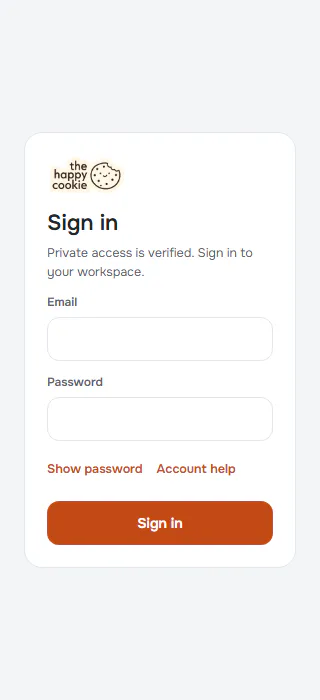

**p390** 390×844

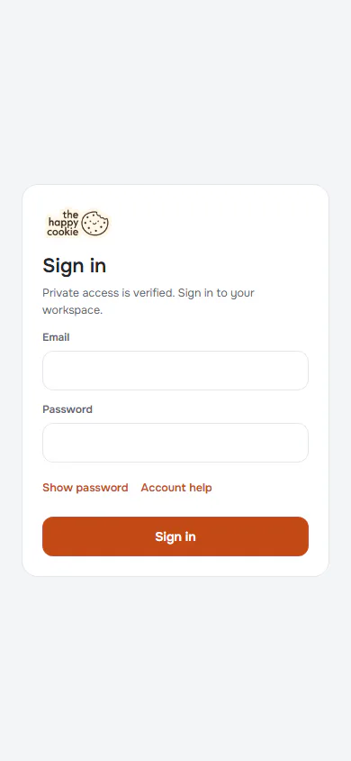

**t768** 768×1024

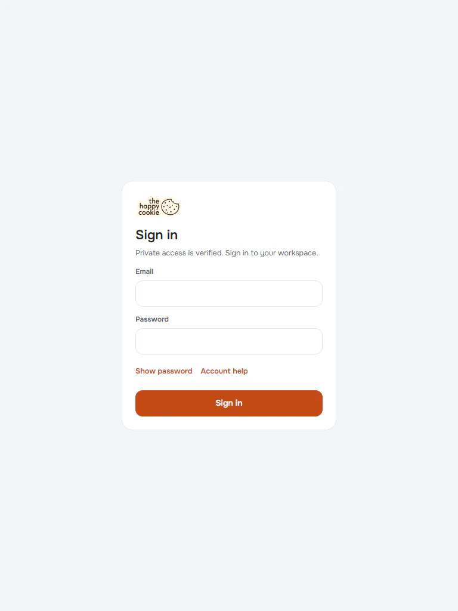

**l1024** 1024×768

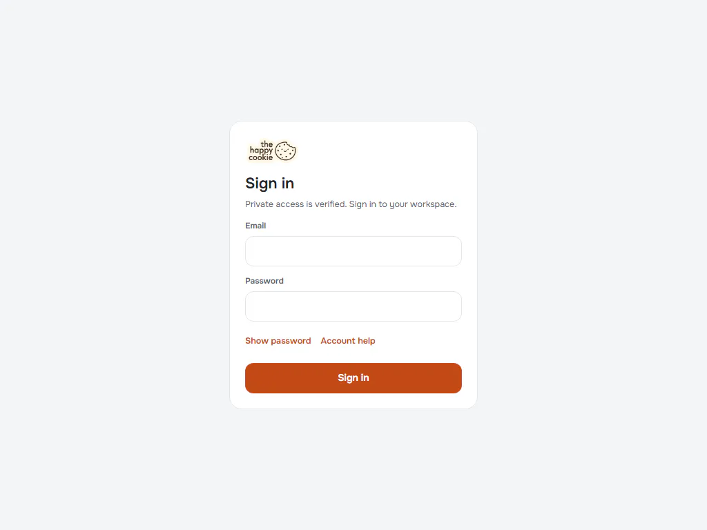

**d1440** 1440×900

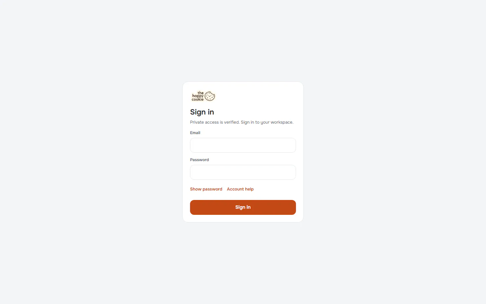

**w1920** 1920×1080

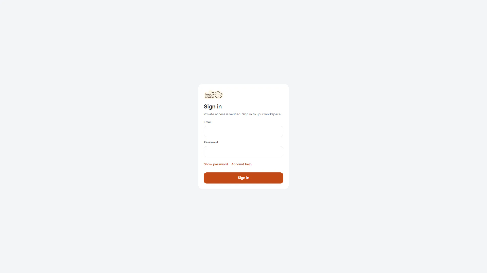

## account-help

Group: interaction. Fixture: `signed-out`. How it was reached: ui-driven.

**p390** 390×844

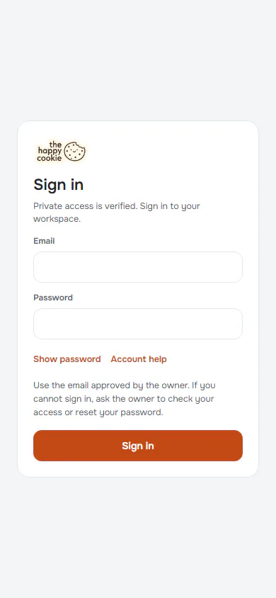

**d1440** 1440×900

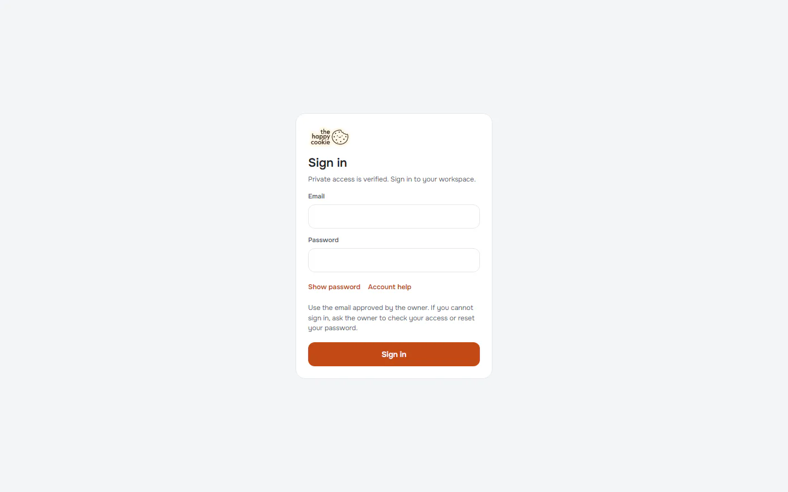

## wrong-password

Group: failure. Fixture: `signed-out`. How it was reached: ui-driven.

**p390** 390×844

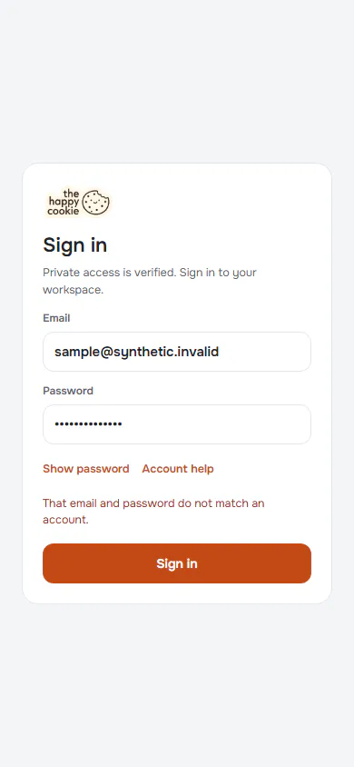

**d1440** 1440×900

## network-failure

Group: failure. Fixture: `signed-out;fail:signIn=network`. How it was reached: rpc-fixture.

**p390** 390×844

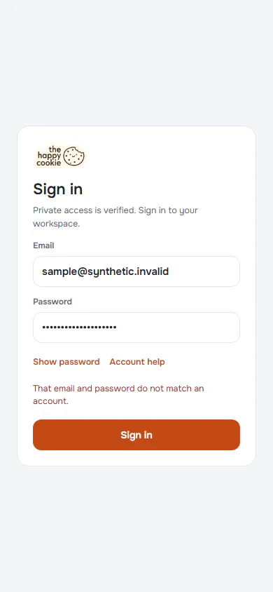

**d1440** 1440×900

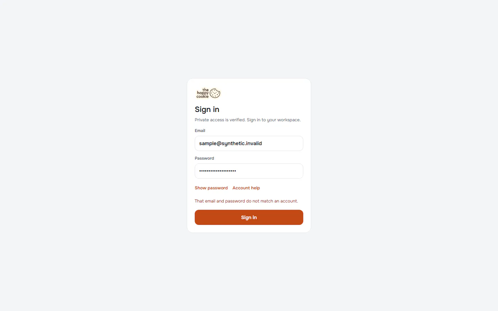

## empty-submit

Group: interaction. Fixture: `signed-out`. How it was reached: ui-driven.

**p390** 390×844

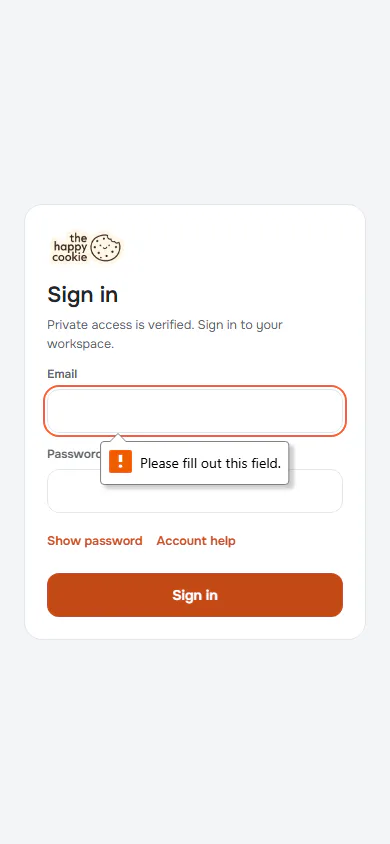

**d1440** 1440×900

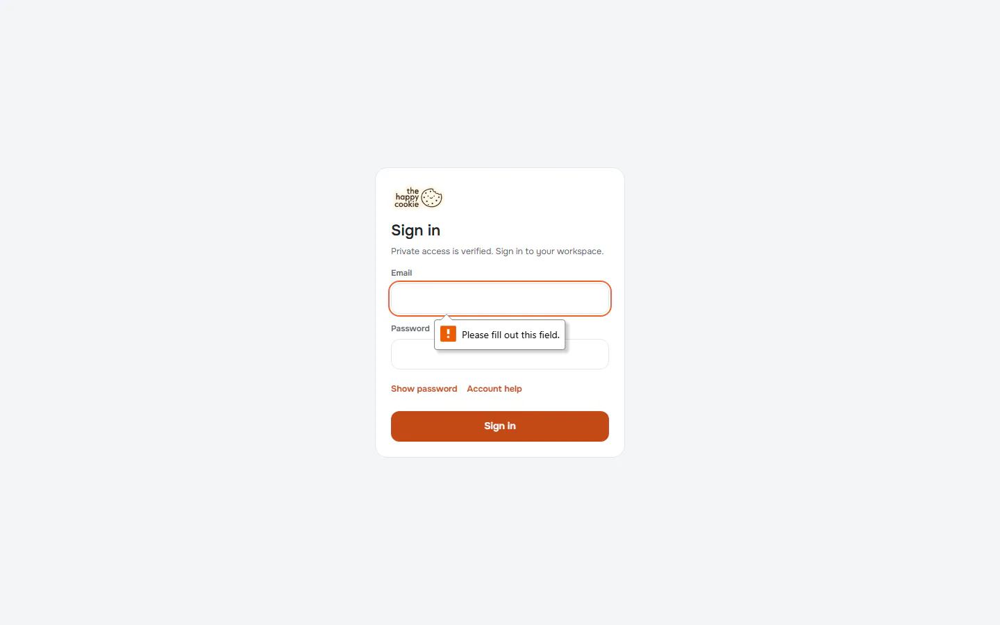

## password-shown

Group: interaction. Fixture: `signed-out`. How it was reached: ui-driven.

**p390** 390×844

