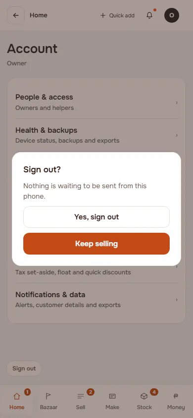
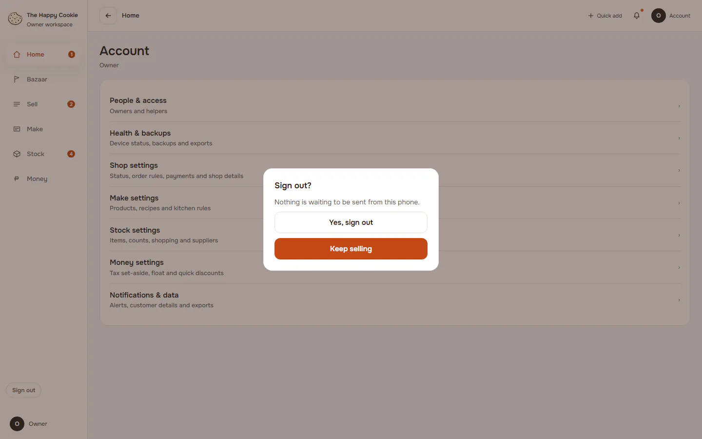
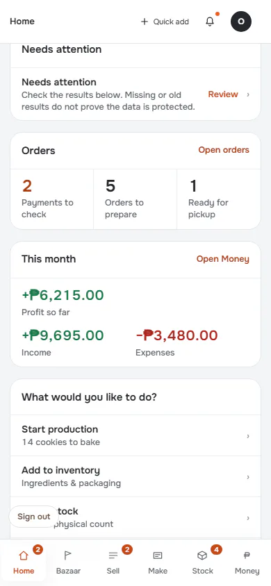
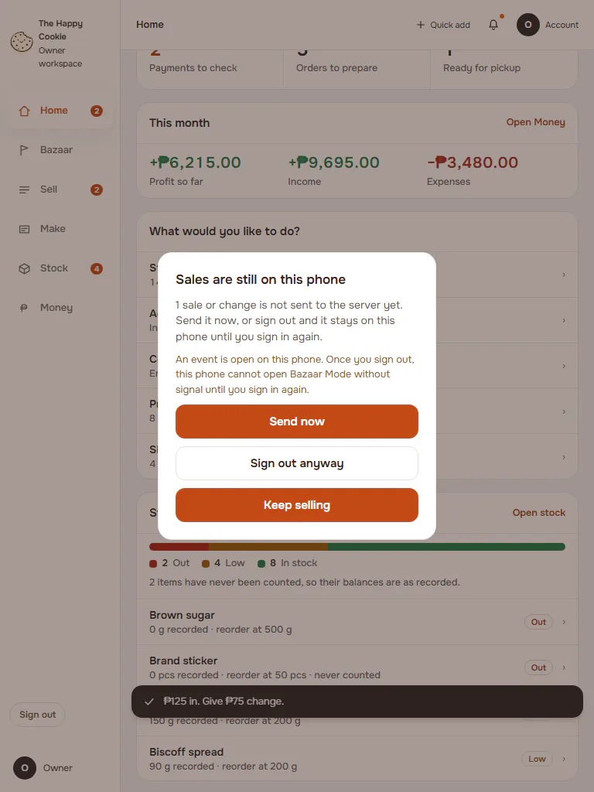
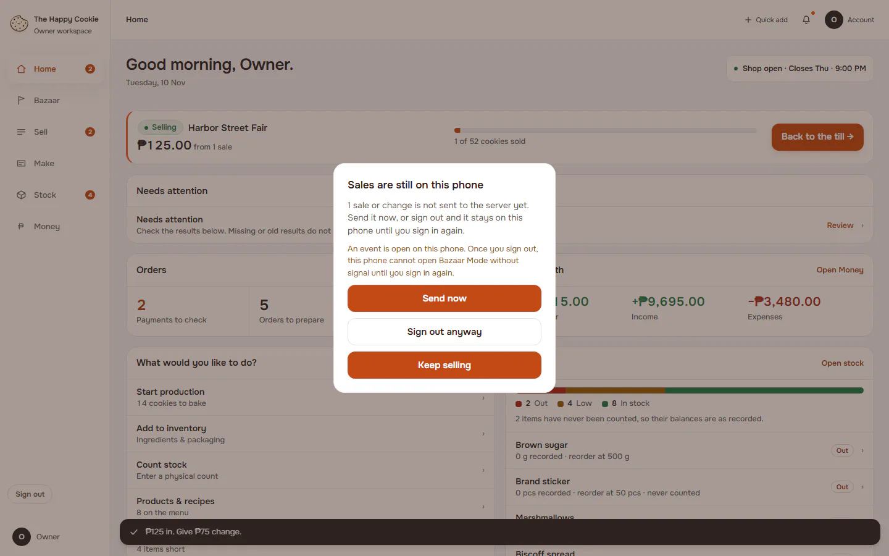

# Sign out

**ACTUAL application.** [Back to account](README.md)

- Manifest id: `account/sign-out`
- Source: `src/components/app/sign-out-control.tsx`
- Role: owner
- Reference views: sign-out

## no-unsent

Group: interaction. Fixture: `default`. How it was reached: ui-driven.

**p390** 390×844

**d1440** 1440×900

## with-unsent-sales

Warns about unsent sales first. Group: business. Fixture: `bazaar:planned`. How it was reached: ui-driven.

**p390** 390×844 · [full page](../../screenshots/account/sign-out/with-unsent-sales/p390.full.webp)

**t768** 768×1024 · [full page](../../screenshots/account/sign-out/with-unsent-sales/t768.full.webp)

**d1440** 1440×900 · [full page](../../screenshots/account/sign-out/with-unsent-sales/d1440.full.webp)

