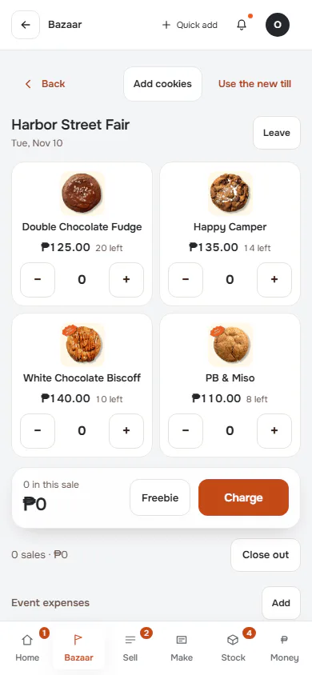
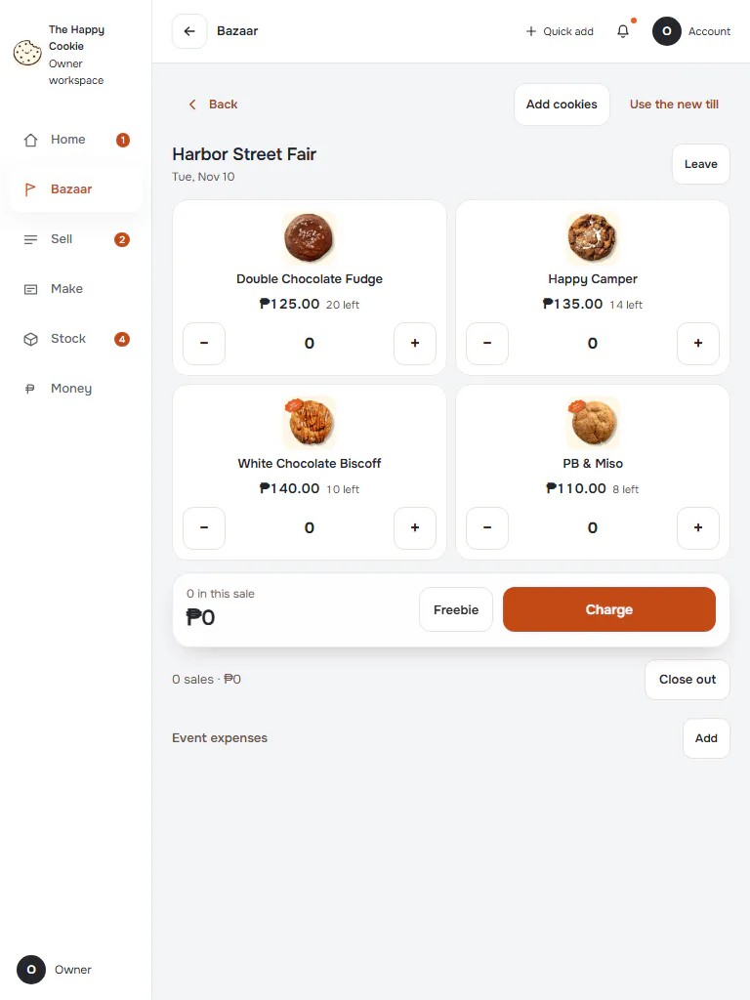
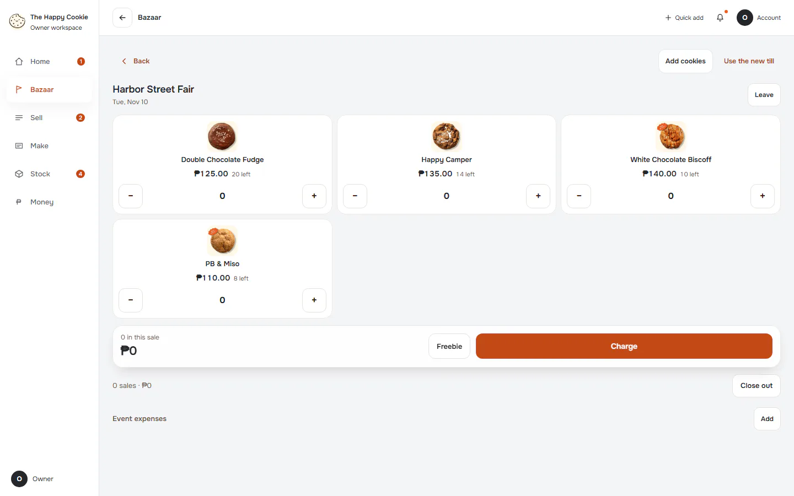

# Classic till (ported fallback)

**ACTUAL application.** [Back to bazaar](README.md)

- Manifest id: `bazaar/classic-till`
- Source: `src/components/screens/bazaar-mode.tsx`
- Role: owner
- Reference views: classic-till
- Drawn by an old ported screen, not the refined live interface.

## default

Group: interaction. Fixture: `bazaar:planned`. How it was reached: ui-driven.

**p390** 390×844 · [full page](../../screenshots/bazaar/classic-till/default/p390.full.webp)

**t768** 768×1024

**d1440** 1440×900

