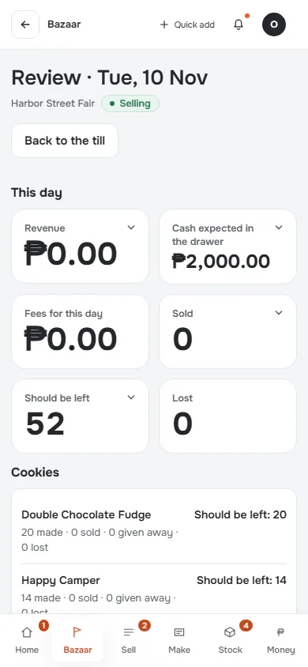
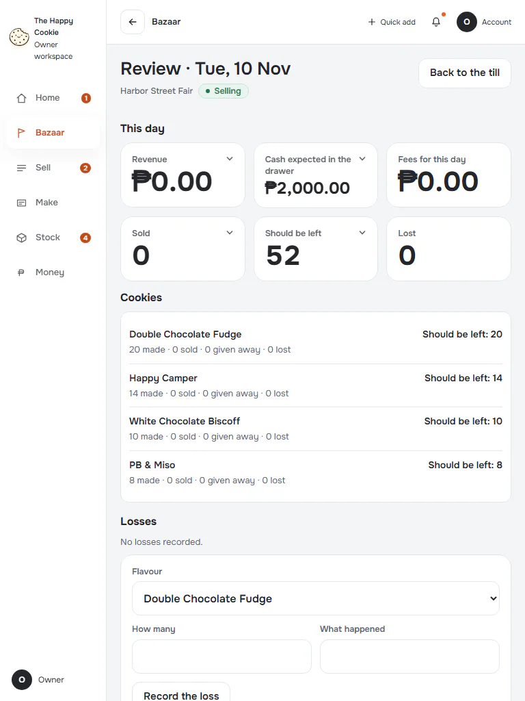
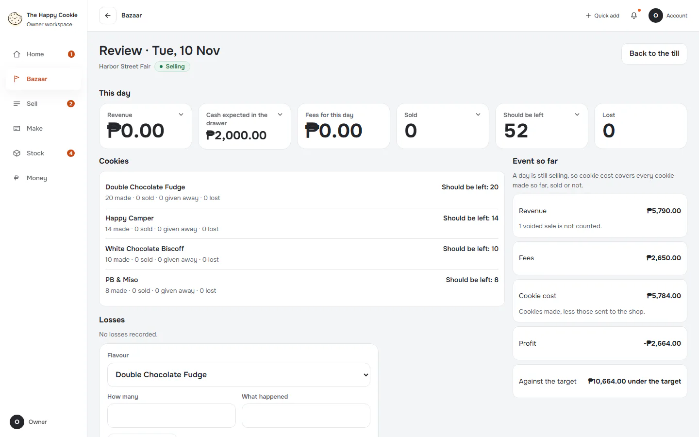
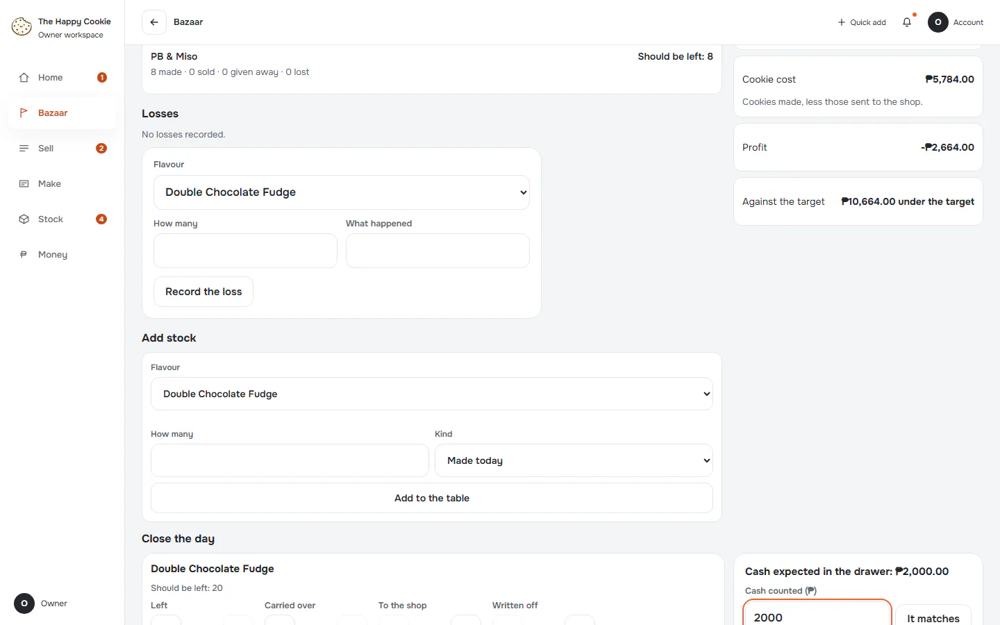
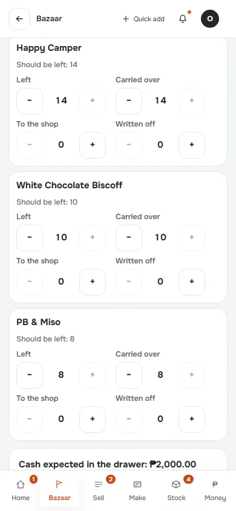
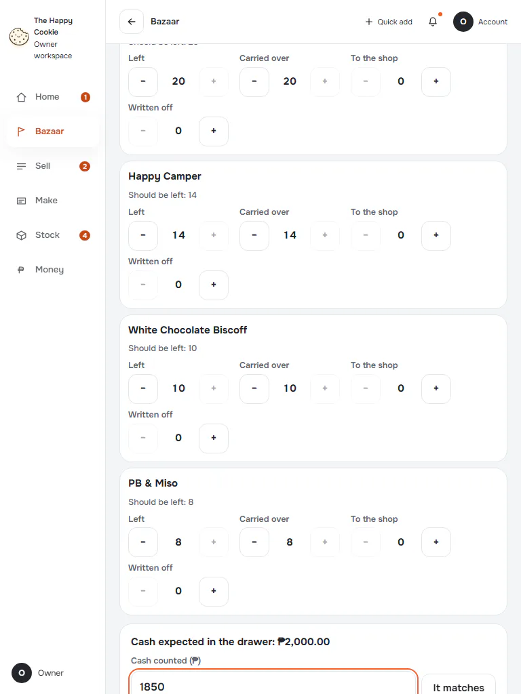
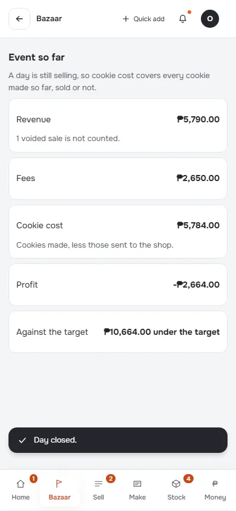
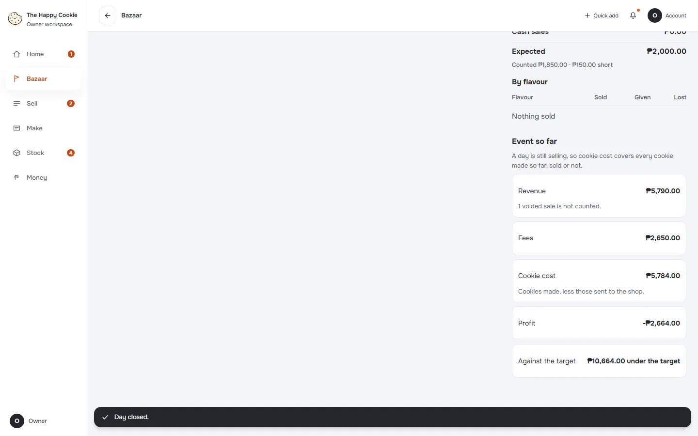
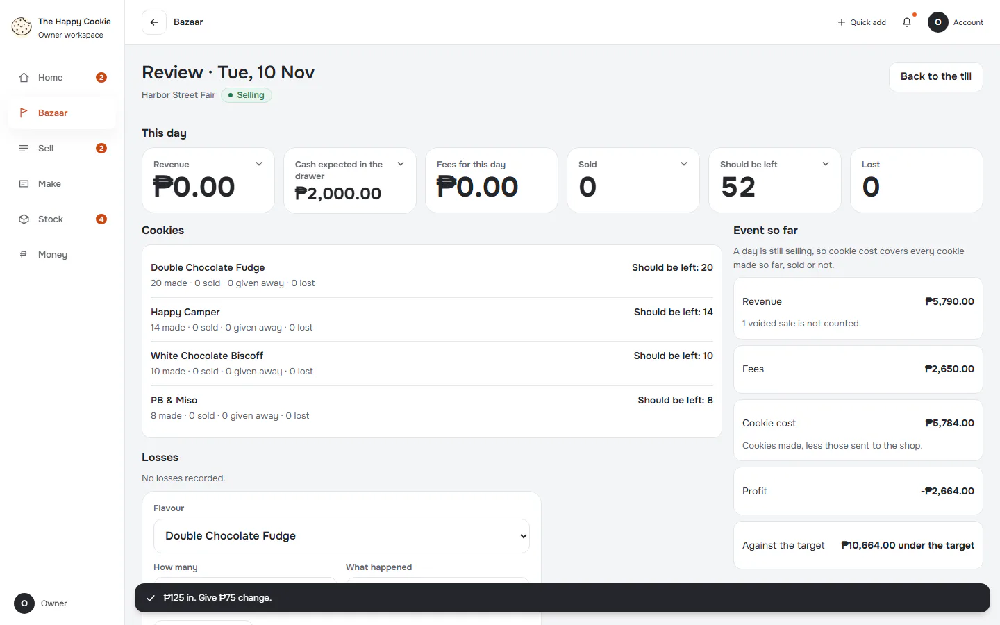

# Close day: count and drawer

**ACTUAL application.** [Back to bazaar](README.md)

- Manifest id: `bazaar/close`
- Source: `src/components/live/bazaar/close-form.tsx`
- Role: owner
- Reference views: close, close-review

## untouched

Group: interaction. Fixture: `bazaar:planned`. How it was reached: ui-driven.

**p390** 390×844 · [full page](../../screenshots/bazaar/close/untouched/p390.full.webp)

**t768** 768×1024 · [full page](../../screenshots/bazaar/close/untouched/t768.full.webp)

**d1440** 1440×900 · [full page](../../screenshots/bazaar/close/untouched/d1440.full.webp)

## cash-matches

Group: business. Fixture: `bazaar:planned`. How it was reached: ui-driven.

**p390** 390×844 · [full page](../../screenshots/bazaar/close/cash-matches/p390.full.webp)

**d1440** 1440×900 · [full page](../../screenshots/bazaar/close/cash-matches/d1440.full.webp)

## cash-short

Group: business. Fixture: `bazaar:planned`. How it was reached: ui-driven.

**p390** 390×844 · [full page](../../screenshots/bazaar/close/cash-short/p390.full.webp)

**t768** 768×1024 · [full page](../../screenshots/bazaar/close/cash-short/t768.full.webp)

**d1440** 1440×900 · [full page](../../screenshots/bazaar/close/cash-short/d1440.full.webp)

## cash-over

Group: business. Fixture: `bazaar:planned`. How it was reached: ui-driven.

**p390** 390×844 · [full page](../../screenshots/bazaar/close/cash-over/p390.full.webp)

**d1440** 1440×900 · [full page](../../screenshots/bazaar/close/cash-over/d1440.full.webp)

## closed-without-cash-typed

Close pressed with the form untouched: the app closed the day. Group: business. Fixture: `bazaar:planned`. How it was reached: ui-driven.

**p390** 390×844 · [full page](../../screenshots/bazaar/close/closed-without-cash-typed/p390.full.webp)

**d1440** 1440×900 · [full page](../../screenshots/bazaar/close/closed-without-cash-typed/d1440.full.webp)

## closed-short

Group: business. Fixture: `bazaar:planned`. How it was reached: ui-driven.

**p390** 390×844 (pixel-identical to `bazaar/close/closed-without-cash-typed@p390`) · [full page](../../screenshots/bazaar/close/closed-without-cash-typed/p390.full.webp)

**d1440** 1440×900 · [full page](../../screenshots/bazaar/close/closed-short/d1440.full.webp)

## unsent-sales-block

A refused sale still waits when the day is being closed. Group: business. Fixture: `bazaar:planned`. How it was reached: ui-driven.

**p390** 390×844 · [full page](../../screenshots/bazaar/close/unsent-sales-block/p390.full.webp)

**d1440** 1440×900 · [full page](../../screenshots/bazaar/close/unsent-sales-block/d1440.full.webp)

