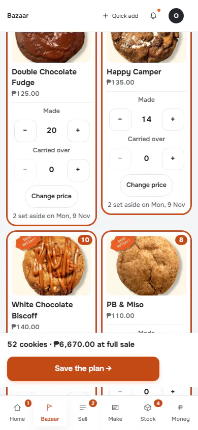
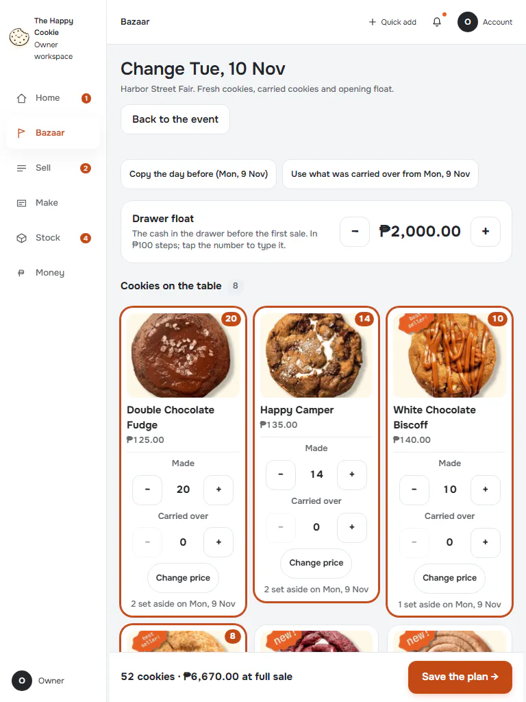
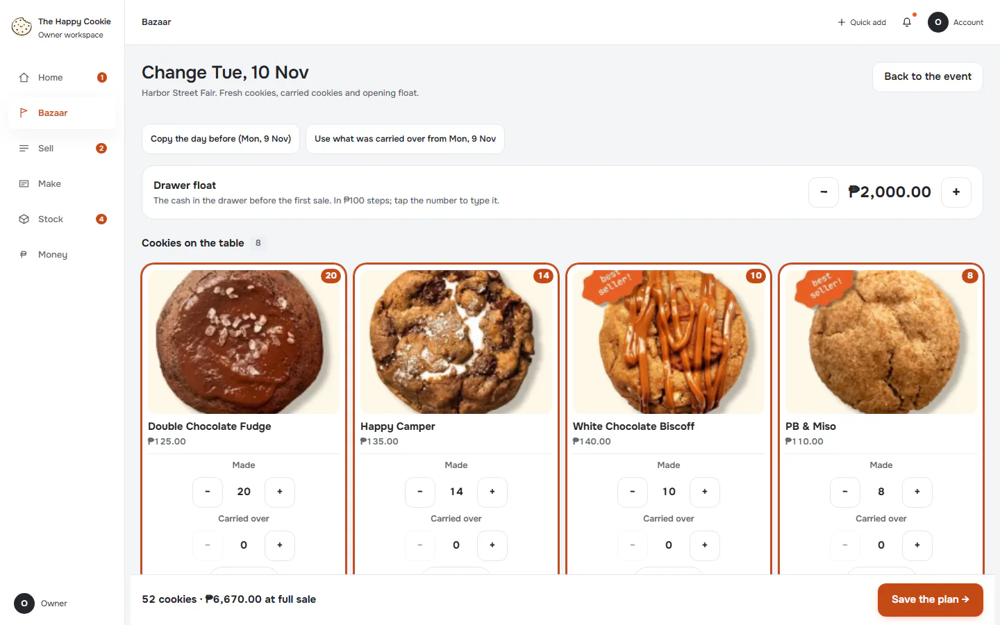
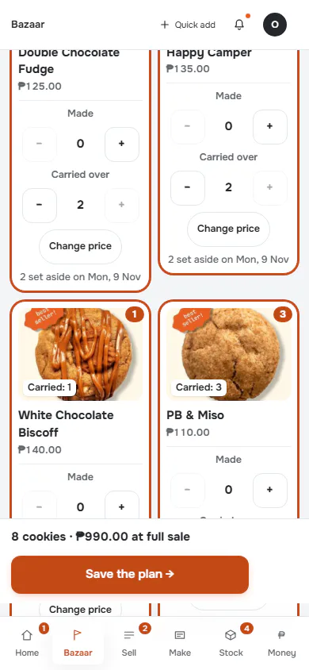
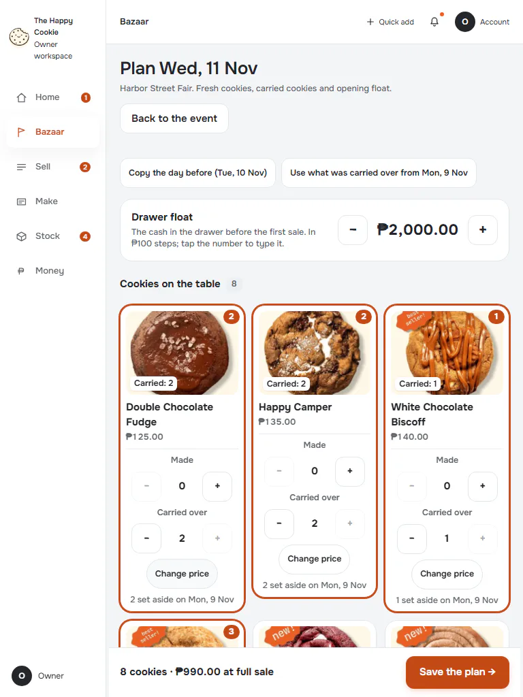
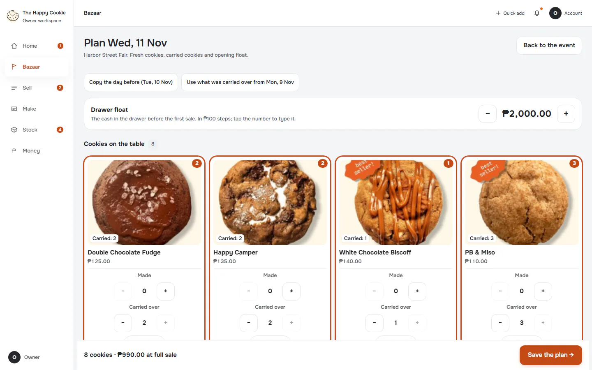
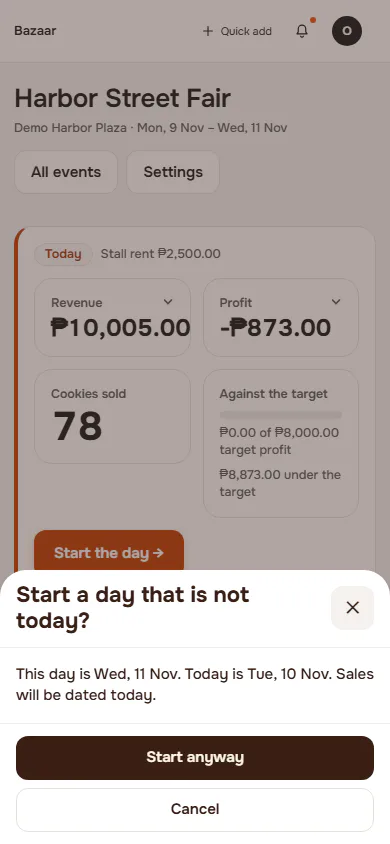
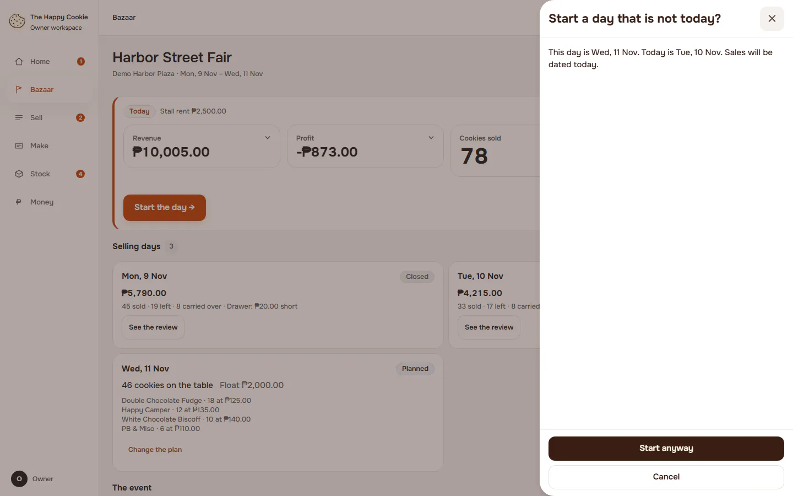

# Plan a day

**ACTUAL application.** [Back to bazaar](README.md)

- Manifest id: `bazaar/day-plan`
- Source: `src/components/live/bazaar/day-plan.tsx`
- Role: owner
- Reference views: plan, plan-review
- Note: Saving a plan opens nothing, so the app has no Review page; starting the day asks first when the date is not today.

## change-existing

Group: interaction. Fixture: `bazaar:planned`. How it was reached: ui-driven.

**p390** 390×844 · [full page](../../screenshots/bazaar/day-plan/change-existing/p390.full.webp)

**t768** 768×1024 · [full page](../../screenshots/bazaar/day-plan/change-existing/t768.full.webp)

**d1440** 1440×900 · [full page](../../screenshots/bazaar/day-plan/change-existing/d1440.full.webp)

## new-day

Group: interaction. Fixture: `default`. How it was reached: ui-driven.

**p390** 390×844 · [full page](../../screenshots/bazaar/day-plan/new-day/p390.full.webp)

**t768** 768×1024 · [full page](../../screenshots/bazaar/day-plan/new-day/t768.full.webp)

**d1440** 1440×900 · [full page](../../screenshots/bazaar/day-plan/new-day/d1440.full.webp)

## start-not-today-prompt

plan-review equivalent: the question asked before opening a day dated elsewhere. Group: business. Fixture: `bazaar:plannedTomorrow`. How it was reached: ui-driven.

**p390** 390×844 · [full page](../../screenshots/bazaar/day-plan/start-not-today-prompt/p390.full.webp)

**d1440** 1440×900 · [full page](../../screenshots/bazaar/day-plan/start-not-today-prompt/d1440.full.webp)

