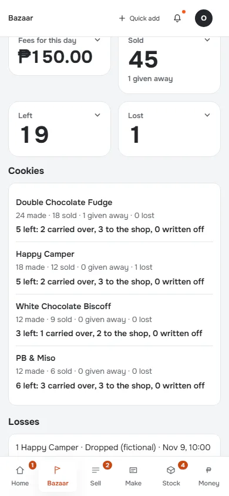
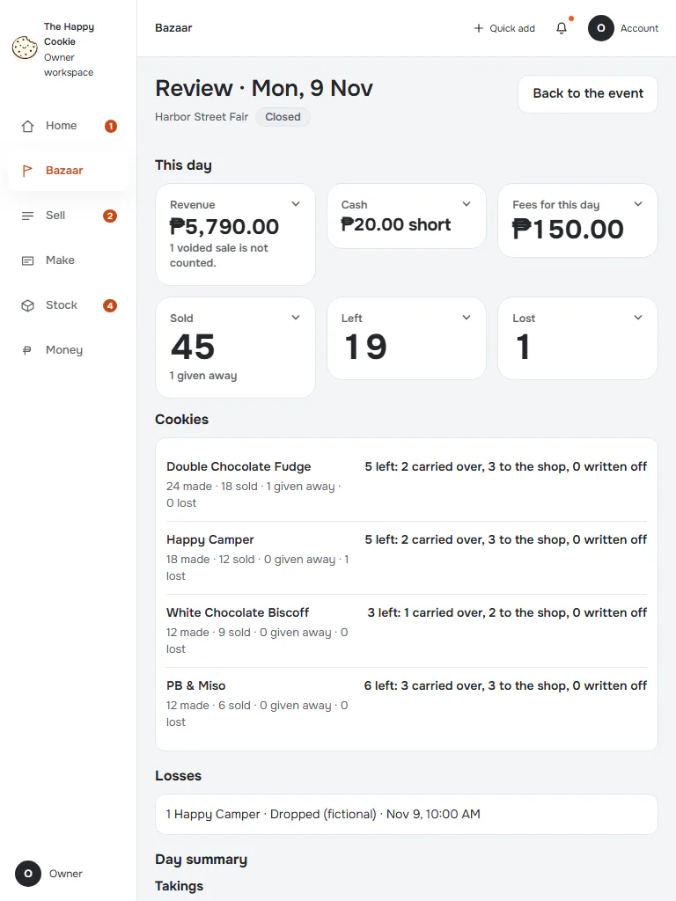
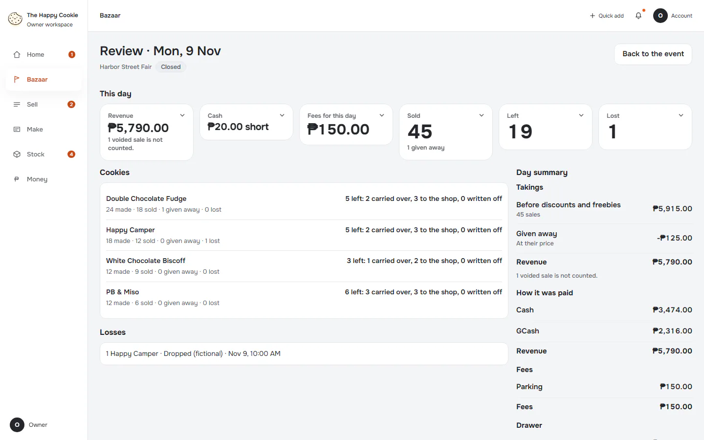

# Review of a closed day

**ACTUAL application.** [Back to bazaar](README.md)

- Manifest id: `bazaar/day-review`
- Source: `src/components/live/bazaar/day-review.tsx`
- Role: owner
- Reference views: close-review

## closed-short

Group: interaction. Fixture: `default`. How it was reached: ui-driven.

**p390** 390×844 · [full page](../../screenshots/bazaar/day-review/closed-short/p390.full.webp)

**t768** 768×1024 · [full page](../../screenshots/bazaar/day-review/closed-short/t768.full.webp)

**d1440** 1440×900 · [full page](../../screenshots/bazaar/day-review/closed-short/d1440.full.webp)

