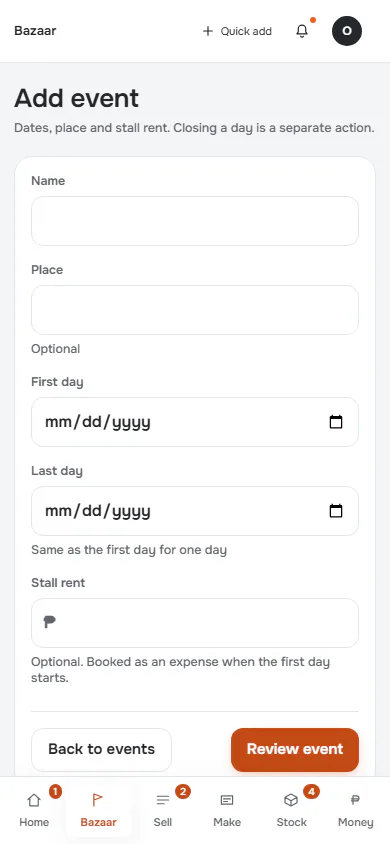
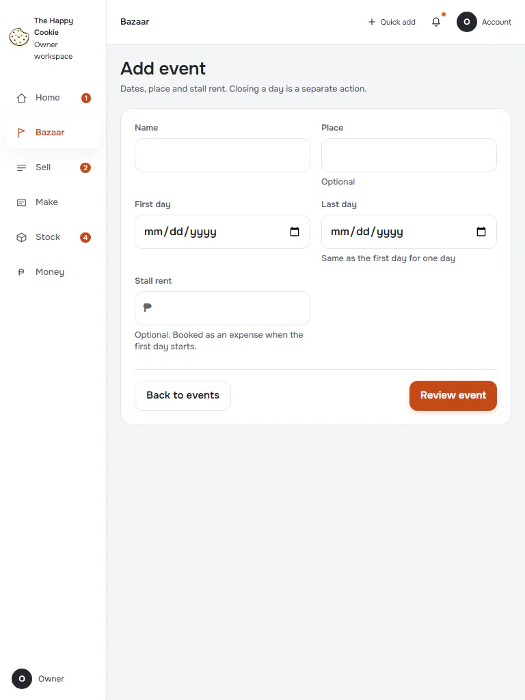
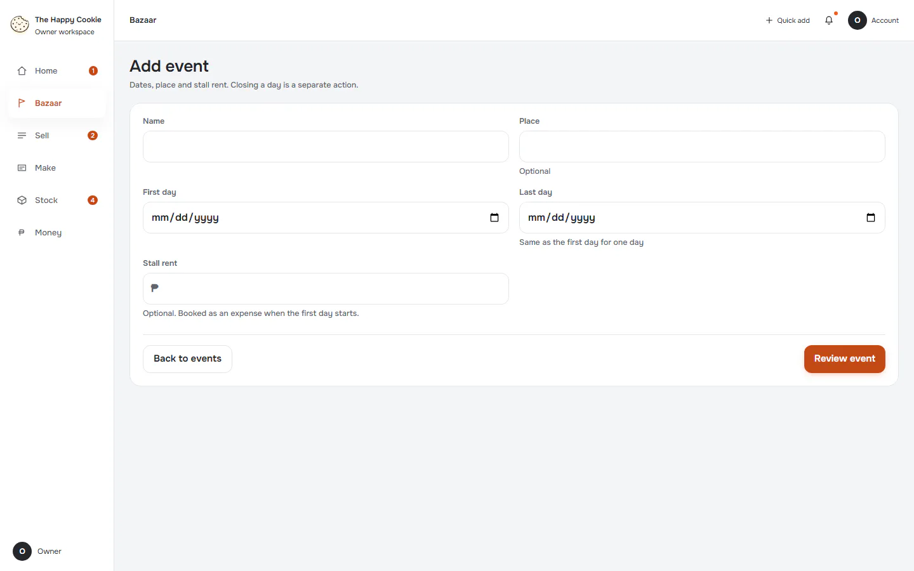
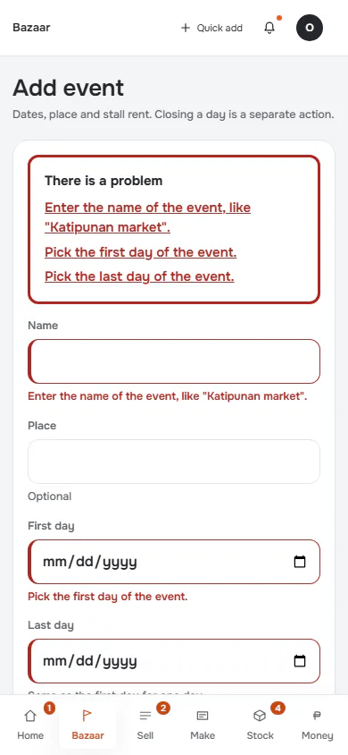
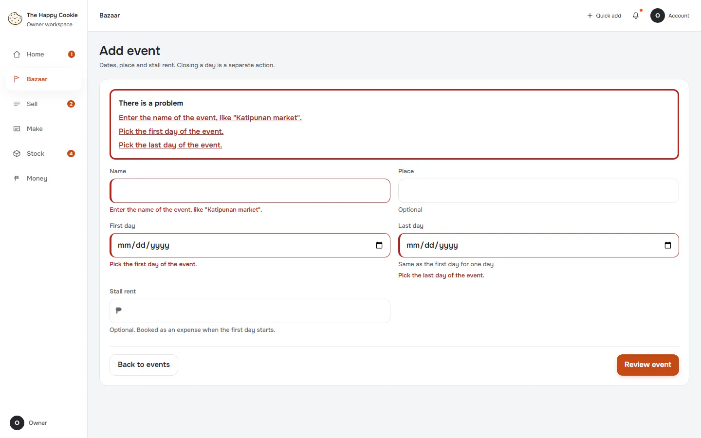
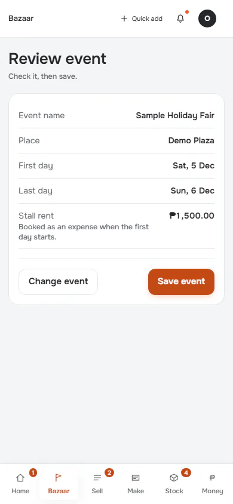
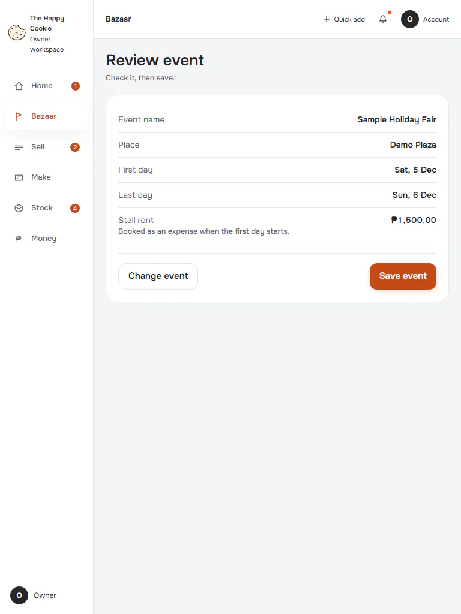
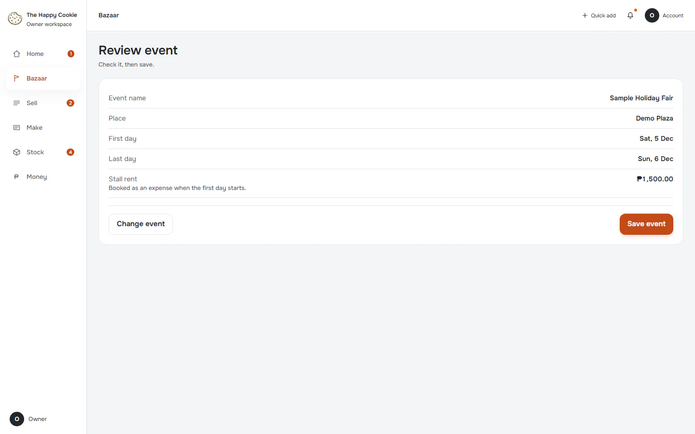
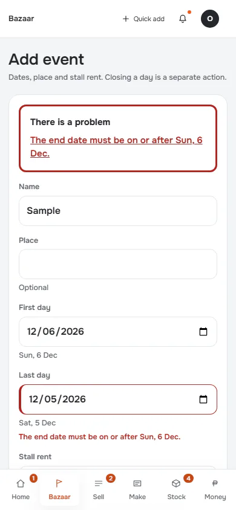
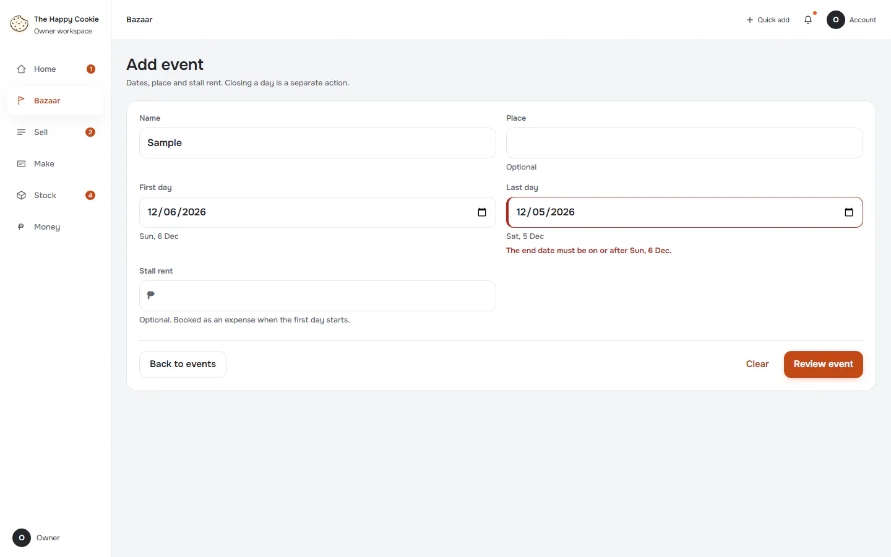

# Add event

**ACTUAL application.** [Back to bazaar](README.md)

- Manifest id: `bazaar/event-add`
- Source: `src/components/live/bazaar/event-form.tsx`
- Role: owner
- Reference views: event-edit

## form-untouched

Group: interaction. Fixture: `default`. How it was reached: ui-driven.

**p390** 390×844 · [full page](../../screenshots/bazaar/event-add/form-untouched/p390.full.webp)

**t768** 768×1024

**d1440** 1440×900

## invalid-empty

Group: interaction. Fixture: `default`. How it was reached: ui-driven.

**p390** 390×844 · [full page](../../screenshots/bazaar/event-add/invalid-empty/p390.full.webp)

**d1440** 1440×900 · [full page](../../screenshots/bazaar/event-add/invalid-empty/d1440.full.webp)

## review

Group: interaction. Fixture: `default`. How it was reached: ui-driven.

**p390** 390×844

**t768** 768×1024

**d1440** 1440×900

## date-order-invalid

Group: interaction. Fixture: `default`. How it was reached: ui-driven.

**p390** 390×844 · [full page](../../screenshots/bazaar/event-add/date-order-invalid/p390.full.webp)

**d1440** 1440×900

