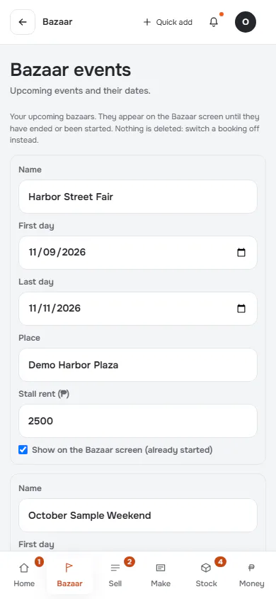
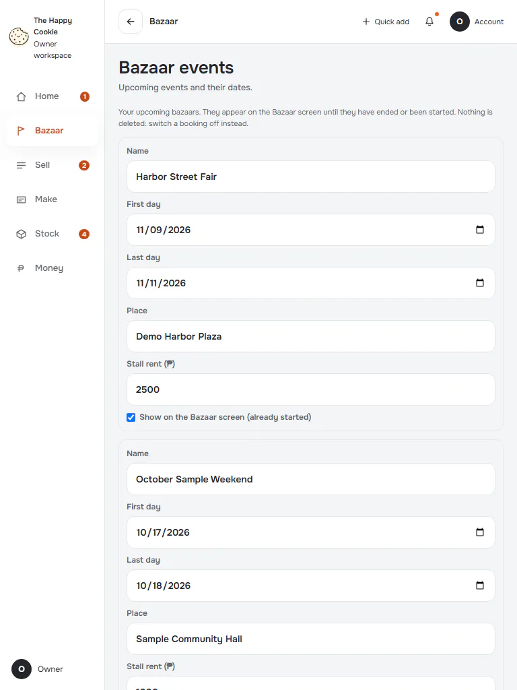
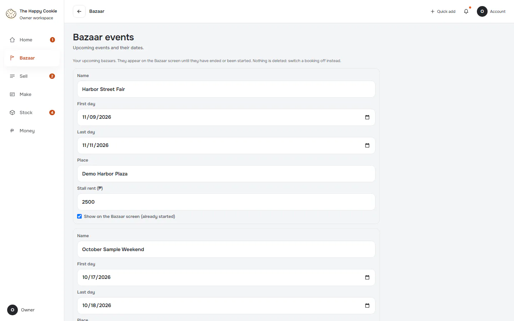

# Edit or switch off events

**ACTUAL application.** [Back to bazaar](README.md)

- Manifest id: `bazaar/event-edit-list`
- Source: `src/components/live/scheduled-events-form.tsx`
- Role: owner
- Reference views: event-edit

## default

Group: interaction. Fixture: `default`. How it was reached: ui-driven.

**p390** 390×844 · [full page](../../screenshots/bazaar/event-edit-list/default/p390.full.webp)

**t768** 768×1024 · [full page](../../screenshots/bazaar/event-edit-list/default/t768.full.webp)

**d1440** 1440×900 · [full page](../../screenshots/bazaar/event-edit-list/default/d1440.full.webp)

