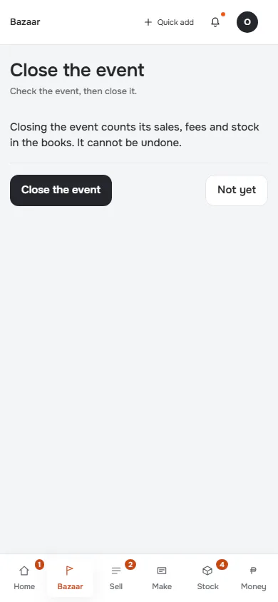
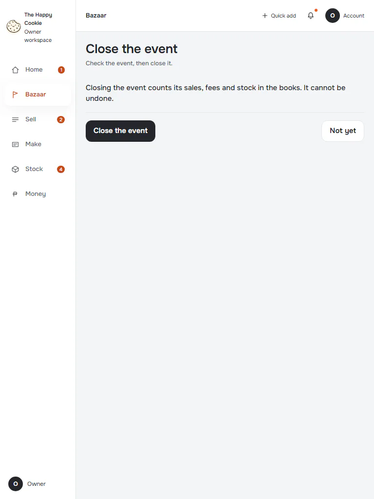
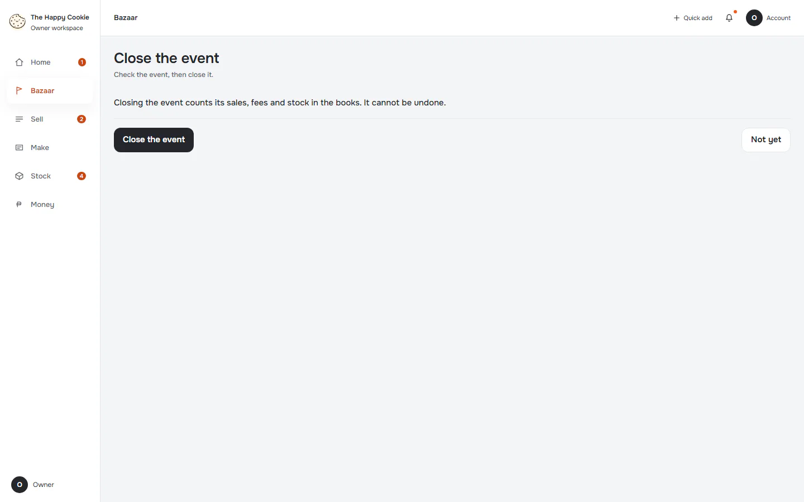

# Review and close the event

**ACTUAL application.** [Back to bazaar](README.md)

- Manifest id: `bazaar/event-review`
- Source: `src/components/live/bazaar/close-event-sheet.tsx`
- Role: owner
- Reference views: event-review

## ready

Group: interaction. Fixture: `bazaar:allClosed`. How it was reached: ui-driven.

**p390** 390×844

**t768** 768×1024

**d1440** 1440×900

