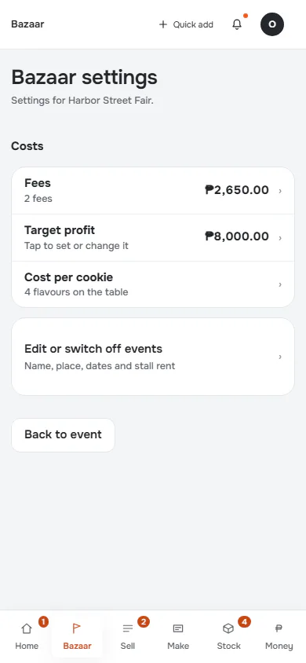
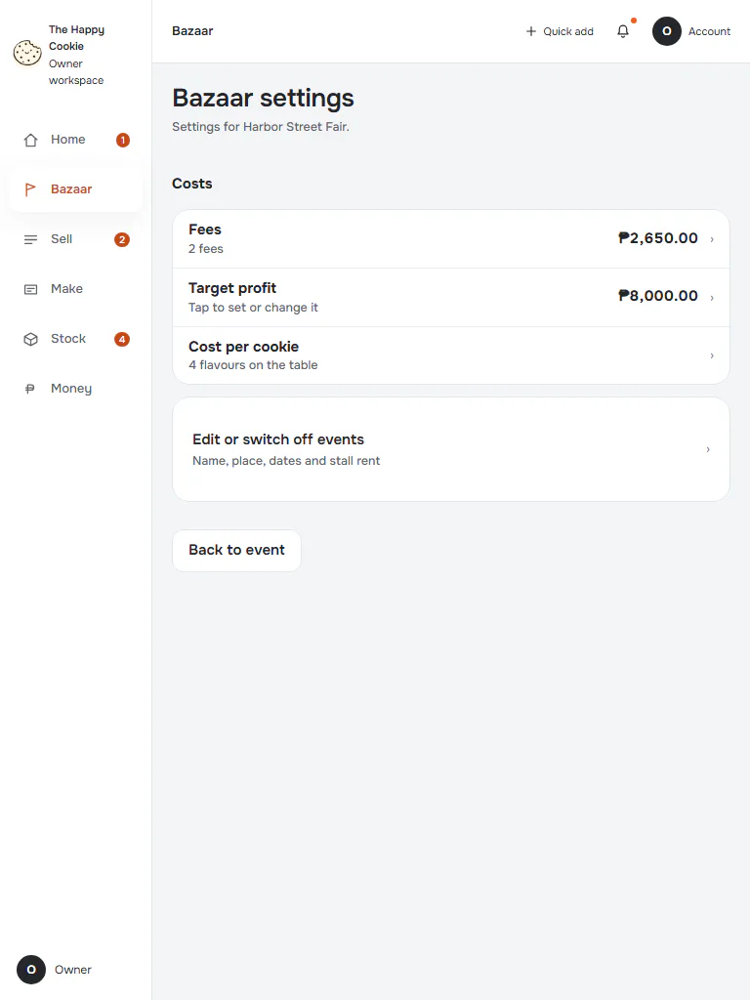
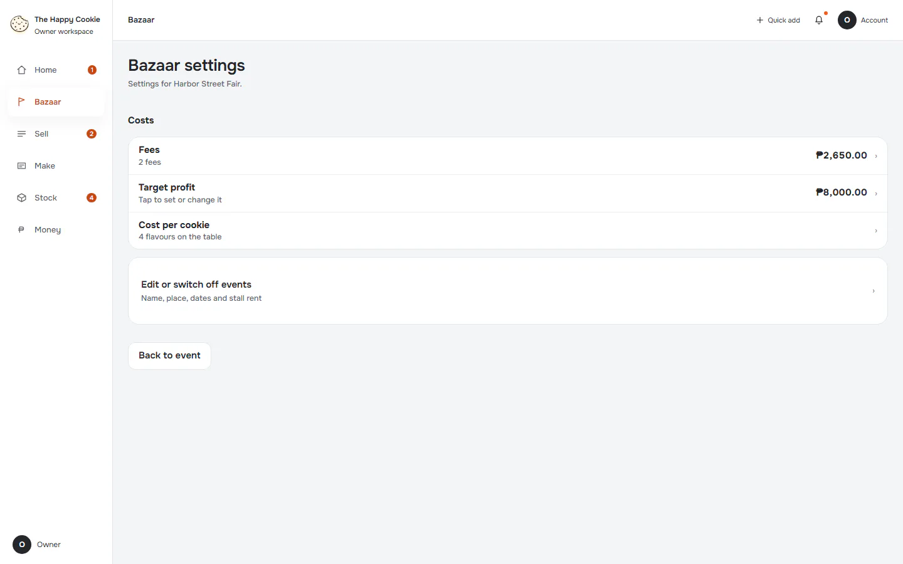
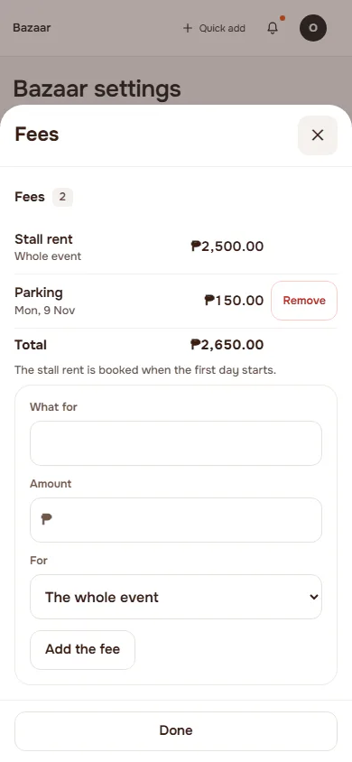
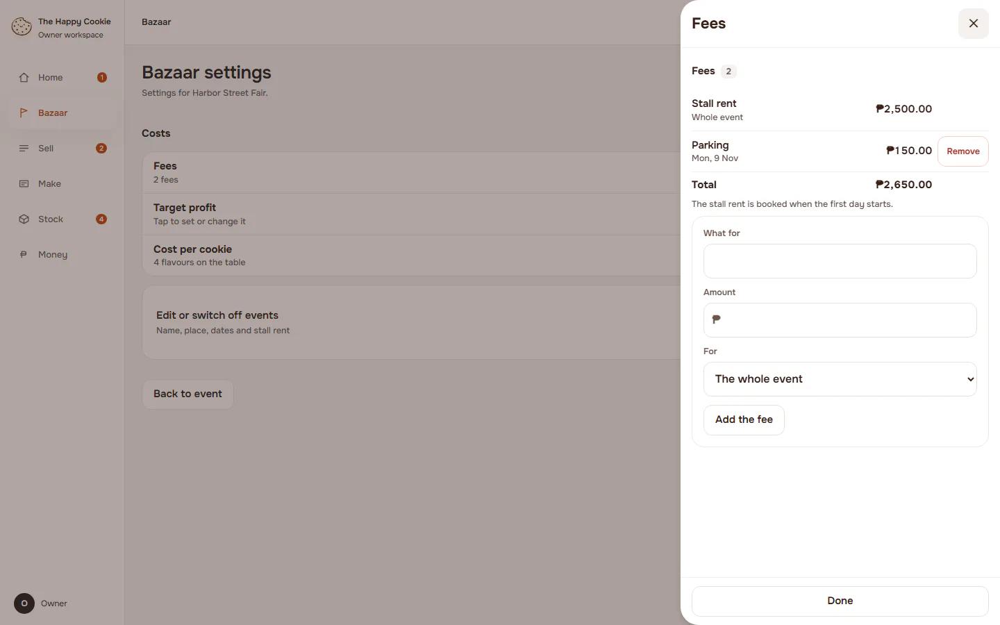
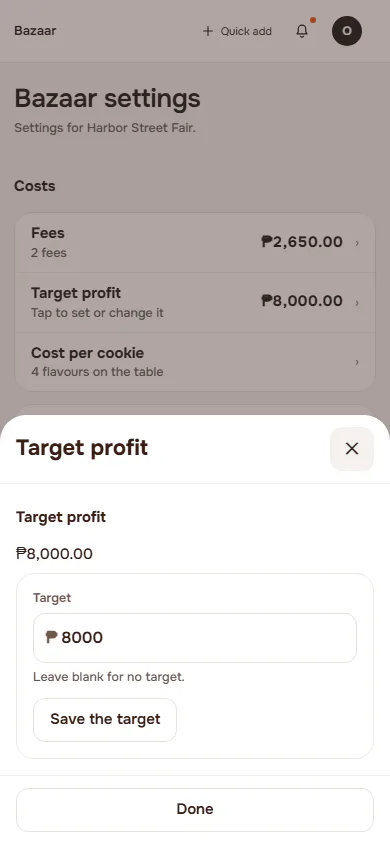
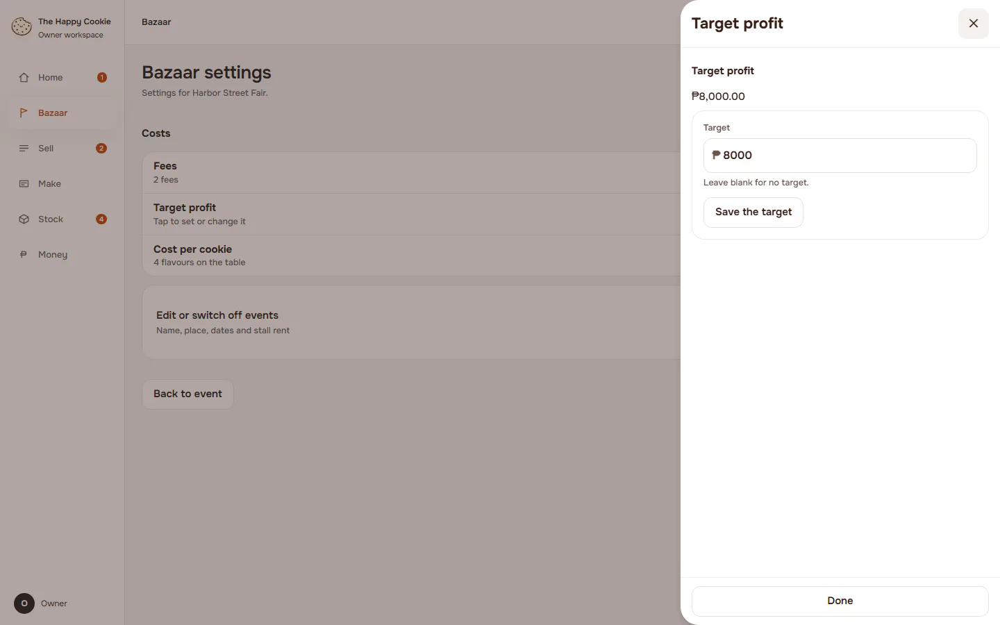
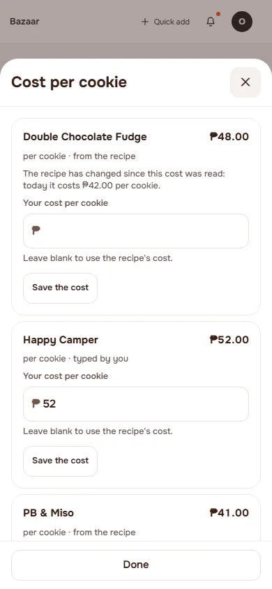
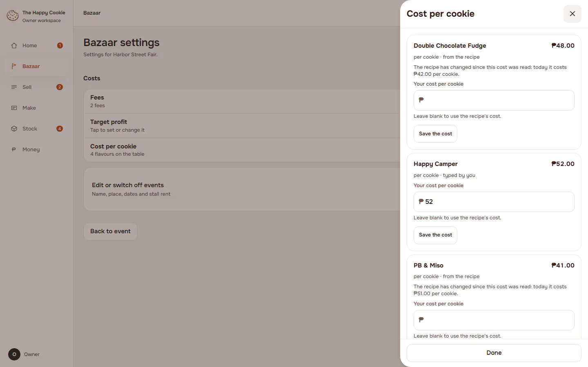

# Bazaar settings (event)

**ACTUAL application.** [Back to bazaar](README.md)

- Manifest id: `bazaar/event-settings`
- Source: `src/components/live/bazaar/event-page.tsx`
- Role: owner
- Reference views: bazaar-settings

## default

Group: interaction. Fixture: `default`. How it was reached: ui-driven.

**p390** 390×844

**t768** 768×1024

**d1440** 1440×900

## fees

Group: interaction. Fixture: `default`. How it was reached: ui-driven.

**p390** 390×844

**d1440** 1440×900

## target

Group: interaction. Fixture: `default`. How it was reached: ui-driven.

**p390** 390×844

**d1440** 1440×900

## cookie-cost

Group: interaction. Fixture: `default`. How it was reached: ui-driven.

**p390** 390×844

**d1440** 1440×900

