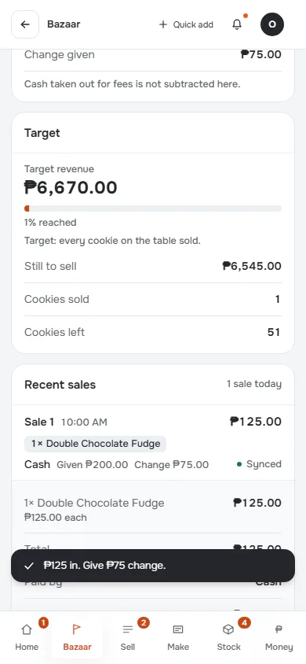
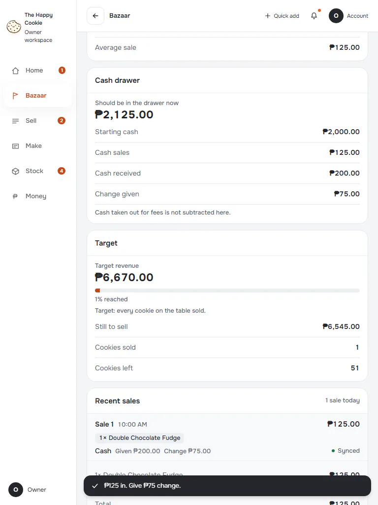
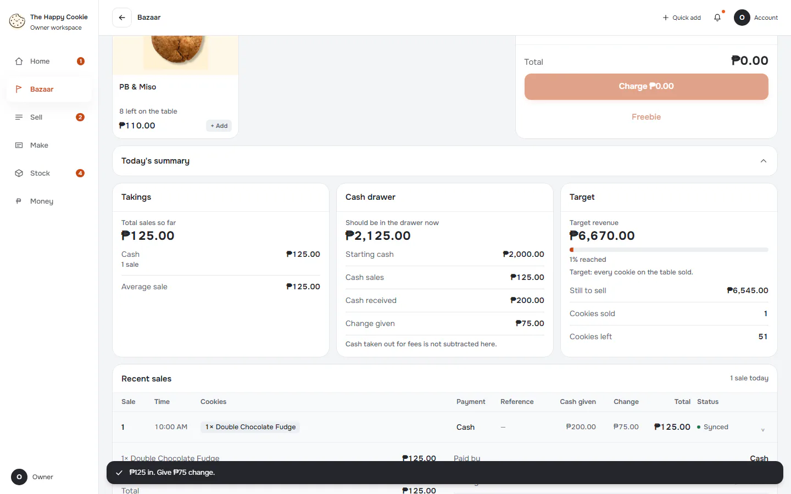

# Sale row and receipt

**ACTUAL application.** [Back to bazaar](README.md)

- Manifest id: `bazaar/receipt`
- Source: `src/components/live/bazaar/till-takings.tsx`
- Role: owner
- Reference views: receipt

## default

Group: interaction. Fixture: `bazaar:planned`. How it was reached: ui-driven.

**p390** 390×844 · [full page](../../screenshots/bazaar/receipt/default/p390.full.webp)

**t768** 768×1024 · [full page](../../screenshots/bazaar/receipt/default/t768.full.webp)

**d1440** 1440×900 · [full page](../../screenshots/bazaar/receipt/default/d1440.full.webp)

