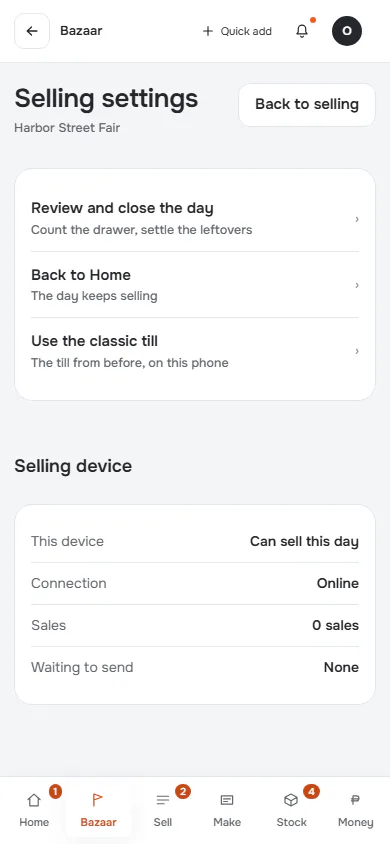
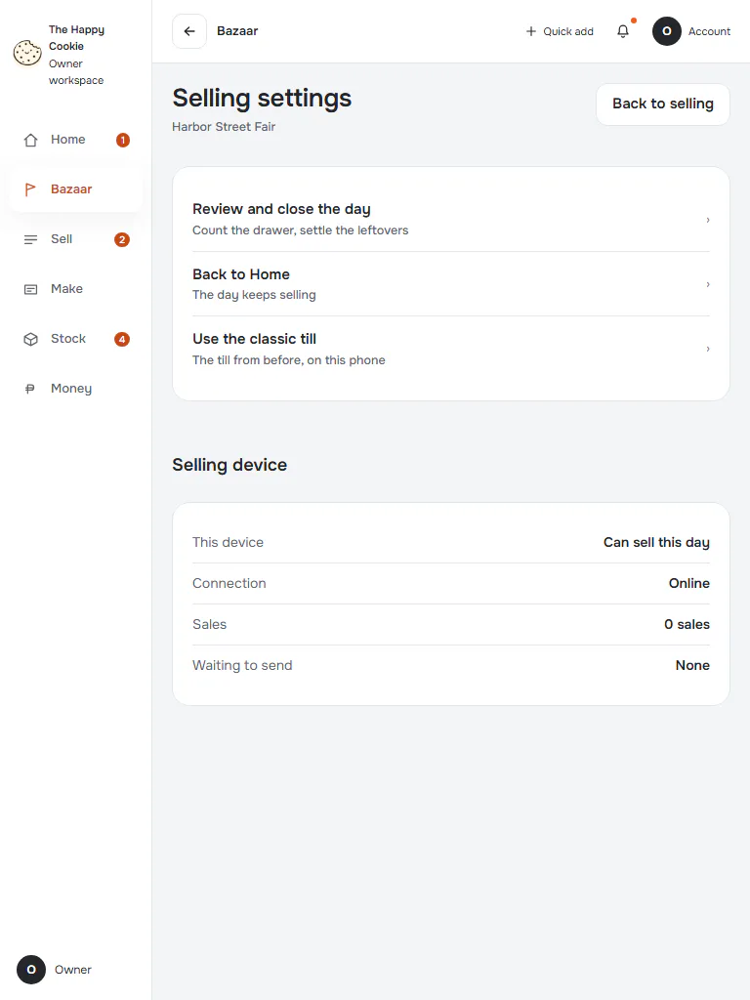
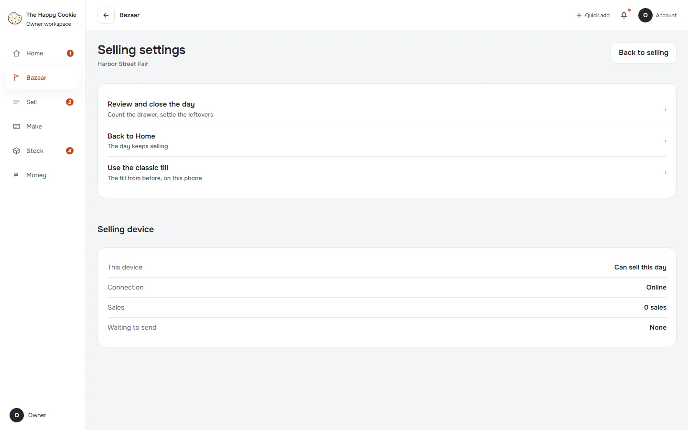

# Selling settings and device

**ACTUAL application.** [Back to bazaar](README.md)

- Manifest id: `bazaar/selling-settings`
- Source: `src/components/live/bazaar/till.tsx`
- Role: owner
- Reference views: device-recovery, bazaar-settings

## default

Group: interaction. Fixture: `bazaar:planned`. How it was reached: ui-driven.

**p390** 390×844 · [full page](../../screenshots/bazaar/selling-settings/default/p390.full.webp)

**t768** 768×1024

**d1440** 1440×900

