# Add cookies, fees and losses

**ACTUAL application.** [Back to bazaar](README.md)

- Manifest id: `bazaar/till-tools`
- Source: `src/components/live/bazaar/till-bar.tsx`
- Role: owner
- Reference views: event-tools, event-tool-review
- Note: No Review step exists; each entry can be removed from the same page (coverage.md: Partial).

## add-cookies

Group: interaction. Fixture: `bazaar:planned`. How it was reached: ui-driven.

**p390** 390×844

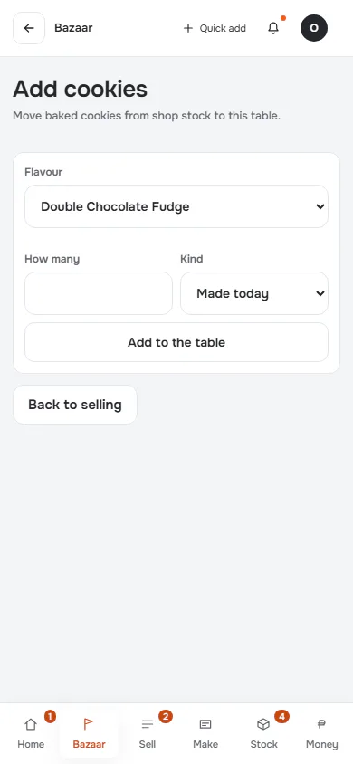

**t768** 768×1024

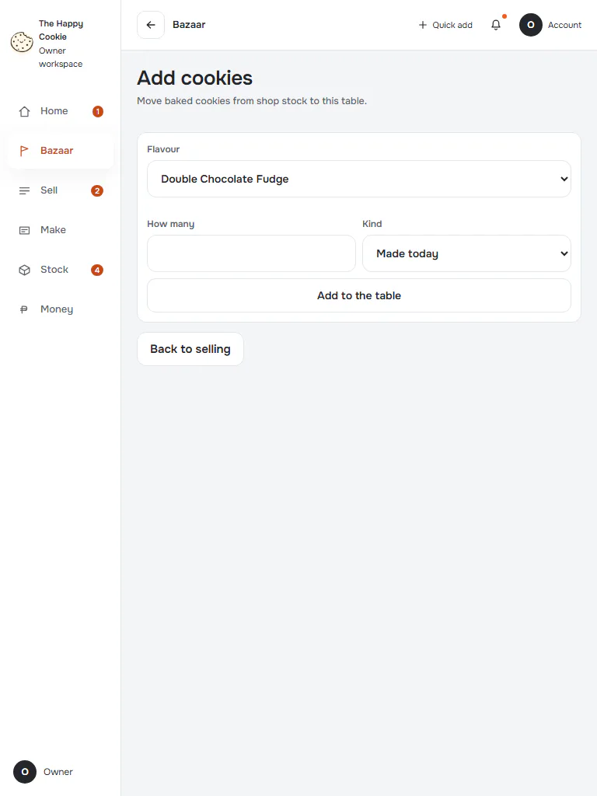

**d1440** 1440×900

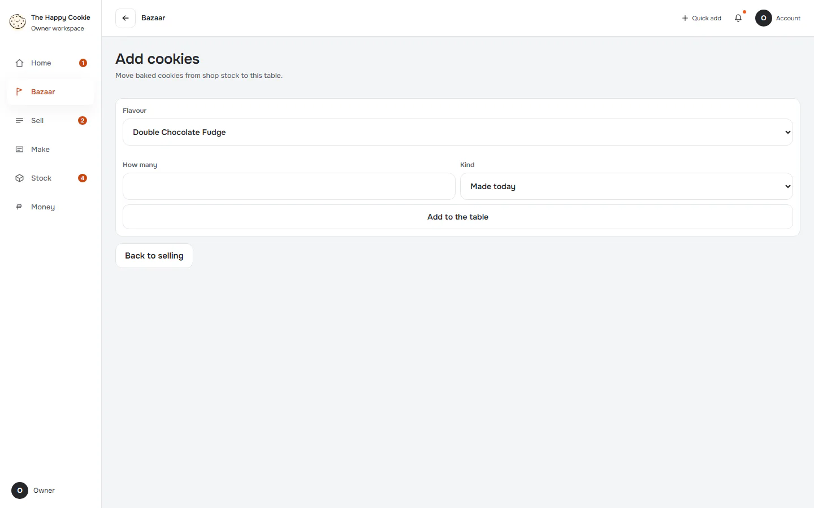

## add-cookies-filled

Group: interaction. Fixture: `bazaar:planned`. How it was reached: ui-driven.

**p390** 390×844

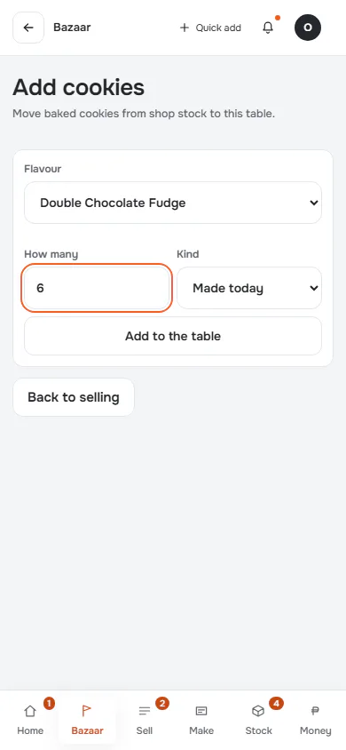

**d1440** 1440×900

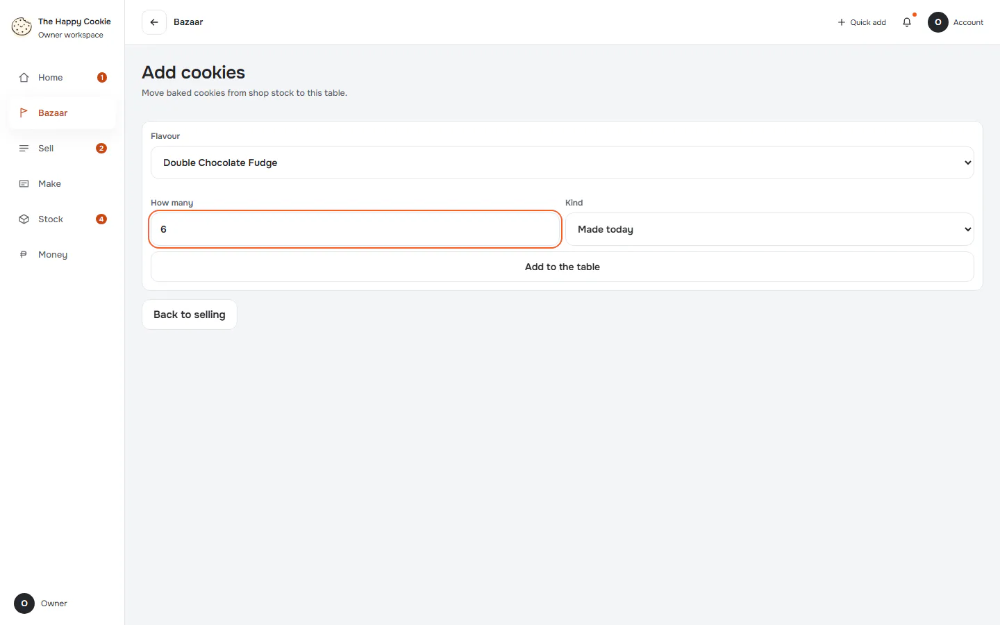

## add-cookies-invalid

Group: interaction. Fixture: `bazaar:planned`. How it was reached: ui-driven.

**p390** 390×844

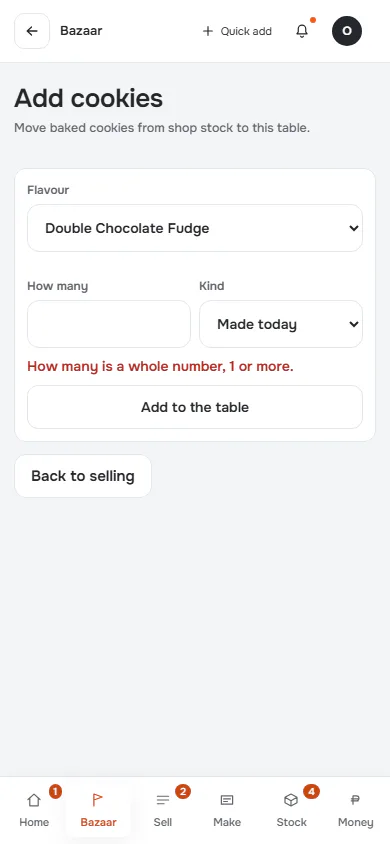

**d1440** 1440×900

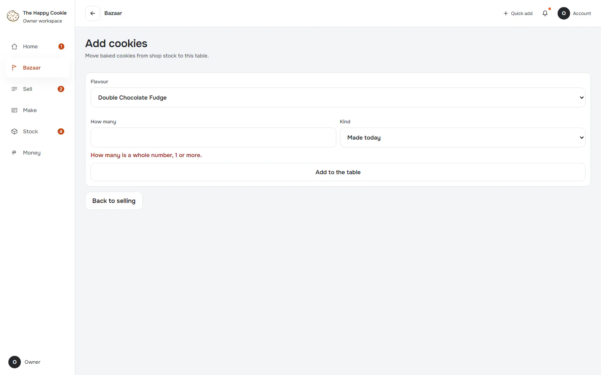

## fees

Group: interaction. Fixture: `bazaar:planned`. How it was reached: ui-driven.

**p390** 390×844 · [full page](../../screenshots/bazaar/till-tools/fees/p390.full.webp)

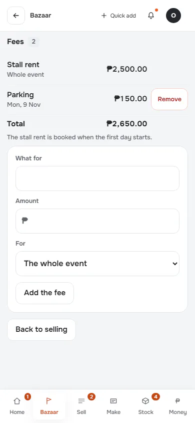

**t768** 768×1024

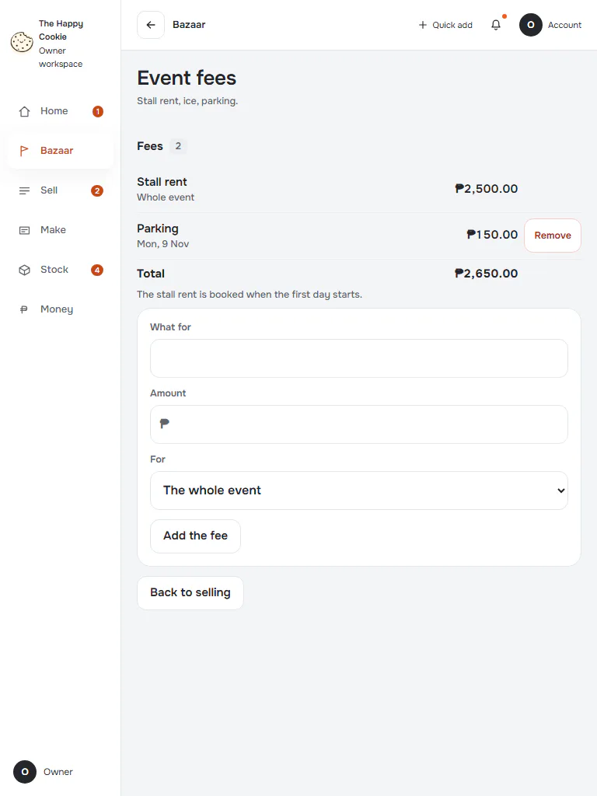

**d1440** 1440×900

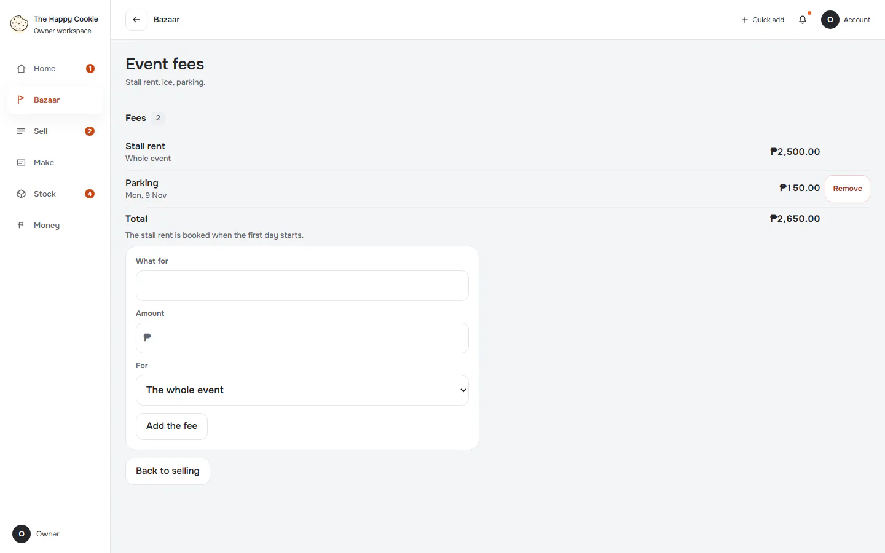

## fees-invalid

Group: interaction. Fixture: `bazaar:planned`. How it was reached: ui-driven.

**p390** 390×844 · [full page](../../screenshots/bazaar/till-tools/fees-invalid/p390.full.webp)

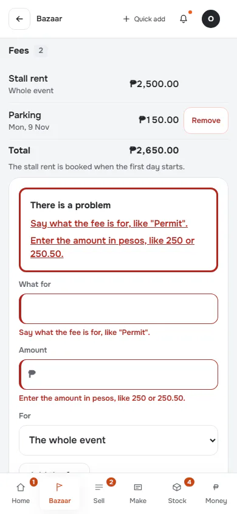

**d1440** 1440×900 · [full page](../../screenshots/bazaar/till-tools/fees-invalid/d1440.full.webp)

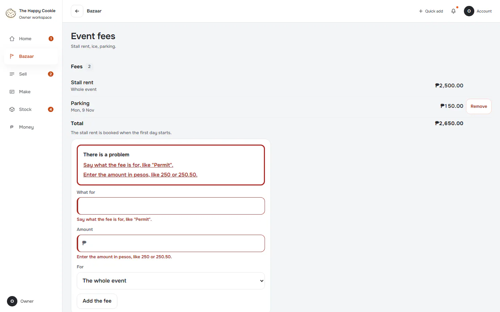
