# Prepare dough

**ACTUAL application.** [Back to make](README.md)

- Manifest id: `make/dough-prepare`
- Source: `src/components/live/production/production-dough.tsx`
- Role: owner
- Reference views: production-entry
- Note: Newly separated recipe amount from actual dough balls at this commit.

## sheet-untouched

Group: interaction. Fixture: `default`. How it was reached: ui-driven.

**p390** 390×844 · [full page](../../screenshots/make/dough-prepare/sheet-untouched/p390.full.webp)

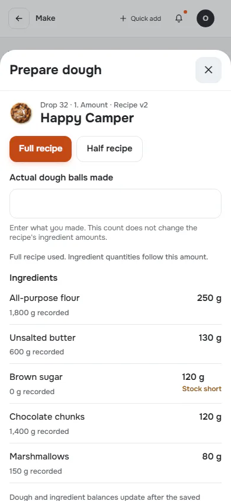

**t768** 768×1024 · [full page](../../screenshots/make/dough-prepare/sheet-untouched/t768.full.webp)

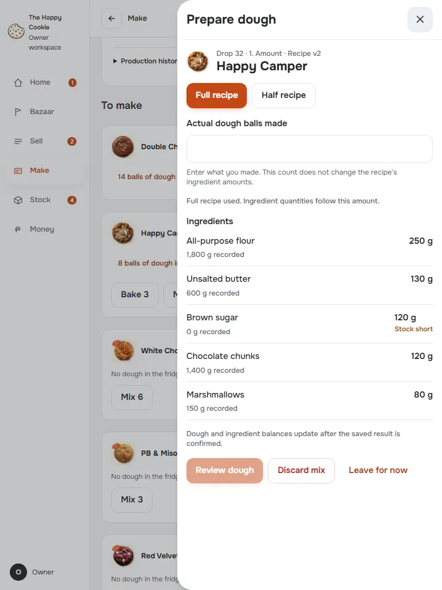

**d1440** 1440×900 · [full page](../../screenshots/make/dough-prepare/sheet-untouched/d1440.full.webp)

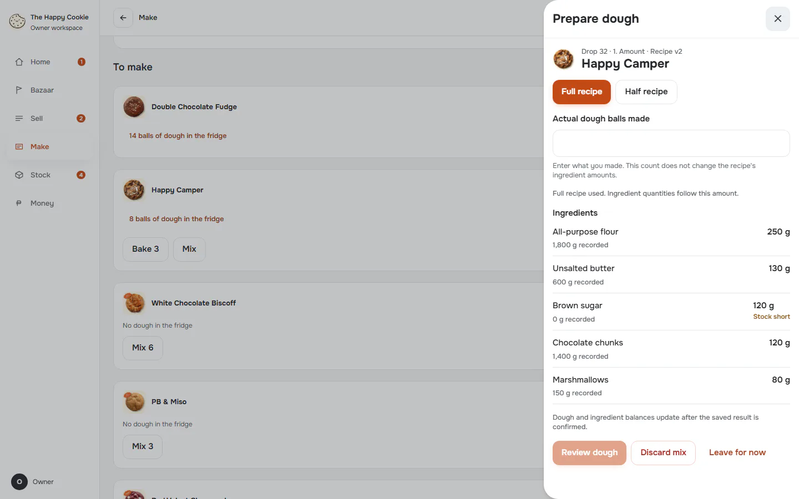

## half-recipe

Group: business. Fixture: `default`. How it was reached: ui-driven.

**p390** 390×844 · [full page](../../screenshots/make/dough-prepare/half-recipe/p390.full.webp)

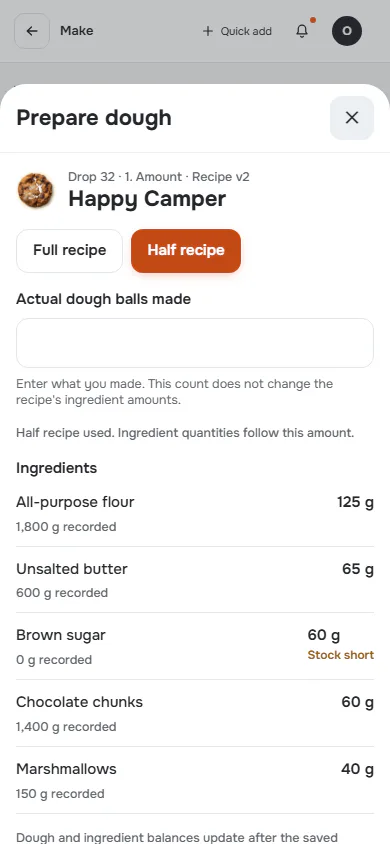

**d1440** 1440×900 · [full page](../../screenshots/make/dough-prepare/half-recipe/d1440.full.webp)

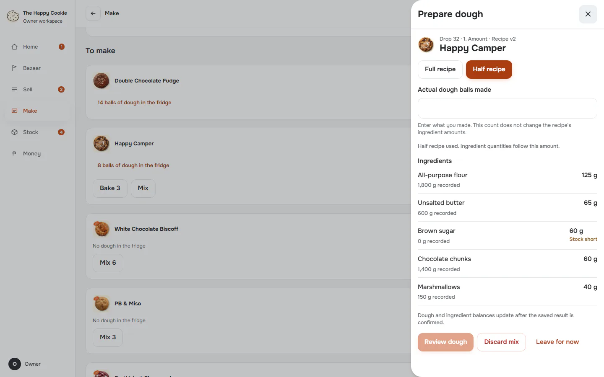

## review

Group: interaction. Fixture: `default`. How it was reached: ui-driven.

**p390** 390×844 · [full page](../../screenshots/make/dough-prepare/review/p390.full.webp)

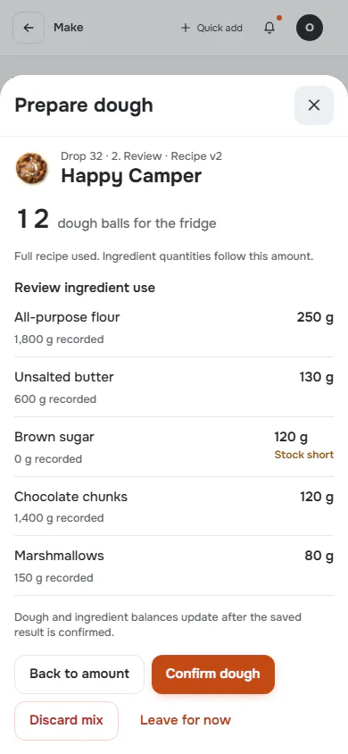

**t768** 768×1024 · [full page](../../screenshots/make/dough-prepare/review/t768.full.webp)

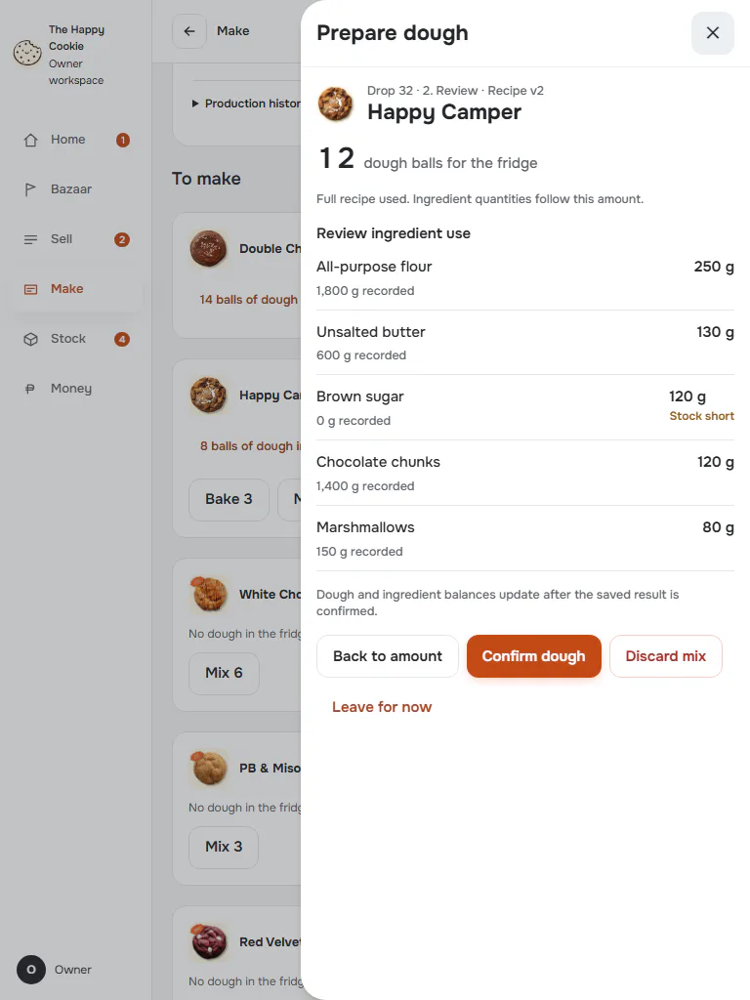

**d1440** 1440×900 · [full page](../../screenshots/make/dough-prepare/review/d1440.full.webp)

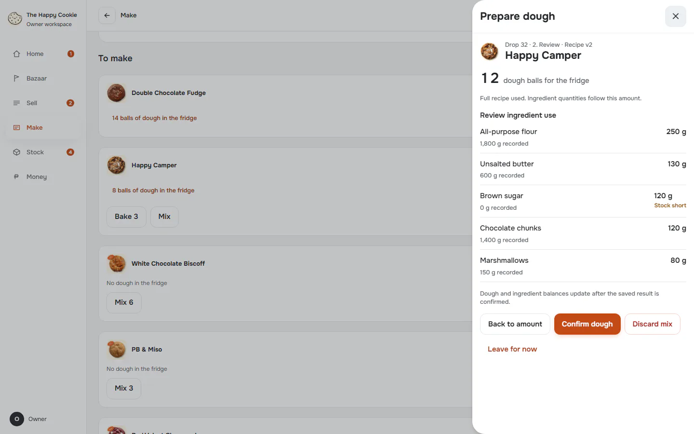

## confirmed

Group: business. Fixture: `default`. How it was reached: ui-driven.

**p390** 390×844 · [full page](../../screenshots/make/dough-prepare/confirmed/p390.full.webp)

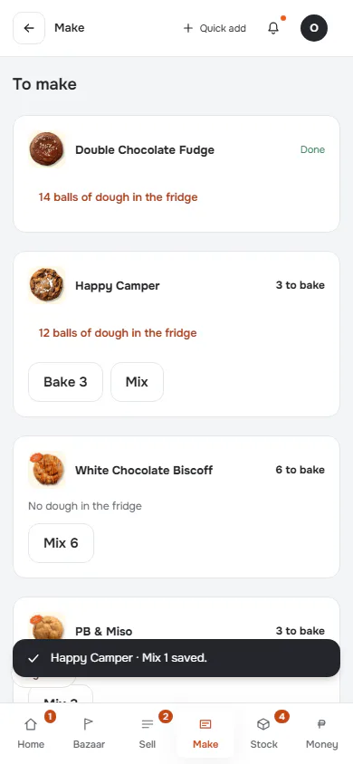

**d1440** 1440×900 · [full page](../../screenshots/make/dough-prepare/confirmed/d1440.full.webp)

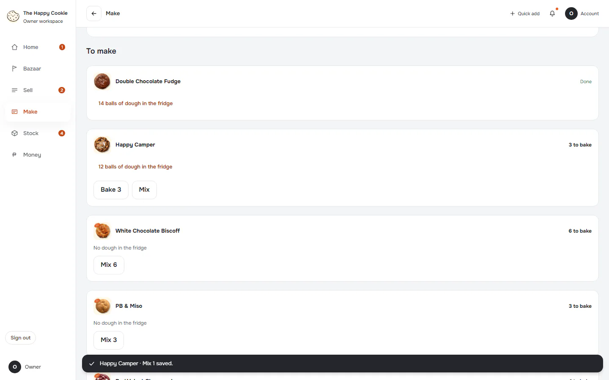

## confirm-failed

Group: failure. Fixture: `default`. How it was reached: ui-driven.

**p390** 390×844 · [full page](../../screenshots/make/dough-prepare/confirm-failed/p390.full.webp)

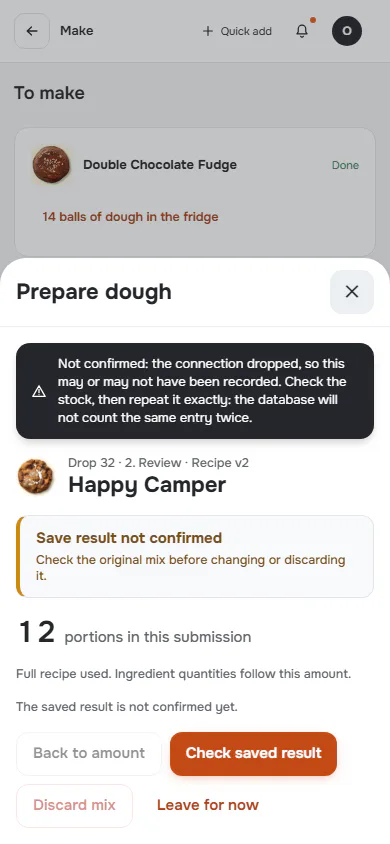

**d1440** 1440×900 · [full page](../../screenshots/make/dough-prepare/confirm-failed/d1440.full.webp)

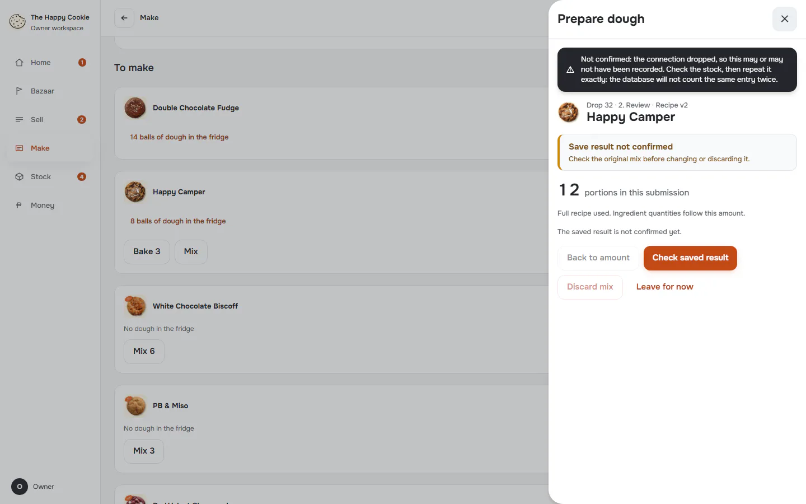

## invalid

Group: interaction. Fixture: `default`. How it was reached: ui-driven.

**p390** 390×844 · [full page](../../screenshots/make/dough-prepare/invalid/p390.full.webp)

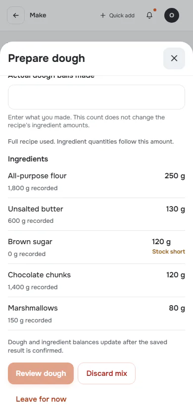

**d1440** 1440×900 · [full page](../../screenshots/make/dough-prepare/invalid/d1440.full.webp)

