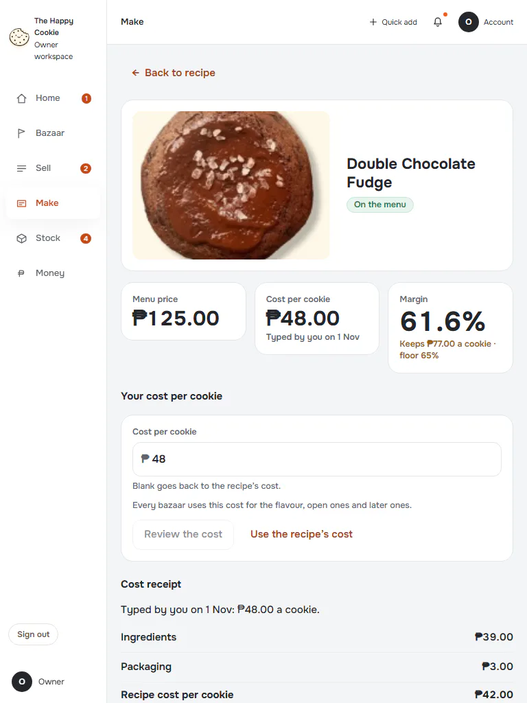
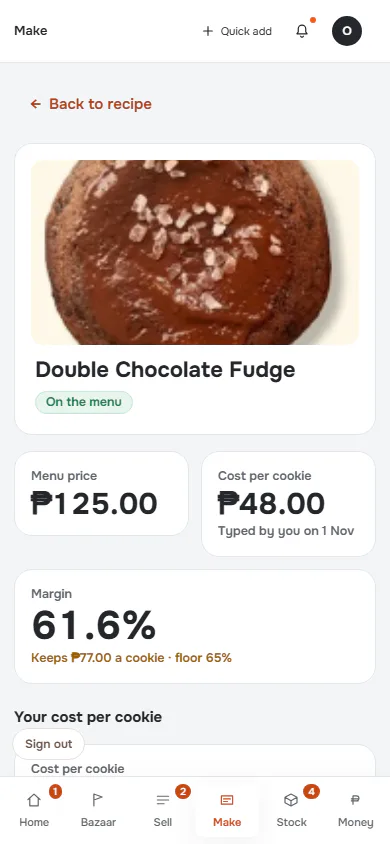
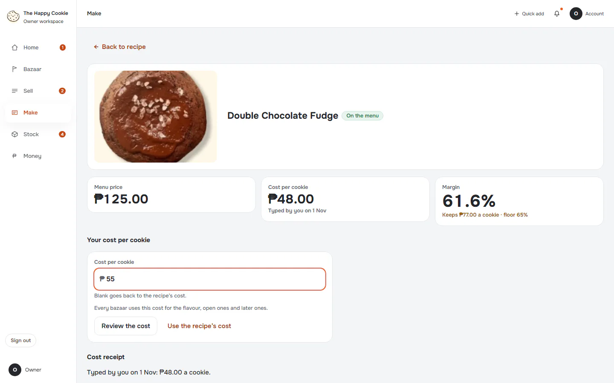
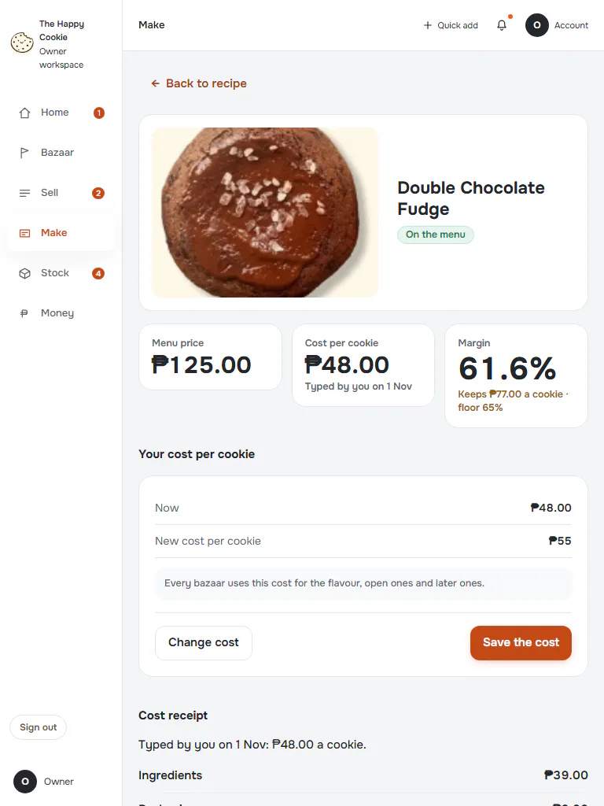
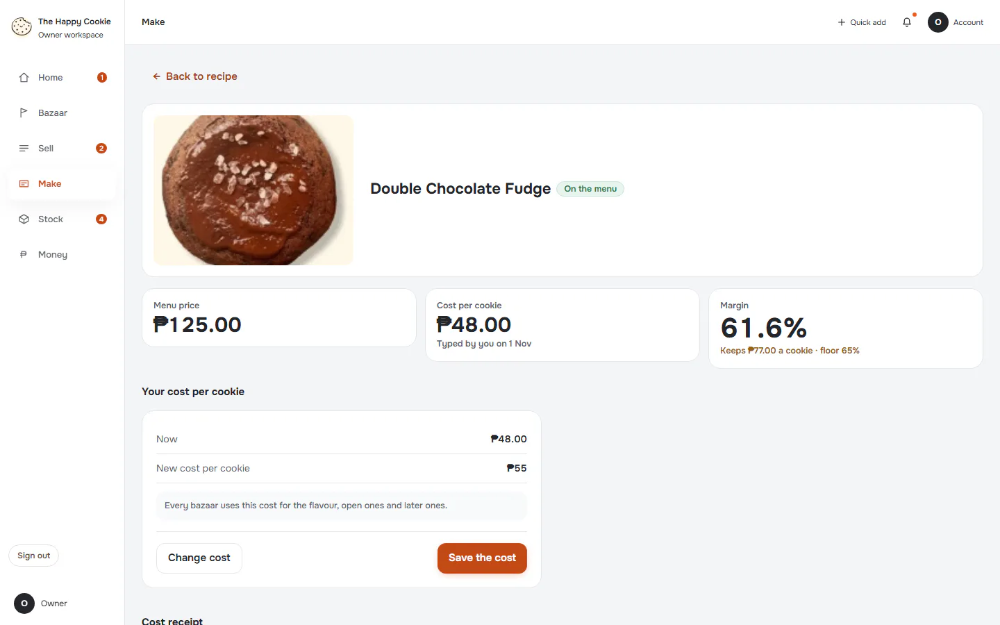
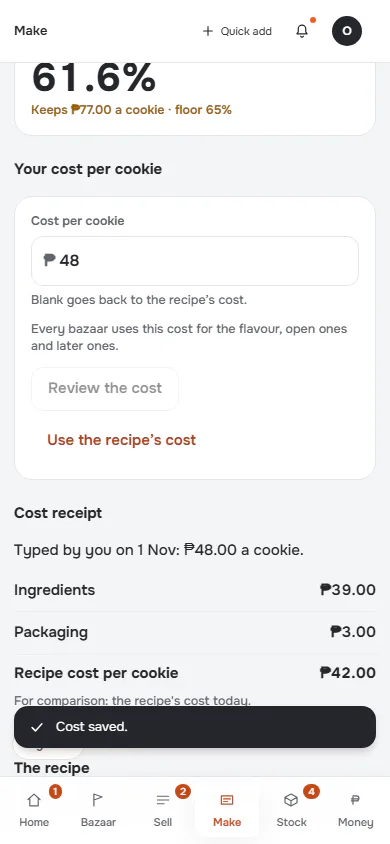
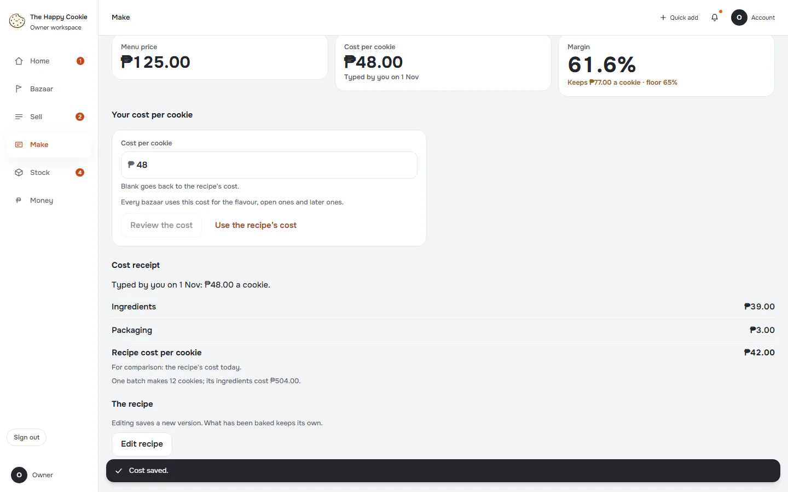
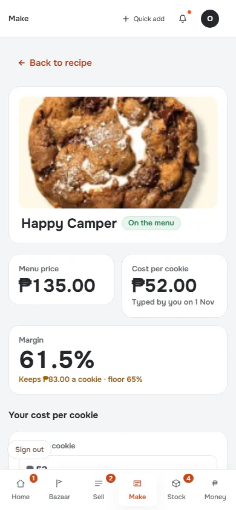
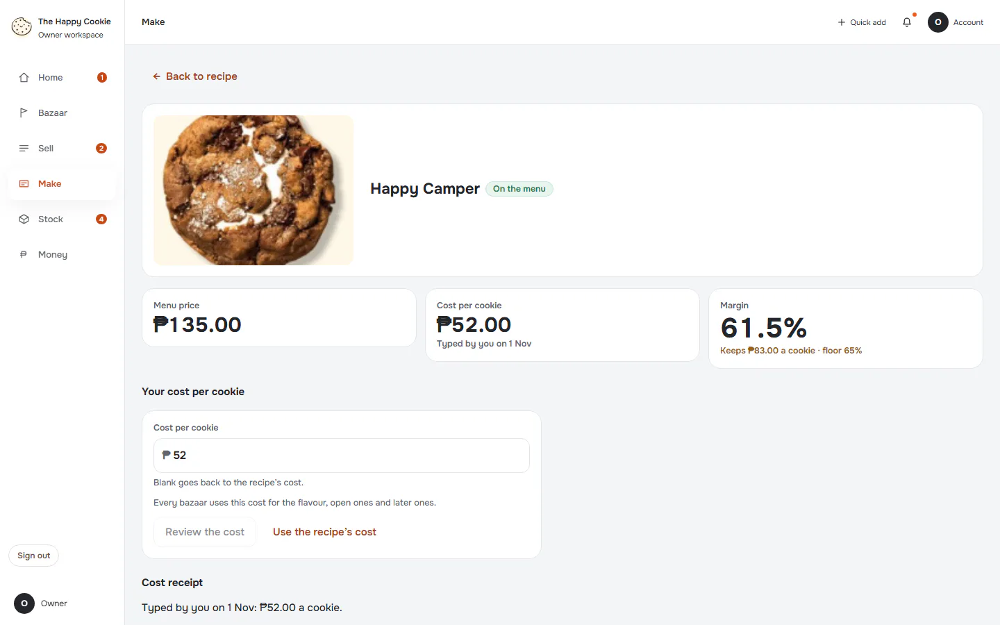

# Cost, history & edit

**ACTUAL application.** [Back to make](README.md)

- Manifest id: `make/flavour-cost`
- Source: `src/components/live/recipes/flavour-page.tsx`
- Role: owner
- Reference views: cost-edit, cost-review

## default

Group: interaction. Fixture: `default`. How it was reached: ui-driven.

**p390** 390×844 · [full page](../../screenshots/make/flavour-cost/default/p390.full.webp)

**t768** 768×1024 · [full page](../../screenshots/make/flavour-cost/default/t768.full.webp)

**d1440** 1440×900 · [full page](../../screenshots/make/flavour-cost/default/d1440.full.webp)

## cost-typed

Group: interaction. Fixture: `default`. How it was reached: ui-driven.

**p390** 390×844 · [full page](../../screenshots/make/flavour-cost/cost-typed/p390.full.webp)

**d1440** 1440×900 · [full page](../../screenshots/make/flavour-cost/cost-typed/d1440.full.webp)

## cost-review

Group: interaction. Fixture: `default`. How it was reached: ui-driven.

**p390** 390×844 · [full page](../../screenshots/make/flavour-cost/cost-review/p390.full.webp)

**t768** 768×1024 · [full page](../../screenshots/make/flavour-cost/cost-review/t768.full.webp)

**d1440** 1440×900 · [full page](../../screenshots/make/flavour-cost/cost-review/d1440.full.webp)

## cost-saved

Group: business. Fixture: `default`. How it was reached: ui-driven.

**p390** 390×844 · [full page](../../screenshots/make/flavour-cost/cost-saved/p390.full.webp)

**d1440** 1440×900 · [full page](../../screenshots/make/flavour-cost/cost-saved/d1440.full.webp)

## incomplete-cost

Recipe cost is incomplete because one ingredient has no cost. Group: business. Fixture: `default`. How it was reached: ui-driven.

**p390** 390×844 · [full page](../../screenshots/make/flavour-cost/incomplete-cost/p390.full.webp)

**d1440** 1440×900 · [full page](../../screenshots/make/flavour-cost/incomplete-cost/d1440.full.webp)

