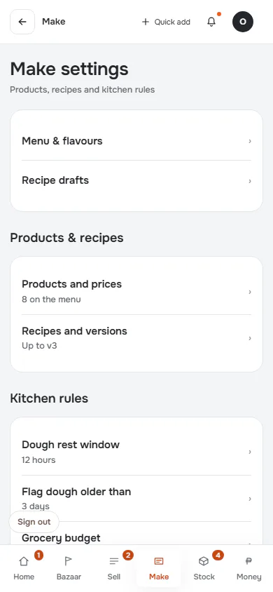
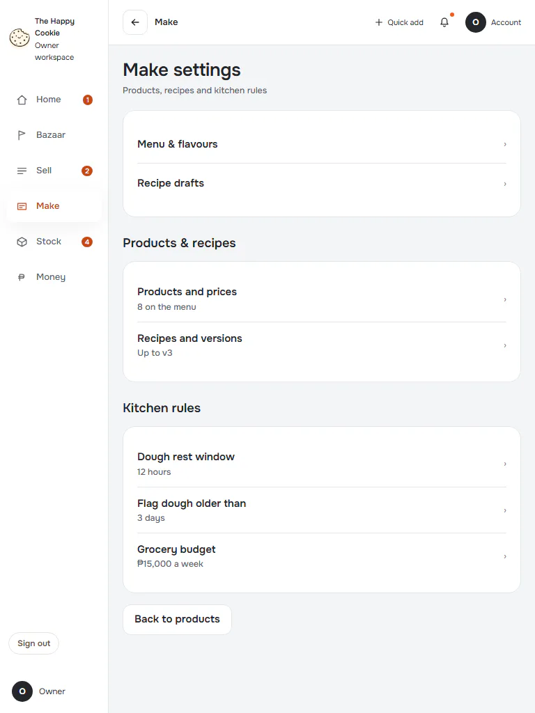
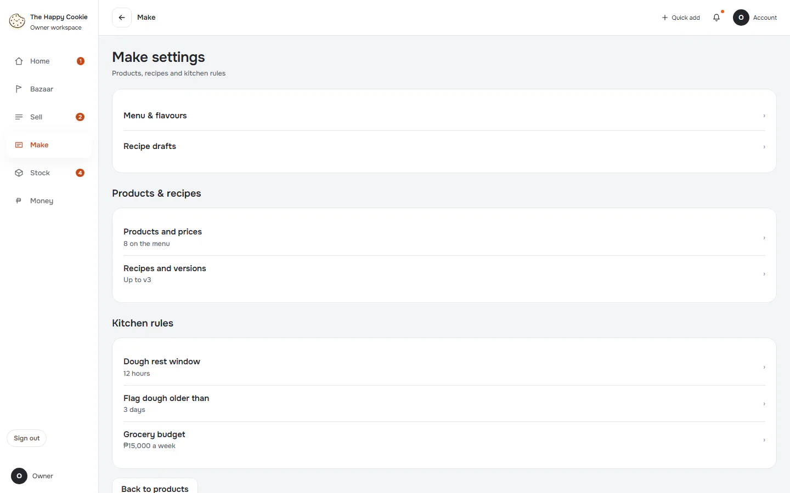

# Make settings

**ACTUAL application.** [Back to make](README.md)

- Manifest id: `make/make-settings`
- Source: `src/components/live/account/settings-areas.tsx`
- Role: owner
- Reference views: make-settings

## default

Group: interaction. Fixture: `default`. How it was reached: ui-driven.

**p390** 390×844 · [full page](../../screenshots/make/make-settings/default/p390.full.webp)

**t768** 768×1024

**d1440** 1440×900 · [full page](../../screenshots/make/make-settings/default/d1440.full.webp)

