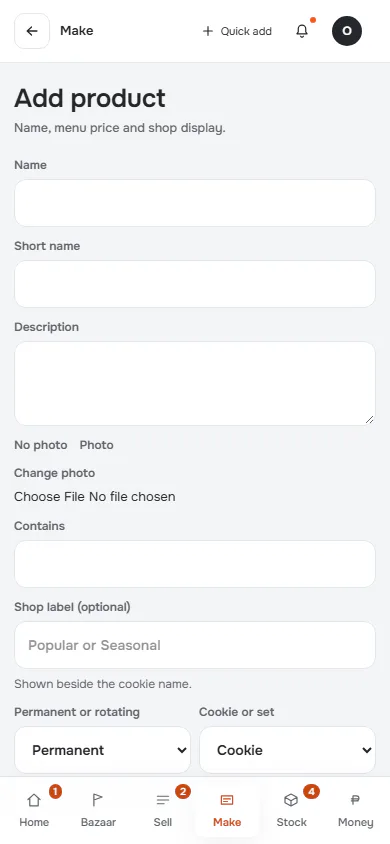
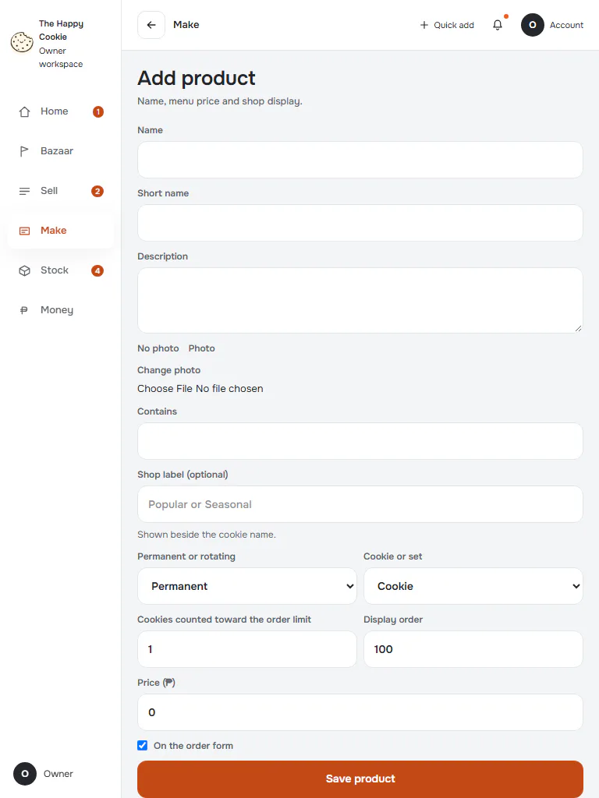
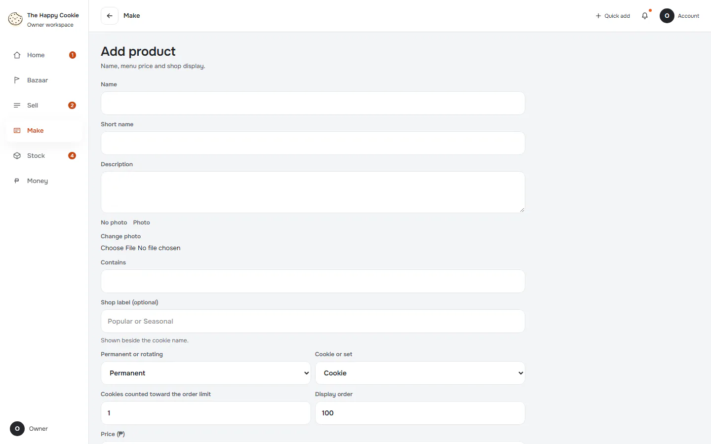
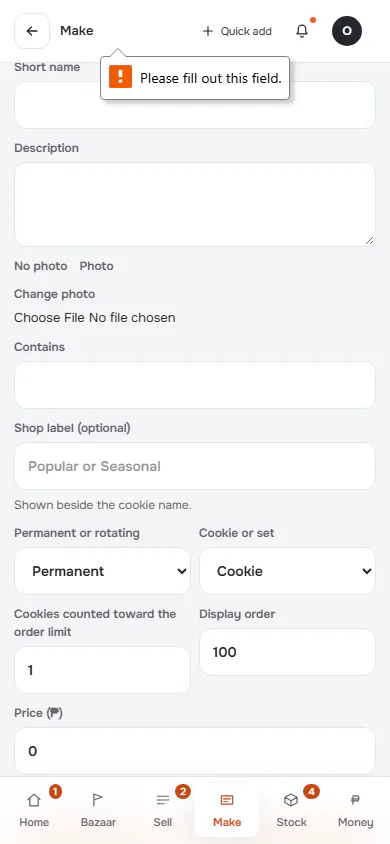
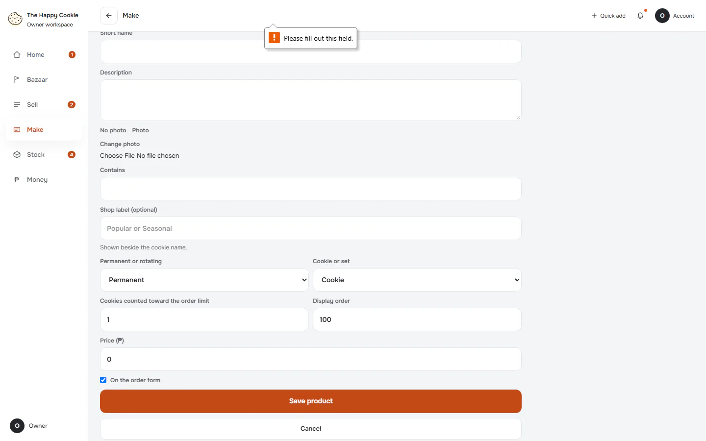

# Add product

**ACTUAL application.** [Back to make](README.md)

- Manifest id: `make/new-product`
- Source: `src/components/live/live-form-host.tsx`
- Role: owner
- Reference views: new-product

## form-untouched

Group: interaction. Fixture: `default`. How it was reached: ui-driven.

**p390** 390×844 · [full page](../../screenshots/make/new-product/form-untouched/p390.full.webp)

**t768** 768×1024 · [full page](../../screenshots/make/new-product/form-untouched/t768.full.webp)

**d1440** 1440×900 · [full page](../../screenshots/make/new-product/form-untouched/d1440.full.webp)

## invalid

Group: interaction. Fixture: `default`. How it was reached: ui-driven.

**p390** 390×844 · [full page](../../screenshots/make/new-product/invalid/p390.full.webp)

**d1440** 1440×900 · [full page](../../screenshots/make/new-product/invalid/d1440.full.webp)

