# Recipe book

**ACTUAL application.** [Back to make](README.md)

- Manifest id: `make/recipe-book`
- Source: `src/components/live/recipes/recipe-book.tsx`
- Role: owner
- Reference views: none (found in code)

## populated

Group: data. Fixture: `default`. How it was reached: ui-driven.

**p320** 320×700 · [full page](../../screenshots/make/recipe-book/populated/p320.full.webp)

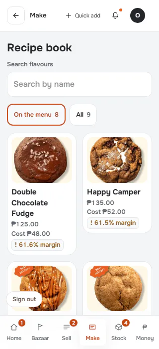

**p390** 390×844 · [full page](../../screenshots/make/recipe-book/populated/p390.full.webp)

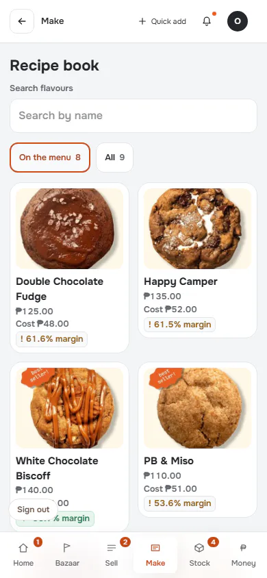

**t768** 768×1024 · [full page](../../screenshots/make/recipe-book/populated/t768.full.webp)

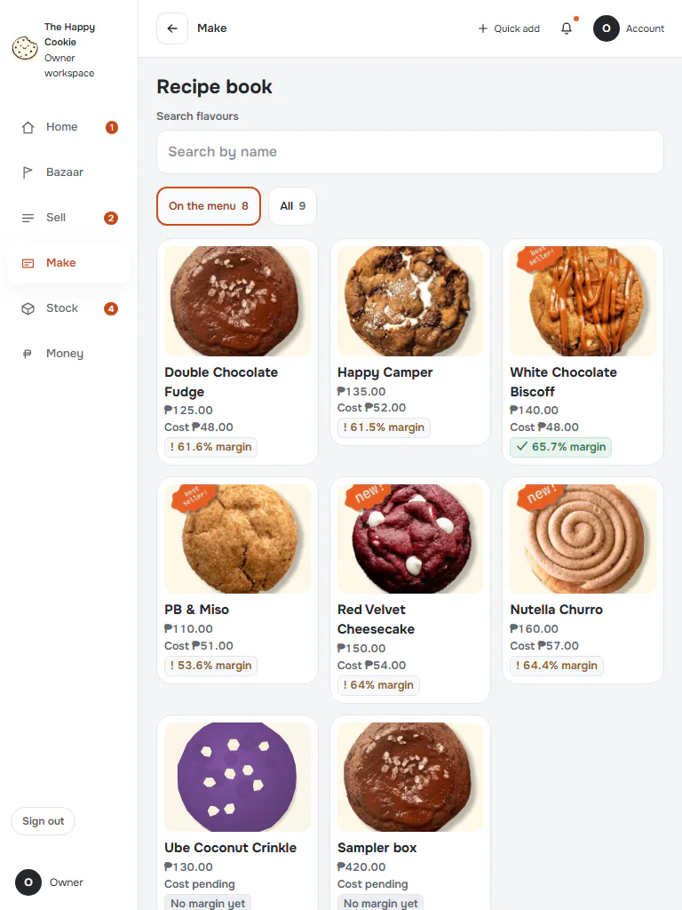

**l1024** 1024×768 · [full page](../../screenshots/make/recipe-book/populated/l1024.full.webp)

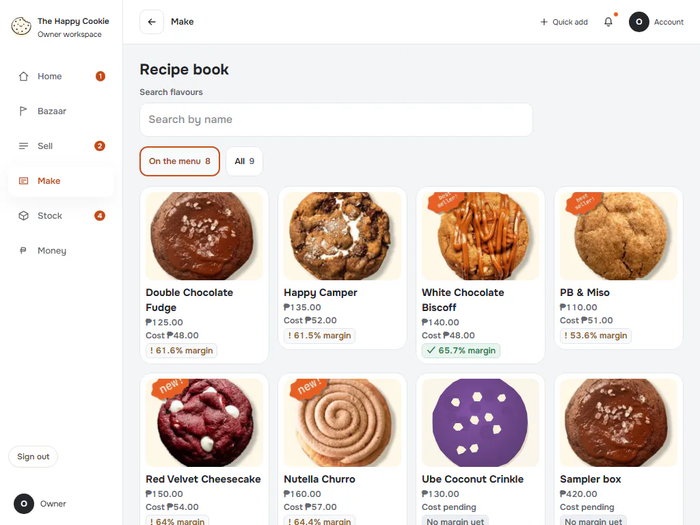

**d1440** 1440×900 · [full page](../../screenshots/make/recipe-book/populated/d1440.full.webp)

**w1920** 1920×1080 · [full page](../../screenshots/make/recipe-book/populated/w1920.full.webp)

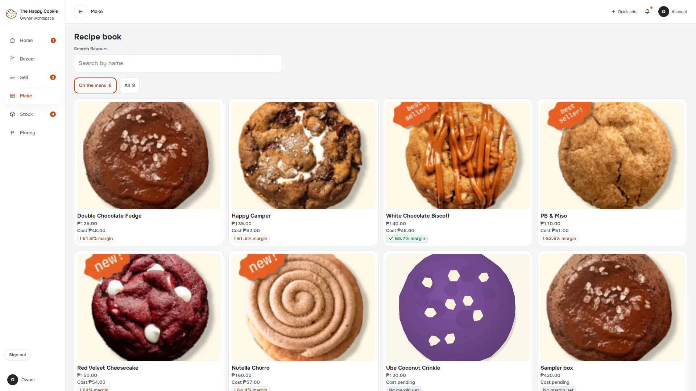

## empty

Simulated server answers with no records. Group: data. Fixture: `data:empty`. How it was reached: rpc-fixture.

**p390** 390×844

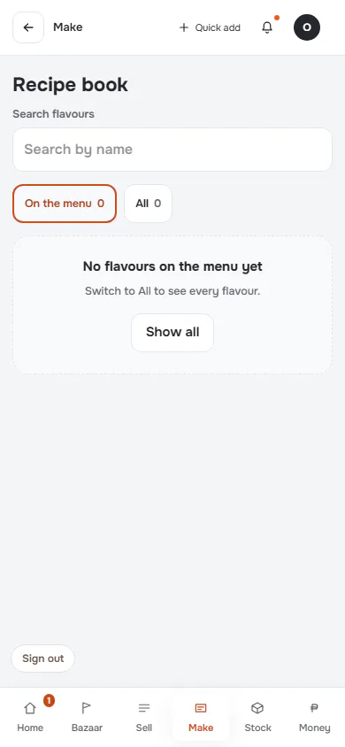

**d1440** 1440×900

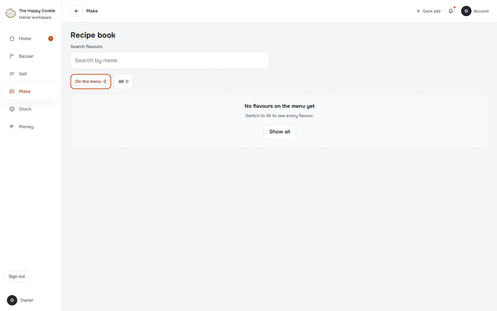

## long-text

Long customer, product and item names. Group: data. Fixture: `data:long`. How it was reached: rpc-fixture.

**p390** 390×844 · [full page](../../screenshots/make/recipe-book/long-text/p390.full.webp)

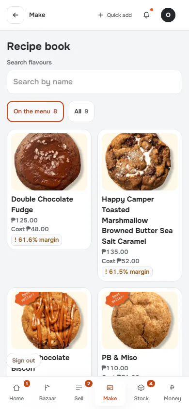

**d1440** 1440×900 · [full page](../../screenshots/make/recipe-book/long-text/d1440.full.webp)

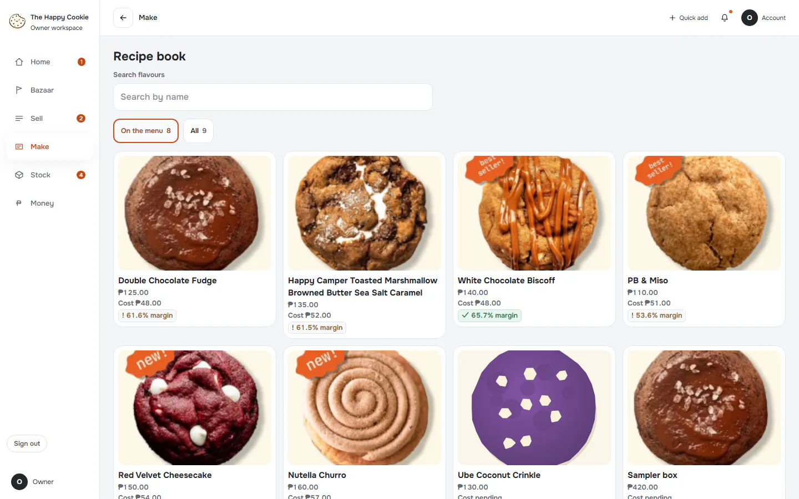

## loading

Reads never answer, so the loading treatment stays on screen. Group: failure. Fixture: `fail:get_recipes=never`. How it was reached: rpc-fixture.

**p390** 390×844 · [full page](../../screenshots/make/recipe-book/loading/p390.full.webp)

**d1440** 1440×900 · [full page](../../screenshots/make/recipe-book/loading/d1440.full.webp)

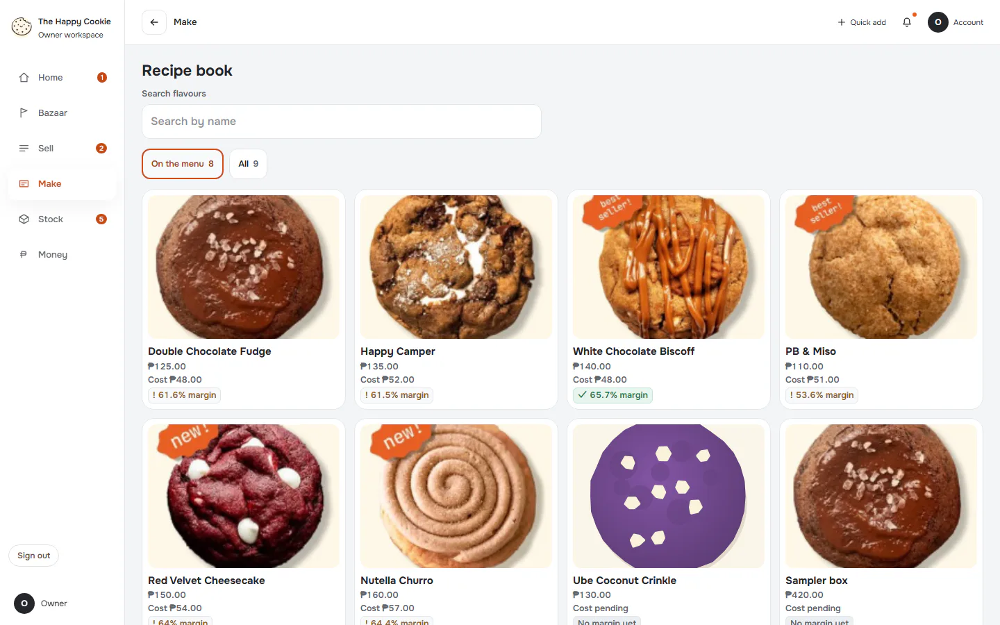

## read-failure

Reads answer with a connection error (08006). Group: failure. Fixture: `fail:get_recipes=down`. How it was reached: rpc-fixture.

**p390** 390×844 (pixel-identical to `make/recipe-book/loading@p390`) · [full page](../../screenshots/make/recipe-book/loading/p390.full.webp)

**d1440** 1440×900 (pixel-identical to `make/recipe-book/loading@d1440`) · [full page](../../screenshots/make/recipe-book/loading/d1440.full.webp)

## malformed-answer

Reads answer with a shape the parser refuses. Group: failure. Fixture: `fail:get_recipes=malformed`. How it was reached: rpc-fixture.

**p390** 390×844 (pixel-identical to `make/recipe-book/loading@p390`) · [full page](../../screenshots/make/recipe-book/loading/p390.full.webp)

**d1440** 1440×900 (pixel-identical to `make/recipe-book/loading@d1440`) · [full page](../../screenshots/make/recipe-book/loading/d1440.full.webp)

## offline-after-load

Browser goes offline after a populated load. Group: failure. Fixture: `default`. How it was reached: ui-driven.

**p390** 390×844 · [full page](../../screenshots/make/recipe-book/offline-after-load/p390.full.webp)

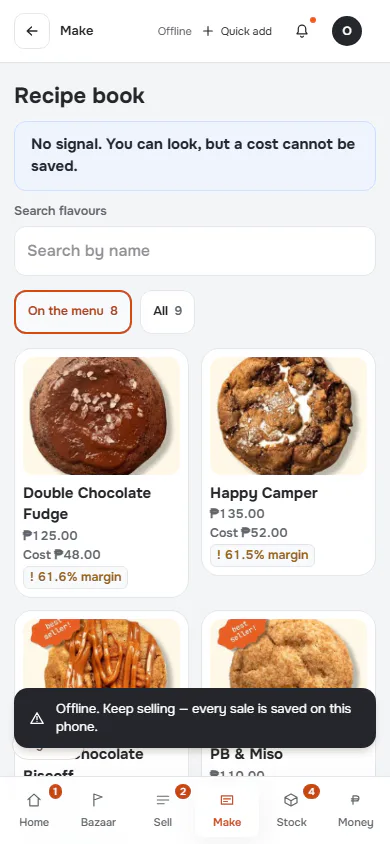

**d1440** 1440×900 · [full page](../../screenshots/make/recipe-book/offline-after-load/d1440.full.webp)

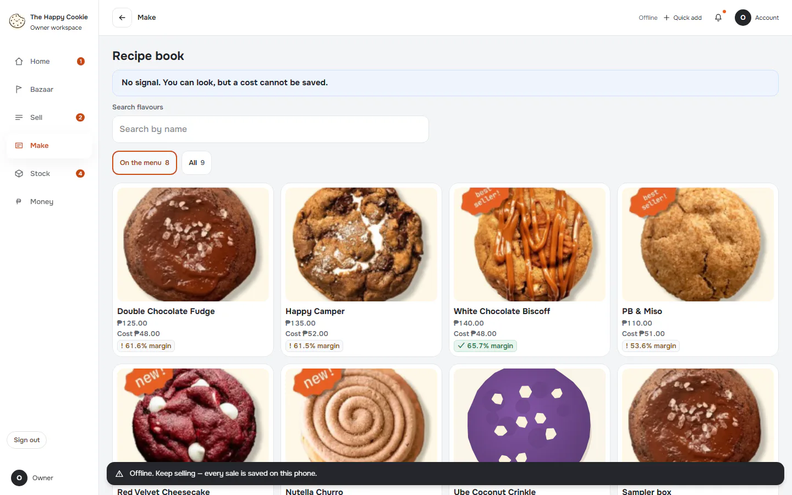

## focus-keyboard

Five Tab presses from page start: what focus looks like. Group: interaction. Fixture: `default`. How it was reached: ui-driven.

**d1440** 1440×900

