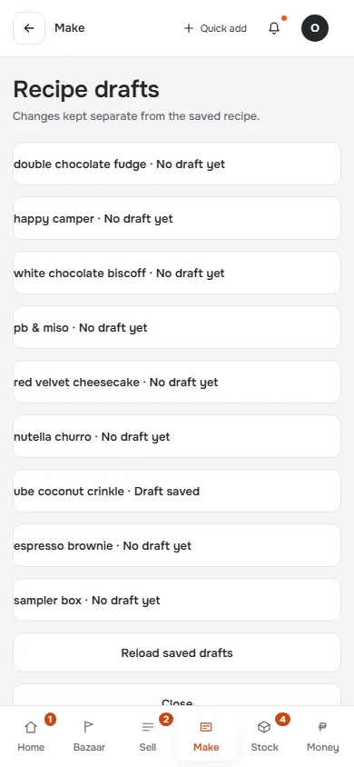
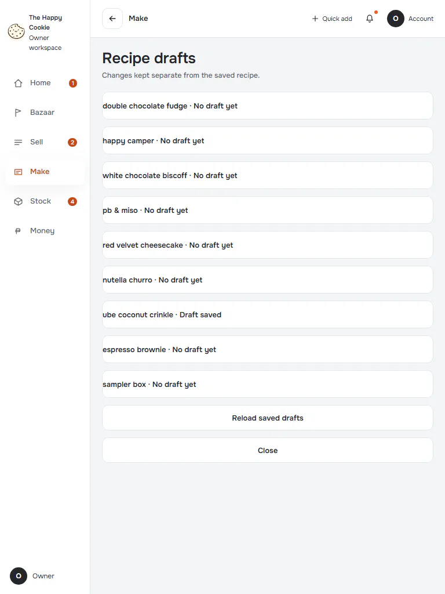
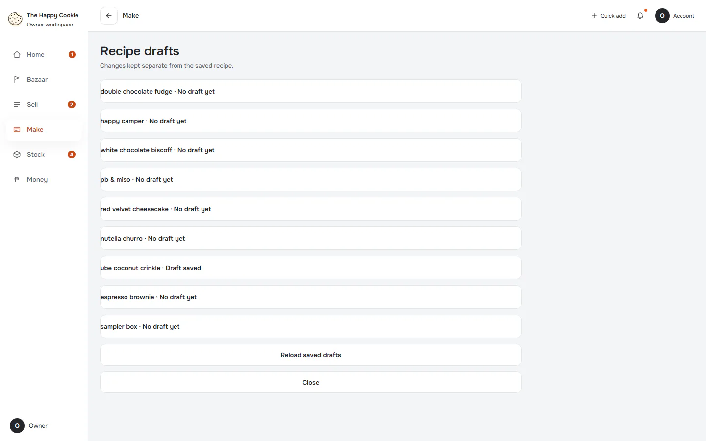
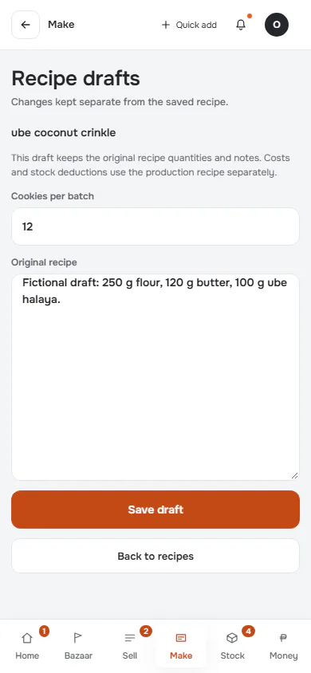
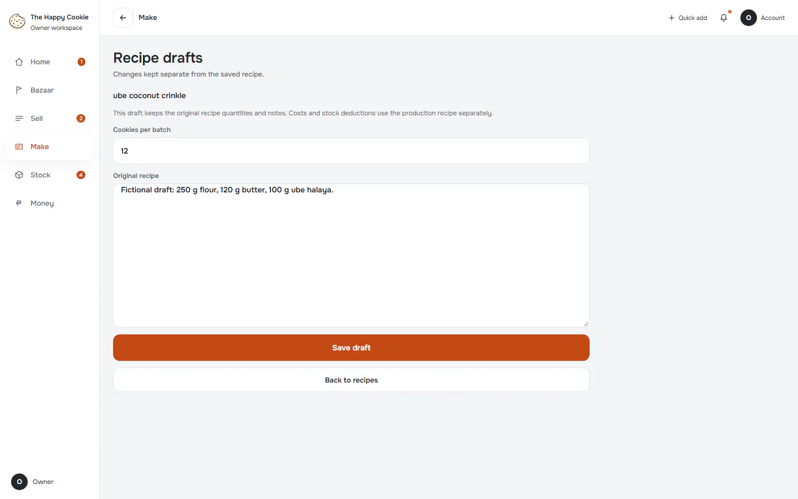
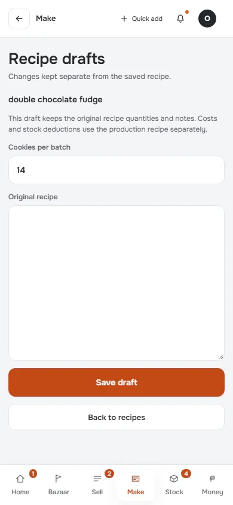
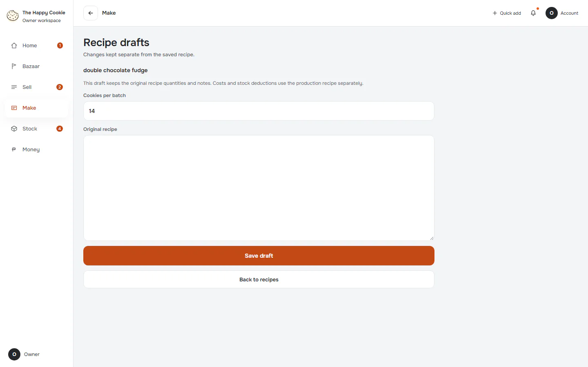

# Recipe drafts

**ACTUAL application.** [Back to make](README.md)

- Manifest id: `make/recipe-drafts`
- Source: `src/components/live/recipe-drafts-form.tsx`
- Role: owner
- Reference views: recipe-drafts

## list

Group: interaction. Fixture: `default`. How it was reached: ui-driven.

**p390** 390×844 · [full page](../../screenshots/make/recipe-drafts/list/p390.full.webp)

**t768** 768×1024

**d1440** 1440×900

## open-draft

Group: interaction. Fixture: `default`. How it was reached: ui-driven.

**p390** 390×844 · [full page](../../screenshots/make/recipe-drafts/open-draft/p390.full.webp)

**d1440** 1440×900

## new-draft

Group: interaction. Fixture: `default`. How it was reached: ui-driven.

**p390** 390×844 · [full page](../../screenshots/make/recipe-drafts/new-draft/p390.full.webp)

**d1440** 1440×900

