# Edit recipe

**ACTUAL application.** [Back to make](README.md)

- Manifest id: `make/recipe-edit`
- Source: `src/components/live/recipes/recipe-editor.tsx`
- Role: owner
- Reference views: recipe-edit, recipe-review

## default

Group: interaction. Fixture: `default`. How it was reached: ui-driven.

**p390** 390×844 · [full page](../../screenshots/make/recipe-edit/default/p390.full.webp)

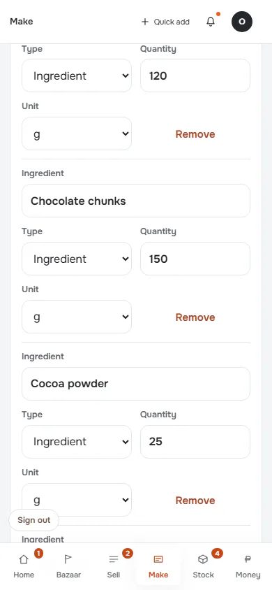

**t768** 768×1024 · [full page](../../screenshots/make/recipe-edit/default/t768.full.webp)

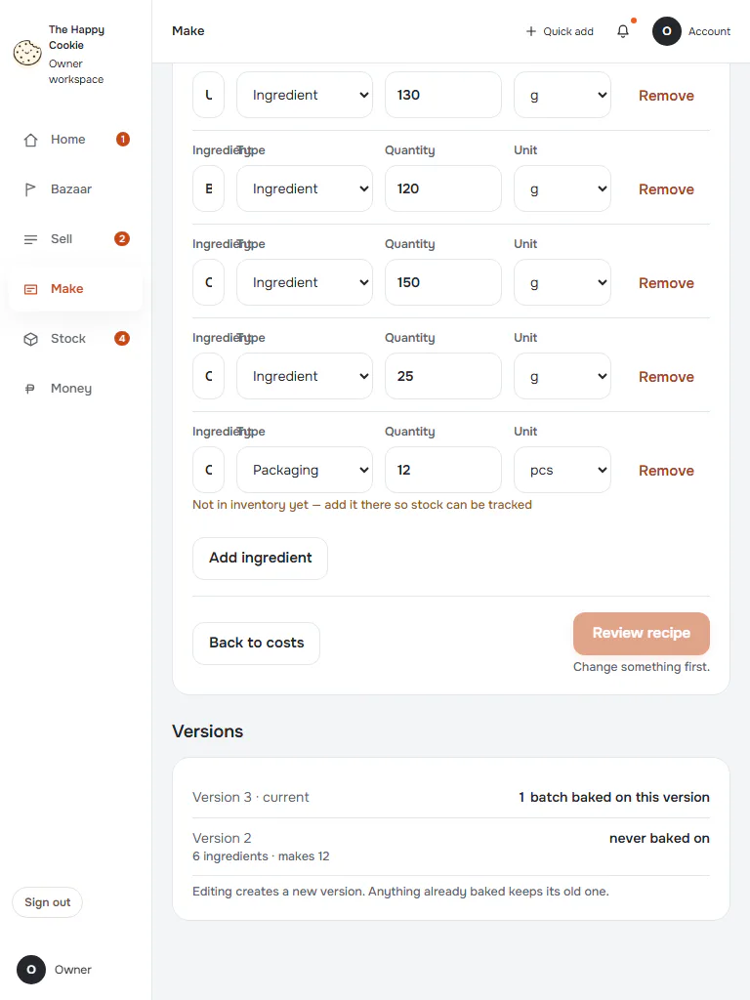

**d1440** 1440×900 · [full page](../../screenshots/make/recipe-edit/default/d1440.full.webp)

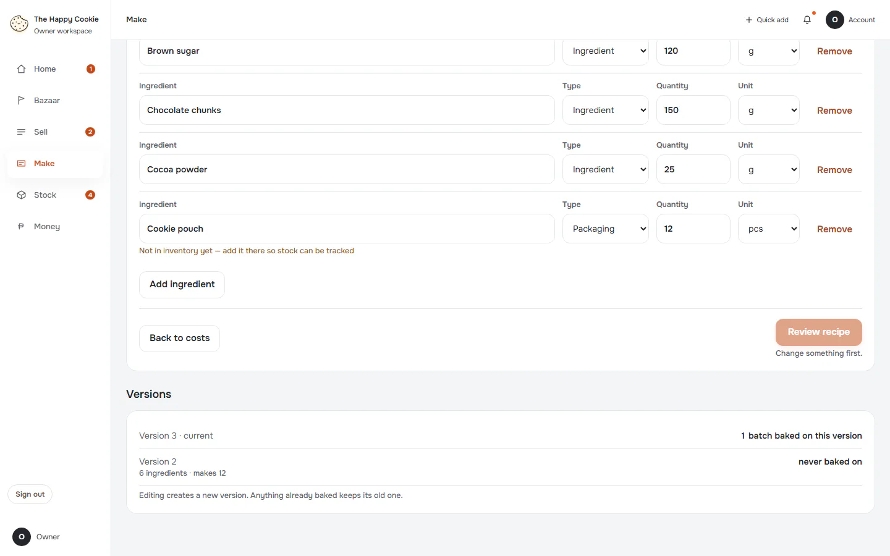

## line-changed

Group: interaction. Fixture: `default`. How it was reached: ui-driven.

**p390** 390×844 · [full page](../../screenshots/make/recipe-edit/line-changed/p390.full.webp)

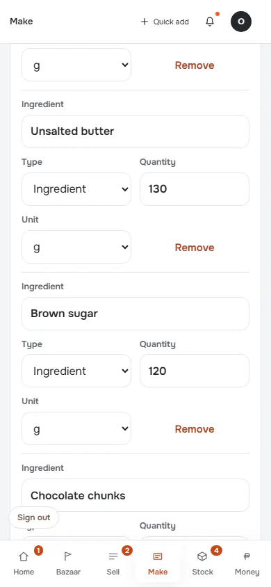

**d1440** 1440×900 · [full page](../../screenshots/make/recipe-edit/line-changed/d1440.full.webp)

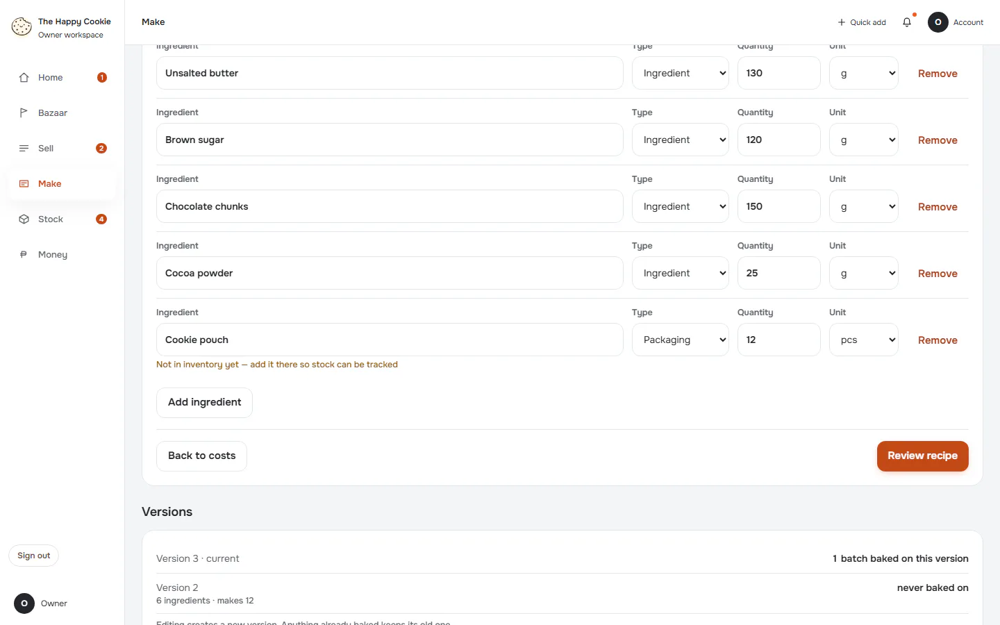

## review

Group: interaction. Fixture: `default`. How it was reached: ui-driven.

**p390** 390×844 · [full page](../../screenshots/make/recipe-edit/review/p390.full.webp)

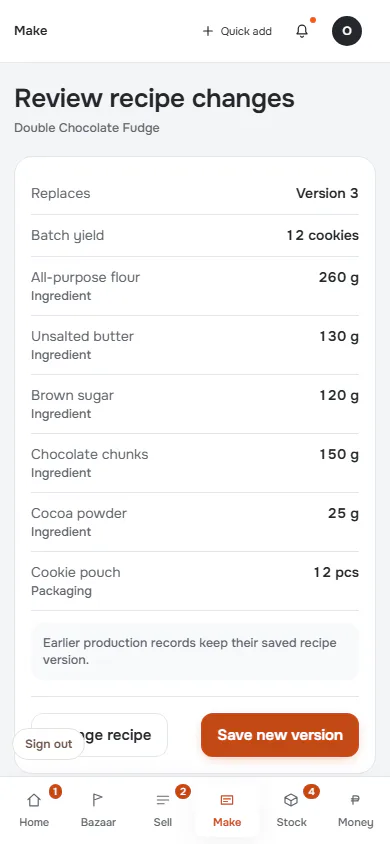

**t768** 768×1024

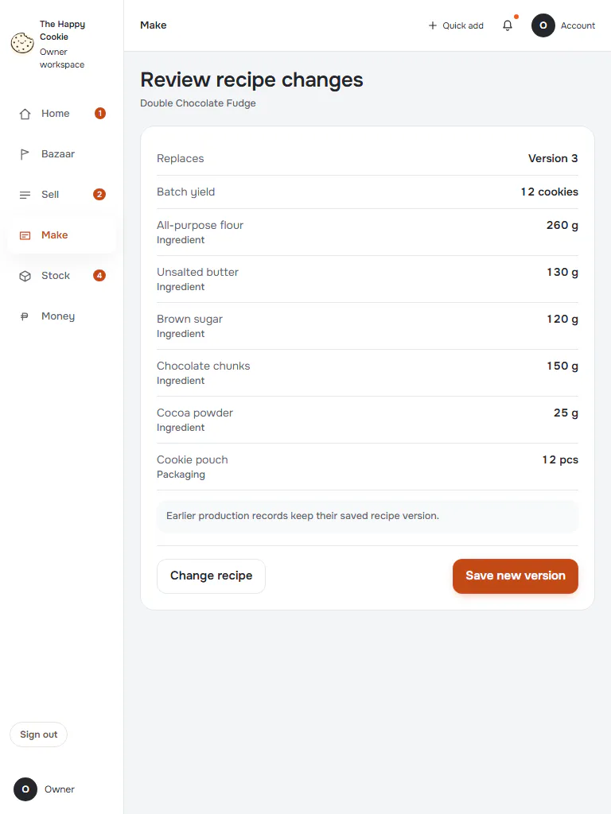

**d1440** 1440×900

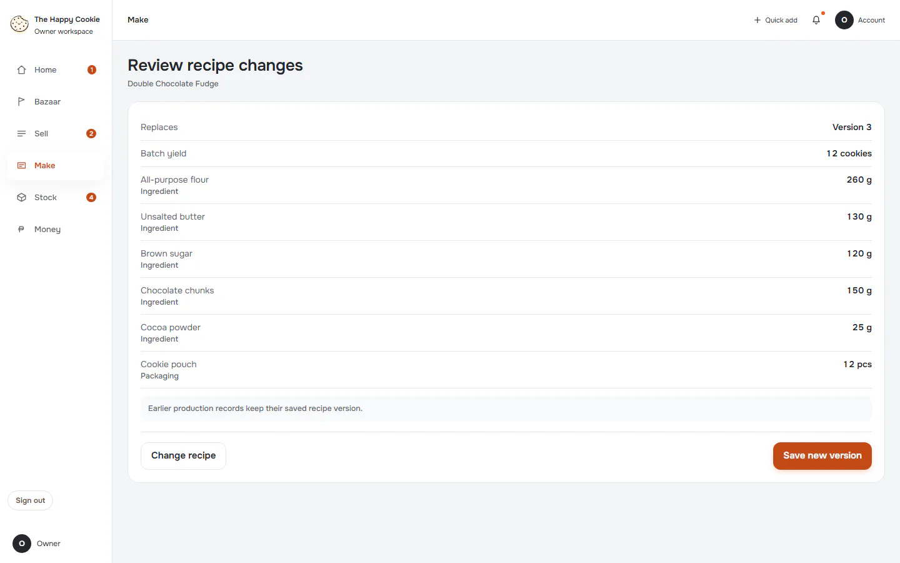

## line-added

Group: interaction. Fixture: `default`. How it was reached: ui-driven.

**p390** 390×844 · [full page](../../screenshots/make/recipe-edit/line-added/p390.full.webp)

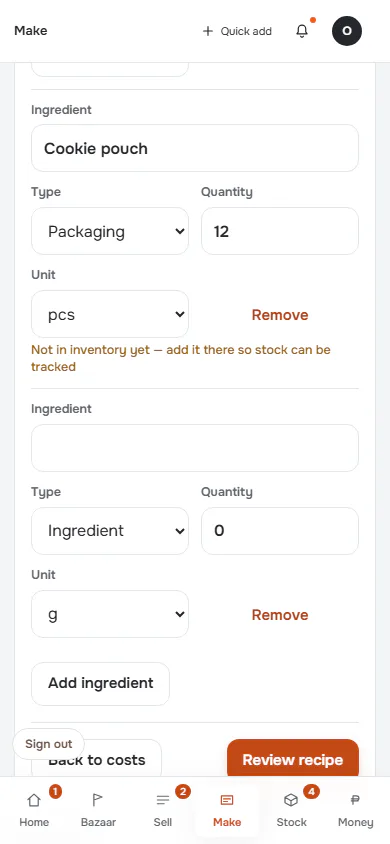

**d1440** 1440×900 · [full page](../../screenshots/make/recipe-edit/line-added/d1440.full.webp)

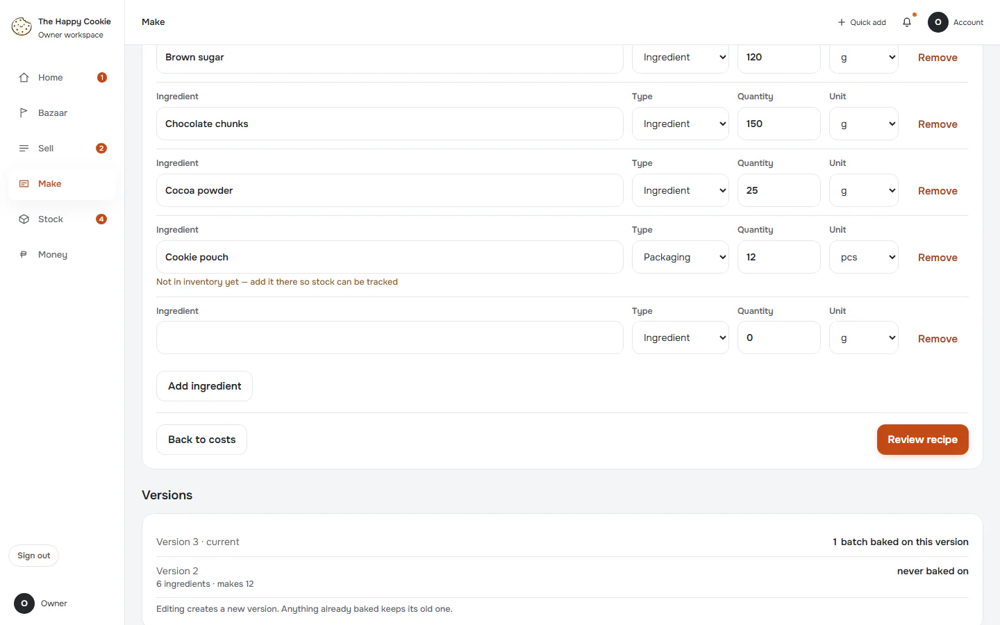

## saved-new-version

Group: business. Fixture: `default`. How it was reached: ui-driven.

**p390** 390×844 · [full page](../../screenshots/make/recipe-edit/saved-new-version/p390.full.webp)

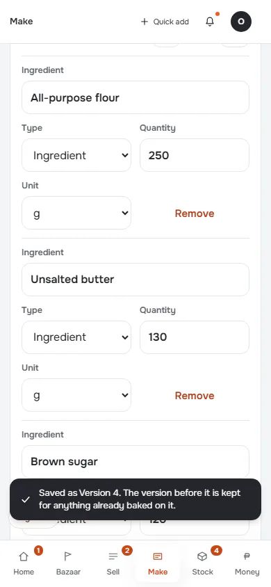

**d1440** 1440×900 · [full page](../../screenshots/make/recipe-edit/saved-new-version/d1440.full.webp)

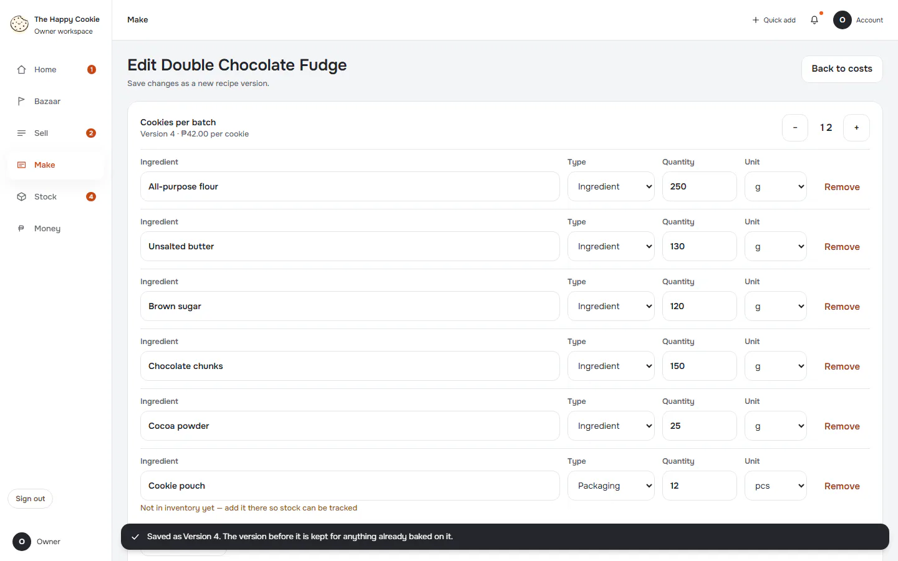

## save-failure

Group: failure. Fixture: `default`. How it was reached: ui-driven.

**p390** 390×844 · [full page](../../screenshots/make/recipe-edit/save-failure/p390.full.webp)

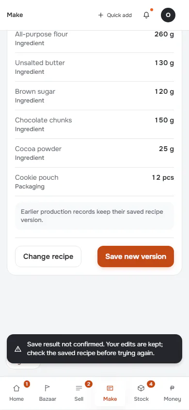

**d1440** 1440×900

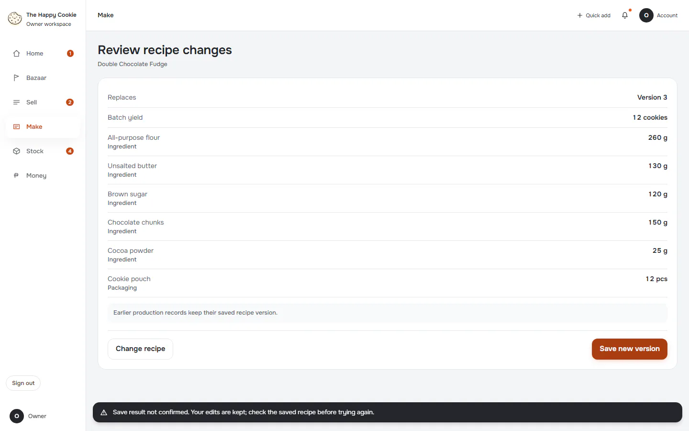

## save-conflict

Group: failure. Fixture: `default`. How it was reached: ui-driven.

**p390** 390×844 · [full page](../../screenshots/make/recipe-edit/save-conflict/p390.full.webp)

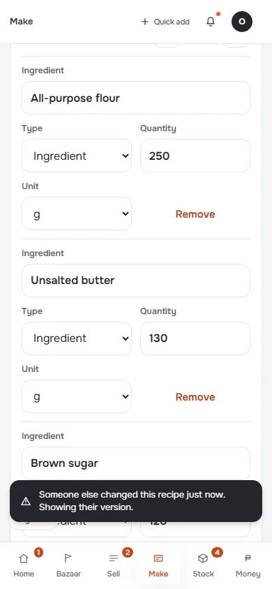

**d1440** 1440×900 · [full page](../../screenshots/make/recipe-edit/save-conflict/d1440.full.webp)

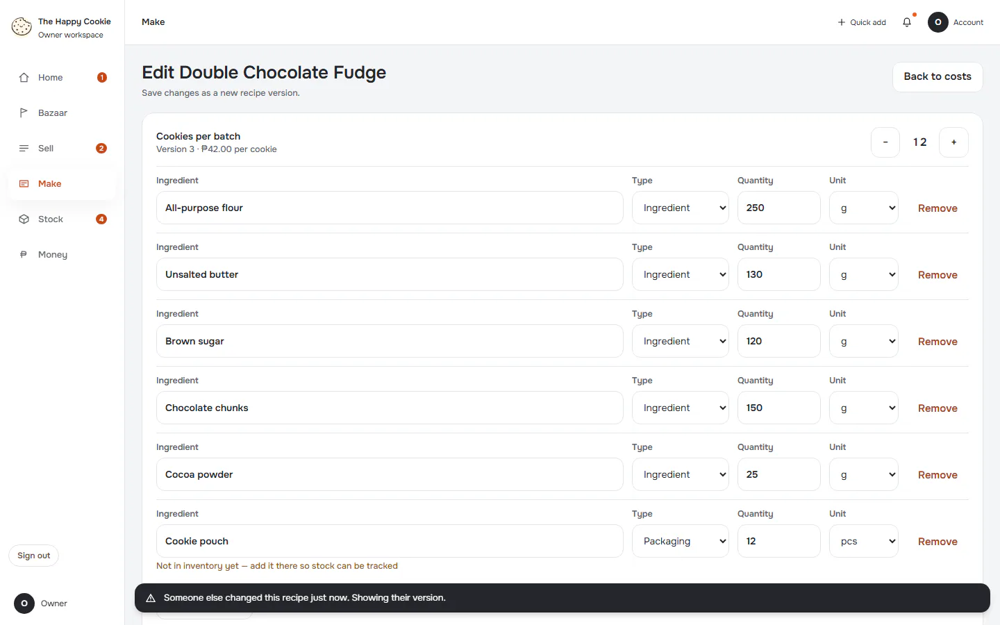
