# Recipe page

**ACTUAL application.** [Back to make](README.md)

- Manifest id: `make/recipe`
- Source: `src/components/live/recipes/recipe-reader.tsx`
- Role: owner
- Reference views: recipe

## default

Group: data. Fixture: `default`. How it was reached: ui-driven.

**p320** 320×700 · [full page](../../screenshots/make/recipe/default/p320.full.webp)

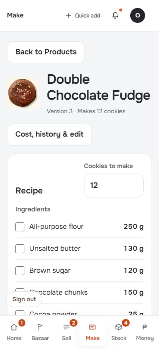

**p390** 390×844 · [full page](../../screenshots/make/recipe/default/p390.full.webp)

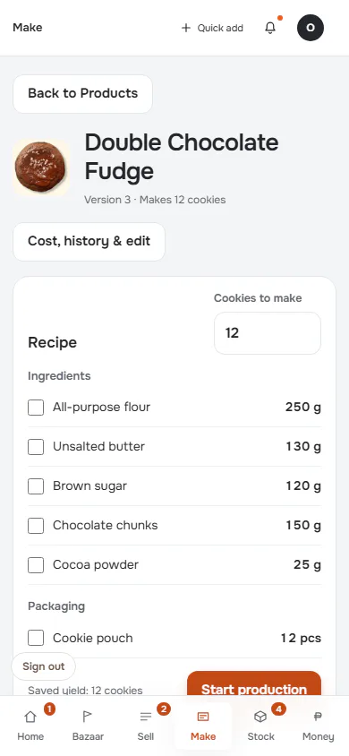

**t768** 768×1024

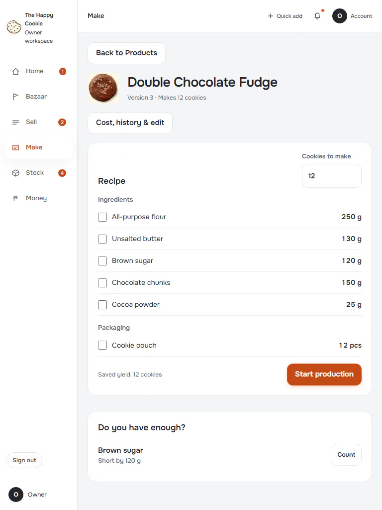

**l1024** 1024×768 · [full page](../../screenshots/make/recipe/default/l1024.full.webp)

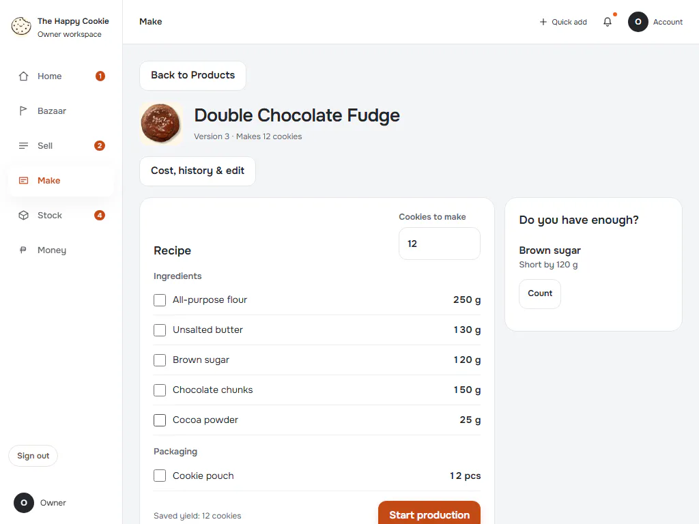

**d1440** 1440×900

**w1920** 1920×1080

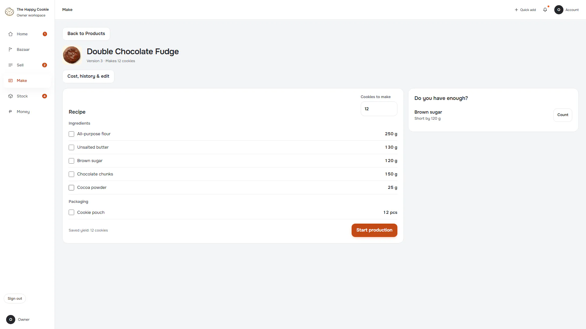

## scaled-half

Group: interaction. Fixture: `default`. How it was reached: ui-driven.

**p390** 390×844 · [full page](../../screenshots/make/recipe/scaled-half/p390.full.webp)

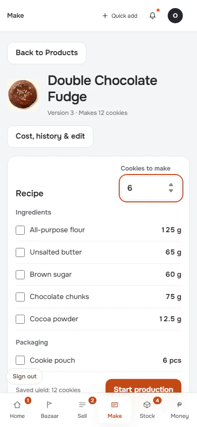

**d1440** 1440×900

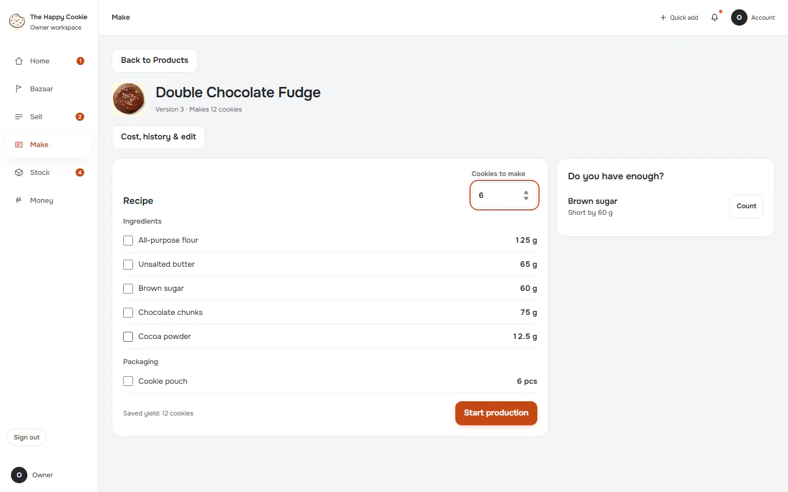

## scaled-large-shortage

Group: business. Fixture: `default`. How it was reached: ui-driven.

**p390** 390×844 · [full page](../../screenshots/make/recipe/scaled-large-shortage/p390.full.webp)

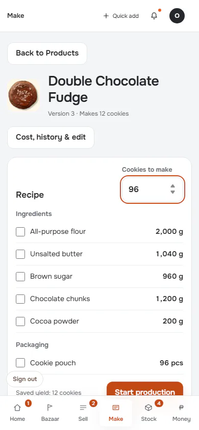

**t768** 768×1024 · [full page](../../screenshots/make/recipe/scaled-large-shortage/t768.full.webp)

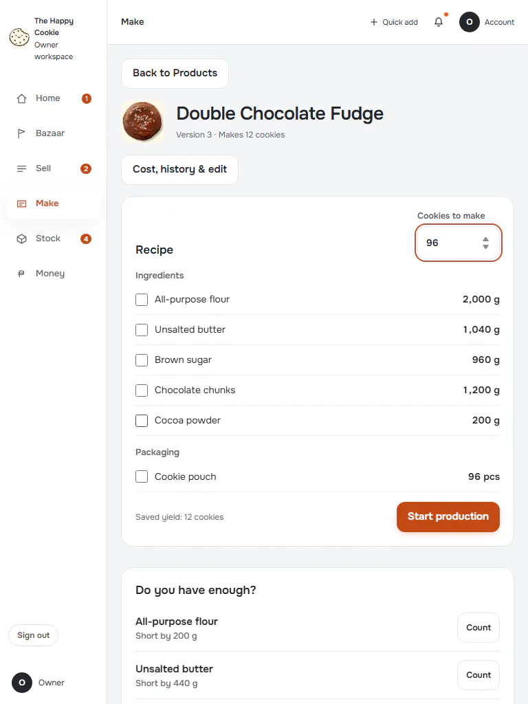

**d1440** 1440×900

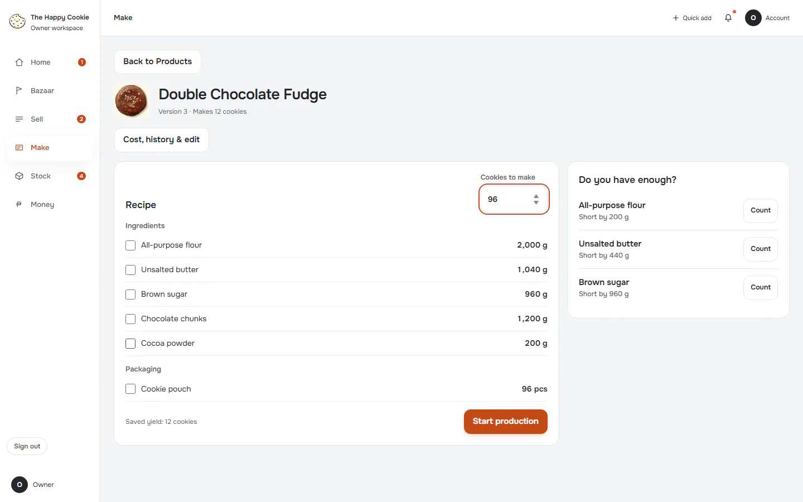

## ingredients-ticked

Group: interaction. Fixture: `default`. How it was reached: ui-driven.

**p390** 390×844 · [full page](../../screenshots/make/recipe/ingredients-ticked/p390.full.webp)

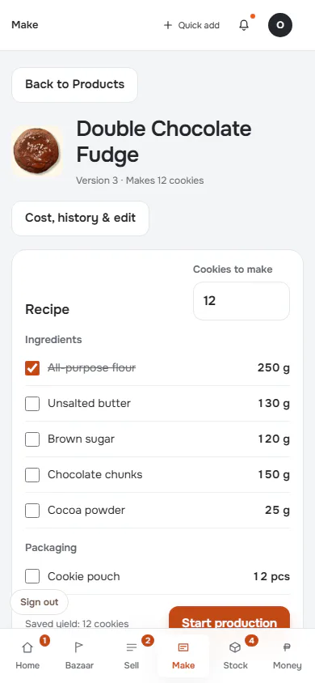

**d1440** 1440×900

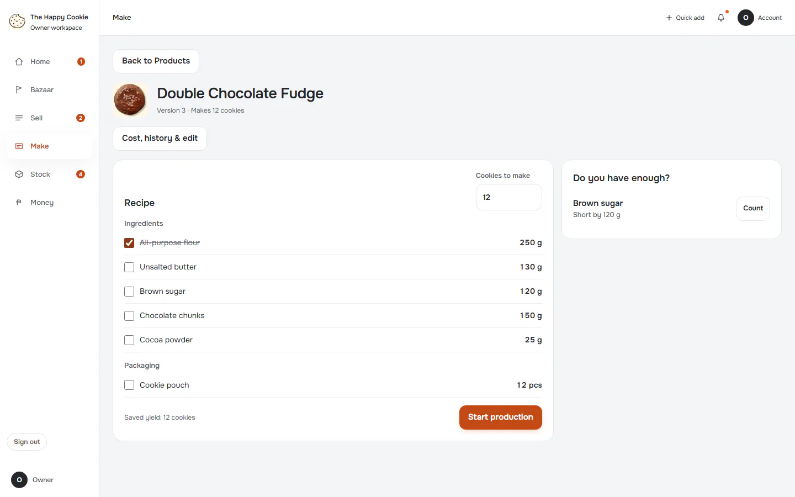

## no-recipe-yet

Group: business. Fixture: `default`. How it was reached: ui-driven.

**p390** 390×844

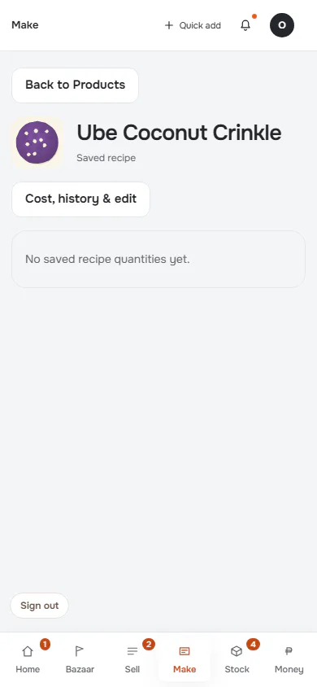

**d1440** 1440×900

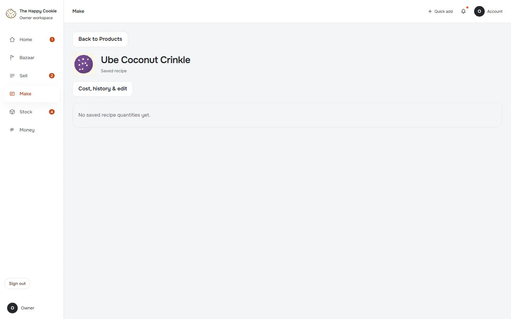

## read-failure

Group: failure. Fixture: `fail:get_recipes=down`. How it was reached: rpc-fixture.

**p390** 390×844

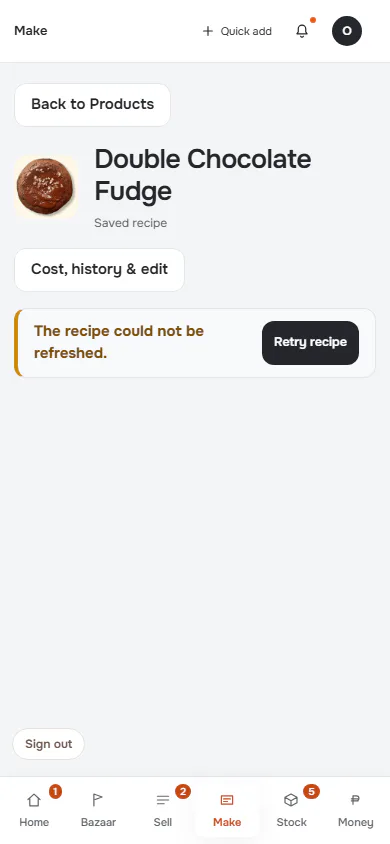

**d1440** 1440×900

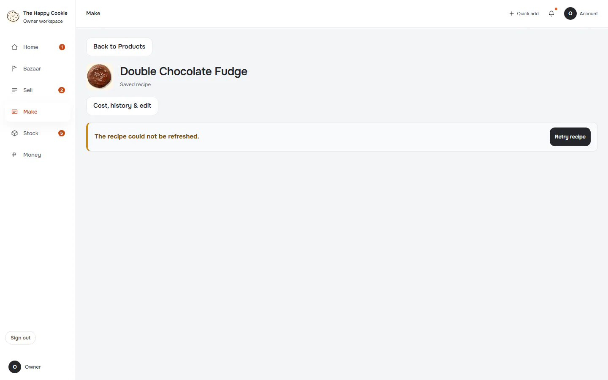
