# Record expense

**ACTUAL application.** [Back to money](README.md)

- Manifest id: `money/expense`
- Source: `src/components/live/money/money-pages.tsx`
- Role: owner
- Reference views: money-entry, money-review

## untouched

Group: interaction. Fixture: `default`. How it was reached: ui-driven.

**p390** 390×844

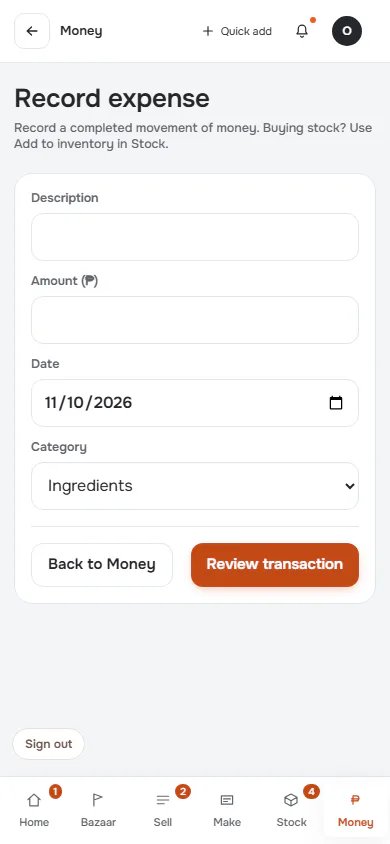

**t768** 768×1024

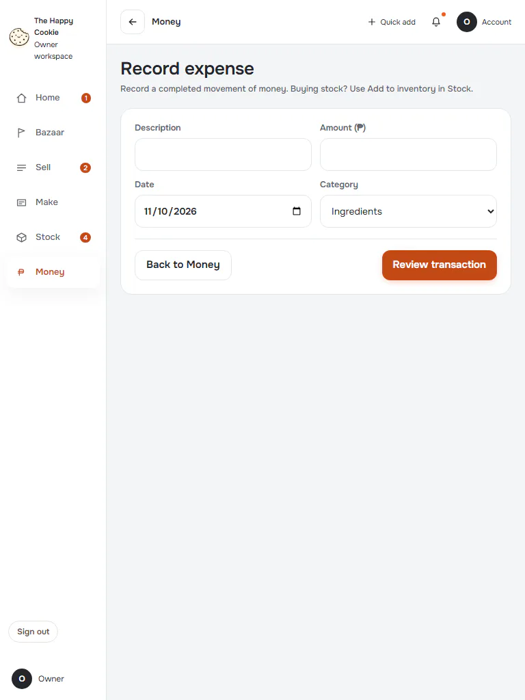

**d1440** 1440×900

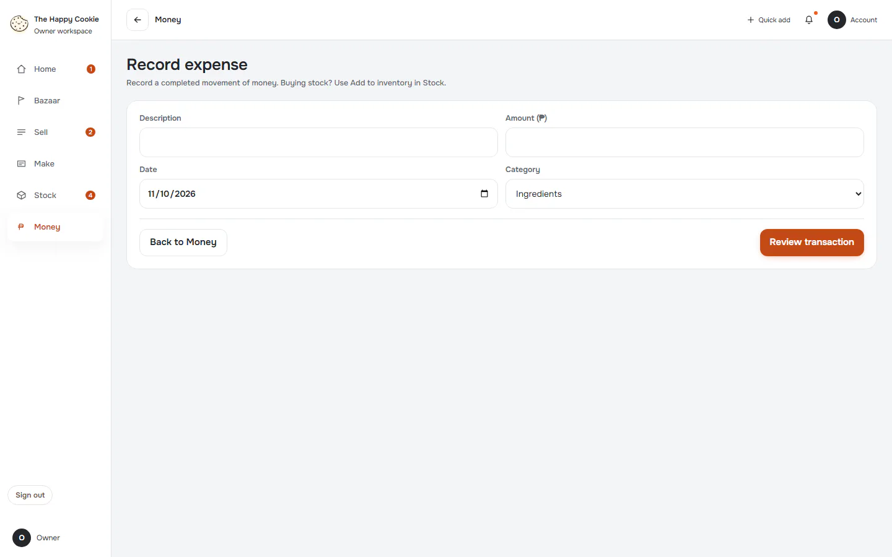

## invalid

Group: interaction. Fixture: `default`. How it was reached: ui-driven.

**p390** 390×844

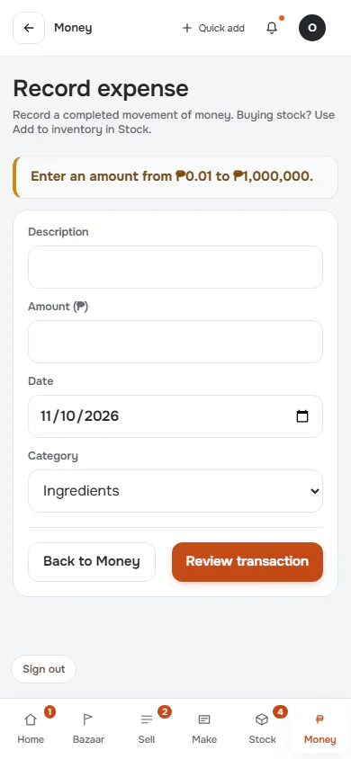

**d1440** 1440×900

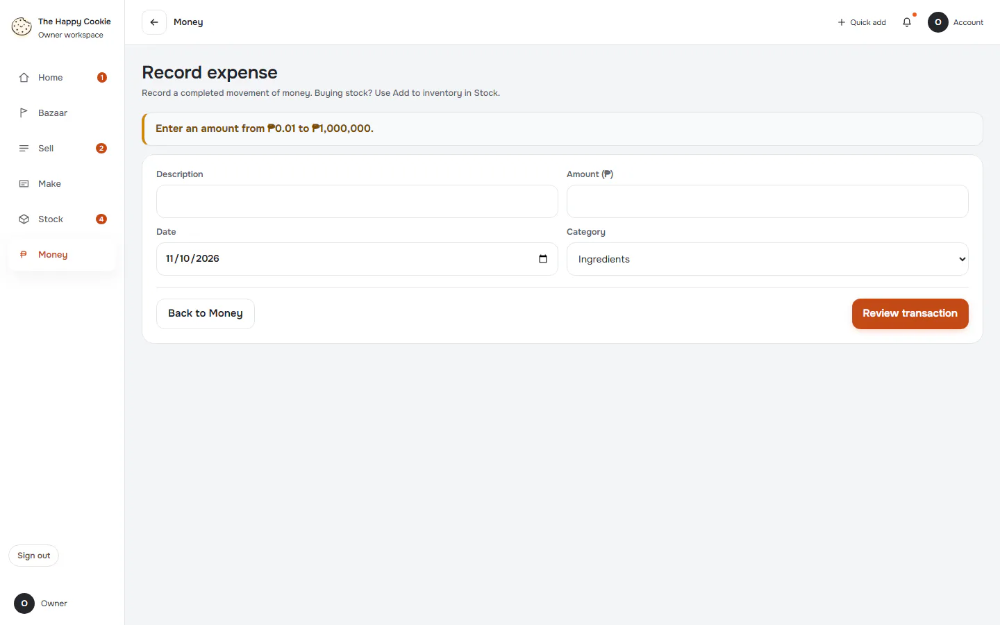

## review

Group: interaction. Fixture: `default`. How it was reached: ui-driven.

**p390** 390×844

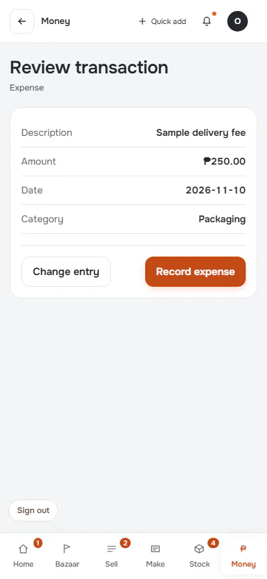

**t768** 768×1024

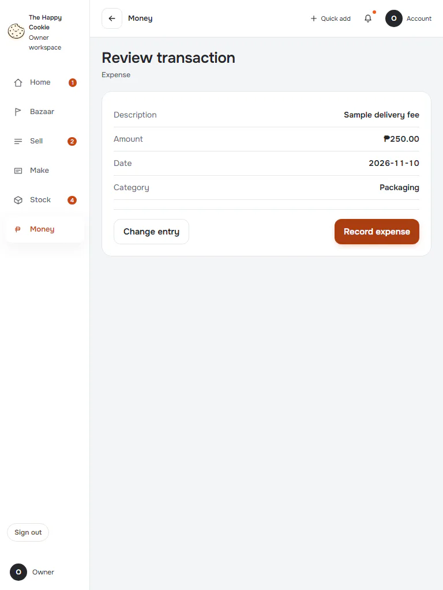

**d1440** 1440×900

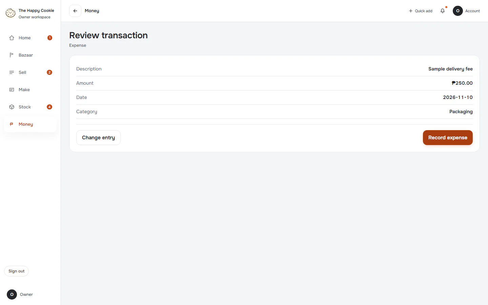

## saved

Group: business. Fixture: `default`. How it was reached: ui-driven.

**p390** 390×844 · [full page](../../screenshots/money/expense/saved/p390.full.webp)

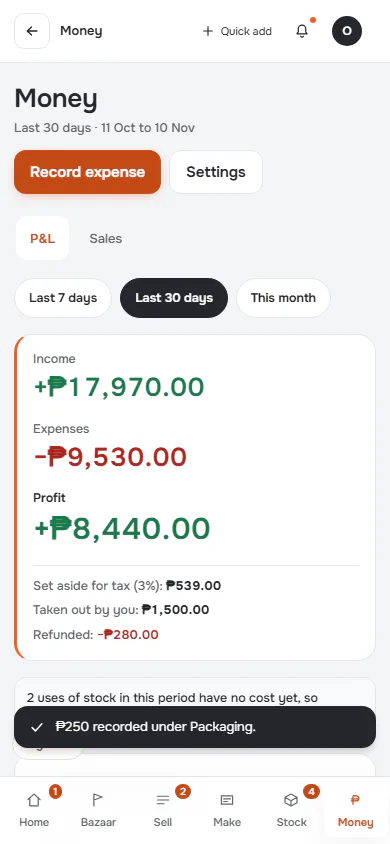

**d1440** 1440×900 · [full page](../../screenshots/money/expense/saved/d1440.full.webp)

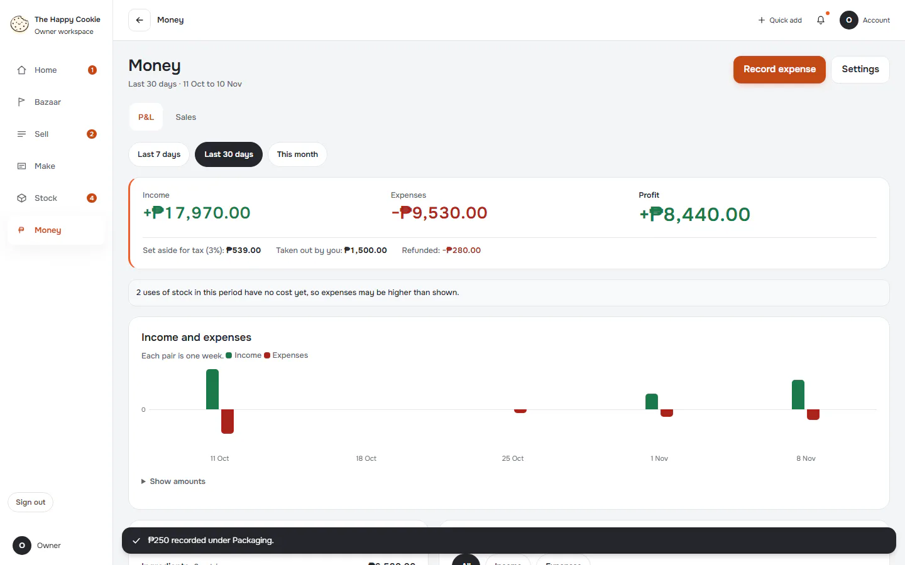

## save-failed

Group: failure. Fixture: `default`. How it was reached: ui-driven.

**p390** 390×844

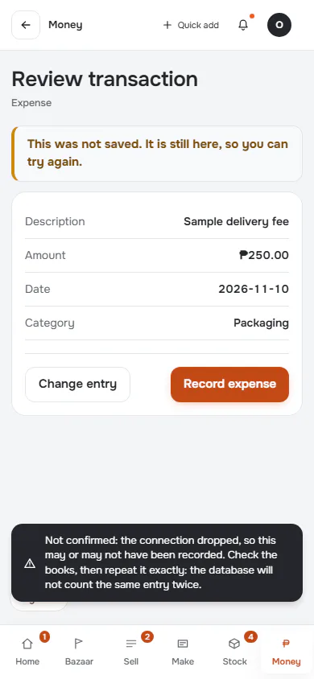

**d1440** 1440×900

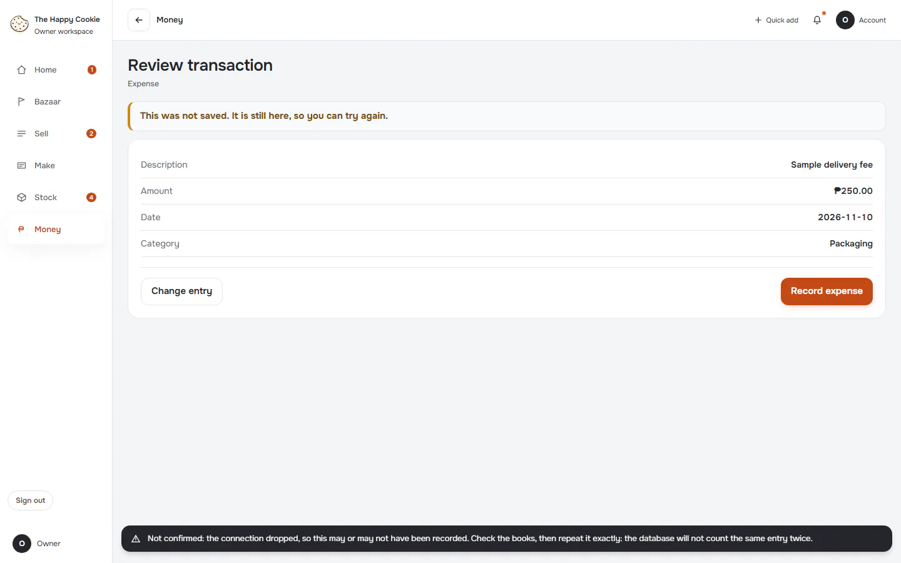
