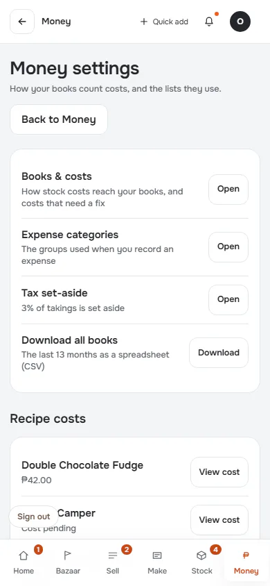
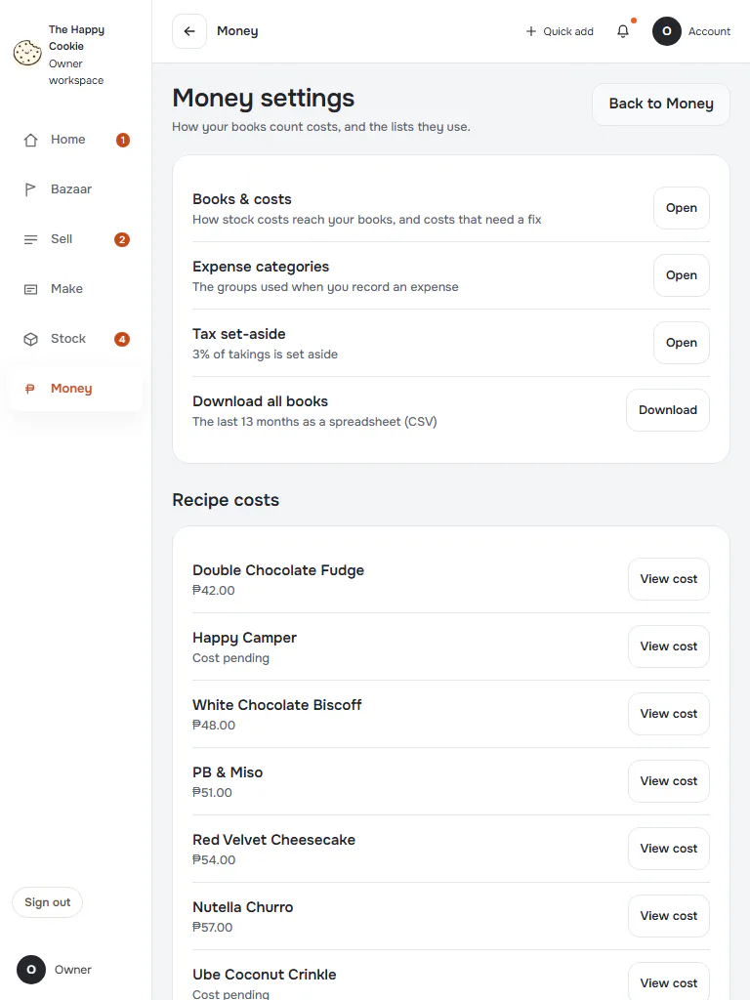
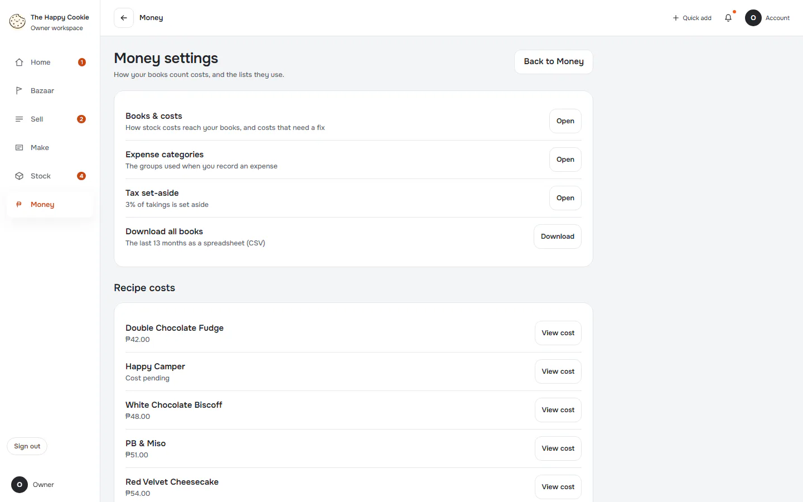
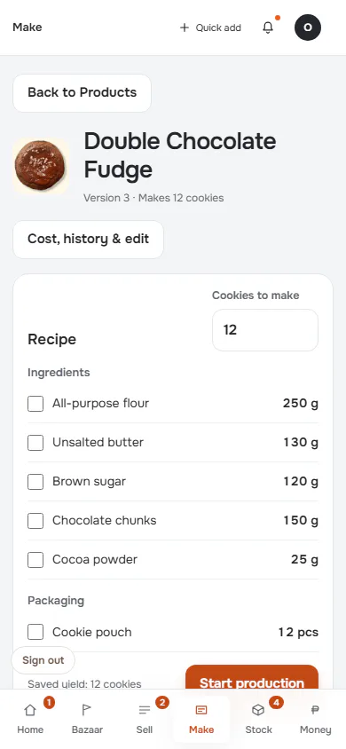
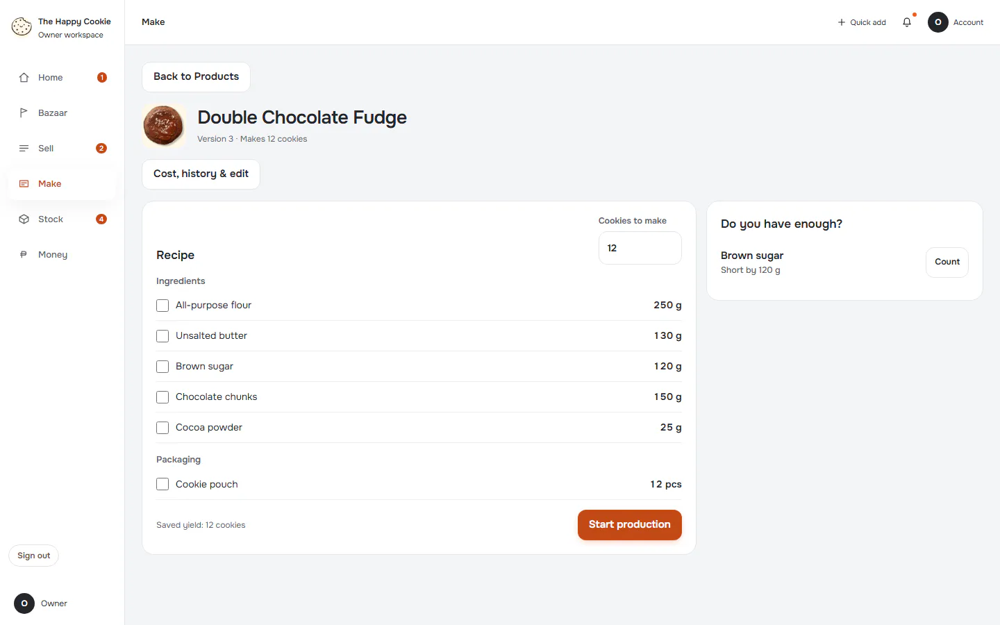

# Money settings

**ACTUAL application.** [Back to money](README.md)

- Manifest id: `money/money-settings`
- Source: `src/components/live/money/money-pages.tsx`
- Role: owner
- Reference views: money-settings

## default

Group: interaction. Fixture: `default`. How it was reached: ui-driven.

**p390** 390×844 · [full page](../../screenshots/money/money-settings/default/p390.full.webp)

**t768** 768×1024 · [full page](../../screenshots/money/money-settings/default/t768.full.webp)

**d1440** 1440×900 · [full page](../../screenshots/money/money-settings/default/d1440.full.webp)

## cost-of-flavour

Group: interaction. Fixture: `default`. How it was reached: ui-driven.

**p390** 390×844 (pixel-identical to `make/recipe/default@p390`) · [full page](../../screenshots/make/recipe/default/p390.full.webp)

**d1440** 1440×900

