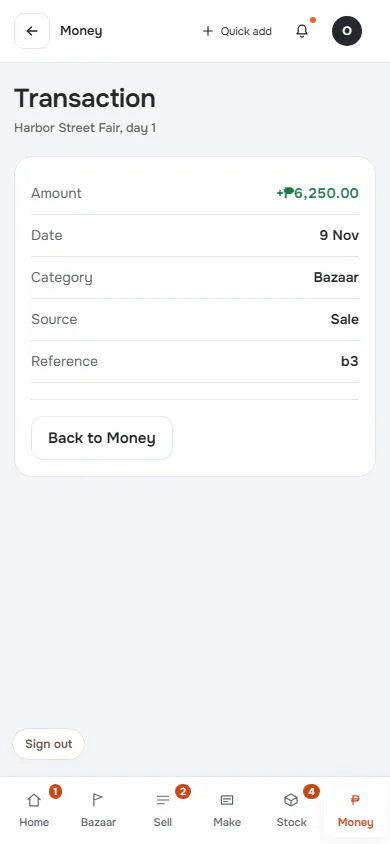
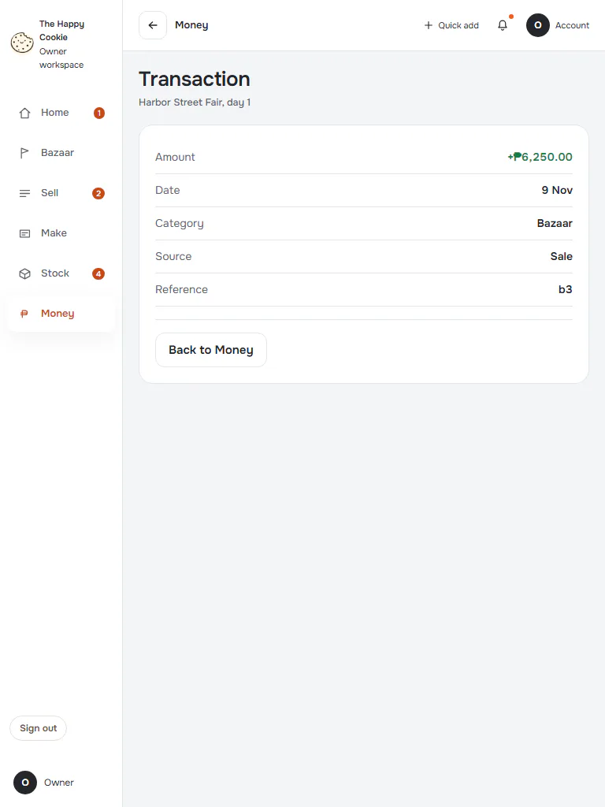
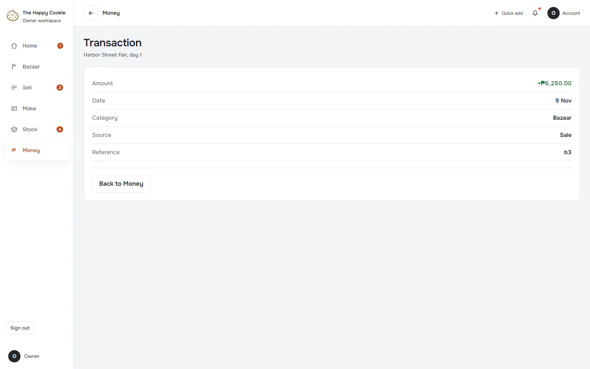
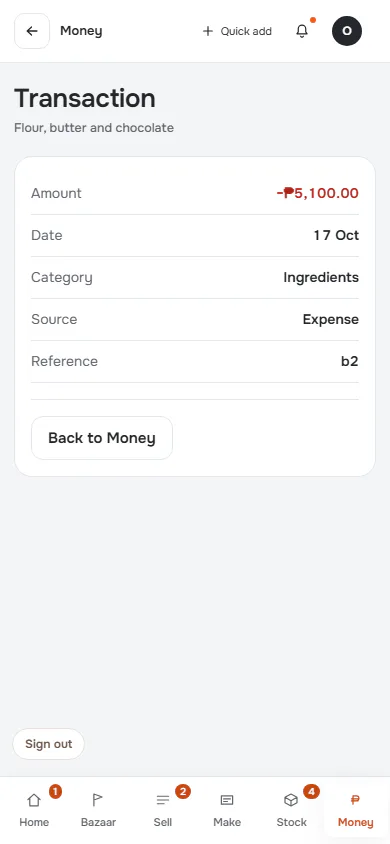
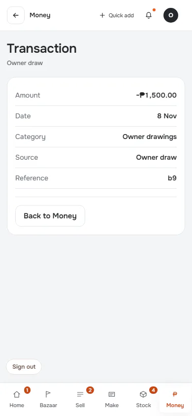
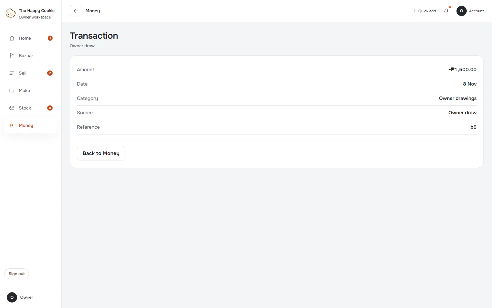
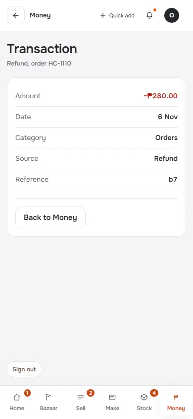
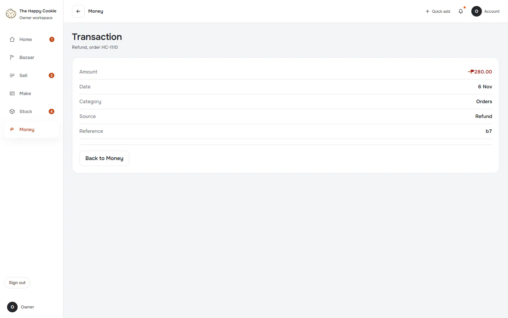

# Transaction

**ACTUAL application.** [Back to money](README.md)

- Manifest id: `money/transaction`
- Source: `src/components/live/money/money-pages.tsx`
- Role: owner
- Reference views: transaction

## income

Group: interaction. Fixture: `default`. How it was reached: ui-driven.

**p390** 390×844

**t768** 768×1024

**d1440** 1440×900

## expense

Group: interaction. Fixture: `default`. How it was reached: ui-driven.

**p390** 390×844

**d1440** 1440×900

## owner-draw

Group: interaction. Fixture: `default`. How it was reached: ui-driven.

**p390** 390×844

**d1440** 1440×900

## refund

Group: interaction. Fixture: `default`. How it was reached: ui-driven.

**p390** 390×844

**d1440** 1440×900

