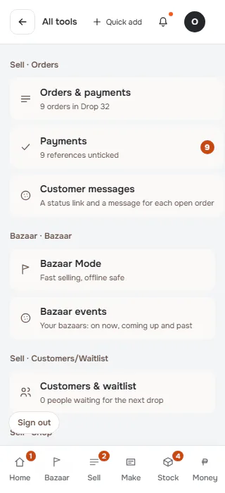
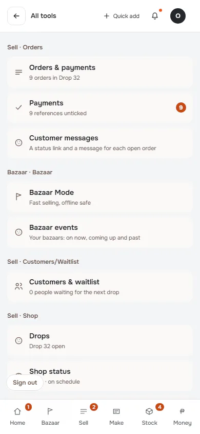
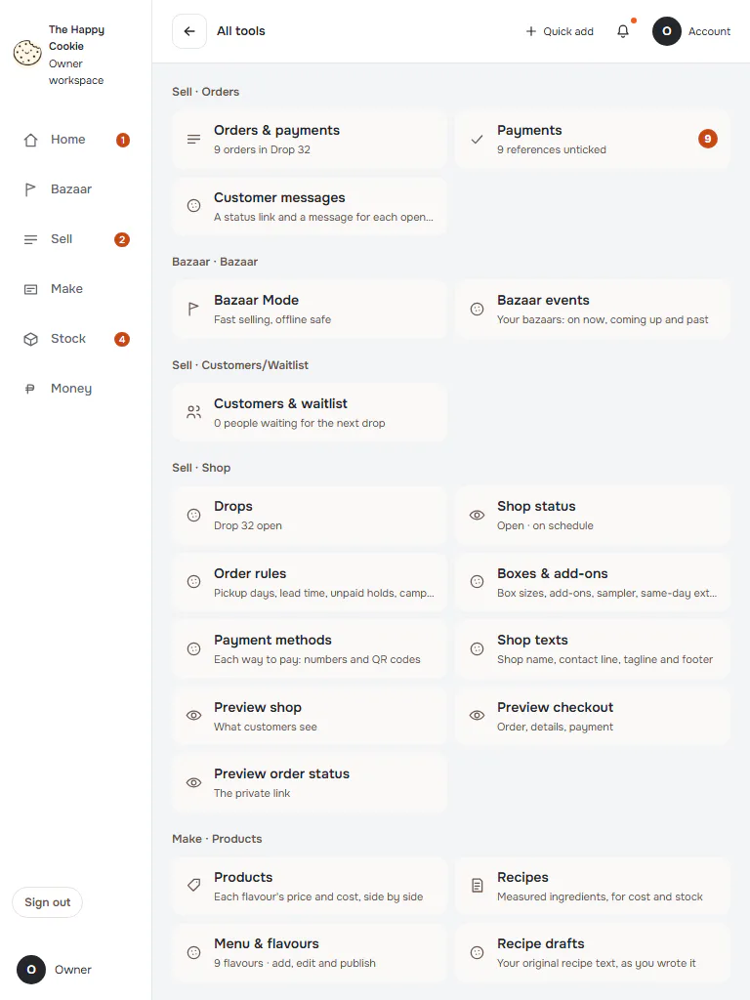
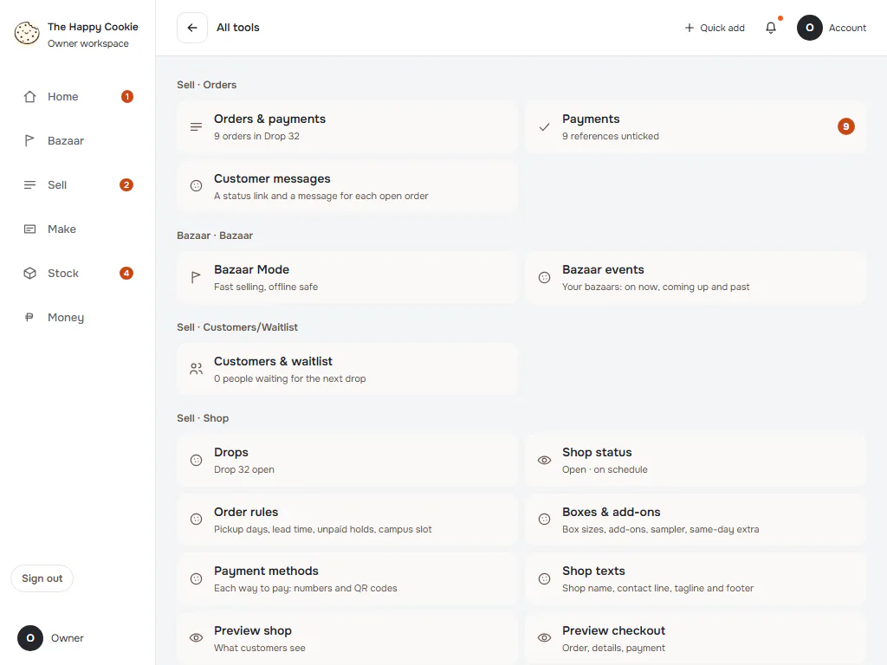
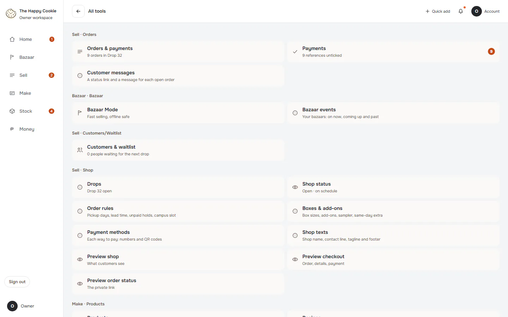
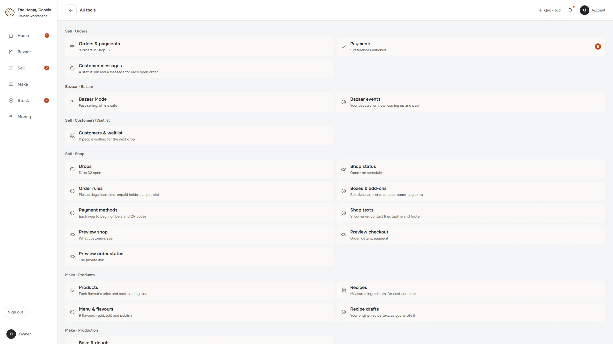

# All tools (old address)

**ACTUAL application.** [Back to other](README.md)

- Manifest id: `other/all-tools`
- Source: `src/components/screens/all-tools.tsx`
- Role: owner
- Reference views: none (found in code)
- Drawn by an old ported screen, not the refined live interface.

## default

Group: interaction. Fixture: `default`. How it was reached: ui-driven.

**p320** 320×700 · [full page](../../screenshots/other/all-tools/default/p320.full.webp)

**p390** 390×844 · [full page](../../screenshots/other/all-tools/default/p390.full.webp)

**t768** 768×1024 · [full page](../../screenshots/other/all-tools/default/t768.full.webp)

**l1024** 1024×768 · [full page](../../screenshots/other/all-tools/default/l1024.full.webp)

**d1440** 1440×900 · [full page](../../screenshots/other/all-tools/default/d1440.full.webp)

**w1920** 1920×1080 · [full page](../../screenshots/other/all-tools/default/w1920.full.webp)

