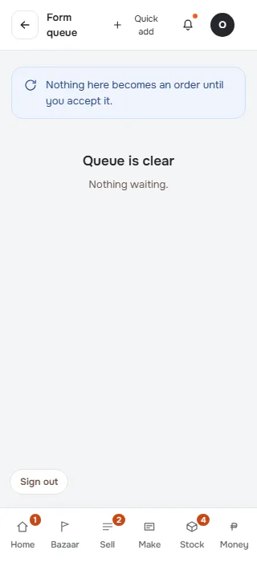
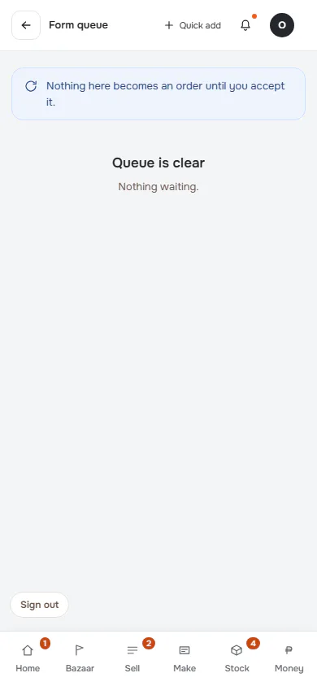
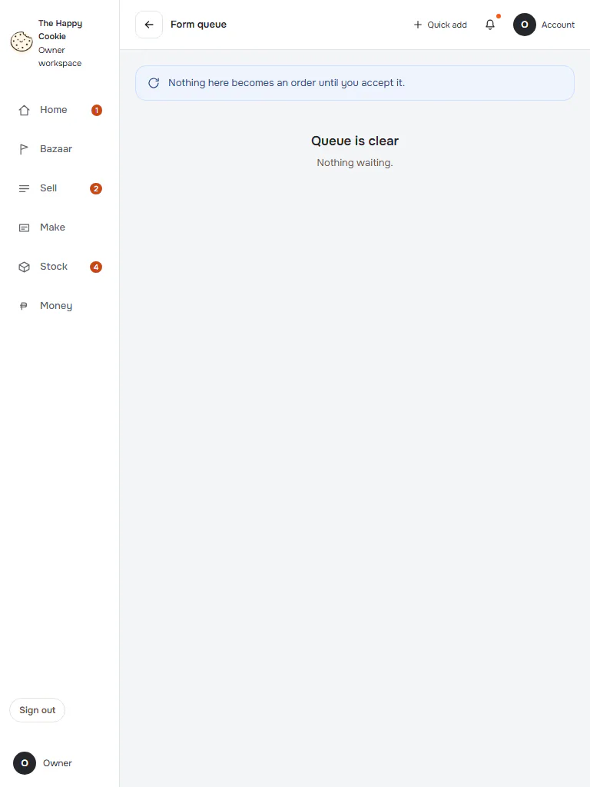
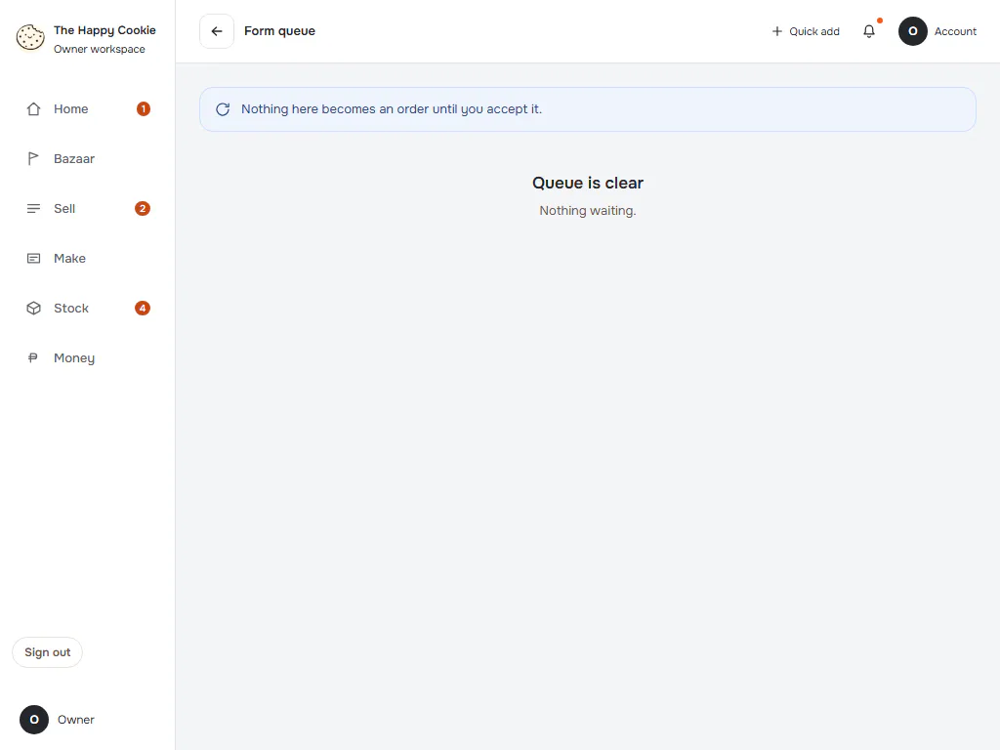
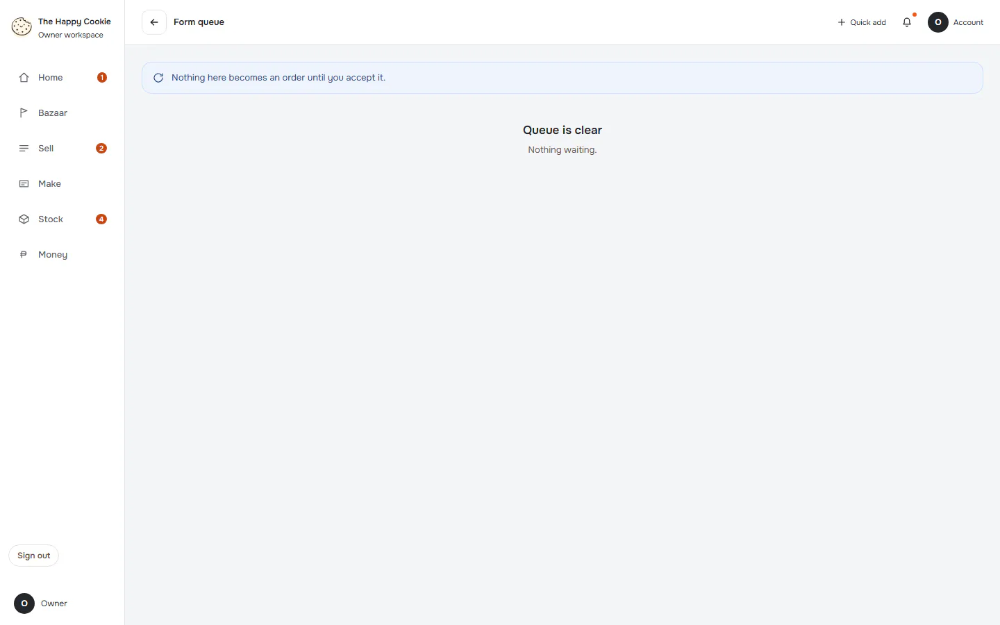
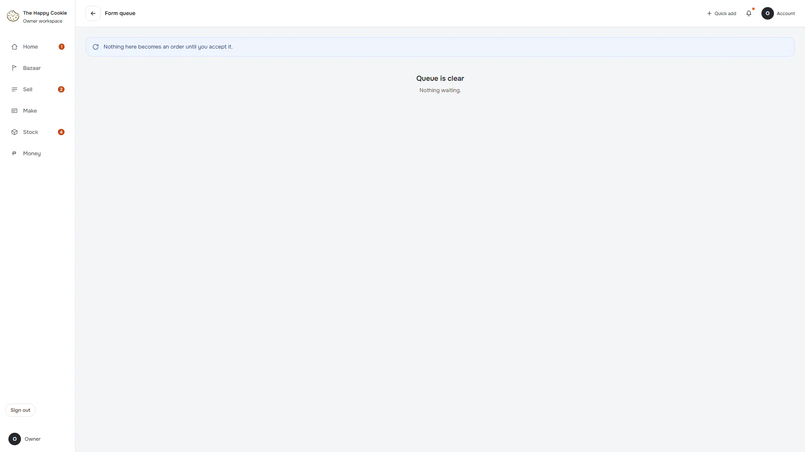

# Form queue (old address)

**ACTUAL application.** [Back to other](README.md)

- Manifest id: `other/form-queue`
- Source: `src/components/screens/form-queue.tsx`
- Role: owner
- Reference views: none (found in code)
- Drawn by an old ported screen, not the refined live interface.

## default

Group: interaction. Fixture: `default`. How it was reached: ui-driven.

**p320** 320×700

**p390** 390×844

**t768** 768×1024

**l1024** 1024×768

**d1440** 1440×900

**w1920** 1920×1080

