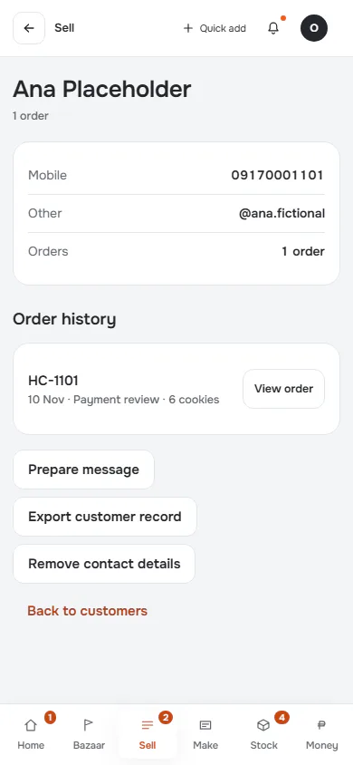
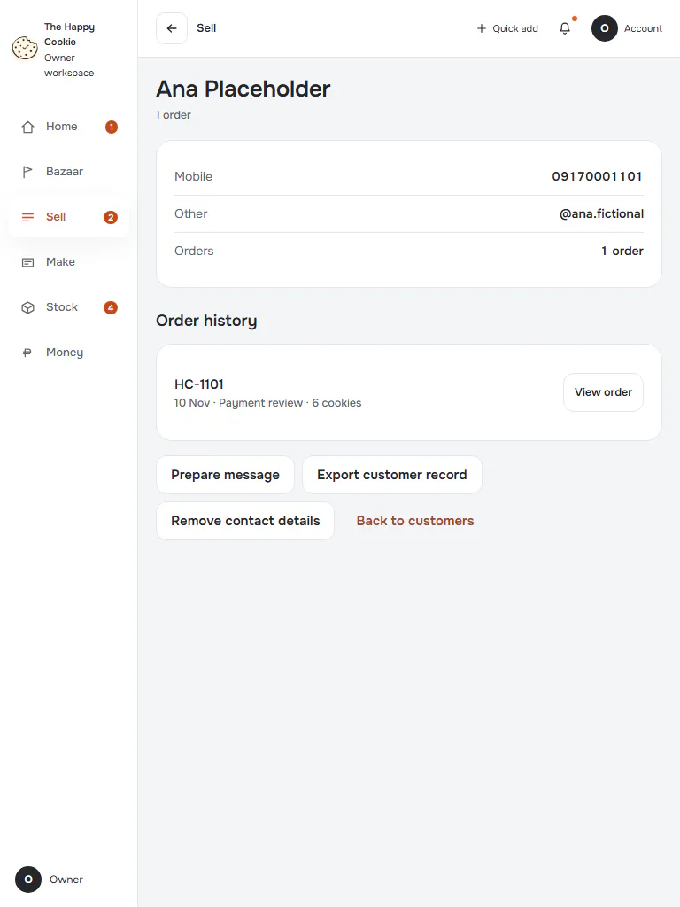
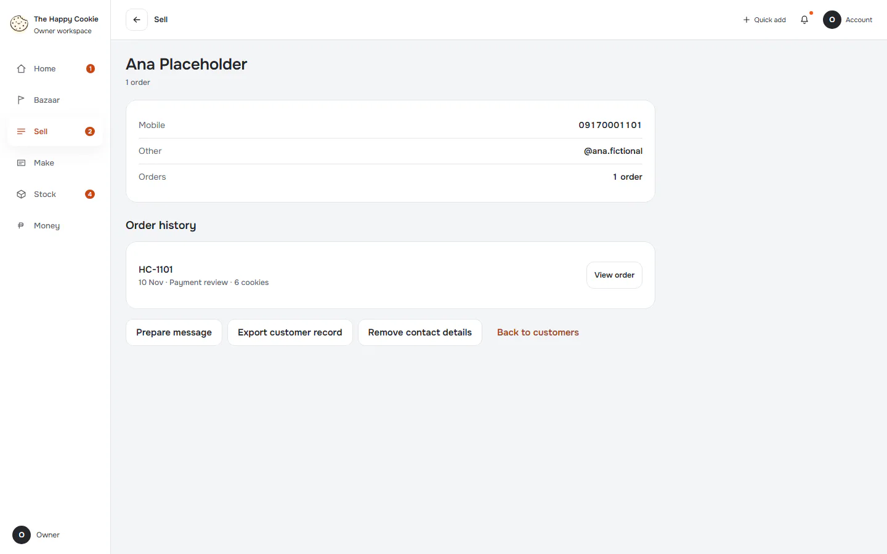

# Customer detail

**ACTUAL application.** [Back to sell](README.md)

- Manifest id: `sell/customer-detail`
- Source: `src/components/live/sell/customers-live.tsx`
- Role: owner
- Reference views: customer-detail

## default

Group: interaction. Fixture: `default`. How it was reached: ui-driven.

**p390** 390×844 · [full page](../../screenshots/sell/customer-detail/default/p390.full.webp)

**t768** 768×1024

**d1440** 1440×900

