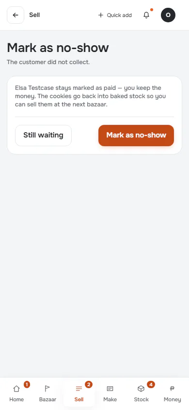
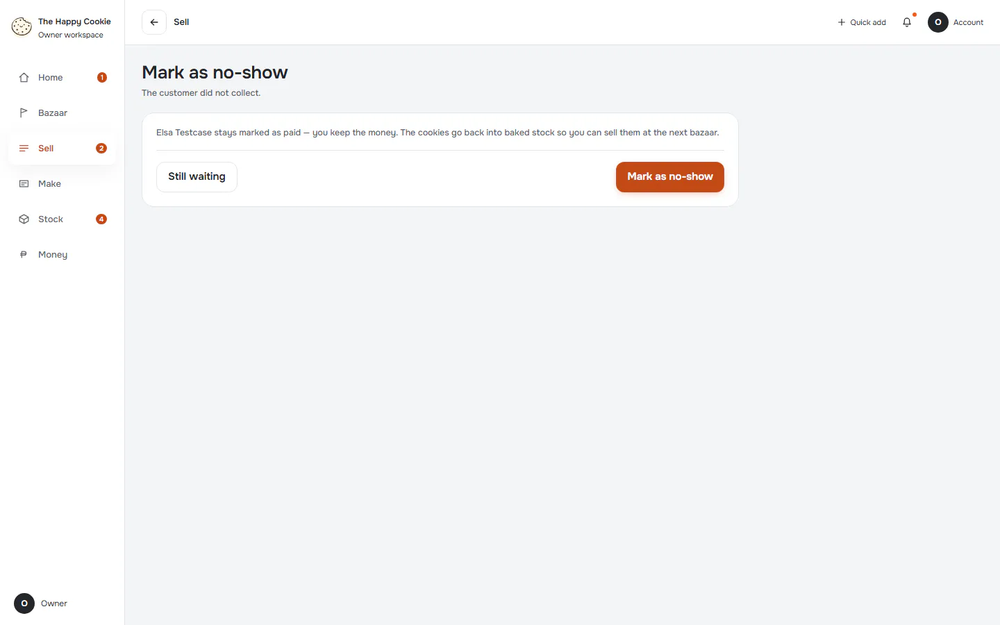
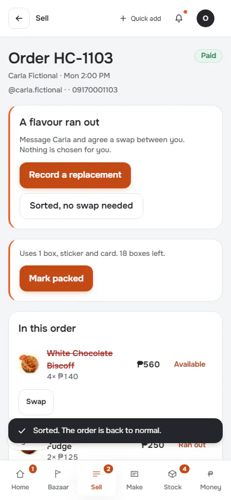
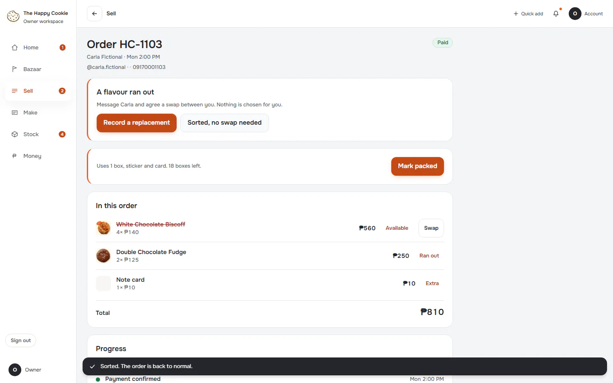

# No-show and swap

**ACTUAL application.** [Back to sell](README.md)

- Manifest id: `sell/order-actions`
- Source: `src/components/live/settings-pages.tsx`
- Role: owner
- Reference views: order-action

## no-show-from-ready

Group: interaction. Fixture: `default`. How it was reached: ui-driven.

**p390** 390×844

**d1440** 1440×900

## swap-from-paid

Group: interaction. Fixture: `default`. How it was reached: ui-driven.

**p390** 390×844 · [full page](../../screenshots/sell/order-actions/swap-from-paid/p390.full.webp)

**d1440** 1440×900 · [full page](../../screenshots/sell/order-actions/swap-from-paid/d1440.full.webp)

