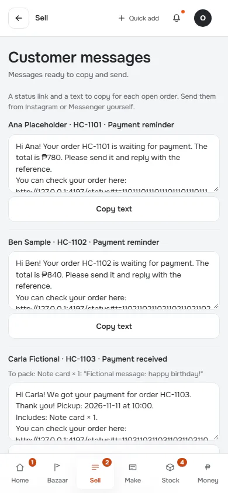
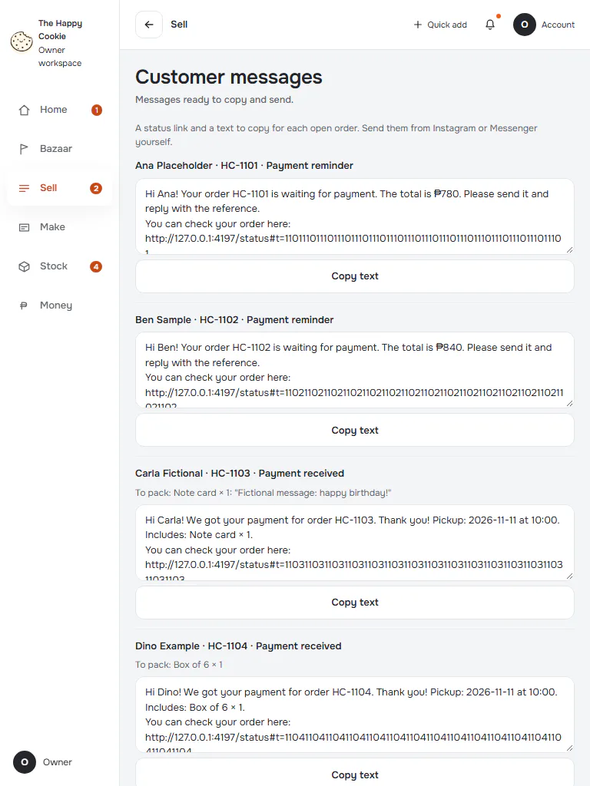
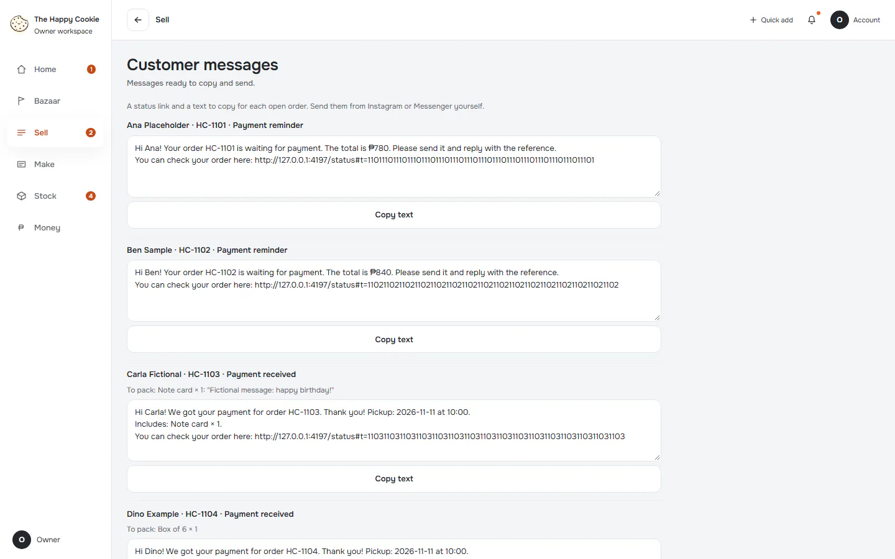

# Customer messages (ready to copy)

**ACTUAL application.** [Back to sell](README.md)

- Manifest id: `sell/order-messages`
- Source: `src/components/live/order-messages.tsx`
- Role: owner
- Reference views: none (found in code)

## default

Group: interaction. Fixture: `default`. How it was reached: ui-driven.

**p390** 390×844 · [full page](../../screenshots/sell/order-messages/default/p390.full.webp)

**t768** 768×1024 · [full page](../../screenshots/sell/order-messages/default/t768.full.webp)

**d1440** 1440×900 · [full page](../../screenshots/sell/order-messages/default/d1440.full.webp)

