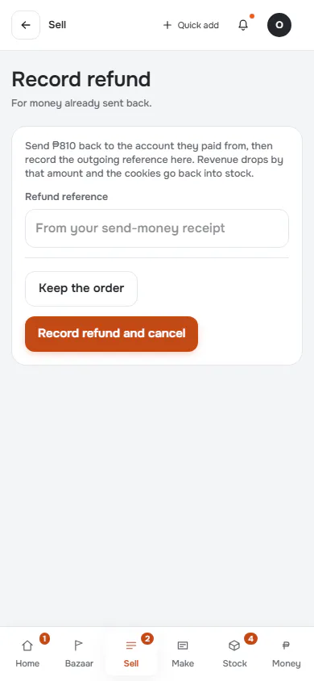
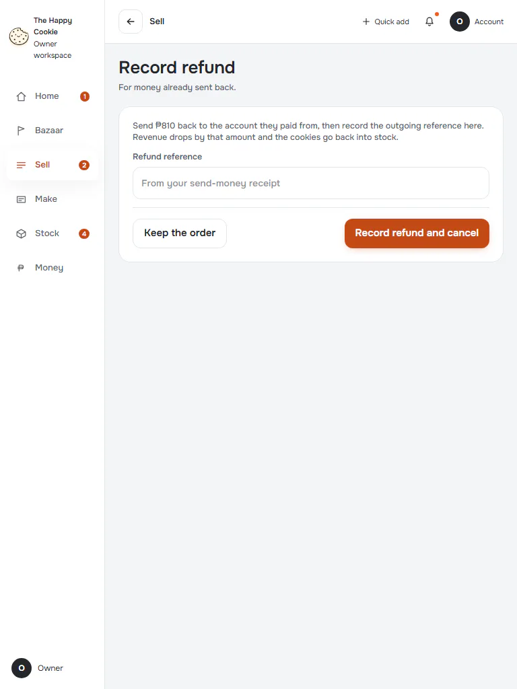
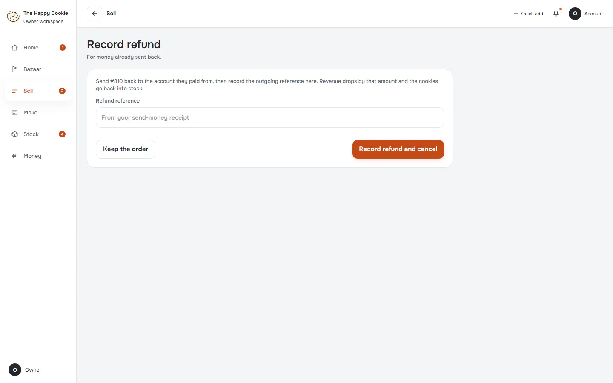
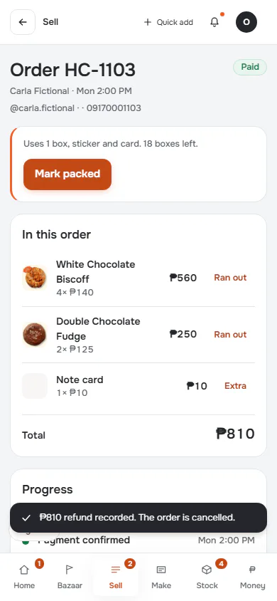
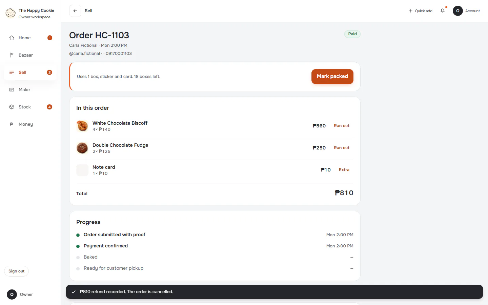
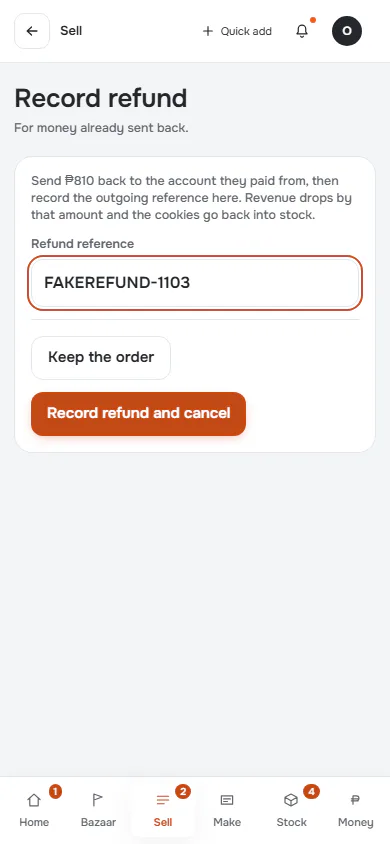
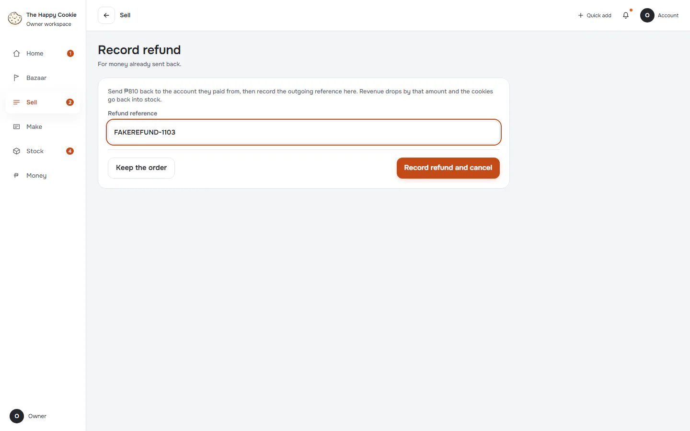

# Record refund

**ACTUAL application.** [Back to sell](README.md)

- Manifest id: `sell/order-refund`
- Source: `src/components/live/settings-pages.tsx`
- Role: owner
- Reference views: order-action

## form-untouched

Group: interaction. Fixture: `default`. How it was reached: ui-driven.

**p390** 390×844

**t768** 768×1024

**d1440** 1440×900

## submitted-empty-reference

Pressed with the reference empty: the client sent the request. Group: interaction. Fixture: `default`. How it was reached: ui-driven.

**p390** 390×844 · [full page](../../screenshots/sell/order-refund/submitted-empty-reference/p390.full.webp)

**d1440** 1440×900 · [full page](../../screenshots/sell/order-refund/submitted-empty-reference/d1440.full.webp)

## filled

Group: interaction. Fixture: `default`. How it was reached: ui-driven.

**p390** 390×844

**d1440** 1440×900

